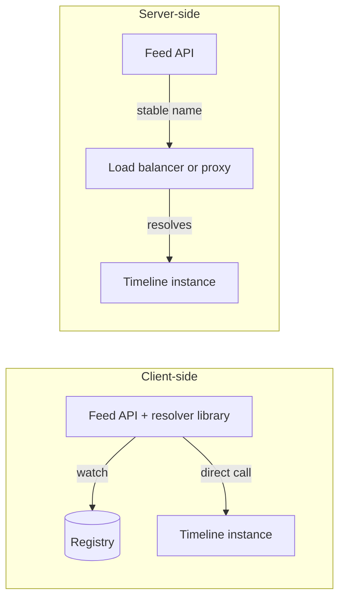

Pulse's feed API calls the timeline service, which runs on 15 servers that autoscale, deploy several times a day and occasionally crash. At 6,000 req/s peak each server takes 400 req/s ([§24](/c/system-design/24-load-balancer)). When one dies, every second the callers keep sending to its address costs 400 failed requests. Service discovery is the system that tells callers which addresses are alive — and how fast it learns of a death is a number you choose.

:::key[First principle]
Discovery is a **registry of leases**: an instance is listed while it keeps renewing, and dropped when a renewal is overdue. A crash stays invisible for up to the **lease TTL**, then for however long callers take to **hear about it**. Staleness is inherent; you pick its size, and cover the remainder with retries and passive outlier detection.
:::

## 33.1 Client-side or server-side



| | Client-side | Server-side |
|---|---|---|
| How | Client library resolves the name and balances across instances | Client calls a stable name or virtual IP; a proxy picks the instance |
| Examples | gRPC resolver + Consul/etcd, Eureka clients | Kubernetes Service, internal load balancer, sidecar proxy (service mesh) |
| Extra hop | None | One per call — ~0.5 ms intra-DC RTT for a remote LB, much less for a sidecar on localhost |
| Balancing quality | Client sees per-instance latency; can do least-request ([§24.2](/c/system-design/24-load-balancer)) | Proxy sees all clients' traffic |
| Cost | Every language needs the library; upgrades touch every service | One component to run and scale |

:::example[Worked example · what the hop costs]
A Pulse feed request makes 4 internal calls (timeline, posts, users, ranking — illustrative). Through a remote load balancer each adds ~0.5 ms: +2 ms if the calls are sequential, +0.5 ms if parallel — against a feed budget of tens of milliseconds, usually acceptable. A sidecar proxy keeps the convenience of server-side discovery without the network hop, at the cost of one proxy process per instance.
:::

## 33.2 Leases: how a registry learns of a death

An instance registers, then renews its lease with a heartbeat every $H$ seconds; the registry drops it once no heartbeat has arrived for the lease TTL $L$. A crash lands somewhere between two heartbeats, so

$$
\text{detection} = L - U, \quad U \sim \text{Uniform}(0, H)
\;\Rightarrow\;
\text{detection} \in [L - H,\, L], \quad \text{mean } L - \tfrac{H}{2}.
$$

Callers stop only after the change reaches them, so the **stale window** is detection + propagation, and the dead instance receives about $\text{rate per instance} \times \text{stale window}$ requests. In Kubernetes the same structure appears as the kubelet's readiness probes (period × failure threshold) feeding the endpoint list, which proxies and resolvers then watch.

```python run
"""Crash detection: lease TTL = 3 heartbeats; how long callers keep sending to a dead instance."""
import numpy as np

rng = np.random.default_rng(33)
N, K = 100_000, 3                                # simulated crashes, TTL = K heartbeat intervals
PER_SERVER = 6_000 / 15                          # Pulse feed: 6,000 req/s peak over 15 servers
FLEET = 2_000                                    # instances registered company-wide (illustrative)
PROPAGATION = {"watch/push": lambda n: rng.lognormal(np.log(0.1), 0.5, n),   # registry streams changes
               "poll every 10 s": lambda n: rng.uniform(0, 10, n),
               "DNS TTL 30 s": lambda n: rng.uniform(0, 30, n)}

print(f"{'heartbeat':>9} {'TTL':>5} | {'registry detects':>16} | {'callers stop (mean, p99)':^44} | registry")
print(f"{'':>9} {'':>5} | {'mean':>7} {'p99':>8} | " + " ".join(f"{k:>14}" for k in PROPAGATION) + " | writes/s")
for hb in (0.5, 1, 2, 5, 10):
    ttl = K * hb
    since_last = rng.uniform(0, hb, N)            # crash lands somewhere between two heartbeats
    detect = ttl - since_last                     # lease expires TTL after the last heartbeat
    cells = []
    for prop in PROPAGATION.values():
        stale = detect + prop(N)
        cells.append(f"{stale.mean():5.1f}/{np.percentile(stale, 99):5.1f} s")
    print(f"{hb:>7} s {ttl:>4.1f}s | {detect.mean():5.2f} s {np.percentile(detect, 99):6.2f} s | "
          + " ".join(f"{c:>14}" for c in cells) + f" | {FLEET / hb:>8,.0f}")

hb, ttl = 1, 3
stale = ttl - rng.uniform(0, hb, N) + PROPAGATION["watch/push"](N)
print(f"\nHB 1 s, TTL 3 s, watch: {stale.mean():.2f} s stale x {PER_SERVER:.0f} req/s ="
      f" {stale.mean() * PER_SERVER:,.0f} requests to a dead server (mean)")
for name, prop in list(PROPAGATION.items())[1:]:
    s = ttl - rng.uniform(0, hb, N) + prop(N)
    print(f"HB 1 s, TTL 3 s, {name}: {s.mean() * PER_SERVER:,.0f} requests (mean)")
```

```output
heartbeat   TTL | registry detects |           callers stop (mean, p99)           | registry
                |    mean      p99 |     watch/push poll every 10 s   DNS TTL 30 s | writes/s
    0.5 s  1.5s |  1.25 s   1.50 s |    1.4/  1.7 s    6.2/ 11.2 s   16.2/ 30.9 s |    4,000
      1 s  3.0s |  2.50 s   2.99 s |    2.6/  3.2 s    7.5/ 12.6 s   17.5/ 32.2 s |    2,000
      2 s  6.0s |  5.00 s   5.98 s |    5.1/  6.1 s   10.0/ 15.4 s   20.0/ 34.9 s |    1,000
      5 s 15.0s | 12.50 s  14.95 s |   12.6/ 15.1 s   17.5/ 24.0 s   27.5/ 43.3 s |      400
     10 s 30.0s | 25.00 s  29.90 s |   25.1/ 30.0 s   30.0/ 38.6 s   40.0/ 57.5 s |      200

HB 1 s, TTL 3 s, watch: 2.61 s stale x 400 req/s = 1,045 requests to a dead server (mean)
HB 1 s, TTL 3 s, poll every 10 s: 3,004 requests (mean)
HB 1 s, TTL 3 s, DNS TTL 30 s: 6,998 requests (mean)
```

:::chart[Mean time callers keep using a crashed instance vs heartbeat interval (TTL = 3 heartbeats, simulated)]{type="line" x="heartbeat interval (s)" y="seconds until callers stop" points="true" xlog="true"}
heartbeat, registry detects, watch/push, poll every 10 s, DNS TTL 30 s
0.5, 1.25, 1.4, 6.2, 16.2
1, 2.50, 2.6, 7.5, 17.5
2, 5.00, 5.1, 10.0, 20.0
5, 12.50, 12.6, 17.5, 27.5
10, 25.00, 25.1, 30.0, 40.0
:::

:::example[Worked example · one timeline server crashes at peak]
With 1 s heartbeats, a 3 s lease and a watch, callers stop after ~2.6 s: ~1,045 requests hit the dead server. The same lease behind a resolver that polls every 10 s costs ~3,000; behind DNS with a 30 s TTL, ~7,000 — the propagation mechanism matters more than the heartbeat once it's slower than the lease. Halving the heartbeat to 0.5 s saves ~1.2 s (~480 requests) and doubles registry writes to 4,000/s across a 2,000-instance fleet. Either way the failed requests are idempotent reads, so a retry on another instance ([§30](/c/system-design/30-retry)) plus passive outlier ejection after 5 errors (\(5/400\) s = 12.5 ms, [§24.4](/c/system-design/24-load-balancer)) hides most of them; discovery's job is to make the window bounded, not zero.
:::

## 33.3 How short can the lease be? False evictions

A short lease detects crashes quickly — and evicts healthy instances whose heartbeats were lost or delayed by a stop-the-world pause. The simulation runs 120 instances for a day with 1 s heartbeats, 1% heartbeat loss and 48 pauses per instance per day (median 100 ms, long-tailed; all illustrative):

```python run
"""False evictions: healthy instances whose lease expires because heartbeats were lost or delayed."""
import numpy as np

rng = np.random.default_rng(33)
INSTANCES, DAY, HB = 120, 86_400, 1.0            # Pulse internal fleet, seconds, heartbeat interval
LOSS = 0.01                                      # heartbeat lost on the network (illustrative)
PAUSES_PER_DAY = 48                              # stop-the-world pauses per instance (illustrative)
TTLS = (2, 3, 5, 10)

false_evictions = dict.fromkeys(TTLS, 0)
for _ in range(INSTANCES):
    t = np.arange(0, DAY, HB)
    ok = rng.random(t.size) > LOSS               # heartbeat reached the registry
    starts = rng.uniform(0, DAY, rng.poisson(PAUSES_PER_DAY))
    lengths = rng.lognormal(np.log(0.1), 1.0, starts.size)  # median 100 ms, long tail
    for s, d in zip(starts, lengths):
        ok[(t >= s) & (t < s + d)] = False       # a paused process sends nothing
    gaps = np.diff(t[ok])                        # time between heartbeats the registry saw
    for ttl in TTLS:
        false_evictions[ttl] += int((gaps > ttl).sum())

print(f"{INSTANCES} instances x 1 day, heartbeat every {HB:.0f} s, {LOSS:.0%} loss,"
      f" {PAUSES_PER_DAY} pauses/day each (median 100 ms)\n")
print("lease TTL | TTL/HB | false evictions/day (sim) | loss-only model | mean crash detection")
for ttl in TTLS:
    model = INSTANCES * DAY / HB * LOSS ** int(ttl / HB)   # needs floor(TTL/HB) losses in a row
    print(f"{ttl:>6} s  | {ttl / HB:>5.0f}  | {false_evictions[ttl]:>16,}          | {model:>13,.3f}"
          f"   | {ttl - HB / 2:>6.1f} s")
```

```output
120 instances x 1 day, heartbeat every 1 s, 1% loss, 48 pauses/day each (median 100 ms)

lease TTL | TTL/HB | false evictions/day (sim) | loss-only model | mean crash detection
     2 s  |     2  |            1,039          |     1,036.800   |    1.5 s
     3 s  |     3  |               21          |        10.368   |    2.5 s
     5 s  |     5  |                0          |         0.001   |    4.5 s
    10 s  |    10  |                0          |         0.000   |    9.5 s
```

Reading it: to be evicted while healthy, an instance must miss $\lfloor L/H \rfloor$ heartbeats in a row. With independent losses that's \(p^{L/H}\) per heartbeat — each extra multiple of $H$ divides false evictions by 100 at 1% loss. At 3 heartbeats, half the simulated evictions come from pauses (21 vs the loss-only 10), not the network: the tail of pause lengths, not the average, sets the floor. **A TTL of 3–5 heartbeats** is the usual compromise; go to the high end if your runtime has multi-second pauses.

:::warn[A false eviction during an incident]
When a dependency slows down, CPU-starved instances miss heartbeats, get evicted, and their traffic moves to the rest — which then also miss heartbeats. Cap how many instances can be removed at once (a panic threshold, as in [§24.4](/c/system-design/24-load-balancer)), and keep heartbeats on a thread that isn't blocked by request work.
:::

## 33.4 Propagation and the DNS pitfalls

Once the registry knows, callers must find out:

| Mechanism | Stale after registry update | Notes |
|---|---|---|
| Watch / push (etcd watch, Consul blocking query, xDS) | ~0.1 s | Long-lived streams; reconnect storms if the registry restarts |
| Poll every $P$ | mean $P/2$, worst $P$ | Load on registry = clients ÷ $P$ |
| DNS with TTL $T$ | mean $T/2$, worst $T$ — *if* clients honour $T$ | Universal and the least predictable |

DNS staleness is often worse than its TTL:

- **Runtimes and libraries cache on their own terms.** Some ignore the record's TTL and cache for a configured period, or indefinitely (the JVM has its own `networkaddress.cache.ttl`). Check what your runtime does before relying on a 30 s TTL.
- **Connection pools never re-resolve.** A client holding keep-alive or HTTP/2 connections keeps using the old IPs until a connection breaks. A dead instance surfaces as connection errors (fine, retries handle it); a *new* instance receives nothing.
- **Scale-out is slow to take effect.** Pulse scales the timeline fleet from 15 to 20 servers. If clients recycle connections at a maximum age $A$ (with ages spread evenly), the new servers' share ramps linearly from 0 to 5/20 = 25% over $A$. With $A$ = 5 minutes, the old 15 servers carry the full load for minutes after the new ones are ready — set a maximum connection age (minutes, with jitter) on long-lived connections.
- **Negative caching.** A lookup that failed (NXDOMAIN during a deploy) can itself be cached for the SOA's negative TTL.

## 33.5 The registry is a dependency

Registries (etcd, Consul, ZooKeeper) are consensus systems: every heartbeat or lease renewal is a replicated write. 2,000 instances at 1 s heartbeats is 2,000 writes/s — comfortable for a dedicated cluster, but it's why heartbeat intervals rarely go below ~1 s at scale (illustrative). Design for registry outages:

- **Clients keep the last-known-good instance list** if the registry is unreachable, rather than failing all calls. Stale addresses with retries beat no addresses.
- **Don't evict everyone when the registry recovers.** After an outage every lease looks expired; registries usually extend leases on recovery before resuming evictions.
- **Jitter re-registration and reconnects** so a registry restart doesn't receive 2,000 simultaneous reconnects.

**Zone-aware routing.** With 3 availability zones and uniform random choice, 2 of every 3 calls cross a zone — extra latency on every call and, on most clouds, a per-GB inter-zone charge. Prefer instances in the caller's zone while that zone has capacity, and spill over when it doesn't.

## 33.6 Knobs and failure modes

| Knob | Pulse setting | Why |
|---|---|---|
| Heartbeat interval $H$ | 1 s | 2,000 registry writes/s company-wide |
| Lease TTL $L$ | 3 s (3 × H) | ~2.5 s detection; ~21 false evictions/day across 120 instances |
| Propagation | Watch / push | +0.1 s, vs +5 s polling, +15 s DNS |
| Passive outlier ejection | 5 consecutive errors | 12.5 ms at 400 req/s |
| Client cache on registry outage | Keep last-known-good | Stale beats empty |
| Max connection age | 5 min ± jitter | New instances get traffic within minutes |
| Routing | Same zone first | Avoids 2/3 cross-zone calls |

| Failure mode | Symptom | Fix |
|---|---|---|
| DNS cached past its TTL | Errors to a removed instance for minutes | Re-resolving client, watch-based resolver or sidecar |
| Long-lived connections after scale-out | New instances idle, old ones hot | Max connection age, least-request balancing |
| Lease too short for the pause tail | Healthy instances flap in and out | TTL 3–5 × heartbeat; heartbeat on its own thread |
| Zombie instance | Partitioned process keeps serving stale data | Leases (not static registration); fencing for writers ([§21](/c/system-design/21-distributed-locks)) |
| Registry outage with no client cache | Every call fails to resolve | Last-known-good list |
| Readiness check too deep | One DB blip deregisters the whole fleet | Shallow checks, panic threshold |

## 33.7 Check yourself

:::qa[Heartbeat every 2 s, lease TTL 6 s, clients poll every 10 s. What's the mean time callers keep sending to a crashed instance, and how many requests is that at 400 req/s?]
Detection mean \(6 - 2/2\) = 5 s, plus polling mean 5 s → ~10 s (the simulation gives 10.0 s), so ~4,000 requests. Switching to a watch cuts it to ~5.1 s (~2,000).
:::

:::qa[With 1% independent heartbeat loss and 1 s heartbeats, how many false evictions per day does a 4 s lease give across 120 instances?]
Four losses in a row: \(0.01^4 = 10^{-8}\) per heartbeat, × 120 × 86,400 heartbeats ≈ 0.1 per day from loss alone. Pauses add more — the simulation showed pauses doubling the count at 3 s.
:::

:::qa[The DNS TTL is 10 s, but traffic still goes to a server removed 5 minutes ago. Name two likely causes.]
The client runtime caches DNS longer than the TTL (or forever), or the client reuses pooled keep-alive connections opened before the change and never re-resolves. Fix with a re-resolving client or maximum connection age.
:::

:::qa[Why is a watch-based registry with a 3 s lease not enough on its own to avoid user-visible errors?]
For ~2.6 s after a crash, callers still pick the dead instance — ~1,000 requests at 400 req/s. Retries on another instance and passive outlier ejection (milliseconds) cover that window; discovery bounds it.
:::

Next: [§34 Sharding](/c/system-design/34-sharding) — when one database is no longer enough.
