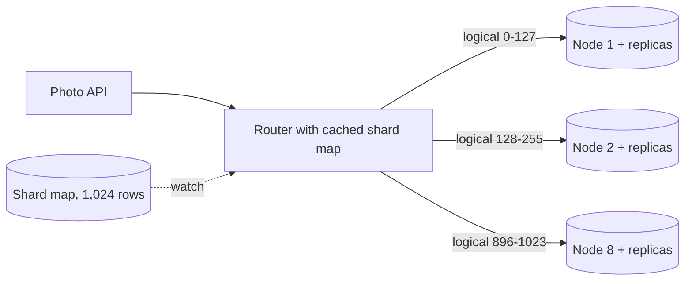

Two of the running examples store rows in a relational database: Pulse's posts (600 writes/s at peak, 20 GB/day) and the photo service's metadata (one row per upload: 1,200 writes/s at peak, 40M rows/day). Neither is close to a single primary's write ceiling. One of them will nonetheless outgrow a single node within a year — on storage, not writes. This section decides which, and how to split it so the split can grow without a rewrite.

:::key[First principle]
Shard when a **measured** single-node ceiling — write rate, storage, or the time to restore it — is within a year or so, and cheaper levers (indexes, caching, replicas, archiving) are spent. Then route by a **shard key** that the dominant query always contains, place **many logical shards on few physical nodes**, and expect hashing to spread keys evenly but not traffic. The theory is in [§12.5–12.7](/c/system-design/12-replication-and-partitioning); this section does it.
:::

## 34.1 Do you need to shard?

Compare each system with what one node does in *your* load test, and with the largest database you're willing to back up, restore and rebuild a replica of. Both ceilings below are illustrative:

```python run
"""Shard or not? Pulse posts vs photo metadata against one node's (illustrative) ceilings."""
import math

WRITE_CEIL = 5_000          # rows/s one primary sustains in your load test (illustrative)
STORE_CEIL_TB = 10          # largest DB you're willing to back up, restore and rebuild (illustrative)
RESTORE_MBS = 200           # restore / replica-rebuild throughput, MB/s (illustrative)

systems = {  # name: (peak writes/s, bytes per row incl. indexes, rows per day)
    "Pulse posts": (600, 1_000, 10_000_000 * 2),
    "Photo metadata": (1_200, 1_000, 20_000_000 * 2),
}
for name, (peak, row, per_day) in systems.items():
    tb_year = row * per_day * 365 / 1e12
    months = STORE_CEIL_TB / tb_year * 12
    print(f"{name:15s} peak {peak:>5,} w/s = {peak / WRITE_CEIL:4.0%} of the write ceiling;"
          f" {tb_year:4.1f} TB/yr -> hits {STORE_CEIL_TB} TB after {months:4.1f} months")

print(f"\nrestore time at {RESTORE_MBS} MB/s: " + ", ".join(
    f"{tb} TB = {tb * 1e6 / RESTORE_MBS / 3600:.1f} h" for tb in (2, 10, 15)))

tb3 = 1_000 * 40e6 * 365 * 3 / 1e12                  # photo metadata after 3 years
per_shard = 2.0                                       # TB per physical shard: ~2.8 h restore
need = math.ceil(tb3 / per_shard)
print(f"\nphoto metadata, 3 years: {tb3:.1f} TB -> {need} physical shards at <= {per_shard:.0f} TB")
for nodes in (8, 16, 32):
    print(f"  1,024 logical shards on {nodes:>2} nodes: {1024 // nodes:>3} logical per node,"
          f" {tb3 / 1024 * 1e3:.0f} GB per logical shard at 3 years,"
          f" {1_200 / nodes:>5.0f} peak writes/s per node")
```

```output
Pulse posts     peak   600 w/s =  12% of the write ceiling;  7.3 TB/yr -> hits 10 TB after 16.4 months
Photo metadata  peak 1,200 w/s =  24% of the write ceiling; 14.6 TB/yr -> hits 10 TB after  8.2 months

restore time at 200 MB/s: 2 TB = 2.8 h, 10 TB = 13.9 h, 15 TB = 20.8 h

photo metadata, 3 years: 43.8 TB -> 22 physical shards at <= 2 TB
  1,024 logical shards on  8 nodes: 128 logical per node, 43 GB per logical shard at 3 years,   150 peak writes/s per node
  1,024 logical shards on 16 nodes:  64 logical per node, 43 GB per logical shard at 3 years,    75 peak writes/s per node
  1,024 logical shards on 32 nodes:  32 logical per node, 43 GB per logical shard at 3 years,    38 peak writes/s per node
```

:::example[Worked example · Pulse no, photo metadata yes]
- **Pulse posts: don't shard yet.** Writes use 12% of the ceiling; storage reaches 10 TB after ~16 months. Before sharding, move posts older than a year to cheaper storage (most feed reads are recent, [§54](/c/system-design/54-news-feed)) — that keeps the hot database near 7 TB indefinitely. Revisit if write rate passes ~50% of the tested ceiling.
- **Photo metadata: plan it now.** Writes are fine (24%), but 14.6 TB/yr crosses 10 TB in ~8 months, and old photos are still viewed, so archiving doesn't help. A 10 TB database takes ~14 hours to restore at 200 MB/s; 2 TB shards restore in ~2.8 hours. Three years is 43.8 TB → 22 physical shards at 2 TB — start with 8 nodes and grow to 16 and 32.
:::

## 34.2 Logical shards on physical nodes

Never map keys straight to machines. Hash the key into one of $L$ **logical shards** (fixed forever, e.g. 1,024), and keep a small table mapping logical shard → physical node:

$$
\text{logical} = \text{hash}(\text{owner\_id}) \bmod 1024, \qquad \text{node} = \text{table}[\text{logical}].
$$

Growing from 8 to 16 nodes moves half the logical shards and changes table entries — no key ever changes its logical shard. At 3 years each logical shard is ~43 GB, so moving one is a bounded copy. With 1,024 logical shards you can reach 1,024 nodes before needing to split one; choose $L$ ≥ ~10× the largest node count you can imagine. A routing layer (a library with a cached shard map, or a proxy such as Vitess or Citus) does the lookup so services never hard-code locations; the [shard router implementation](/c/system-design/68-sharding) builds one.



## 34.3 Choosing the shard key

The photo service's dominant queries: "show this user's photo grid" (by `owner_id`, most reads) and "show photo X" (by `photo_id`). The simulation runs one day of uploads at 1% scale — heavy-tailed per-user upload counts, plus one brand account bulk-importing 20,000 photos — through three candidate keys on 16 shards:

```python run
"""Photo metadata writes: which shard key makes a hot shard? (one simulated day, 1% scale)"""
import numpy as np

rng = np.random.default_rng(34)
USERS, SHARDS = 200_000, 16                      # 1% of the photo service's 20M DAU
uploads = rng.poisson(rng.lognormal(np.log(2) - 1.5**2 / 2, 1.5, USERS))  # mean 2/day, heavy tail
IMPORTER, BULK = 7, 20_000                       # one brand account bulk-imports its archive
uploads[IMPORTER] += BULK
owner = np.repeat(np.arange(USERS), uploads)     # one row per photo
photo_id = rng.permutation(owner.size)           # random ids, as from a hash or a UUID
day_bucket = np.full(owner.size, SHARDS - 1)     # range on created_at: today is the newest range


def h(x):                                        # splitmix64 finaliser -> 32-bit hash
    z = x.astype(np.uint64) + np.uint64(0x9E3779B97F4A7C15)
    z = (z ^ (z >> np.uint64(30))) * np.uint64(0xBF58476D1CE4E5B9)
    z = (z ^ (z >> np.uint64(27))) * np.uint64(0x94D049BB133111EB)
    return (z ^ (z >> np.uint64(31))) >> np.uint64(32)


keys = {"hash(owner_id)": h(owner) % SHARDS, "hash(photo_id)": h(photo_id) % SHARDS,
        "range(created_at)": day_bucket}
active = np.flatnonzero((uploads >= 20) & (np.arange(USERS) != IMPORTER))[0]
print(f"{owner.size:,} uploads from {USERS:,} users; importer {uploads[IMPORTER]:,},"
      f" top other user {np.sort(uploads)[-2]}, median {int(np.median(uploads))}\n")
print(f"{'shard key':18s} {'max/mean':>8s} {'hot shard at 1,200 w/s':>23s}"
      f"  shards read for one user's grid ({uploads[active]} photos)")
for name, shard in keys.items():
    load = np.bincount(shard.astype(np.int64), minlength=SHARDS)
    ratio = load.max() / load.mean()
    grid = len(np.unique(shard[owner == active]))
    print(f"{name:18s} {ratio:8.2f} {1_200 / SHARDS * ratio:>17,.0f} w/s  {grid:>3}")

print("\nmax/mean vs shard count, hash(owner_id):")
for n in (4, 16, 64, 256, 1024):
    s = (h(owner) % n).astype(np.int64)
    with_imp = np.bincount(s, minlength=n)
    without = np.bincount(s[owner != IMPORTER], minlength=n)
    print(f"  {n:>5} shards: {with_imp.max() / with_imp.mean():6.2f} with importer,"
          f" {without.max() / without.mean():5.2f} without")
```

```output
419,887 uploads from 200,000 users; importer 20,001, top other user 577, median 1

shard key          max/mean  hot shard at 1,200 w/s  shards read for one user's grid (32 photos)
hash(owner_id)         1.71               128 w/s    1
hash(photo_id)         1.01                76 w/s   13
range(created_at)     16.00             1,200 w/s    1

max/mean vs shard count, hash(owner_id):
      4 shards:   1.16 with importer,  1.02 without
     16 shards:   1.71 with importer,  1.05 without
     64 shards:   3.95 with importer,  1.15 without
    256 shards:  13.21 with importer,  1.30 without
   1024 shards:  49.72 with importer,  2.27 without
```

| Key | Write spread | Grid query | Verdict |
|---|---|---|---|
| `hash(owner_id)` | 1.71× mean on 16 shards, all from one importer (1.05× without it) | 1 shard | **Use it**; handle the importer separately |
| `hash(photo_id)` | Even (1.01×) | 13 of 16 shards for a 32-photo grid | Every grid view becomes a scatter-gather |
| `range(created_at)` | All of today's writes on one shard (16×) | 1 shard, but only by luck of date | Never lead with a timestamp |

"Show photo X" with an owner-hashed table needs the owner: embed the logical shard number in the photo id when it's generated (a Snowflake-style id with shard bits, [§52](/c/system-design/52-id-generator)), so the router can find the row from the id alone.

:::warn[One importer, one hot shard]
The bulk import is 5% of the day's uploads on one key. At 16 shards it lifts its shard to 1.71× the mean (128 writes/s instead of 75). At 1,024 logical shards the same import is ~50× its logical shard's mean — harmless if that shard shares a node with 127 others, a problem if it's alone. Rate-limit bulk imports per owner ([§28](/c/system-design/28-rate-limiter)) and run them through a queue at a steady rate.
:::

## 34.4 Hot shards under Zipf

Writes are bounded per user; **reads** are not. Views concentrate on popular accounts: if owner popularity is Zipf with exponent $s$, the hottest owner's share of reads is \(1/\sum_i i^{-s}\), and its shard carries at least that share. Hashing can't split a single key, so ([§12.6](/c/system-design/12-replication-and-partitioning)):

$$
\frac{\text{hottest shard}}{\text{mean shard}} \ge p_{\max} \cdot P.
$$

```python run
"""Metadata reads by owner under Zipf skew: hottest shard / average shard vs shard count."""
import numpy as np

rng = np.random.default_rng(341)
OWNERS, READS = 1_000_000, 3_000_000             # owners (1/20 scale), simulated reads


def h(x):                                        # splitmix64 finaliser -> 32-bit hash
    z = x.astype(np.uint64) + np.uint64(0x9E3779B97F4A7C15)
    z = (z ^ (z >> np.uint64(30))) * np.uint64(0xBF58476D1CE4E5B9)
    z = (z ^ (z >> np.uint64(27))) * np.uint64(0x94D049BB133111EB)
    return (z ^ (z >> np.uint64(31))) >> np.uint64(32)


print("shards | " + " | ".join(f"zipf s={s}" for s in (0.6, 0.8, 1.0, 1.2)))
for n in (4, 16, 64, 256, 1024):
    cells = []
    for s in (0.6, 0.8, 1.0, 1.2):
        w = 1.0 / np.arange(1, OWNERS + 1) ** s
        k = rng.choice(OWNERS, size=READS, p=w / w.sum())
        load = np.bincount((h(k) % n).astype(np.int64), minlength=n)
        cells.append(f"{load.max() / load.mean():9.2f}")
    print(f"{n:>6} | " + " | ".join(cells))
w = 1.0 / np.arange(1, OWNERS + 1)
print(f"\ns=1.0: top owner gets {w[0] / w.sum():.2%} of reads -> at 30,000 reads/s:"
      f" {30_000 * w[0] / w.sum():,.0f}/s on one key")
```

```output
shards | zipf s=0.6 | zipf s=0.8 | zipf s=1.0 | zipf s=1.2
     4 |      1.02 |      1.07 |      1.20 |      1.32
    16 |      1.03 |      1.18 |      1.99 |      3.76
    64 |      1.11 |      1.79 |      5.26 |     12.70
   256 |      1.39 |      4.25 |     18.21 |     48.69
  1024 |      2.57 |     14.42 |     71.69 |    194.27

s=1.0: top owner gets 6.95% of reads -> at 30,000 reads/s: 2,084/s on one key
```

:::chart[Hottest shard ÷ mean shard for photo metadata, hash(owner_id) (simulated)]{type="line" x="shards" y="max / mean load" xlog="true" ylog="true" points="true" hmarks="1:perfectly even"}
shards, writes with importer, writes without importer, reads Zipf s=0.8, reads Zipf s=1.0, reads Zipf s=1.2
4, 1.16, 1.02, 1.07, 1.20, 1.32
16, 1.71, 1.05, 1.18, 1.99, 3.76
64, 3.95, 1.15, 1.79, 5.26, 12.70
256, 13.21, 1.30, 4.25, 18.21, 48.69
1024, 49.72, 2.27, 14.42, 71.69, 194.27
:::

:::example[Worked example · the celebrity account]
At $s$ = 1.0 the top owner draws 6.95% of reads: 2,084 reads/s out of 30,000 at peak (before caching). On 64 shards the mean is 469/s and the hot shard ~5.3× that — the bound \(0.0695 \times 64\) = 4.4 plus everything else on that shard. More shards make the ratio worse, not better. The fix is not resharding: put a cache in front of metadata reads ([§18](/c/system-design/18-cache)) — a hot key is the easiest thing to cache — and add read replicas for the hot node. Salting (`owner_id#0…#7`) is for hot *writes*, and it turns every grid read into 8 lookups.
:::

## 34.5 Resharding: how much moves

Adding capacity moves data. How much depends on placement, measured here on 200,000 keys for the photo metadata at one year (14.6 TB), with the busiest receiving node copying at 200 MB/s (illustrative, throttled to protect production):

```python run
"""Resharding cost: fraction of keys that move, and hours of copying, for three placement schemes."""
import bisect
import numpy as np

rng = np.random.default_rng(342)
keys = rng.integers(0, 2**62, 200_000, dtype=np.int64)
DATA_TB, COPY_MBS = 14.6, 200                    # photo metadata after 1 year; per-receiver copy rate


def h(x):                                        # splitmix64 finaliser -> 32-bit hash
    z = x.astype(np.uint64) + np.uint64(0x9E3779B97F4A7C15)
    z = (z ^ (z >> np.uint64(30))) * np.uint64(0xBF58476D1CE4E5B9)
    z = (z ^ (z >> np.uint64(27))) * np.uint64(0x94D049BB133111EB)
    return (z ^ (z >> np.uint64(31))) >> np.uint64(32)


def ring(nodes, vnodes=100):
    pts = sorted((int(v), n) for n in range(nodes)
                 for v in h(np.arange(vnodes, dtype=np.int64) + n * 1_000_003))
    return [p for p, _ in pts], [n for _, n in pts]


def ring_lookup(r, x):
    pts, owners = r
    return np.array([owners[bisect.bisect(pts, int(v)) % len(pts)] for v in x])


def logical(nodes, L=1024):                      # logical shard -> node table; new node steals evenly
    table = np.arange(L) % 8
    for new in range(8, nodes):
        counts = np.bincount(table, minlength=new + 1)
        for _ in range(L // (new + 1)):
            donor = counts.argmax()
            table[np.flatnonzero(table == donor)[0]] = new
            counts[donor] -= 1
    return table


hk = h(keys)
schemes = {
    "hash mod N": lambda n: hk % np.uint64(n),
    "consistent hashing, 100 vnodes": lambda n: ring_lookup(ring(n), hk),
    "1,024 logical shards + table": lambda n: logical(n)[(hk % np.uint64(1024)).astype(np.int64)],
}
print(f"{'scheme':31s} {'8 -> 9 nodes':>20s} {'8 -> 16 nodes':>21s}")
for name, place in schemes.items():
    before = place(8)
    cells = []
    for after_n in (9, 16):
        after = place(after_n)
        moved = after != before
        busiest = np.bincount(after[moved].astype(np.int64), minlength=after_n).max() / keys.size
        hours = busiest * DATA_TB * 1e6 / COPY_MBS / 3600            # busiest receiver sets the time
        cells.append(f"{moved.mean():6.1%} {moved.mean() * DATA_TB:5.1f} TB {hours:4.1f} h")
    print(f"{name:31s} {cells[0]:>20s} {cells[1]:>21s}")
print(f"\n(TB = share moved x {DATA_TB} TB; hours = busiest receiving node at {COPY_MBS} MB/s)")
```

```output
scheme                                  8 -> 9 nodes         8 -> 16 nodes
hash mod N                       88.9%  13.0 TB  2.2 h  49.9%   7.3 TB  1.3 h
consistent hashing, 100 vnodes   10.0%   1.5 TB  2.0 h  49.0%   7.2 TB  1.4 h
1,024 logical shards + table     11.0%   1.6 TB  2.2 h  49.9%   7.3 TB  1.3 h

(TB = share moved x 14.6 TB; hours = busiest receiving node at 200 MB/s)
```

:::example[Worked example · reading the table]
- **Adding one node**: hash-mod-N moves 89% of the data (13 TB) because almost every key's `hash mod 9` differs from its `hash mod 8` — every row changes home, so every key goes through a cutover. Consistent hashing and logical shards both move ~1/9 (1.5–1.6 TB), all of it onto the new node.
- **Doubling**: anything moves half the data when capacity doubles; the schemes differ in *which* half and how controllable it is. Hash-mod-N happens to be clean here (16 is a multiple of 8), so each old node splits in two.
- **Wall-clock** is similar (~2 h) because the busiest receiver sets it — but hash-mod-N spends it copying 8× the bytes across every node. Logical shards add the operational property that matters most: you move one 14 GB unit at a time, verify it, flip one table entry, and can stop or roll back at any point.

The [consistent hashing implementation](/c/system-design/64-consistent-hashing) measures how virtual nodes even out the ring.
:::

Moving one logical shard safely:

1. **Copy** a snapshot of the logical shard to the target node.
2. **Tail changes** (the source's replication log or CDC) until the target is seconds behind.
3. **Fence**: briefly block writes for that logical shard (milliseconds to seconds), let the target catch up fully.
4. **Flip** the shard-map entry; routers pick it up via watch. Writes resume on the target.
5. **Verify** row counts and checksums, then delete the source copy after a grace period.

The fence is what prevents split-brain: without it, a router with a stale map writes to the old node after the flip, and those writes are lost.

## 34.6 What sharding takes away

| Lost | Before | After | Replacement |
|---|---|---|---|
| Joins across owners | `JOIN` | Fan-out per shard, merge in the app | Denormalise; analytics in a warehouse |
| Transactions across owners | One `BEGIN … COMMIT` | Not available | Keep invariants within one owner; otherwise a [saga](/c/system-design/31-sagas) |
| Global secondary index (e.g. by hashtag) | One B-tree | Local per shard (query all) or global (async, lags) | A [search index](/c/system-design/32-search-index) fed by an outbox |
| Global aggregates | `COUNT(*)` | Scatter-gather over all nodes | Precomputed counters |
| Unique constraints across owners | `UNIQUE` | Per shard only | A dedicated uniqueness table sharded by the unique value |
| Tail latency on fan-out | One query | Slowest of $P$ | Avoid fan-out on hot paths: \(1 - 0.99^{16}\) ≈ 15% of 16-shard queries hit a 1%-slow shard |

## 34.7 Knobs and failure modes

| Knob | Photo metadata setting | Why |
|---|---|---|
| Shard key | `hash(owner_id)` | Grid query on 1 shard; 1.05× spread without bulk imports |
| Logical shards | 1,024 | ~43 GB each at 3 years; room to grow to 1,024 nodes |
| Physical nodes | 8 now → 16 → 32 | ≤ 2 TB per node, ~2.8 h restore |
| Photo id | Embeds the logical shard | "Photo X" routes without the owner |
| Move throttle | 200 MB/s per receiver | One-node add ≈ 2 h |
| Hot owners | Cache + replicas for reads, rate-limited imports for writes | Zipf reads: 2,084/s on one key |

| Failure mode | Symptom | Fix |
|---|---|---|
| Sharding too early | N× backups, migrations, on-call — for 12% of one node's write capacity | Shard on a measured ceiling (§34.1) |
| Timestamp-led key | All new writes on one shard | Hash the owner; time as a secondary column |
| Key not in the dominant query | Every page view fans out to all shards | Key = what the hot path filters on |
| Celebrity / bulk importer | One shard's p99 and CPU spike | Cache, replicas, per-owner rate limits; dedicated shard for the worst |
| `hash mod N` placement | Adding a node moves ~89% of data | Logical shards or consistent hashing |
| Resharding without a fence | Writes lost to the old location | Fence, flip, verify |
| Uneven growth by bytes | One node fills first though key counts are even | Move logical shards by size, not count |

## 34.8 Check yourself

:::qa[A system writes 300 rows/s at peak and grows 3 TB a year; one node handles 5,000 writes/s and you cap databases at 10 TB. Shard?]
No. Writes are 6% of the ceiling and storage reaches 10 TB in ~3.3 years. Plan archiving or sharding around year 2–3, and re-measure; meanwhile spend nothing on cross-shard complexity.
:::

:::qa[With 64 hash shards and one key carrying 5% of reads, what's the minimum max/mean ratio? Does going to 256 shards help?]
At least \(0.05 \times 64\) = 3.2. At 256 shards it's at least 12.8 — worse, because the mean falls while the hot key's load stays. Cache the key or replicate its shard.
:::

:::qa[You have 8 nodes with hash(key) mod 8 and add a ninth. Roughly what fraction of keys move, and with 1,024 logical shards instead?]
mod N: a key stays only if \(h \bmod 8 = h \bmod 9\), about 1 in 9, so ~89% move. Logical shards: the new node takes ~1,024/9 ≈ 114 logical shards, ~11% of the data, and nothing else moves.
:::

:::qa[Why must "show photo X" not fan out to all shards when the table is sharded by owner_id?]
It's a hot path (every view). Encode the logical shard in the photo id at creation so the router computes the shard from the id; otherwise each view costs 8–32 queries and inherits the slowest shard's latency.
:::

Next: [§35 Can't see what broke → telemetry](/c/system-design/35-cannot-see-what-broke-telemetry) — the patterns part of the course starts here.
