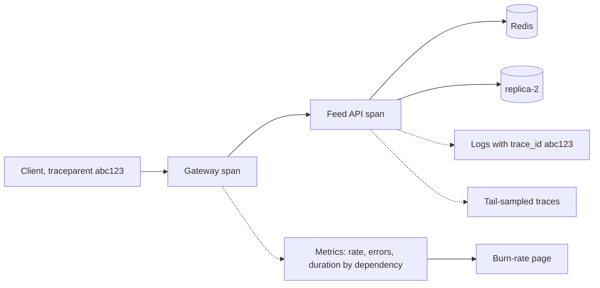

At 03:10 Pulse's feed starts failing 2% of requests — 40 a second out of 2,000. API CPU sits at 50%, so the CPU alert stays quiet. At 04:00 support escalates a batch of complaints; the on-call engineer SSHes into 15 API servers and greps logs that share no request ID, restarts Redis on a hunch, and at 05:10 finds `pool timeout` lines that all mention `postgres-replica-2`. Pulling it from the pool takes five minutes. The 125-minute outage burnt 300,000 requests — 6.2% of the 28-day error budget — and almost none of that time was spent fixing anything. This section is the pattern that turns those minutes into a page and two clicks; [§27](/c/system-design/27-observability) has the internals and cost formulas.

:::key[First principle]
Incident cost = error rate × traffic × (time to detect + time to diagnose + time to fix). Observability attacks the first two terms: **burn-rate alerts** bound detection by a fixed share of the budget, and **metrics with bounded labels plus traces joined by one trace ID** turn diagnosis from a search into a lookup.
:::

## 35.1 What the symptom looks like, in numbers

| Signal | How to measure it | You have this problem when |
|---|---|---|
| Who notices first | Share of SEV-1/2 incidents first reported by users or support | > 0 |
| Time to detect (MTTD) | Incident start → page, from the postmortem timeline | Later than the burn-rate rule's design time ($wB/b$, [§27.3](/c/system-design/27-observability)) — 43 min at 2% errors |
| Time to suspect (MTTI) | Page → named failing component | > ~15 min (illustrative target) |
| Correlation | Share of boundary log lines carrying `trace_id` | < 100% |
| Sliceability | Can one query show error rate by dependency, route, zone, version? | No |
| Cost blow-ups | Series per metric; log GB/day vs requests/day | > 10,000 series per metric; lines per request rising |
| Alert quality | Pages without user impact per week | More than a handful — people learn to ignore them |

Two of these are cheap to check today: grep a day of logs for lines without a `trace_id`, and read the last three postmortems for "how did we find out".

## 35.2 The mechanism

Instrument the **boundaries** — every inbound request, every outbound call, every state change — with three signals that share one W3C `traceparent` ID:

- **Metrics** (RED: rate, errors, duration histograms) with *bounded* labels — route template, status class, dependency, zone, version. Cheap to keep for a year; answer "is something wrong, and in which slice?"
- **Traces**, tail-sampled: every error and every request above p99, plus a 1% baseline. Answer "which hop?"
- **Structured logs** with `trace_id` on every line. Answer "what exactly happened to this request?"



The on-call path is always the same: **alert → dashboard slice → exemplar trace → log lines**. Each step narrows by orders of magnitude, which is why it takes minutes rather than an hour.

## 35.3 Diagnosis: slice by bounded labels, read lift and share

A metric with the right labels answers "where" before anyone opens a log. For each label, take the value with the worst error rate and compute two numbers: **lift** (its error rate ÷ the overall rate) and **share** (its errors ÷ all errors). The culprit has high lift *and* high share. The block replays one minute of the 03:10 incident: 15 API servers in 3 zones, a 90% cache hit rate, misses spread over three replicas, and replica-2 failing two thirds of its queries (illustrative).

```python run
"""One minute of Pulse traffic during the 03:10 incident: which label explains the errors?"""
import numpy as np

rng = np.random.default_rng(35)
N = 132_000                                   # 60 s at 2,200 req/s (2,000 feed reads + 200 posts)
zone = rng.integers(0, 3, N)
inst = zone * 5 + rng.integers(0, 5, N)      # 15 API servers, 5 per zone
route = np.where(rng.random(N) < 2000 / 2200, "GET /feed", "POST /posts")
miss = (route == "GET /feed") & (rng.random(N) < 0.10)     # 90% cache hit rate
dep = np.where(route == "POST /posts", "primary",
               np.where(miss, np.array(["replica-1", "replica-2", "replica-3"])[rng.integers(0, 3, N)],
                        "redis"))
p_err = np.where(dep == "replica-2", 0.66, 0.0005)          # replica-2 pool times out; 0.05% background
err = rng.random(N) < p_err
user = rng.integers(0, 10_000_000, N)        # 10M DAU: a label you must never put on a metric

print("overall: %d requests, %d errors, %.2f%% -> burn %.1f on a 99.9%% SLO"
      % (N, err.sum(), 100 * err.mean(), err.mean() / 0.001))
print("%-10s %-12s %9s %11s %6s %16s" % ("label", "worst value", "requests", "error rate", "lift", "share of errors"))
for name, lab in [("zone", zone), ("instance", inst), ("route", route), ("dependency", dep)]:
    vals = np.unique(lab)
    rates = [(err[lab == v].mean(), v) for v in vals]
    r, v = max(rates)
    m = lab == v
    print("%-10s %-12s %9d %10.2f%% %5.1fx %15.1f%%" % (name, v, m.sum(), 100 * r, r / err.mean(), 100 * err[m].sum() / err.sum()))
u, cnt = np.unique(user[err], return_counts=True)
print("user_id: %d distinct users among %d errors; the most-hit user has %d" % (len(u), err.sum(), cnt.max()))
```

```output
overall: 132000 requests, 2752 errors, 2.08% -> burn 20.8 on a 99.9% SLO
label      worst value   requests  error rate   lift  share of errors
zone       2                43883       2.12%   1.0x            33.9%
instance   6                 8723       2.32%   1.1x             7.3%
route      GET /feed       120143       2.29%   1.1x            99.8%
dependency replica-2         4018      66.77%  32.0x            97.5%
user_id: 2752 distinct users among 2752 errors; the most-hit user has 1
```

- **Zone and instance have lift ≈ 1**: errors are spread evenly, so it is not a bad host, a bad deploy wave or a zone. That alone rules out half the usual suspects.
- **Route has high share but no lift**: almost all traffic is `GET /feed`, so "the feed is broken" is true and useless.
- **Dependency = replica-2 has lift 32× and share 97.5%**: 3% of requests cause nearly all errors. One exemplar trace from that slice shows the failing span; its `trace_id` finds the log line `pool timeout after 2000ms`.
- **`user_id` has nothing to say**: 2,752 errors hit 2,752 different users. Per-user labels cost 10 million series ([§27.4](/c/system-design/27-observability)) and would not have helped — they belong in traces and logs.

Rule: a slice with **lift > ~5× and share > ~50%** is the suspect; if no bounded label reaches that, you are missing a label (version, dependency, shard) — add it, not a per-request one.

## 35.4 Before and after on the 03:10 incident

At 2% errors Pulse fails \(0.02 \times 2{,}000 \times 60\) = 2,400 requests a minute, 0.050% of the 4.84M-request budget per minute. The minutes come from the story above (illustrative) and §27's burn-rate policy (computed there):

| Phase | Before: CPU alerts, greppable logs | After: burn-rate page, sliced metrics, traces |
|---|---:|---:|
| Detect | 50 min (support escalation) | 43.2 min (burn > 14.4 over 1 h; 21.6 min on a 30-min window) |
| Find the component | 70 min (grep 15 hosts, wrong Redis restart) | 5 min (dependency slice → exemplar trace → log) |
| Mitigate | 5 min (pull replica-2) | 5 min |
| **Total** | **125 min** | **53 min** (31.6 min with the 30-min rule) |
| Failed requests | 300,000 | ~127,000 (75,800) |
| Share of 28-day budget | 6.2% | 2.6% (1.6%) |

:::chart[Share of Pulse's 28-day error budget burnt by the 2% incident (99.9% SLO)]{type="line" x="minutes since 03:10" y="budget burnt (%)" marks="21.6:30-min rule pages;43.2:1-h rule pages" ymin="0"}
minutes, before, after (1-h burn rule), after (30-min burn rule)
0, 0.00, 0.00, 0.00
10, 0.50, 0.50, 0.50
20, 0.99, 0.99, 0.99
31.6, 1.57, 1.57, 1.57
40, 1.98, 1.98, 1.57
53, 2.63, 2.63, 1.57
60, 2.98, 2.63, 1.57
80, 3.97, 2.63, 1.57
100, 4.96, 2.63, 1.57
125, 6.20, 2.63, 1.57
140, 6.20, 2.63, 1.57
:::

:::example[Worked example · where the minutes went]
Before, detection (50 min) and diagnosis (70 min) were 96% of the incident; the fix was 5 minutes either way. After, diagnosis dropped 14× and detection became a policy — at 2% errors the 1-hour rule always fires after 2.1% of the budget. The remaining lever is detection: a 30-minute window halves it, at the price of more pages on short blips ([§27.3](/c/system-design/27-observability)).
:::

## 35.5 Choosing the signal

| Approach | Says "something is wrong" | Says "where" | Per-request detail | Cost at Pulse (§27.4, illustrative prices) | Verdict |
|---|---|---|---|---|---|
| Host dashboards (CPU, memory) | Rarely — CPU was 50% at 03:10 | No | No | Small | Dashboards only; never page on them |
| More logging, grep | Only via log-rate alerts | Slowly without trace IDs | Yes | 228 GB/day at 4 lines/request; 1,369 with one debug line per post | Needed, not sufficient |
| RED metrics + burn-rate alerts | Yes: 43 min at 2%, < 1 min for an outage | To a label (replica-2) | No | 31,500–126,000 series | Core |
| Tail-sampled traces | No | To the span | The slow and failing ones | 12.7 GB/day vs 608 at 100% | Core once a request crosses two services |
| Synthetic probes | Yes, even at zero traffic | Coarse | No | Negligible | Add for low-traffic paths and an outside view |
| Continuous profiling | No | To the function | No | Varies | When CPU or memory is the cause |

## 35.6 When to reach for it, and when not

- Always once a request crosses more than one service; before the incident, because correlation IDs cannot be retrofitted during one.
- When "it is slow" is the whole bug report, or when postmortems show detection or diagnosis longer than the fix.
- When the SLO's error budget is real money or reputation: at 99.9%, Pulse has 40 minutes a month and cannot spend 70 of them grepping.

:::warn[When it is the wrong move]
Never skip it — but don't buy everything. A single service with one database needs RED metrics, structured logs and a burn-rate alert, not a tracing tier. Adding signals without bounding labels, sampling traces and setting retention moves the incident from the system to the bill.
:::

## 35.7 Trade-offs

**Cost.** Unbounded telemetry can cost more than the compute it watches: one `log.debug` per post rendered takes Pulse's logs from 228 to 1,369 GB/day. Sampling and retention are design decisions ([§27.4](/c/system-design/27-observability)).

**Cardinality.** Series multiply: a `user_id` label turns 126,000 series into trillions. Bounded labels in metrics, per-entity detail in traces and logs.

**Instrumentation effort.** Every new service must emit the same RED metrics, propagate `traceparent` and log structured JSON. Make it the service template, not a checklist item.

**Alert fatigue.** Cause-based pages ("CPU > 80%") fire without user impact and stay silent during the 03:10 incident. Page on burn rate; keep causes on dashboards.

## 35.8 Failure modes

| Failure | What you see | Fix |
|---|---|---|
| No correlation ID | Logs from different services cannot be joined; diagnosis is grep | Propagate `traceparent` from the edge; log it on every line |
| Missing dependency label | Errors spread evenly over every label you have (lift ≈ 1 everywhere) | Add bounded labels: dependency, version, shard |
| High-cardinality label | TSDB memory and bill jump | Series limit per metric in the collector (~10,000) |
| Head sampling only | The failing request has no trace | Tail sampling: keep all errors and > p99 |
| Monitoring shares fate | The outage takes dashboards with it | Separate failure domain; external probes |
| Paging on causes | 3 a.m. pages with no user impact; real incidents missed | Page on burn rate; ticket on causes |

## 35.9 Sizing it

- **Four golden signals per service** — rate, errors, latency histogram, saturation — labelled by route template, status class, dependency, zone and version: tens of thousands of series for Pulse, not millions.
- **Two page rules and one ticket rule** per SLO: $b > 14.4$ over 1 h and 5 min (fires at 2.1% of budget), $b > 6$ over 6 h and 30 min (5.4%), $b > 1$ over 3 days (ticket).
- **Leading indicators on the dashboard, not the pager**: cache hit rate (< 85%), replica lag (> 5 s), connection-pool wait (> 0), oldest queue message age — the thresholds from [§27.2](/c/system-design/27-observability).
- **Traces**: tail sampling, 10–30 s decision wait; **logs**: 14 days hot, successes sampled, errors never.

## 35.10 Interview soundbite

> "Every request carries a W3C trace ID into metrics, spans and logs. I page on SLO burn rate — at 2% errors on a 99.9% SLO that fires after about 2% of the monthly budget — and the dashboard slices errors by dependency, zone and version, so the culprit shows up as the slice with high lift and high share. One exemplar trace from that slice gives me the span and the log line."

## 35.11 Check yourself

:::qa[Errors are 1.5% and every zone, instance and route shows 1.4–1.6%. What does that tell you, and what do you do next?]
Lift ≈ 1 everywhere: the cause is not tied to any label you have. It is either something every request touches (a shared dependency, config, certificate) or a dimension you don't label. Check the dependency and version slices; if they don't exist, open tail-sampled error traces and look at which span fails — then add that label.
:::

:::qa[A 5% error incident is detected by support after 30 minutes and fixed 20 minutes later. How much of Pulse's 28-day budget did it burn, and what would a burn-rate page have saved?]
\(0.05 \times 2{,}000 \times 60\) = 6,000 failed requests a minute; 50 minutes = 300,000 = 6.2% of 4.84M. The 1-hour rule pages at 5% errors after 17.3 min ([§27.3](/c/system-design/27-observability)): 37.3 minutes total, 224,000 requests, 4.6% — and diagnosis time is usually the bigger saving.
:::

:::qa[A developer wants `user_id` on the request-error metric "so we can see which users are affected". What do you offer instead?]
The affected users are already in the traces and logs (hashed IDs on every line). For a count, emit a bounded metric — errors by customer tier — or compute distinct users from logs. A `user_id` label on 10M DAU creates millions of series and, as the 03:10 run shows, each user saw one error, so it would not have located anything.
:::

:::qa[Why is 'page → dashboard slice → exemplar trace → logs' faster than starting from logs?]
Each step narrows by orders of magnitude using indexes built for it: the burn-rate alert says when, the sliced metric says which 3% of traffic, the exemplar trace says which span, and its trace ID fetches a handful of log lines. Starting from logs means searching 228 GB/day of text across 15 hosts for a pattern you don't know yet.
:::

Next: [§36 Choosing between overlapping fixes](/c/system-design/36-choosing-between-fixes) — once you can see what broke, picking the fix that matches it.
