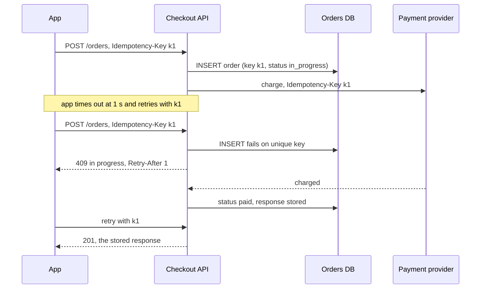

The checkout flash sale sends 2,000 orders a second to a payment provider with a p50 of 300 ms and a p99 of 2 s (illustrative). The mobile app gives up after 1 s and retries once; 2% of shoppers also tap **Pay** twice. The provider doesn't know the app gave up, so the first call still charges the card — and the retry charges it again. Over 100 seconds that is about 17,700 cards charged twice: at an illustrative USD 50 average order, USD 0.88M in refunds, disputes and support tickets. The mechanism is in [§22](/c/system-design/22-idempotency); this section is when to reach for it and what it buys.

:::key[First principle]
A timeout tells the client nothing about whether the work happened, so any retry of a side effect is a possible duplicate. Make the *server* recognise the intent: the client names it with a key once, the server **claims the key with an atomic insert before doing any work**, and every later copy gets the first copy's answer. The duplicate count then stops depending on timeouts, retries or users.
:::

## 37.1 What the symptom looks like, in numbers

| Signal | How to measure it | You have this problem when |
|---|---|---|
| Duplicate effects | `GROUP BY user_id, cart_id HAVING count(*) > 1` within 10 min; provider refunds tagged "duplicate" | > 0 per day on money, orders or bookings |
| Timeout below the tail | $P(\text{latency} > \text{timeout})$ from the dependency's histogram | Timeout < dependency p99: 7.0% of payment calls time out at 1 s |
| Attempts per request | Outbound calls ÷ inbound requests | > 1.0 on a non-idempotent endpoint |
| Redeliveries | Consumer messages with delivery count > 1 | Any, on a consumer with side effects ([§9](/c/system-design/09-delivery-semantics)) |
| Same key, different outcome | Requests sharing an `Idempotency-Key` but with different responses | Any — the key exists but isn't enforced |

The second row predicts the first. For checkout's lognormal provider (p50 300 ms, $\sigma$ = 0.8156), a 1 s timeout cuts off \(P(z > \ln(1/0.3)/0.8156 = 1.48)\) = 7.0% of calls — every one of them a duplicate if retried without a key.

## 37.2 The mechanism



Three rules make it work ([§22.3](/c/system-design/22-idempotency) has the full protocol):

1. **The client generates the key once per intent** (one checkout attempt) and resends it on every retry. A server-generated or per-request key is unique every time and therefore useless.
2. **Claim first.** The unique-constraint insert happens *before* the charge. A read-then-write check races exactly when duplicates arrive — during slow calls.
3. **Pass the key downstream.** The provider deduplicates its side of the charge if the API crashes between charging and recording.

## 37.3 Before and after: the flash sale

The block replays 100 s of the sale — 200,000 orders — with the app retrying once after its timeout and 2% double-taps (gaps as in §22: 10% within 5 ms, the rest exponential with a 500 ms mean). Three designs: no key; a key that is looked up first and written after the charge ("check, charge, record"); and insert-first with the key passed to the provider.

```python run
"""Checkout flash sale: double charges per 100 s, by client timeout and idempotency design."""
import math
import numpy as np

rng = np.random.default_rng(37)
N = 200_000                                    # 100 s at 2,000 orders/s
SIGMA = math.log(2000 / 300) / 2.326           # provider p50 300 ms, p99 2 s (illustrative)
lat = rng.lognormal(math.log(300), SIGMA, N)   # ms the provider takes for the first call
click = rng.random(N) < 0.02                   # 2% double-taps (illustrative, as in §22)
gap = np.where(rng.random(N) < 0.1, rng.uniform(0, 5, N), rng.exponential(500, N))


def run(timeout_ms, design):
    """The app retries once after a timeout; the provider still finishes the first call."""
    retried = lat > timeout_ms                 # second attempt sent timeout_ms after the first
    if design == "no key":
        doubles = retried | click
        conflicts = 0
    elif design == "check, charge, record":    # key looked up first, written after the charge
        doubles = retried | (click & (gap < lat))
        conflicts = 0
    else:                                      # insert-first, key also passed to the provider
        doubles = np.zeros(N, bool)
        conflicts = (retried | (click & (gap < lat))).sum()
    return retried.sum(), doubles.sum(), conflicts


print("%-24s %8s %9s %14s %14s" % ("design", "timeout", "retries", "double charges", "409 in-flight"))
for t in (1000, 2500):
    for d in ("no key", "check, charge, record", "insert-first + provider"):
        r, dbl, c = run(t, d)
        print("%-24s %6.1f s %9d %14d %14d" % (d, t / 1000, r, dbl, c))

print("\nkey store at 2,000 orders/s peak: separate table +%d writes/s (+%.0f%% on 8,000);"
      " key column on the order row +0" % (2 * 2000, 100 * 4000 / 8000))
print("\nchart: timeout s, double charges with no key, of which timeout retries")
for t in (0.5, 0.75, 1, 1.5, 2, 2.5, 3, 4, 5):
    r, dbl, _ = run(t * 1000, "no key")
    print("%g, %d, %d" % (t, dbl, r))
```

```output
design                    timeout   retries double charges  409 in-flight
no key                      1.0 s     13861          17686              0
check, charge, record       1.0 s     13861          15734              0
insert-first + provider     1.0 s     13861              0          15734
no key                      2.5 s       943           5006              0
check, charge, record       2.5 s       943           3035              0
insert-first + provider     2.5 s       943              0           3035

key store at 2,000 orders/s peak: separate table +4000 writes/s (+50% on 8,000); key column on the order row +0

chart: timeout s, double charges with no key, of which timeout retries
0.5, 55886, 52821
0.75, 29572, 25986
1, 17686, 13861
1.5, 8789, 4797
2, 6066, 2023
2.5, 5006, 943
3, 4526, 453
4, 4234, 153
5, 4143, 60
```

:::example[Worked example · reading the sale]
- **Before (no key, 1 s timeout): 17,686 double charges in 100 s** — 13,861 from timeout retries (the 7.0% predicted in §37.1) plus the double-taps that weren't already retries.
- **A key used as check-then-act barely helps: 15,734.** A timeout retry arrives at exactly 1 s, while the first call is by definition still running, so the lookup finds nothing every time. The window is the provider's latency, and duplicates arrive during it.
- **Insert-first: 0.** The price is 15,734 responses of `409 in progress` — 7.9% of orders — which the app must handle by waiting `Retry-After` and resending the same key. That path is common, not an edge case.
- **Raising the timeout to 2.5 s is a good second fix, not a substitute**: 5,006 double charges remain, mostly double-taps no timeout can prevent.
:::

:::chart[Double charges per 100 s flash sale vs app timeout, without an idempotency key (insert-first key: 0 at every timeout)]{type="line" x="app timeout (s)" y="double charges per 100 s" points="true" marks="1:app today;2:provider p99"}
timeout s, all double charges, from timeout retries
0.5, 55886, 52821
0.75, 29572, 25986
1, 17686, 13861
1.5, 8789, 4797
2, 6066, 2023
2.5, 5006, 943
3, 4526, 453
4, 4234, 153
5, 4143, 60
:::

The curve flattens at ~4,000: the double-taps. Timeouts above the provider's p99 remove the retry duplicates; only a key removes the rest.

## 37.4 Choosing the fix

| Option | Double charges per sale (1 s timeout) | Cost | Use when |
|---|---:|---|---|
| Do nothing; refund later (reconciliation) | 17,686, all refunded by hand or batch | Refund fees, disputes, angry customers | Never for money; acceptable for cheap, reversible effects |
| Longer timeout (2.5 s) | 5,006 | Users wait longer before an error | Always — set timeouts above the p99 ([§30.3](/c/system-design/30-retry)) |
| No client retries | Double-taps remain; users retry by hand | Worse success rate on blips | Never alone |
| Natural idempotency (upsert, `SET status = 'paid'`, unique `cart_id`) | 0 for that operation | Needs an identity in the data | First choice when the operation has one |
| Key column on the order row, insert-first | 0 | One unique index; 0 extra writes | Operations that create a row |
| Key table in the same database | 0 | +2 writes per order: +4,000/s on 8,000 at peak | Operations without a natural row |
| Redis `SET NX` beside the database | Small gap on crashes | Separate system, not atomic with the write | Low-stakes endpoints |
| Consumer dedup in a stream | Duplicates removed after delivery | A dedup store per consumer | Queue redeliveries, not client retries ([§9](/c/system-design/09-delivery-semantics)) |

## 37.5 When to reach for it, and when not

- Any write with a side effect a client, proxy or queue might repeat: payments, orders, bookings, provisioning, emails.
- Whenever the client's timeout is below the dependency's p99 — duplicates are then a certainty, not a risk.
- Webhook receivers and queue consumers, which are at-least-once by construction.

:::warn[When it is the wrong move]
The operation is already idempotent — a `PUT` that replaces state, `SET status = 'paid' WHERE id = 7`, an upsert on a natural key. Use that; a key store adds a write for nothing. Reads have nothing to duplicate.
:::

## 37.6 Trade-offs

**A store on the critical path.** The key sits on the write path of your most important endpoint, so it must be as durable as the order. Keep it in the same database and transaction; a separate store reopens the distributed-transaction window ([§15](/c/system-design/15-transactions)).

**The 409 path is real traffic.** 7.9% of sale orders hit it. Clients must treat `409 + Retry-After` as "wait and resend the same key", or users see errors for orders that succeeded.

**Retention.** Too short and late retries escape (5,235 a day at a 5-minute TTL, from §22.5); 24–72 h costs 2.8–8.3 GB for checkout.

**It can't dedupe different intents.** Two genuine orders with identical contents are two orders; only the client knows the difference, which is why the key comes from the client.

## 37.7 Failure modes

| Failure | What you see | Fix |
|---|---|---|
| Check-then-act | 15,734 of 17,686 duplicates still charge | Unique-constraint insert before the charge |
| Key generated per HTTP request | Every retry looks new | One key per intent, on the client |
| Key not passed to the provider | Crash between charge and record → second charge on retry | Send the same key downstream |
| Response not stored | Replay returns a different body or status | Store status and body; replay verbatim |
| Stuck `in_progress` after a crash | Retries get 409 forever | Sweeper reconciles with the provider after a few minutes |
| TTL shorter than retry tail | Late mobile replays charge again | 24–72 h plus a unique `cart_id` backstop |

## 37.8 Sizing it

- **Writes:** 0 extra with the key on the order row; +2 per order with a table (+4,000/s at the 2,000 orders/s peak).
- **Storage:** 5.52M keys/day × ~500 B × TTL — 2.8 GB at 24 h, 8.3 GB at 72 h ([§22.5](/c/system-design/22-idempotency)).
- **409 rate:** about $P(\text{latency} > \text{timeout})$ plus near-simultaneous double-taps — 7.9% of orders at a 1 s timeout, 1.5% at 2.5 s (3,035 of 200,000).
- **Key space:** UUIDv4 per intent; collision probability over a year of checkout ~10⁻¹⁹. Scope keys by merchant and endpoint anyway.

## 37.9 Interview soundbite

> "The app generates an Idempotency-Key per checkout attempt. I insert it as a unique column on the order before calling the provider, and pass the same key to the provider. A retry that arrives while the first is still charging gets 409 with Retry-After; one that arrives after gets the stored response. In a flash sale with a 1-second timeout that's the difference between about 17,000 double charges and zero."

## 37.10 Check yourself

:::qa[The app timeout is 1.5 s and the provider's p50 is 300 ms with p99 2 s. Roughly how many timeout retries per 100 s of a 2,000 orders/s sale, and what does each cost without a key?]
\(P(z > \ln(1.5/0.3)/0.8156 = 1.97)\) ≈ 2.4% of 200,000 ≈ 4,900 (the simulation: 4,797). Without a key each is a double charge, because the provider finishes the first call anyway.
:::

:::qa[Why does checking for the key before charging still double-charge almost every timeout retry?]
The retry is sent exactly when the first call has been running for the timeout — so the first call is always still in flight, and the key hasn't been written yet. The lookup's race window is the provider's latency, which is where every timeout retry lands.
:::

:::qa[Orders already have a unique `cart_id`. Do you still need an idempotency key?]
The `cart_id` constraint stops two *orders*, but not two *charges*: if the charge happens before the insert, or the provider call is retried inside the handler, the card can be charged twice while the second insert fails. Use the key (or the cart ID as the key) as the provider's idempotency key and claim it before charging; keep `cart_id` unique as the backstop.
:::

:::qa[A queue consumer sends a welcome email per `user.created` event and some users get two. Idempotency key or consumer dedup?]
Consumer dedup: the duplicate comes from at-least-once redelivery, not a client retry. Record the event ID in the same transaction as "email sent" (or use the email provider's idempotency key with the event ID) and skip events already recorded.
:::

Next: [§38 One service failing → circuit breaker](/c/system-design/38-one-service-failing-breaker).
