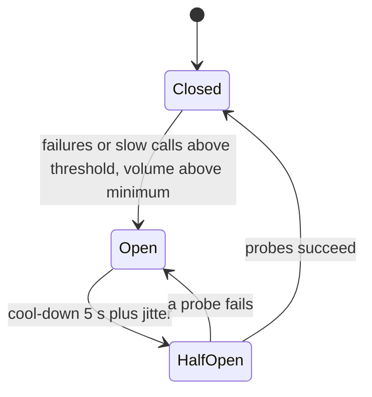

At 40 s into checkout's flash sale the payment provider stops answering. Every payment call now waits its full 2.5 s timeout while holding a worker; the 1,500-worker pool is gone in a third of a second, and the cart — which never calls the provider — serves 29.9% of its requests for the next 40 seconds ([§20.3](/c/system-design/20-circuit-breaker)). The provider's outage has become checkout's. This section is the pattern: how to recognise it from metrics, what a breaker and a bulkhead buy, and the brownout case the breaker misses.

:::key[First principle]
Workers held by a dependency = its call rate × how long each call waits ($L = \lambda W$, [§10.2](/c/system-design/10-latency-and-throughput)). A **breaker** sets $W \approx 0$ when the dependency is clearly failing; a **bulkhead** caps $L$ for one dependency whatever $W$ is; a **fallback** decides what the user sees. The breaker only trips on what it counts, so count slow calls, not just errors.
:::

## 38.1 What the symptom looks like, in numbers

| Metric | Healthy (checkout peak) | Provider hung | Threshold that says "this pattern" |
|---|---:|---:|---|
| Busy workers | 857 of 1,500 (837 payment + 20 cart) | 1,500 | At pool size while CPU is low |
| In-flight calls to the provider ($\lambda \times$ mean latency) | 837 | 5,000 wanted | > ~1.5× healthy for one dependency |
| Provider call p50 | 300 ms | 2.5 s (= the timeout) | p50 ≈ timeout: calls are hanging, not failing |
| Provider failure rate | 0.5% | 100% | ≥ 50% over ≥ 20 calls |
| Cart 503s (never calls the provider) | 0 | 70% | Any errors in endpoints that don't use the failing dependency |
| API CPU | Moderate | Lower than healthy | Workers waiting, not working |

The signature is the combination: one dependency's in-flight count balloons, its latency pins at the timeout, the pool saturates with CPU idle, and **unrelated endpoints start failing**. If errors stay inside the failing dependency's endpoints, timeouts are already doing their job.

## 38.2 The mechanism



Per dependency, at the call site, in this order: **deadline → bulkhead → breaker → timeout → call**, with retries outside the breaker so an open circuit stops them. The breaker counts timeouts, connection errors, 5xx and 429 — not other 4xx — and opens when the failure rate over a 2–10 s window reaches ~50% with at least 20 calls. [§20](/c/system-design/20-circuit-breaker) derives every one of those numbers.

## 38.3 Before and after: the hung provider

From the 120-second simulation in [§20.3](/c/system-design/20-circuit-breaker) (provider hung from 40 s to 80 s, 2,000 payment and 1,000 cart requests a second):

| Configuration | Payment users who waited 2.5 s | Cart served | Fail-fast payments after recovery |
|---|---:|---:|---:|
| Timeout only (before) | 23,999 | 29.9% | 0 |
| Bulkhead 1,000 only | 16,000 | 100% | 0 |
| Breaker, 10 s window | 5,748 | 86.4% | 12,566 |
| Breaker, 2 s window | 1,618 | 95.6% | 16,916 |
| **Breaker 2 s + bulkhead (after)** | **1,132** | **100%** | **3,241** |

:::example[Worked example · what changed]
The breaker turned 24,000 users waiting 2.5 s into ~75,000 immediate "payments unavailable, try again in a minute" responses, and the bulkhead kept the 2.6 s before it opened from touching the cart. Nothing made payments *succeed* during the outage — every configuration fails ~80,000 attempts between 40 and 80 s. What the pattern buys is containment: one dead dependency stays one. Its price is paid after recovery: 3,241 payments fail fast against a healthy provider until the half-open probes close the circuit at 81.6 s.
:::

## 38.4 Brownouts: when the breaker doesn't open

Providers rarely go from healthy to dead. More often they slow down. Little's law says a slower provider holds more workers, but an error-rate breaker only sees calls that *exceed the timeout*. The block computes what checkout sees as the provider's p50 rises (same lognormal shape, $\sigma$ = 0.8156; 2.5 s timeout; slow-call threshold 1 s; payment bulkhead 1,000).

```python run
"""Checkout's payment provider slows down (brownout) instead of dying. What does the breaker see?"""
import math

LAM, P50, SIGMA = 2000, 0.3, 0.8156      # calls/s; healthy p50 300 ms, p99 2 s (illustrative)
TAU, SLOW, BULKHEAD = 2.5, 1.0, 1000     # timeout s; slow-call threshold s; payment worker cap
Phi = lambda z: 0.5 * (1 + math.erf(z / math.sqrt(2)))


def view(p50):
    mu = math.log(p50)
    p_timeout = 1 - Phi((math.log(TAU) - mu) / SIGMA)
    p_slow = 1 - Phi((math.log(SLOW) - mu) / SIGMA)
    # mean time a worker is held: E[min(X, tau)] for lognormal X
    held = math.exp(mu + SIGMA ** 2 / 2) * Phi((math.log(TAU) - mu - SIGMA ** 2) / SIGMA) + TAU * p_timeout
    return p_timeout, p_slow, held


print("%5s %6s %8s %8s %10s %9s %8s %9s" % ("p50", "held", "workers", "fits in", "served by", "timeouts",
                                             "slow", "breaker"))
print("%5s %6s %8s %8s %10s %9s %8s %9s" % ("s", "s", "wanted", "pool?", "bulkhead", "", "> 1 s",
                                             "opens on"))
for k in (1, 1.5, 2, 3, 4, 6, 10, None):
    if k is None:
        pt, ps, held = 1.0, 1.0, TAU                      # hung: every call waits the full timeout
    else:
        pt, ps, held = view(P50 * k)
    L = LAM * held                                        # Little's law
    opens = "errors" if pt >= 0.5 else ("slow>=30%" if ps >= 0.3 else "nothing")
    print("%5s %6.2f %8.0f %8s %9.0f%% %8.1f%% %7.1f%% %9s" % (
        "hung" if k is None else "%.2f" % (P50 * k), held, L, "yes" if L + 20 <= 1500 else "NO",
        100 * min(1, BULKHEAD / L), 100 * pt, 100 * ps, opens))

print("\nchart: p50 s, timeouts (2.5 s), slow calls (> 1 s)")
for k in (1, 1.5, 2, 2.5, 3, 4, 5, 6, 8, 10):
    pt, ps, _ = view(P50 * k)
    print("%.2f, %.3f, %.3f" % (P50 * k, pt, ps))
```

```output
  p50   held  workers  fits in  served by  timeouts     slow   breaker
    s      s   wanted    pool?   bulkhead              > 1 s  opens on
 0.30   0.41      829      yes       100%      0.5%     7.0%   nothing
 0.45   0.61     1220      yes        82%      1.8%    16.4%   nothing
 0.60   0.79     1581       NO        63%      4.0%    26.6%   nothing
 0.90   1.10     2205       NO        45%     10.5%    44.9% slow>=30%
 1.20   1.35     2706       NO        37%     18.4%    58.8% slow>=30%
 1.80   1.71     3424       NO        29%     34.4%    76.4% slow>=30%
 3.00   2.10     4192       NO        24%     58.8%    91.1%    errors
 hung   2.50     5000       NO        20%    100.0%   100.0%    errors

chart: p50 s, timeouts (2.5 s), slow calls (> 1 s)
0.30, 0.005, 0.070
0.45, 0.018, 0.164
0.60, 0.040, 0.266
0.75, 0.070, 0.362
0.90, 0.105, 0.449
1.20, 0.184, 0.588
1.50, 0.266, 0.690
1.80, 0.344, 0.764
2.40, 0.480, 0.858
3.00, 0.588, 0.911
```

:::chart[What the breaker sees as the payment provider slows down (2.5 s timeout, lognormal latency)]{type="line" x="provider p50 (s)" y="share of calls counted as failed" yfmt="pct" ymin="0" ymax="1" points="true" hmarks="0.5:error-rate threshold 50%;0.3:slow-call threshold 30%" marks="0.6:pool saturates"}
p50 s, timeouts (2.5 s), slow calls (> 1 s)
0.30, 0.005, 0.070
0.45, 0.018, 0.164
0.60, 0.040, 0.266
0.75, 0.070, 0.362
0.90, 0.105, 0.449
1.20, 0.184, 0.588
1.50, 0.266, 0.690
1.80, 0.344, 0.764
2.40, 0.480, 0.858
3.00, 0.588, 0.911
:::

- **At 2× slower (p50 600 ms) the pool is already gone** — 1,581 workers wanted for payments alone — while only 4.0% of calls time out. An error-rate breaker sees a healthy dependency; the cart starves exactly as in the hard outage.
- **An error-only breaker needs the provider ~8–10× slower** (p50 ≥ ~2.4–3 s) before half the calls time out. Every brownout below that passes under it.
- **A slow-call rule** — count calls slower than 1 s, open at 30% — trips from 3× slower (44.9% slow). It is safe when healthy: 7.0% of calls exceed 1 s, and a 2 s window holds ~4,000 calls, so the noise is \(\sqrt{0.07 \times 0.93 / 4{,}000}\) ≈ 0.4 percentage points — nowhere near 30%.
- **The bulkhead covers the gap in between.** At 2× slower it serves 63% of payments and leaves the rest of the pool to the cart. Breakers handle outages; bulkheads handle brownouts; you need both.

## 38.5 Choosing the fix

| Option | Hung provider | 2× slower provider | Cost | Verdict |
|---|---|---|---|---|
| Timeout only | Pool full, cart 29.9% | Pool full | None | Necessary, never sufficient |
| Retries | Worse: \((1+r)^d\) attempts ([§30](/c/system-design/30-retry)) | Worse: more in flight | Load | Outside the breaker, with a budget |
| Bulkhead (cap per dependency) | Cart 100%; payment users still wait 2.5 s | Cart safe; 63% of payments served | Rejects some payments early | Always, sized ~1.2–2× healthy $L$ |
| Breaker, error rate | Opens in ~2.5 s, users fail fast | Never opens | Fail-fast after recovery | Pair with slow-call counting |
| Breaker, slow calls (> 1 s, 30%) | Opens | Opens from 3× slower | Same | Default for latency-sensitive calls |
| Fallback | Decides what the user sees | Same | Product decision | Required with any breaker |
| Load shedding at the provider's quota | Doesn't help a dead provider | Lowers $\lambda$ to what it can take | Rejected requests | When the provider is overloaded by you ([§28](/c/system-design/28-rate-limiter)) |
| Queue the work (async) | Orders accepted, charged later | Same | Fraud and stock risk, pending state | Only if the business accepts deferred payment |

## 38.6 When to reach for it, and when not

- Any synchronous call to another service or third party that shares a worker pool with other work.
- When waiting is expensive: long timeouts, high call rates, scarce workers — check with $\lambda \times$ timeout against the pool.
- When a degraded answer exists (cached recommendations, deferred ledger writes) or an honest fast error is better than a slow one.

:::warn[When it is the wrong move]
The dependency is local and fast (a cache in the same process, a sidecar): a timeout is enough. Very low call rates (a few per minute) can't fill a window — use a timeout and an alert. And a breaker does not make a required call optional: payment authorisation fails fast with `Retry-After`, it doesn't pretend to succeed.
:::

## 38.7 Trade-offs

**Recovery delay.** The breaker re-probes once per cool-down cycle, so it keeps failing fast after the provider is back — up to 8.4 s and 16,916 payments with a 2 s window and no bulkhead in §20.3. Short, jittered cool-downs and a traffic ramp after closing.

**False opens.** A thin window opens on noise. At $n$ = 20 and a 10% baseline error rate, 0.062 false opens a day; at 20% baseline, 22 — keep the threshold ≥ 2–3× baseline ([§20.4](/c/system-design/20-circuit-breaker)).

**Per-instance state.** Fifteen instances open at slightly different times. Acceptable at ~133 calls/s each; central state would add a network call to protect a network call.

**It hides failure.** A breaker open for a week, quietly serving a fallback, is a feature down for a week. Alert on time spent open.

## 38.8 Failure modes

| Failure | What you see | Fix |
|---|---|---|
| No timeout under the breaker | Closed state still hangs; nothing is counted until calls end | Timeout on every call, ~1.25–3× healthy p99 |
| Counting only errors | Brownout saturates the pool, breaker closed | Count slow calls (> healthy p99 or a fixed bound) |
| No bulkhead | Seconds before the breaker opens already starve other endpoints | Cap workers per dependency |
| Counting 4xx | A client bug opens the circuit on a healthy service | Count timeouts, connection errors, 5xx, 429 only |
| Retries inside the breaker | Attempts ≫ requests while it's deciding | Retries outside; never retry `CircuitOpen` |
| Synchronised probes | Dependency spiked every cool-down | Jitter; ramp after closing |
| Silent fallback | Stale widgets for days | Metric and alert on fallback use and open time |

## 38.9 Sizing it

| Setting | Checkout value | Rule |
|---|---|---|
| Timeout | 2.5 s | Healthy p99 (2 s) × ~1.25, below the caller's 8 s deadline |
| Window | 2 s (~4,000 calls) | $W \ge n_{\min}/\lambda$; shorter detects faster |
| Error threshold, min volume | 50%, 20 calls | ≥ 2–3× baseline error rate |
| Slow-call rule | > 1 s counted slow; open at 30% | Healthy slow share (7%) × ≥ 3–4 |
| Bulkhead | 1,000 workers for payments | Healthy $L$ (837) × 1.2–2 |
| Cool-down, probes | 5 s + U(0, 1) s; 5 probes | Recovery delay ≈ timeout + cool-down |
| Alert | Open > 5 min; fallback rate | A breaker open for long is an outage |

## 38.10 Interview soundbite

> "Per dependency: a 2.5-second timeout, a bulkhead of about 1.2 to 2 times the healthy in-flight count, and a breaker on a 2-second window that counts timeouts, 5xx and calls slower than one second. The breaker handles outages — users get a fast, honest error instead of a 2.5-second wait — and the bulkhead handles brownouts, where the provider is slow enough to eat my pool but not slow enough to trip an error-rate rule."

## 38.11 Check yourself

:::qa[A recommendations service is called 500 times a second with a 3 s timeout and normally answers in 40 ms. It hangs. How many workers does it want, and what is the fix if the page renders fine without it?]
Healthy: \(500 \times 0.04\) = 20 in flight. Hung: \(500 \times 3\) = 1,500. A breaker with a cached or empty widget as fallback, a bulkhead of ~30–40 workers, and a timeout near its healthy p99 (a few hundred ms, not 3 s) — it's a soft dependency, so it should never be able to take the page down.
:::

:::qa[The provider's p50 doubles to 600 ms and the cart starts failing, but the breaker dashboard shows 'closed, 4% errors'. What happened?]
Little's law: \(2{,}000 \times 0.79\) s ≈ 1,580 workers for payments, more than the 1,500 pool, while only 4.0% of calls exceed the 2.5 s timeout. The error-rate breaker can't see a brownout. Add the bulkhead (cart protected, 63% of payments served) and a slow-call rule (it opens from ~3× slower).
:::

:::qa[Why put retries outside the breaker rather than inside?]
Inside, each failing request makes several attempts before the breaker counts one failure, so it opens later and the dependency gets \(1 + r\) times the load while it's struggling. Outside, an open circuit returns `CircuitOpen` immediately and that result is never retried ([§30](/c/system-design/30-retry)).
:::

:::qa[Payments can't be faked. What should checkout return while the payment breaker is open?]
A fast, explicit failure — "payments are temporarily unavailable, try again in a minute" with `Retry-After` — or, if the business accepts the fraud and stock risk, an order accepted as *pending payment* and charged later. The idempotency key from [§37](/c/system-design/37-duplicate-requests-idempotency) makes the later attempt safe.
:::

Next: [§39 Read-heavy database → read replicas](/c/system-design/39-read-heavy-replicas).
