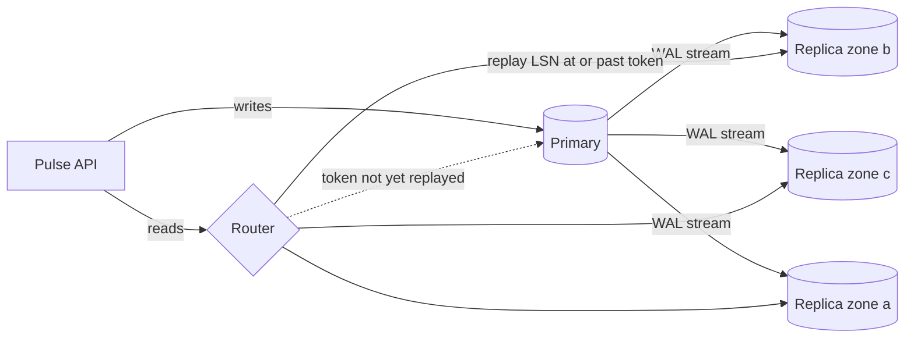

Pulse's feed cache hits 90%, so only 600 feed reads/s reach Postgres at peak ([§29](/c/system-design/29-read-replicas)). Then the team ships profile pages and filtered search. Assume each user makes 4 such reads a day (illustrative): 40M/day ≈ 400/s average, 1,200/s at the 3× peak. The primary now serves 1,800 reads/s on top of 600 writes/s, the p99 of every page that touches the database starts to climb, and a 10% traffic bump would tip it over. This section diagnoses that shape, adds replicas, and measures what changed.

:::key[First principle]
A replica adds **read** capacity by replaying every write, so it fixes a primary that is busy *reading* broad data — not one busy writing, and not one serving the same few keys again and again. Size the count from database reads at ≤ 60% utilisation with a zone lost, and send any read that must see a particular write to a copy that has it.
:::

## 39.1 Diagnosis: is this a replica problem?

| Metric | Where to read it | Replicas fit when | Pulse at peak |
|---|---|---|---|
| Primary utilisation | CPU, active sessions ÷ cores, queue wait | > 60% sustained ([§10](/c/system-design/10-latency-and-throughput) knee) | 90% (1,800 of ~2,000 reads/s) |
| Read share of DB work | `pg_stat_statements` total time by statement type | Reads ≥ ~75% of DB time | 1,800 of 2,400 statements/s |
| Key reuse | Share of reads on the top 1% of keys, from a sampled log ([§42](/c/system-design/42-slow-reads-cache)) | < ~30%: a cache would hit poorly | Search filters: 15%, LRU hit ~11% |
| Rows examined ÷ returned | `EXPLAIN ANALYZE`, slow-query log | < ~10: queries are already indexed | ~1 (indexed lookups) |
| Writes vs replica apply rate | WAL bytes/s vs replay rate | Writes < ~60% of apply rate | 600 of 1,500/s (40%) |
| Tolerated staleness | Product agreement | Seconds are fine, except own writes | Feed and profiles: yes |

Read the table top to bottom: a hot primary, mostly reads, reads that don't repeat, queries that are already efficient, and writes with headroom. If key reuse is high, cache first ([§42](/c/system-design/42-slow-reads-cache)); if rows examined dwarf rows returned, index first ([§41](/c/system-design/41-slow-queries-indexes)); if writes dominate, replicas make it worse.

## 39.2 The mechanism

The primary streams its write-ahead log to each replica, which replays it and serves reads ([§29.1](/c/system-design/29-read-replicas) has the replication modes). A router sends reads to replicas and the few reads that must see a specific write to the primary.



Routing rules ([§29.4](/c/system-design/29-read-replicas) derives the costs):

- **Own writes:** carry the write's log position (LSN) as a token; a replica that has replayed it serves the read, otherwise the primary does. 0 stale reads, ~1% of reads to the primary, versus 5.6% stale reads if you route blindly.
- **Transactions and read-modify-write** (stock, balances): primary.
- **Analytics and exports:** a dedicated replica outside the serving pool.

## 39.3 Before and after on Pulse

Model each node as 10 workers taking 5 ms per query — 2,000 reads/s, the capacity used in [§29](/c/system-design/29-read-replicas) — and treat the read path as an M/M/c queue ([§10](/c/system-design/10-latency-and-throughput)). All capacities are illustrative; measure yours with a load test.

```python run
"""Pulse's database at peak: one primary vs primary + replicas (M/M/c queue model, capacities illustrative)."""
import math

S, WORKERS = 0.005, 10                  # 5 ms per query x 10 workers = 2,000 reads/s per node (section 29)
FEED_MISSES, BROAD = 600, 1_200         # peak DB reads: feed-cache misses (90% hit) + profile/search reads
WRITES, APPLY = 600, 1_500              # peak writes/s; entries/s one replica can apply (section 29)


def queue(lam, c=WORKERS, mu=1 / S):
    """Return (mean response ms, p99 time spent waiting for a worker ms) for an M/M/c queue."""
    a = lam / mu
    if a >= c:
        return float("inf"), float("inf")
    top = a ** c / math.factorial(c) * c / (c - a)
    p_wait = top / (sum(a ** k / math.factorial(k) for k in range(c)) + top)   # Erlang C
    r = c * mu - lam
    p99_wait = math.log(p_wait / 0.01) / r if p_wait > 0.01 else 0.0
    return 1000 * (S + p_wait / r), 1000 * p99_wait


reads = FEED_MISSES + BROAD
print("peak DB reads %d/s + %d writes/s; one node serves %d reads/s" % (reads, WRITES, WORKERS / S))
print("\nlayout                reads/node  util  mean ms  p99 wait ms  saturates at  zone lost")
for name, n in (("primary only", 1), ("primary + 2 replicas", 2), ("primary + 3 replicas", 3)):
    per = reads if n == 1 else 0.99 * reads / n        # 1% LSN-token fallbacks stay on the primary
    mean, p99w = queue(per)
    left = n - math.ceil(n / 3)                        # lose the biggest of three zones
    lost = "down" if left == 0 else "%.0f%%" % (100 * reads * S / WORKERS / left)
    print("%-21s %10.0f %4.0f%% %8.1f %12.1f %8.0f/s %10s" % (
        name, per, 100 * per * S / WORKERS, mean, p99w, n * WORKERS / S, lost))

print("\nwrites on every replica vs apply rate %d/s" % APPLY)
for w in (600, 1_500, 8_000):
    print("  %5d writes/s -> lag grows %4.0f s per minute of load" % (w, max(0, w - APPLY) * 60 / APPLY))
```

```output
peak DB reads 1800/s + 600 writes/s; one node serves 2000 reads/s

layout                reads/node  util  mean ms  p99 wait ms  saturates at  zone lost
primary only                1800   90%      8.3         21.0     2000/s       down
primary + 2 replicas         891   45%      5.0          0.5     4000/s        90%
primary + 3 replicas         594   30%      5.0          0.0     6000/s        45%

writes on every replica vs apply rate 1500/s
    600 writes/s -> lag grows    0 s per minute of load
   1500 writes/s -> lag grows    0 s per minute of load
   8000 writes/s -> lag grows  260 s per minute of load
```

:::example[Worked example · reading the before and after]
**Before.** One primary at 90%: mean read 8.3 ms instead of 5 ms, and 1% of reads wait 21 ms just for a free worker. The bigger number is headroom: \(2{,}000 / 1{,}800\) = 1.11, so an 11% bump above an already-3× peak saturates it and the queue grows without bound — and the same node takes every write.

**After, two replicas.** 891 reads/s each, 45%: queueing all but vanishes (0.5 ms p99 wait), read capacity doubles to 4,000/s, and the primary keeps only writes plus ~18 LSN-token fallbacks/s. But lose a zone and one replica carries 1,800/s at 90% — the "before" state again.

**After, three replicas** (one per zone). 594 reads/s each at 30%; losing a zone leaves two at 45%. This is the [§29.2](/c/system-design/29-read-replicas) rule — survivors ≤ 75% — and it, not the normal-day load, sets the count.

**Where replicas stop.** Every replica replays every write. At Pulse's 600 writes/s that is 40% of an illustrative 1,500/s apply rate. Point the same design at checkout's flash sale — 8,000 writes/s — and each replica falls 260 s further behind per minute: the fix there is a [queue](/c/system-design/47-write-spikes-queue) or [sharding](/c/system-design/46-write-heavy-shard).
:::

:::chart[Mean DB read latency vs peak DB reads/s (5 ms query, 10 workers per node, M/M/c model)]{type="line" x="peak DB reads/s" y="mean read latency (ms)" points="true" ymin="4" ymax="14" marks="1800:Pulse peak"}
reads, primary only, primary + 2 replicas, primary + 3 replicas
200, 5.0, 5.0, 5.0
600, 5.0, 5.0, 5.0
1000, 5.0, 5.0, 5.0
1400, 5.4, 5.0, 5.0
1600, 6.0, 5.0, 5.0
1800, 8.3, 5.0, 5.0
1900, 13.3, 5.0, 5.0
2200, -, 5.1, 5.0
2600, -, 5.2, 5.0
3000, -, 5.6, 5.0
3400, -, 6.8, 5.1
3600, -, 8.3, 5.1
3800, -, 13.3, 5.2
4200, -, -, 5.4
4600, -, -, 5.7
5000, -, -, 6.5
5400, -, -, 8.3
5700, -, -, 13.3
:::

Each curve is flat until ~70% of its capacity and then turns vertical: adding replicas moves the wall to the right; it does not make a query faster.

## 39.4 Replicas vs the alternatives

| Load shape | Read replicas | Cache ([§42](/c/system-design/42-slow-reads-cache)) | Index ([§41](/c/system-design/41-slow-queries-indexes)) | Shard ([§46](/c/system-design/46-write-heavy-shard)) |
|---|---|---|---|---|
| Broad reads, low reuse (Pulse search) | **Yes**: 3 replicas, 30% each | Poor: ~11% hit, 1,668 of 1,800 reads remain | Only if queries scan | Overkill |
| Hot keys, high reuse (feed posts) | Works but wasteful: 6 replicas for 6,000 reads/s | **Yes**: 90% hit leaves 600 reads/s | No | No |
| One query scans the table | Spreads the waste over more nodes | Hides it until a miss | **Yes**: scan → ~2 ms seek | No |
| Writes saturate the primary | **No**: lag grows on every copy | No | Makes it worse (more writes) | **Yes**, or queue spikes |
| Need a failover target anyway | **Yes** | No | No | No |
| Staleness budget | Lag, ms to seconds | TTL, seconds to minutes | None | None |
| Cost per step | One full copy of the data per replica | RAM for the working set | Write amplification, storage | Re-architecture |

Order of operations: **index → cache → replicas → shard**. Each later step costs more and fixes a different shape; doing them out of order buys hardware to run bad queries faster.

## 39.5 When to reach for it, and when not

Reach for it when the §39.1 diagnosis holds: read-bound primary, broad reads, efficient queries, writes under ~60% of apply rate, seconds of staleness acceptable. It is also the default way to get a hot standby and an analytics copy.

:::warn[When it is the wrong move]
**Writes are the bottleneck** — replicas replay all of them (8,000 writes/s → 260 s more lag per minute).
**A few keys carry the load** — a cache serves them from RAM for a fraction of the cost.
**One query is slow** — replicas spread a table scan across more machines.
**The read must be exact** — a stock check at checkout or a balance belongs on the primary, inside the write ([§8](/c/system-design/08-consistency)).
:::

## 39.6 Trade-offs

**Staleness is now a routing problem.** Blind routing makes 5.6% of a poster's reads miss their own post; a 5 s pin to the primary costs 20% of feed reads on the primary; an LSN token costs ~1% and is exact ([§29.4](/c/system-design/29-read-replicas)).

**Writes stay on one node.** Replicas raise the read wall from 2,000 to 6,000 reads/s; the write wall does not move.

**Failover loses the lag window.** Writes lost ≈ 600 writes/s × lag at failure: ~280 at the calm 0.46 s p99, ~9,000 during a 15 s spike. Fence the old primary before promoting ([§29.5](/c/system-design/29-read-replicas)).

**Every replica is a full copy** to back up, patch, monitor and pay for — three replicas quadruple the database's storage.

## 39.7 Failure modes

| Failure | What you see | Detect with | Fix |
|---|---|---|---|
| Backfill above apply headroom | All replicas lag together; "my post vanished" | p99 lag > 2 s, replay rate flat | Throttle bulk writes below 1,500 − 600 = 900 rows/s |
| Long query on a serving replica | Replay paused up to 30 s on one node | Lag on one replica only | Dedicated analytics replica; 10 s statement timeout |
| Zone loss with 2 replicas | Survivor at 90%, p99 climbs | Per-node utilisation | Size for survivors ≤ 75% (3 replicas) |
| Lagging replica still in the pool | Some users see old data | Lag per node vs routing table | Remove at lag > 5 s, re-add below 1 s |
| Read inside a transaction routed to a replica | Inconsistent reads within one transaction | Code review, router logs | Pin whole transactions to the primary |
| Replica of a replica | Lag adds per hop | Lag by depth | One level deep |

## 39.8 Sizing it

$$
n = \min\left\{\, n \ge \left\lceil \frac{R}{c\,\rho} \right\rceil \;:\; \frac{R}{(n - \lceil n/3 \rceil)\,c} \le 0.75 \right\}, \qquad R = \text{peak DB reads}, \ c = \text{reads/s per node}, \ \rho = 0.6
$$

For Pulse: \(\lceil 1{,}800 / 1{,}200 \rceil\) = 2 for load, 3 for a lost zone. Check apply headroom (writes ≤ ~60% of the apply rate) and alarm on p99 lag above 2 s, page above 30 s.

## 39.9 Interview soundbite

> "The cache already takes the hot feed reads; what's left is broad profile and search reads, 1,800/s on a primary that tops out near 2,000. I'd add three replicas, one per zone, so losing a zone leaves two at 45%, route own-writes by LSN token so only ~1% of reads go back to the primary, and alarm on replica lag above two seconds. Writes stay on the primary — if they become the bottleneck, that's a queue or sharding, not more replicas."

## 39.10 Check yourself

:::qa[Pulse's peak doubles to 3,600 DB reads/s. How many replicas, and what does each run at?]
Load: \(\lceil 3{,}600 / 1{,}200 \rceil\) = 3. Zone check with 3: two survivors carry 3,600 → 90%, too high; with 4: \(4 - 2\) = 2 survivors, still 90%; with 5: \(5 - 2\) = 3 survivors → 60%. So 5 replicas at 36% each on a normal day.
:::

:::qa[A dashboard shows the primary at 85% CPU, but 70% of the time is one report query with rows examined ÷ returned = 50,000. Replicas?]
No — index first. The ratio says the query scans; replicas would spread the scan over more machines. Fix the plan ([§41](/c/system-design/41-slow-queries-indexes)); if the report still matters, move it to a dedicated analytics replica.
:::

:::qa[Why does the chart show almost no latency gain from the third replica on a normal day?]
At 1,800 reads/s, two replicas already run at 45%, below the knee, so queueing is negligible (mean 5.0 ms either way). The third replica buys zone-loss headroom — 45% instead of 90% for the survivors — not speed.
:::

:::qa[A nightly migration writes 2,000 rows/s for 10 minutes on top of 600 writes/s. With a 1,500/s apply rate, what happens to read routing?]
Backlog grows at \(2{,}600 - 1{,}500\) = 1,100 entries/s → 660,000 after 600 s, i.e. 440 s of lag on every replica. All leave the pool at the 5 s threshold and every read lands on the primary — the "before" state at night. Throttle the migration below 900 rows/s.
:::

Next: [Slow file loads → object storage + CDN](/c/system-design/40-slow-files-object-storage-cdn) — when the bytes, not the queries, are the load.
