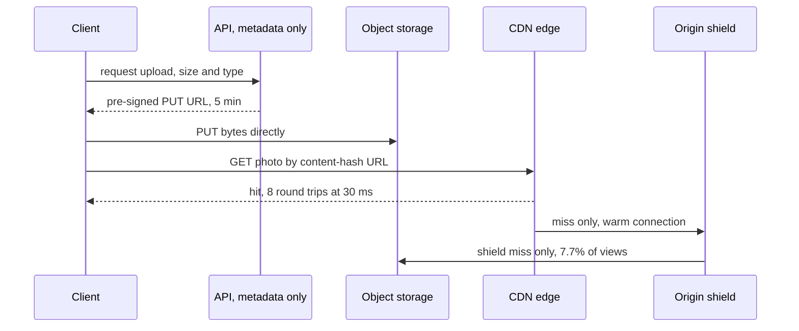

The photo service's first version stores photos as database blobs and serves them through its API in one region. At the 30,000 views/s peak that is 480 Gbit/s of photo bytes leaving the application tier, 1.2 s to load one 2 MB photo for a user 150 ms away, and an illustrative USD 1.0M a month in egress ([§19](/c/system-design/19-cdn), [§26](/c/system-design/26-object-storage)). The HTML is fast; the images are not. This section diagnoses that shape and measures what object storage and a CDN take away.

:::key[First principle]
Bytes are a **bandwidth and distance** problem, not a compute problem. Get them off the request path (object storage, direct uploads, the API handles only metadata), then serve them from caches near users (CDN edges) behind one aggregation tier (an origin shield). Origin load and egress then scale with the *total* miss ratio; latency with the *edge* hit ratio and the user's distance.
:::

## 40.1 Diagnosis: is this a byte problem?

| Metric | Where to read it | Byte-bound when | Photo service (before) |
|---|---|---|---|
| App-tier egress | NIC Gbit/s on API hosts, bytes by route | Media routes > ~50% of bytes, NICs > ~60% | 480 Gbit/s: 20 × 25 Gbit/s NICs at 100% |
| Time to first byte vs total | Browser resource timing, RUM | TTFB small, total large: transfer-bound | 2 MB = 8 round trips: 1,200 ms at 150 ms RTT |
| Media time by user region | RUM p50/p95 grouped by RTT to origin | Far/near ratio > ~3× | 1,200 ms vs 240 ms at 30 ms RTT: 5× |
| Downloads in flight | Open connections per host (Little: rate × time) | Thousands per host holding buffers | 30,000/s × 1.2 s = 36,000 |
| Blob share of the database | Table sizes, `pg_total_relation_size` | Blobs > ~50% of bytes | 88 TB/day of photos vs a few GB of rows |
| Egress line on the bill | Cloud bill by service | Egress ≫ compute | ~USD 1.0M/month (illustrative) |

CPU on the API hosts is often *low* in this state — the work is copying bytes — which is why "add servers" looks wrong but works badly: it buys NICs at server prices.

## 40.2 The mechanism

Two moves, in order:

1. **Bytes out of the request path.** The API issues a pre-signed PUT URL (5–15 min, one key, size-capped, [§26.5](/c/system-design/26-object-storage)); the client uploads straight to object storage; an object-created event drives thumbnails. The database keeps only metadata: owner, key, size, checksum, status.
2. **Bytes near the user.** Photos get content-hashed URLs served `public, max-age=31536000, immutable` through a CDN with an origin shield, so nothing is ever purged and every edge miss is aggregated before it reaches storage ([§19.3](/c/system-design/19-cdn)).



## 40.3 Before and after on the photo service

The model below reuses [§19](/c/system-design/19-cdn)'s numbers: 50 PoPs, 24 h residence and a 7-day shield under Zipf skew 1 give a 66.0% edge hit ratio and a 7.7% origin share; a hit costs 8 round trips at a 30 ms edge RTT, a miss adds 3 warm round trips to the origin. Prices and RTTs are illustrative.

```python run
"""Photo service before/after: bytes through the app tier vs object storage + CDN. Prices and RTTs illustrative."""
import math

PEAK_VIEWS, MB = 30_000, 2.0                 # photo views/s at peak, MB per photo (section 2)
PEAK_UPLOADS, UP_MB = 1_200, 2.2             # uploads/s at peak, MB incl. thumbnails
MONTH_GB = 10_000 * MB / 1e3 * 86_400 * 30   # average views/s x GB per photo x seconds per month
NIC, PROXY_UPLOADS = 25, 568                 # Gbit/s per server NIC; uploads/s per 10 Gbit proxy (section 13)
EGRESS, CDN = 0.02, 0.005                    # USD/GB origin egress, CDN delivery (section 19)
EDGE_HIT, ORIGIN_SHARE = 0.660, 0.077        # 50 PoPs + 7-day shield, Zipf s = 1 (section 19.3 model)
EDGE_RTT = 30                                # ms, user to nearby PoP


def photo_ms(rtt, cdn):
    """2 MB on a fresh connection = 8 round trips; an edge miss adds 3 warm round trips to origin."""
    if not cdn:
        return 8 * rtt
    hit = 8 * min(EDGE_RTT, rtt)
    return EDGE_HIT * hit + (1 - EDGE_HIT) * (hit + 3 * rtt)


gbit = PEAK_VIEWS * MB * 8 / 1000
rows = [
    ("photo bytes through app servers, Gbit/s", gbit, 0),
    ("app NICs at 100% (25 Gbit/s)", math.ceil(gbit / NIC), 0),
    ("upload bytes through API, Gbit/s", PEAK_UPLOADS * UP_MB * 8 / 1000, 0),
    ("upload proxies at 100%", math.ceil(PEAK_UPLOADS / PROXY_UPLOADS), 0),
    ("origin egress, Gbit/s", gbit, ORIGIN_SHARE * gbit),
    ("origin GETs/s", PEAK_VIEWS, ORIGIN_SHARE * PEAK_VIEWS),
    ("egress + CDN bill, USD k/month", MONTH_GB * EGRESS / 1e3,
     MONTH_GB * (CDN + ORIGIN_SHARE * EGRESS) / 1e3),
    ("photo time, user 150 ms away, ms", photo_ms(150, False), photo_ms(150, True)),
    ("downloads in flight on app servers", PEAK_VIEWS * photo_ms(150, False) / 1000, 0),
]
print("%-40s %9s %9s" % ("peak, photo service", "before", "after"))
for name, before, after in rows:
    print("%-40s %9.0f %9.0f" % (name, before, after))

print("\nuser RTT to origin | direct ms | CDN hit | CDN miss | CDN mean | saving")
for rtt in (10, 30, 60, 100, 150, 200, 250):
    hit = 8 * min(EDGE_RTT, rtt)
    print("%15d ms | %9.0f | %7.0f | %8.0f | %8.0f | %5.0f%%" % (
        rtt, photo_ms(rtt, False), hit, hit + 3 * rtt, photo_ms(rtt, True),
        100 * (1 - photo_ms(rtt, True) / photo_ms(rtt, False))))
```

```output
peak, photo service                         before     after
photo bytes through app servers, Gbit/s        480         0
app NICs at 100% (25 Gbit/s)                    20         0
upload bytes through API, Gbit/s                21         0
upload proxies at 100%                           3         0
origin egress, Gbit/s                          480        37
origin GETs/s                                30000      2310
egress + CDN bill, USD k/month                1037       339
photo time, user 150 ms away, ms              1200       393
downloads in flight on app servers           36000         0

user RTT to origin | direct ms | CDN hit | CDN miss | CDN mean | saving
             10 ms |        80 |      80 |      110 |       90 |   -13%
             30 ms |       240 |     240 |      330 |      271 |   -13%
             60 ms |       480 |     240 |      420 |      301 |    37%
            100 ms |       800 |     240 |      540 |      342 |    57%
            150 ms |      1200 |     240 |      690 |      393 |    67%
            200 ms |      1600 |     240 |      840 |      444 |    72%
            250 ms |      2000 |     240 |      990 |      495 |    75%
```

:::example[Worked example · what each move removed]
**Object storage + direct upload** takes the app tier out entirely: 480 Gbit/s of downloads, 21 Gbit/s of uploads (three 10 Gbit/s proxies at 100%) and 36,000 open downloads become metadata calls. The database stops growing by 88 TB a day.

**CDN + shield** takes the origin from 480 to 37 Gbit/s and 30,000 to 2,310 GETs/s — 7.7% of views. The bill falls from USD 1,037k to 339k a month: 259k of CDN delivery (flat) plus 80k of origin egress (illustrative prices).

**Latency depends on distance.** A user 150 ms away goes from 1,200 to 393 ms (−67%). A user 30 ms from the origin goes from 240 to 271 ms in this model — a CDN miss adds a hop, and the model is pessimistic because it assumes the edge receives the whole object before forwarding (real edges stream). For near users the win is the origin and the bill, not speed.
:::

:::chart[2 MB photo load time vs user RTT to the origin (66% edge hit, 30 ms edge RTT, model)]{type="line" x="user RTT to origin (ms)" y="photo load time (ms)" points="true" marks="150:far user" dash="CDN hit only,CDN miss"}
rtt ms, direct from origin, CDN expected, CDN hit only, CDN miss
10, 80, 90, 80, 110
30, 240, 271, 240, 330
60, 480, 301, 240, 420
100, 800, 342, 240, 540
150, 1200, 393, 240, 690
200, 1600, 444, 240, 840
250, 2000, 495, 240, 990
:::

## 40.4 Options compared

| Option (photo service, peak) | Far-user photo | Origin egress | App-tier bytes | Bill, USD k/month | Choose when |
|---|---:|---:|---:|---:|---|
| Blobs in the DB, served by the API | 1,200 ms | 480 Gbit/s | 480 Gbit/s | 1,037 | Never past a prototype |
| Object storage, direct GET | 1,200 ms | 480 Gbit/s | 0 | 1,037 | Internal tools, tiny audiences |
| + CDN, no shield (50 PoPs) | 393 ms | 163 Gbit/s (34%) | 0 | 612 | Few PoPs, very hot content |
| + CDN + origin shield | 393 ms | 37 Gbit/s (7.7%) | 0 | 339 | Default for user media |
| + origin in a second region | lower on misses | split across regions | 0 | + a second copy of storage | Misses dominate far users; compliance |

Bills are egress plus CDN delivery at [§19](/c/system-design/19-cdn)'s illustrative prices; storage is excluded. The shield is the cheapest line on the table: same latency, 4.4× less origin traffic than edges alone.

## 40.5 When to reach for it, and when not

Reach for it when any binary larger than a few KB is served by application code, the audience is spread across regions, and objects are immutable or can be versioned.

:::warn[When it is the wrong move]
**Bytes must never leave your infrastructure** (regulation) — use an internal edge or regional origins, not a public CDN.
**Files are small and rare** — an admin export a few times a day isn't worth a CDN contract and a cache-key review.
**Every response is per-user** — a CDN can still terminate TLS near the user, but it can't cache; don't let anyone mark these `public`.
:::

## 40.6 Trade-offs

**Invalidation is slow and partial.** Purges take seconds to minutes and create a herd: a viral photo purged with no protection triggers ~209 concurrent origin fetches ([§19.5](/c/system-design/19-cdn)). Version URLs with a content hash and never purge.

**You debug someone else's cache.** Require `X-Cache` and `Age` headers, hit ratio per path prefix and PoP, and a bypass header for testing.

**Cost becomes a ratio.** The CDN line is flat; origin egress is $(1-h)$. Every halving of the miss ratio halves origin egress — and a miss storm or a long-tail scraper multiplies it.

**Object storage is slow per request** — tens of ms to first byte. Never read objects in a per-row loop; batch, or keep small fields in the database.

## 40.7 Failure modes

| Failure | What you see | Detect with | Fix |
|---|---|---|---|
| Per-user response cached `public` | One user's private photos served to others | Synthetic check with two accounts | `private, no-store` by default; separate media hostname |
| `Vary: Accept` or `User-Agent` | Edge hit 66% → 47.8%, origin 7.7% → 25% (50 variants, §19.3) | Hit ratio per deploy | Normalise to ≤ 3 format classes, key on the class |
| Signature in the cache key | Private-photo hit ratio near 0 | Distinct keys per object | Validate at the edge, strip from the key |
| Public bucket | Data exposed | Account-level policy audit | Block public access; serve only via CDN or signed URLs |
| Week-long signed URLs | Leaked links keep working | URL expiry distribution | 1–5 min downloads, 5–15 min uploads |
| Orphaned objects | Storage grows after rows are deleted | Daily list-vs-DB reconciliation | `pending` rows first; lifecycle rules |

## 40.8 Sizing it

$$
\text{origin egress} = (1 - h_{\text{total}}) \times 480\ \text{Gbit/s}, \qquad
\text{photo time} \approx h_{\text{edge}}\, t_{\text{hit}} + (1-h_{\text{edge}})\, t_{\text{miss}}, \qquad
\text{PoP cache} = \text{fills/s} \times T \times 2\ \text{MB}
$$

For the photo service: 37 Gbit/s at 92.3% total, ~11.8 TB per PoP for 24 h residence at 50 PoPs, ~0.93 PB on the shield ([§19.3](/c/system-design/19-cdn)). Uploads go straight to storage: 1,200/s fits under one prefix's documented 3,500 writes/s ([§26.6](/c/system-design/26-object-storage)).

## 40.9 Interview soundbite

> "Photos never touch our servers: clients upload with a five-minute pre-signed URL, and views come from a CDN with an origin shield on content-hashed URLs with a one-year TTL, so we never purge. That takes origin egress from 480 to under 40 Gbit/s at peak and a far user's photo from 1.2 s to about 400 ms. Near users barely get faster — for them the win is the bill."

## 40.10 Check yourself

:::qa[A release adds six image variants per photo and the edge hit ratio drops to 57.6%. What happens to origin egress, the bill and the far user?]
[§19.3](/c/system-design/19-cdn) gives a 15.3% origin share with six variants: \(0.153 \times 480\) ≈ 73 Gbit/s at peak (from 37), and \(259 + 0.153 \times 1{,}037\) ≈ USD 418k a month (from 339k, illustrative). The far user's photo goes to \(0.576 \times 240 + 0.424 \times 690\) ≈ 431 ms (from 393).
:::

:::qa[Users in the origin's own region say photos got no faster after the CDN launch. Are they right?]
Yes, in this model: at 30 ms RTT, direct is 240 ms and the CDN averages 271 ms because a third of views miss and add a hop. What they gained is indirect — an origin at 7.7% load and a smaller bill — and streaming edges narrow the miss penalty in practice.
:::

:::qa[Why not just put a CDN in front of the existing API that serves photos from the database?]
It fixes reads at the edge, but every miss and every upload still crosses the API and the database: 37 Gbit/s of origin reads plus 21 Gbit/s of uploads through app servers, and 88 TB/day still landing in the database. Object storage removes the bytes from both; the CDN then only has to cache.
:::

:::qa[Avatars live at a fixed URL with `max-age=31536000`. A user changes theirs. What happens, and what's the fix?]
Every edge and browser keeps the old avatar for up to a year; a purge only partly helps (browser caches, propagation delay). Put a content hash in the URL — `/a/u42/9f2c41e7.jpg` — and change the URL in the profile record on upload; the old object can expire on its own.
:::

Next: [Slow queries → add indexes](/c/system-design/41-slow-queries-indexes) — when one query, not the bytes, is the load.
