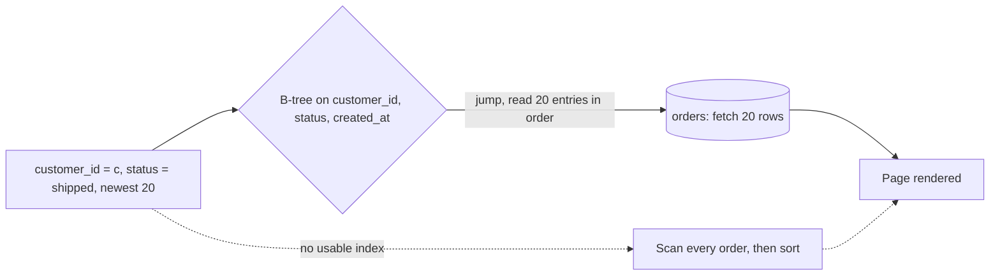

Checkout's "My orders" page runs one query: this customer's shipped orders, newest first, 20 per page. At a steady 50 orders/s the table gains \(50 \times 86{,}400 \times 365\) ≈ 1.6 billion rows a year. Every other endpoint is fast; this one gets slower every week, because without the right index it reads the whole table to return 20 rows. This section diagnoses that, fixes it with one composite index, and prices the fix in flash-sale writes.

:::key[First principle]
A slow query that returns few rows is almost always reading many. An index is a sorted copy of a few columns; ordered **equality → sort → range**, it lets the database jump to the first match and stop after `LIMIT` rows. It is the cheapest fix in this guide because its cost is paid on writes, not in new infrastructure — so count the writes.
:::

## 41.1 Diagnosis: is this an index problem?

| Metric | Where to read it | Index problem when | "My orders" (before) |
|---|---|---|---|
| Rows examined ÷ rows returned | `EXPLAIN ANALYZE`, slow-query log | > ~100 | 200,000 : 20 in the demo below; 1.6B : 20 in a year |
| Plan shape | `EXPLAIN` | `Seq Scan`, `Sort`, `USE TEMP B-TREE` on a big table | `SCAN orders; USE TEMP B-TREE FOR ORDER BY` |
| Latency vs table size | p50 of the query over weeks | Grows linearly with rows | Doubles when the table doubles (§41.3 chart) |
| Share of DB time | `pg_stat_statements` ordered by total time | One fingerprint > ~20% | The top entry |
| Pages read per call | `shared_blks_read` + `shared_blks_hit` per call | ≫ 10 for a 20-row page | Every page of the table |
| Other endpoints | Latency by route | Fine — the database isn't out of capacity | Fine |

The last row separates this pattern from [§39](/c/system-design/39-read-heavy-replicas): a capacity problem slows *everything*; a missing index slows one query, and makes it slower as data grows.

## 41.2 The mechanism

A B-tree on `(customer_id, status, created_at)` keeps entries sorted by customer, then status, then time. The query jumps to `(customer, 'shipped')`, reads the 20 newest entries in order and stops — no scan, no sort. Depth is $\lceil \log_f N \rceil$ with fanout $f \approx 8{,}192 \times 0.7 / e$ ([§23.1](/c/system-design/23-indexes)).



:::example[Worked example · the index on a year of orders]
Entry ≈ 40 B (8 B customer, ~8 B status, 8 B timestamp, row pointer and overhead; illustrative) → \(f = 8{,}192 \times 0.7 / 40\) ≈ 143, depth \(\lceil \log_{143} 1.6 \times 10^9 \rceil\) = 5, size \(1.6 \times 10^9 \times 40 / 0.7\) ≈ 91 GB. Internal levels fit in RAM, so a page costs one leaf read plus 20 row fetches: \(21 \times 100\) µs ≈ 2.1 ms on SSD ([§2](/c/system-design/02-estimation) latency table).

Without it, the scan reads the whole table — 1.6 billion rows of ~500 B (illustrative) is ~800 GB, about 13 minutes at an illustrative 1 GB/s. The query was "fine" in month one only because the table was small.
:::

## 41.3 Before and after, measured

200,000 orders, ~20 per customer, plus a reseller account holding 1% of them; 70% of orders are `shipped`. The block runs the query under five index choices, counting SQLite virtual-machine instructions (deterministic work, like [§23.4](/c/system-design/23-indexes)), then measures the cost per insert as indexes are added.

```python run
"""Checkout 'my orders' in SQLite: one query under five index choices, and what each index costs an insert."""
import sqlite3
import numpy as np

rng = np.random.default_rng(41)
N, CUSTOMERS, RESELLER, TYPICAL = 200_000, 10_000, 7, 4_242
cust = rng.integers(0, CUSTOMERS, N)                       # ~20 orders per customer
cust[rng.random(N) < 0.01] = RESELLER                      # one reseller account: 1% of all orders
status = rng.choice(["pending", "paid", "shipped", "cancelled"], N, p=[0.05, 0.15, 0.7, 0.1])
db = sqlite3.connect(":memory:")
db.execute("CREATE TABLE orders (order_id INTEGER PRIMARY KEY, customer_id INT, status TEXT,"
           " created_at INT, total_cents INT, address TEXT)")
db.executemany("INSERT INTO orders VALUES (?,?,?,?,?,?)", ((i, int(c), str(s), 1_700_000_000 + i, 4_999, "x" * 120)
                                                           for i, (c, s) in enumerate(zip(cust, status))))
QUERY = ("SELECT order_id, created_at, total_cents FROM orders WHERE customer_id = ? AND status = 'shipped'"
         " ORDER BY created_at DESC LIMIT 20")
ops = [0]


def tick():
    ops[0] += 10
    return 0


def vm_ops(sql, args=()):
    ops[0] = 0
    db.set_progress_handler(tick, 10)                      # called every 10 VM instructions
    db.execute(sql, args).fetchall()
    db.set_progress_handler(None, 0)
    return ops[0]


count = lambda c: db.execute("SELECT count(*) FROM orders WHERE customer_id=?", (c,)).fetchone()[0]
print("%d orders; typical customer %d orders, reseller %d\n" % (N, count(TYPICAL), count(RESELLER)))
print("%-36s %13s %13s  plan" % ("index", "typical ops", "reseller ops"))
indexes = {"none": [], "(customer_id)": ["customer_id"], "(status, created_at)": ["status", "created_at"],
           "(customer_id, created_at)": ["customer_id", "created_at"],
           "(customer_id, status, created_at)": ["customer_id", "status", "created_at"]}
for name, cols in indexes.items():
    db.execute("DROP INDEX IF EXISTS i")
    if cols:
        db.execute("CREATE INDEX i ON orders(%s)" % ", ".join(cols))
    plan = "; ".join(r[3] for r in db.execute("EXPLAIN QUERY PLAN " + QUERY, (TYPICAL,)))
    print("%-36s %13s %13s  %s" % (name, format(vm_ops(QUERY, (TYPICAL,)), ","),
                                   format(vm_ops(QUERY, (RESELLER,)), ","), plan))

print("\nindexes on orders   VM ops per insert (avg of 1,000)")
db.execute("DROP INDEX IF EXISTS i")
extra = ["customer_id, status, created_at", "status, created_at", "created_at", "total_cents"]
for k in range(len(extra) + 1):
    if k:
        db.execute("CREATE INDEX x%d ON orders(%s)" % (k, extra[k - 1]))
    base = N + 10_000 * k
    rows = [(base + i, int(rng.integers(CUSTOMERS)), "paid", 1_800_000_000 + base + i, 4_999, "x" * 120)
            for i in range(1_000)]
    ops[0] = 0
    db.set_progress_handler(tick, 10)
    db.executemany("INSERT INTO orders VALUES (?,?,?,?,?,?)", rows)
    db.set_progress_handler(None, 0)
    print("%17d %15.0f" % (k, ops[0] / 1_000))
```

```output
200000 orders; typical customer 19 orders, reseller 1994

index                                  typical ops  reseller ops  plan
none                                       600,220       617,910  SCAN orders; USE TEMP B-TREE FOR ORDER BY
(customer_id)                                  290        23,900  SEARCH orders USING INDEX i (customer_id=?); USE TEMP B-TREE FOR ORDER BY
(status, created_at)                       701,180         9,600  SEARCH orders USING INDEX i (status=?)
(customer_id, created_at)                      180           260  SEARCH orders USING INDEX i (customer_id=?)
(customer_id, status, created_at)              130           170  SEARCH orders USING INDEX i (customer_id=? AND status=?)

indexes on orders   VM ops per insert (avg of 1,000)
                0              17
                1              25
                2              31
                3              36
                4              41
```

What the plans say:

- **No index**: scan and sort, ~600,000 ops for 20 rows — for every customer.
- **`(customer_id)`**: jumps to the customer but sorts their whole history: 290 ops for 19 orders, 23,900 for the reseller's 1,994. It grows with each customer's history.
- **`(status, created_at)`** is a trap: the plan says `SEARCH … USING INDEX`, but `status = 'shipped'` matches 70% of rows, so it walks most of the table newest-first looking for one customer — 701,180 ops, *worse* than no index. It only looks good for the reseller. "Uses an index" is not "fast".
- **`(customer_id, status, created_at)`**: 130–170 ops for both — ~4,600× less work than the scan for the typical customer, and no sort.
- **`(customer_id, created_at)`** is within 1.5× of it (180 vs 130, 260 vs 170): with 70% of orders shipped, filtering status on the fly reads ~29 entries to find 20. That matters for writes (§41.5).

Each index added 5–8 ops to an insert: 17 → 25 for the first (+47%), 41 with four (2.4×). In a real database each one is also a random page write ([§23.2](/c/system-design/23-indexes)).

:::chart[Work per "my orders" query vs table size (SQLite VM ops, ~10 customers averaged)]{type="line" x="orders in table" y="VM ops per query" xlog="true" ylog="true" points="true" marks="200000:demo above"}
orders, no index, (customer_id), (customer_id status created_at)
12500, 37525, 33, 21
25000, 75037, 49, 27
50000, 150065, 83, 42
100000, 300106, 138, 63
200000, 600210, 271, 121
400000, 1200388, 507, 171
800000, 2400766, 1005, 171
:::

The slope is the diagnosis. With 10,000 customers and a growing table, the scan doubles with every doubling of orders; `(customer_id)` doubles with each customer's history; the composite index flattens once each customer has 20 shipped orders to read.

## 41.4 Index vs the alternatives

| Symptom | Index | Cache ([§42](/c/system-design/42-slow-reads-cache)) | Replicas ([§39](/c/system-design/39-read-heavy-replicas)) | Rollup / materialised view | Search index ([§32](/c/system-design/32-search-index)) |
|---|---|---|---|---|---|
| One query scans/sorts, few rows returned | **Yes**: scan → seek | Hides it on hits; misses still scan | Spreads the scan | No | No |
| Efficient query, same params repeated | Already done | **Yes** | Works, costs more | No | No |
| Efficient, varied queries saturate CPU | Already done | Poor reuse | **Yes** | No | No |
| Aggregate over many rows (revenue per day) | Barely: still reads every row | Stale totals OK? | Spreads it | **Yes**: precompute per day | No |
| Text match, leading wildcard, fuzzy | No: `LIKE '%x'` can't use a B-tree | No | No | No | **Yes** |
| Write-hot table, many indexes | Makes writes worse | — | — | Move the read off the table | — |

Rule: run `EXPLAIN` **before** proposing a cache, replicas or sharding. If the plan scans, every other fix just buys hardware to scan faster.

## 41.5 Trade-offs: price the index in checkout writes

**Write amplification, at the worst moment.** Checkout already does 4 database writes per order — 8,000 writes/s at the 2,000 orders/s flash-sale peak. An index on `orders` adds one B-tree modification per insert, and one more for every update that changes an indexed column. Status changes to `paid` during checkout:

| Index | Index writes per order at checkout | Added at 2,000 orders/s | DB writes/s at peak |
|---|---:|---:|---:|
| none | 0 | 0 | 8,000 |
| `(customer_id, created_at)` | 1 (insert) | 2,000 | 10,000 (+25%) |
| `(customer_id, status, created_at)` | 2 (insert + `paid` moves the entry) | 4,000 | 12,000 (+50%) |

Here `(customer_id, created_at)` is the better trade: within 1.5× on reads, half the write cost at the peak, and it also serves "all my orders" without a status filter.

**Storage.** ~91 GB a year for one narrow index on an ~800 GB table (~11%). Wide composite or covering indexes grow toward a second copy of the table.

**Building it is a write hazard.** A plain `CREATE INDEX` on Postgres blocks writes for the whole build; on a live checkout table that is an outage. Use `CREATE INDEX CONCURRENTLY` (slower, doesn't block writes; check it finished valid), and never during a sale.

**The planner may ignore it** — low selectivity (above ~3% for a non-covering index on wide rows, [§23.5](/c/system-design/23-indexes)), stale statistics, a type mismatch. Re-read the plan after every change.

## 41.6 When to reach for it, and when not

Reach for it first, whenever one query is slow and the plan shows a scan or a sort on a large table — it costs minutes of work and some write throughput.

:::warn[When it is the wrong move]
**The table is tiny** — scanning 500 rows is microseconds.
**The filter keeps most rows** — `status = 'shipped'` alone (70%) is past break-even; lead with the selective column or use a partial index.
**The table is write-hot and over-indexed** — drop unused indexes first (check usage statistics); every index is +2,000 writes/s at checkout's peak.
**The query aggregates millions of rows** — precompute it.
:::

## 41.7 Failure modes

| Failure | What you see | Fix |
|---|---|---|
| Wrong leading column | `(status, created_at)`: plan says `SEARCH`, work is worse than a scan | Equality on the selective column first, then sort |
| Function on the column | `WHERE lower(email) = ?` ignores the index on `email` | Expression index, or store the normalised value |
| Implicit cast | Text column compared with a number scans | Compare with the column's type |
| Index built without `CONCURRENTLY` | Checkout writes block for minutes | Concurrent build, off-peak |
| Index bloat after heavy updates | Index larger than expected, reads slower | `REINDEX CONCURRENTLY`; fewer updates to indexed columns |
| Unused indexes accumulate | Inserts slow, buffer cache full of cold index pages | Drop indexes with zero scans over a full business cycle |

## 41.8 Sizing it

$$
f \approx \frac{8{,}192 \times 0.7}{e}, \qquad \text{depth} = \lceil \log_f N \rceil, \qquad \text{size} \approx \frac{N\,e}{0.7}, \qquad \Delta \text{writes/s} = \text{rows/s} \times (1 + \text{updates to indexed columns})
$$

For "my orders": 5 levels, ~91 GB a year, ~2.1 ms per page, +2,000 to +4,000 writes/s at the flash-sale peak depending on whether `status` is in the key.

## 41.9 Interview soundbite

> "Before anything else I'd run EXPLAIN on the slow query. If it scans orders and sorts, that's a missing composite index — customer_id first, then created_at, maybe status. It turns a full-table scan into a 5-level seek of about 2 ms. The cost is on writes: one more B-tree write per order, 2,000 a second at the flash-sale peak, so I'd keep status out of the key and build it concurrently, off-peak."

## 41.10 Check yourself

:::qa[The page changes to "all my orders, newest first" with no status filter. Does `(customer_id, status, created_at)` still serve it without a sort?]
No. Within one customer the entries are grouped by status, so time order only holds inside each status; the database must merge or sort them. `(customer_id, created_at)` serves both queries: in time order directly, and with `status = 'shipped'` filtered on the fly (~29 entries read for 20 returned at 70% shipped).
:::

:::qa[An index on `(status, created_at)` exists and the plan says `SEARCH orders USING INDEX`. Why is the typical customer's page still slow?]
`status = 'shipped'` keeps 70% of rows, so the index hands back most of the table newest-first and the customer filter runs on each entry: 701,180 ops vs 600,220 for a plain scan in §41.3. An index is only as good as its leading column's selectivity.
:::

:::qa[Rows examined ÷ returned is 50,000 : 20 and the primary is at 85% CPU. A colleague proposes three read replicas. What do you say?]
Fix the plan first. At 2,500 rows examined per row returned the query scans; replicas would run the same scan on three more machines. An index takes the query to tens of rows read, which likely drops the CPU enough that replicas are unnecessary.
:::

:::qa[You add `(customer_id, status, created_at)` and two more indexes on orders before a flash sale. What changes at peak?]
Index writes per order: 2 (insert + `paid` update) for the first and at least 1 each for the others — ≥ 4 per order, +8,000 writes/s on top of 8,000: the write path doubles exactly when checkout is busiest. Keep one index, without `status`, and add others only with usage data.
:::

Next: [Slow reads → add a cache](/c/system-design/42-slow-reads-cache) — when the query is already efficient but asked for again and again.
