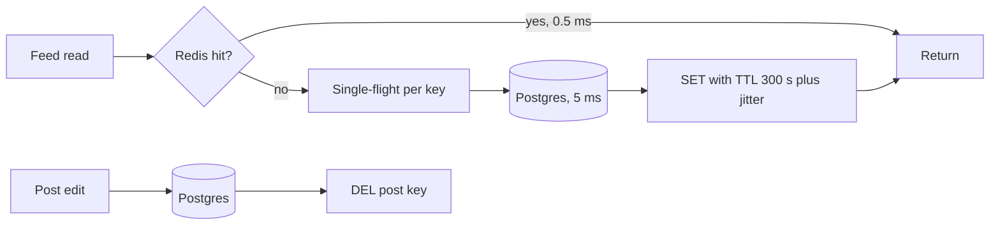

Pulse's first version reads every feed straight from Postgres: 6,000 feed reads/s at peak, each a ~5 ms query (illustrative, [§7](/c/system-design/07-caching)). That needs six read replicas just to keep up ([§29.2](/c/system-design/29-read-replicas)), and most of the work is answering the same popular posts again. Writes are 600/s. This section checks the workload is the kind a cache helps, puts one in front, and measures what changes — and runs the same check on two endpoints where a cache would not help.

:::key[First principle]
A cache wins when **the same keys are read again** before they change. Database load becomes $(1-h) \times \text{QPS}$, and mean latency becomes $t_{hit} + (1-h)\,t_{db}$ — so a cache lowers latency only when $h > t_{hit}/t_{db}$, and cuts load only by the share of reads that repeat. Measure reuse from your own access log before buying memory.
:::

## 42.1 Diagnosis: is this a cache problem?

| Metric | Where to read it | Cache fits when | Pulse feed posts |
|---|---|---|---|
| Read:write ratio of the data | DB stats per table | ≥ ~10:1 | 6,000 : 600 at peak |
| Key reuse | Share of reads on the top 1% of keys; fitted Zipf $s$ (§42.3) | Top 1% ≥ ~50%, $s$ ≳ 0.8 | 70%, $s$ ≈ 1.0 |
| Predicted hit rate | Replay a sampled log through a simulated LRU at candidate sizes | ≥ ~80% at an affordable size | 94% with 44 GB ([§7.1](/c/system-design/07-caching)) |
| $t_{db} \div t_{hit}$ | Traces: DB span vs a cache round trip | ≥ ~5 | 5 ms ÷ 0.5 ms = 10 |
| DB share of request time | Distributed traces ([§27](/c/system-design/27-observability)) | > ~50% | Most of the 5.5 ms page |
| Staleness budget | Agreed with product, per data type | Seconds or more | 30 s for feed pages ([§7.9](/c/system-design/07-caching)) |

The reuse rows are the ones teams skip. A database at high read QPS is necessary, not sufficient: if the reads don't repeat, the cache misses and every request pays an extra round trip.

## 42.2 The mechanism

**Cache-aside**: read the cache; on a miss, read the database and fill the key with a TTL. On a write, update the database and **delete** the key — a delete is idempotent and cannot install an old value. The TTL is the backstop when a delete is lost; ±10% jitter spreads refills; single-flight lets one caller recompute a missing key while the rest wait ([§7.5–7.6](/c/system-design/07-caching)).



## 42.3 Diagnose from a log: three Pulse endpoints

The block builds a sampled access log (200,000 requests over 1M keys) for three endpoints with different skew and query costs, then does what you would do with a real log: fit the skew, measure the share of reads on the top 1% of keys, replay the log through an LRU holding 5% of keys, and predict database load at 6,000 reads/s and mean latency. It's scaled down, so absolute hit rates are lower than [§7](/c/system-design/07-caching)'s full-size 94%; the comparison between endpoints is the point.

```python run
"""Will a cache help? Replay a sampled access log per endpoint through an LRU and predict DB load and latency."""
from collections import Counter, OrderedDict
import numpy as np

rng = np.random.default_rng(42)
KEYS, LOG, CACHE = 1_000_000, 200_000, 50_000     # catalogue, sampled requests, cache = 5% of keys
PEAK, T_HIT = 6_000, 0.5                          # reads/s at peak, ms per cache round trip
ENDPOINTS = {                                     # (true Zipf skew of the synthetic log, DB ms per query)
    "feed post bodies": (1.0, 5.0),
    "search filters": (0.5, 5.0),
    "profile by id": (1.0, 0.2),
}


def zipf_log(s):
    p = np.arange(1, KEYS + 1, dtype=float) ** -s
    return rng.choice(KEYS, LOG, p=p / p.sum())


def lru_hit(log, warm=50_000):
    cache, hits = OrderedDict(), 0
    for t, k in enumerate(log):
        if k in cache:
            cache.move_to_end(k)
            hits += t >= warm
        else:
            cache[k] = None
            if len(cache) > CACHE:
                cache.popitem(last=False)
    return hits / (LOG - warm)


print("%-17s %6s %8s %9s %6s %8s %9s %9s" % (
    "endpoint", "fit s", "top 1%", "distinct", "LRU h", "DB QPS", "ms before", "ms after"))
for name, (s, t_db) in ENDPOINTS.items():
    log = zipf_log(s)
    counts = np.array(sorted(Counter(log.tolist()).values(), reverse=True), float)
    r = np.arange(1, 1_001)
    fit = -np.polyfit(np.log(r), np.log(counts[:1_000]), 1)[0]   # slope of log count vs log rank
    top1 = counts[: KEYS // 100].sum() / LOG                       # share of reads on the top 1% of keys
    h = lru_hit(log)
    print("%-17s %6.2f %7.0f%% %8.0f%% %5.0f%% %8.0f %9.2f %9.2f" % (
        name, fit, 100 * top1, 100 * len(counts) / LOG, 100 * h, (1 - h) * PEAK, t_db,
        T_HIT + (1 - h) * t_db))

print("\nbreak-even hit rate for latency = t_hit / t_db")
for t_db in (0.2, 0.5, 1.0, 5.0, 30.0):
    print("  DB %5.1f ms -> cache lowers mean latency only if h > %s" % (
        t_db, "%.0f%%" % (100 * T_HIT / t_db) if T_HIT < t_db else "100% (never)"))
```

```output
endpoint           fit s   top 1%  distinct  LRU h   DB QPS ms before  ms after
feed post bodies    0.99      70%       33%    70%     1792      5.00      1.99
search filters      0.44      15%       84%    11%     5351      5.00      4.96
profile by id       0.99      71%       33%    70%     1793      0.20      0.56

break-even hit rate for latency = t_hit / t_db
  DB   0.2 ms -> cache lowers mean latency only if h > 100% (never)
  DB   0.5 ms -> cache lowers mean latency only if h > 100% (never)
  DB   1.0 ms -> cache lowers mean latency only if h > 50%
  DB   5.0 ms -> cache lowers mean latency only if h > 10%
  DB  30.0 ms -> cache lowers mean latency only if h > 2%
```

Three verdicts from one table:

- **Feed post bodies** — skew ~1, 70% of reads on 1% of keys, a third of requests distinct: cache. Even this small cache cuts DB load 3.3× and mean latency 2.5×; at full size it reaches §7's 94%.
- **Search filters** — skew ~0.4, 84% of requests distinct, 11% hit: don't. Latency 5.00 → 4.96 ms and DB load −11%, for a cluster to run and a staleness bug to own. That load is a [replica](/c/system-design/39-read-heavy-replicas) problem.
- **Profile by id** — same reuse as the feed, but an indexed 0.2 ms lookup: the Redis round trip makes it *slower* (0.20 → 0.56 ms) at any hit rate. Cache it only if the database is short of capacity — the load does fall 3.3× — or use an in-process tier (~100 ns per hit, [§18.1](/c/system-design/18-cache)).

:::chart[Mean read latency vs hit rate, cache-aside with a 0.5 ms cache (dashed: no cache)]{type="line" x="cache hit rate" y="mean read latency (ms)" xfmt="pct" ylog="true" points="true" dash="no cache DB 5 ms,no cache DB 1 ms,no cache DB 0.2 ms" marks="0.1:break-even 5 ms;0.5:break-even 1 ms"}
hit rate, cache DB 5 ms, no cache DB 5 ms, cache DB 1 ms, no cache DB 1 ms, cache DB 0.2 ms, no cache DB 0.2 ms
0, 5.5, 5, 1.5, 1, 0.7, 0.2
0.1, 5, 5, 1.4, 1, 0.68, 0.2
0.2, 4.5, 5, 1.3, 1, 0.66, 0.2
0.4, 3.5, 5, 1.1, 1, 0.62, 0.2
0.5, 3, 5, 1, 1, 0.6, 0.2
0.6, 2.5, 5, 0.9, 1, 0.58, 0.2
0.8, 1.5, 5, 0.7, 1, 0.54, 0.2
0.9, 1, 5, 0.6, 1, 0.52, 0.2
0.95, 0.75, 5, 0.55, 1, 0.51, 0.2
0.99, 0.55, 5, 0.51, 1, 0.502, 0.2
:::

Each solid line crosses its dashed partner at $h = t_{hit}/t_{db}$; the 0.2 ms line never does.

## 42.4 Before and after on Pulse

:::example[Worked example · Pulse's feed with and without the cache]
**Before.** 6,000 feed reads/s at peak hit Postgres at ~5 ms each. [§29.2](/c/system-design/29-read-replicas) sizes that at 6 replicas (2 per zone) to stay under 60% utilisation and survive a lost zone.

**After.** A cache-aside Redis tier holding 44 GB of post bodies gives a 94% hit rate at skew 1 ([§7.1](/c/system-design/07-caching)) — 57 GB of `maxmemory` after key overhead and fragmentation, which shares [§18.4](/c/system-design/18-cache)'s six 40 GB shards (plus replicas) with the timelines.

| | Before | After |
|---|---:|---:|
| DB reads/s at peak | 6,000 | \((1 - 0.94) \times 6{,}000\) = 360 |
| Mean read latency | 5.0 ms | \(0.5 + 0.06 \times 5\) = 0.8 ms |
| Read replicas | 6 | 2 (for availability, not load) |
| Max staleness | 0 | 300 s TTL backstop; edits delete the key at once |
| New dependency | — | Redis: lose a shard and DB reads jump toward 1,300/s |

The 6× latency gain is pleasant; the 17× drop in database reads is the reason. It is also the risk: a cold or lost cache sends the database load it was sized *not* to see.
:::

## 42.5 Cache vs the alternatives

| Load shape | Cache | Replicas ([§39](/c/system-design/39-read-heavy-replicas)) | Index ([§41](/c/system-design/41-slow-queries-indexes)) | Materialised view | In-process tier |
|---|---|---|---|---|---|
| Hot keys, $t_{db}$ ≫ 0.5 ms (feed posts) | **Yes**: 94% hit, 360 DB reads/s | 6 replicas for the same load | Already indexed | Possible: precomputed feed | Top ~1,000 keys only |
| Low reuse (search filters) | **No**: 11% hit | **Yes** | If queries scan | No | No |
| Cheap indexed lookup (0.2 ms) | Slower per read; only for DB capacity | If capacity-bound | Done | No | **Yes**: ~100 ns, 1–2 s TTL |
| One query scans | Hides it until the miss | Spreads it | **Yes** | Yes if it aggregates | No |
| Must be exact (stock at checkout, balance) | **No** | No (lag) | Yes | No | No |
| Staleness | TTL / invalidation bugs | Replication lag | None | Refresh interval | Local TTL × servers |

## 42.6 When to reach for it, and when not

Reach for it when §42.1 holds: read-skewed, reused keys, $t_{db}$ at least ~5× a cache round trip, a working set that fits in RAM and an agreed staleness number.

:::warn[When it is the wrong move]
**Reads are already cheap** — an indexed 0.2 ms lookup gets slower behind a 0.5 ms round trip.
**Reads don't repeat** — 84% distinct keys gives an 11% hit rate and a new failure mode.
**The data must be exact** — inventory at checkout, a balance, an authorisation decision past its revocation window.
**The working set exceeds the cache** — compulsory and capacity misses cap the hit rate ([§7.3](/c/system-design/07-caching)).
:::

## 42.7 Trade-offs

**Staleness becomes a product decision.** 5 s and 5 min are different designs — up to 10× in refresh load ([§7.4](/c/system-design/07-caching)). Get the number agreed per data type.

**Two copies can disagree.** Delete-on-write still races with a concurrent miss that fills an old value; the window is one database read, rare but real at 6,000 reads/s. The TTL bounds it; versioned values close it.

**The cache is on the critical path.** One of six Redis primaries lost without a replica takes Pulse's DB from 360 to 1,300 reads/s ([§18.4](/c/system-design/18-cache)); a cold restart sends all 6,000. Treat a cache error as a miss, and keep load shedding or replica headroom behind it.

**RAM is the expensive resource.** Size to the working set, not the data set: at skew 1, 14 GB gives 88% and 44 GB 94% — tripling memory buys 6 points ([§7.1](/c/system-design/07-caching)).

## 42.8 Failure modes

| Failure | Size of it on Pulse | Fix |
|---|---|---|
| Stampede on a hot key's expiry | 3,000 reads/s × 100 ms rebuild = 300 identical queries ([§7.6](/c/system-design/07-caching)) | Single-flight; early refresh |
| Synchronised expiry | 10,000 keys, 60 s TTL: 10,000 refills in one second; 863/s with ±10% jitter | Jitter every TTL |
| Hot key | 30,000 reads/s on one shard | 16 key replicas → 1,875/s each, or in-process tier |
| Penetration (missing IDs) | Scraper at 1,000 IDs/s → 1,000 DB queries/s | Bloom filter, 10 bits/key → ~8/s |
| Big value | A 10 MB value blocks a single-threaded shard | Cap values at ~100 KB; split or point to object storage |
| Cold start / lost shard | 360 → 6,000 or → 1,300 DB reads/s | Warm before traffic; replicas; shed load |

## 42.9 Sizing it

$$
h \approx \frac{H_{k,s}}{H_{N,s}}, \qquad \text{DB QPS} = (1-h)\,\text{QPS}, \qquad \bar t = t_{hit} + (1-h)\,t_{db}, \qquad \text{refresh floor} \le \frac{\text{active keys}}{T}
$$

Start from a replayed log, not from the data size: pick the smallest cache on the measured hit-rate curve that brings the database under its target, then multiply by ~1.3 for key overhead and fragmentation and leave fork headroom on top — ~2.2× the raw bytes in RAM for Pulse ([§18.4](/c/system-design/18-cache)). Alert on **misses per second**, not hit rate: 99% → 98% doubles database load.

## 42.10 Interview soundbite

> "I'd check reuse first: on the feed, 1% of posts take 70% of reads and the query is 10× a cache round trip, so cache-aside in Redis with delete-on-write, a 300-second TTL with jitter, and single-flight on misses. At a 94% hit rate the database goes from 6,000 to 360 reads a second at peak. I would not cache search — 84% of those requests are unique — and I'd keep enough headroom behind the cache to survive losing a shard."

## 42.11 Check yourself

:::qa[Pulse's cache is halved from 44 GB to 14 GB to save money. What happens to the database at peak?]
At skew 1 the hit rate falls from 94% to 88% ([§7.1](/c/system-design/07-caching)): misses double from 6% to 12%, so DB reads go from 360 to 720/s at peak. Mean latency moves only 0.80 → 1.10 ms; the database feels it, users barely do.
:::

:::qa[A team wants to cache the search-filter endpoint. The log replay shows 11% hits. What do you tell them?]
At 5 ms queries the break-even is 10%, so latency improves by 0.04 ms and DB load by 11% — not worth a staleness budget and a new dependency. The load is broad and varied: read replicas (or better indexes, if the queries scan) are the fix.
:::

:::qa[Profile lookups are 0.2 ms indexed reads, and the database is at 40% CPU. Cache them in Redis?]
No: every read would take at least the 0.5 ms round trip, slower at any hit rate, and the database isn't short of capacity. If the profile is on every page, a 1–2 s in-process cache gives ~100 ns hits without the network.
:::

:::qa[The Redis cluster restarts empty at peak. Postgres was sized for the 360 reads/s it normally sees. What happens, and what should have been in place?]
All 6,000 reads/s miss and land on a database sized for 360 — 17× its normal load, so it saturates and the cache can't refill fast enough to recover. Have replicas so restarts are failovers, warm the hot keys before taking traffic, single-flight misses, and shed load (serve a degraded feed) when the database queue grows.
:::

Next: [Temporary failures → retry with backoff](/c/system-design/43-temporary-failures-retry) — what callers should do when a dependency, cache or database, fails for a moment.
