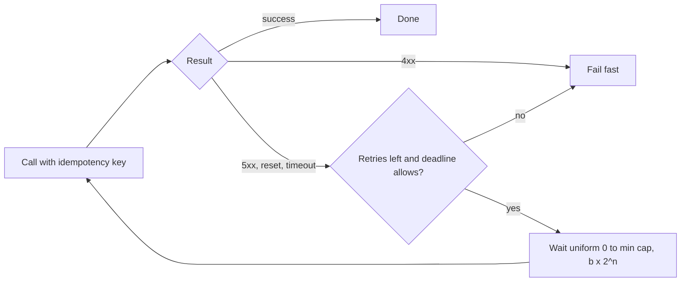

Checkout calls its payment provider about 2,000 times a second during the flash sale. Most of the time 1% of those calls fail with a reset connection or a 503 that a second attempt would have absorbed — 20 lost orders a second, 12,000 over the ten-minute sale. Once or twice a week the provider fails over its primary and returns errors for about 3 seconds (both illustrative). Retrying fixes the first problem almost for free and part of the second; done carelessly, it turns the second into a storm of 15,000 calls a second against a 2,500/s quota. The mechanics and the derivations are in [§30 Retry and backoff](/c/system-design/30-retry); this section is the decision: when the symptom calls for a retry, how to size it, and how to tell when it doesn't.

:::key[First principle]
A retry is a second draw. It is nearly free and very effective when failures are **independent** (extra load ≈ the failure rate $p$, failure probability $p \to p^{r+1}$), useless and expensive when they are **correlated** (every retry fails and adds load). So measure correlation first, retry at one layer with full jitter, make the retry window cover the recovery time but not the caller's deadline, and never repeat a side effect without an [idempotency key](/c/system-design/22-idempotency).
:::

## 43.1 The symptom, and how to diagnose it

- A small, steady error rate on a dependency; the same request succeeds when the user taps again.
- Errors cluster around deploys, leader elections, autoscaling events and network blips, then vanish.
- The errors are 503, 502, 504, connection reset or timeout — not 400, 401, 403, 404 or 422.

Four measurements separate "retry will fix this" from "retry will make it worse":

| Metric | How to get it | Retry helps if | Retry hurts or is pointless if |
|---|---|---|---|
| Retryable share of errors | Errors by status class and exception type | Most are 5xx, resets, timeouts | Most are 4xx (the request itself is wrong) |
| Correlation: $P(\text{fail} \mid \text{previous attempt failed})$ | Log attempt number with each outcome | Close to the base rate $p$ (blips) | ≫ $p$, e.g. above 50% (an outage) |
| Error-burst length | p95 duration of consecutive-error runs | Seconds (failover, restart) | Minutes (outage, bad deploy) |
| Retry success rate | Share of retries that succeed | > 50% | < 10%: retries are pure load |

:::example[Worked example · reading checkout's dashboards]
Calm period (illustrative dashboard): 1.08% of payment calls fail, nearly all resets and 503s; a retry fails 1% of the time — the same as a first attempt, so failures are independent. **Retry.** During a failover: 100% of calls fail for ~3 s and a retry inside that window fails 100% of the time — correlated, but short. **Retry with a window longer than 3 s.** During a provider outage: 100% fail for minutes. **Don't retry** — stop calling with a [circuit breaker](/c/system-design/38-one-service-failing-breaker) and park orders for later ([§47](/c/system-design/47-write-spikes-queue)).
:::

## 43.2 The mechanism

Wait before attempt $n+1$ for a random time in $[0, \min(\text{cap}, b \cdot 2^n)]$ (full jitter), stop after $r$ retries or when the propagated deadline can't be met, and send the same idempotency key on every attempt:

$$
P(\text{request fails}) = p^{\,r+1}, \qquad \text{calls per request} = \sum_{k=0}^{r} p^k \approx 1 + p, \qquad
\text{retry window} \approx r \cdot T_{\text{attempt}} + \sum_{n=0}^{r-1} \tfrac{1}{2}\min(\text{cap}, b \cdot 2^n).
$$

The first two hold only for independent failures; for a failover the third decides the outcome. Jitter matters because clients that failed together otherwise retry together — [§30.2](/c/system-design/30-retry) shows unjittered backoff wasting half the capacity in synchronised waves.



## 43.3 Before and after: checkout's payment call

The simulation runs 30 s of flash-sale traffic (2,000 orders/s) through five policies. The provider fails 1% of calls at random, fails everything from t = 10 s to 13 s (a failover), and answers 429 to calls beyond its 2,500/s quota. Each attempt takes 300 ms (the provider's p50; during the failover it fails fast); shoppers give up after 8 s. All numbers illustrative.

```python run
"""Checkout's payment call: 1% random blips plus a 3 s provider failover. Which retry policy?"""
import heapq
import numpy as np

RATE, T, OUT = 2_000, 30, (10, 13)    # orders/s for 30 s; provider fails everything t = 10-13 s
P, DUR, DEADLINE = 0.01, 0.3, 8.0     # blip rate, s per attempt (fails fast in a failover), deadline
QUOTA, CAP = 2_500, 4.0               # provider answers 429 above this rate (illustrative); max wait


def plan(depth, r, base, t, rng):     # start times of every provider attempt, if all fail
    if depth == 0:
        return [t], t + DUR
    times = []
    for i in range(r + 1):
        ts, t = plan(depth - 1, r, base, t, rng)
        times += ts
        if i < r:
            t += rng.uniform(0, min(CAP, base * 2 ** i))   # full jitter
    return times, t


def run(layers, r, base, budget=None, seed=7):
    rng = np.random.default_rng(seed)
    arrive = np.sort(rng.uniform(0, T, RATE * T))
    plans = [plan(layers, r, base, t, rng)[0] for t in arrive]
    ev = [(p[0], i, 0) for i, p in enumerate(plans)]
    heapq.heapify(ev)
    calls, ok, tokens = np.zeros(T + 60), np.zeros(len(arrive), bool), 10.0
    while ev:
        t, i, k = heapq.heappop(ev)
        late = t + DUR > arrive[i] + DEADLINE
        if late and layers == 1:
            continue                                # deadline propagated: skip what can't finish
        calls[int(t)] += 1
        if k == 0 and budget:
            tokens = min(10.0, tokens + budget)     # each first attempt earns 0.1 retry
        if not (OUT[0] <= t < OUT[1] or calls[int(t)] > QUOTA or rng.random() < P):
            ok[i] = not late
            continue
        if k + 1 < len(plans[i]) and (not budget or tokens >= 1):
            tokens -= 1 if budget else 0
            heapq.heappush(ev, (plans[i][k + 1], i, k + 1))
    calm, hit, after = arrive < 9, (arrive >= 9) & (arrive < 13), (arrive >= 13) & (arrive < 20)
    return (calls[:9].sum() / calm.sum(), 100 * (1 - ok[calm].mean()), 100 * (1 - ok[hit].mean()),
            100 * (1 - ok[after].mean()), calls[OUT[0]:20].max(), np.maximum(calls - QUOTA, 0).sum())


print("                               calm (t < 9 s)      orders failed, arriving    provider")
print("policy                         calls/order failed  t = 9-13 s  t = 13-20 s  peak/s   429s")
for name, layers, r, base, budget in (
        ("no retry", 0, 0, 0.1, None),
        ("client r=2, b=100 ms", 1, 2, 0.1, None),
        ("client r=4, b=1 s", 1, 4, 1.0, None),
        ("client r=4, b=1 s, budget 10%", 1, 4, 1.0, 0.1),
        ("3 layers x r=2, b=100 ms", 3, 2, 0.1, None)):
    per, f_calm, f_hit, f_after, peak, over = run(layers, r, base, budget)
    print("%-30s %7.3f %6.2f%% %9.1f%% %11.1f%% %7.0f %7.0f" % (name, per, f_calm, f_hit, f_after,
                                                              peak, over))
```

```output
                               calm (t < 9 s)      orders failed, arriving    provider
policy                         calls/order failed  t = 9-13 s  t = 13-20 s  peak/s   429s
no retry                         1.000   1.08%      75.7%         1.1%    2083       0
client r=2, b=100 ms             1.009   0.00%      57.1%         0.0%    6240   10258
client r=4, b=1 s                1.010   0.00%      12.6%         0.6%    5858   19865
client r=4, b=1 s, budget 10%    1.010   0.01%      73.5%         0.0%    2280       0
3 layers x r=2, b=100 ms         1.009   0.00%       0.7%         0.0%   15101   88225
```

:::chart[Calls per second at the payment provider around a 3 s failover (simulated)]{type="line" x="seconds" y="provider calls per second" band="10:13:failover" hmarks="2500:provider quota" dash="no retry"}
second, no retry, client r=2 b=100 ms, client r=4 b=1 s, r=4 b=1 s + budget, 3 layers x r=2
0, 1980, 1993, 1987, 1987, 1989
4, 2002, 2019, 2018, 2018, 2020
8, 2070, 2084, 2092, 2092, 2086
9, 2005, 2024, 2017, 2017, 2023
10, 2007, 3877, 2509, 2067, 3906
11, 2083, 6170, 4495, 2278, 9414
12, 2063, 6240, 5730, 2280, 14844
13, 1862, 3640, 5858, 2023, 15101
14, 1929, 2831, 5038, 1951, 13538
15, 1965, 2320, 4778, 1988, 12187
16, 1911, 1931, 4439, 1930, 10748
17, 2022, 2038, 4204, 2040, 9550
18, 2006, 2028, 3784, 2027, 8345
19, 1988, 2009, 3346, 2004, 7178
20, 2044, 2059, 3011, 2073, 6089
21, 1953, 1972, 2673, 1978, 4965
22, 2035, 2053, 2374, 2053, 4054
23, 2002, 2020, 2114, 2024, 3159
24, 1980, 1995, 2029, 2003, 2647
25, 1991, 2013, 2014, 2010, 2161
:::

What the numbers say:

- **Blips: retry is nearly free.** Any retry policy turns 1.08% failed orders into ~0% for 1% more calls (1.009–1.010 calls per order) — at 2,000 orders/s, ~20 extra calls/s buys back ~20 orders/s.
- **Failover: the window decides.** The §30 default ($r$ = 2, $b$ = 100 ms) waits ~0.15 s on average in total and gives up long before the 3 s failover ends: 57.1% of orders arriving around it still fail. Four retries from $b$ = 1 s (cap 4 s) wait on average 0.5 + 1 + 2 + 2 = 5.5 s, which spans the failover inside the 8 s deadline: 12.6% fail. What remains is capacity, not policy: after the failover the provider has only 2,500 − 2,000 = 500 calls/s spare for ~6,000 orders that need redoing.
- **A budget is for outages, not failovers.** A 10% budget keeps the provider at its normal load (peak 2,280/s, no 429s) but rescues almost nothing (73.5%): during a failover every call fails and the budget pays for one retry in ten.
- **The stack rescues the most here, by luck.** Three layers retrying twice each fail only 0.7% — because they keep calling at up to 15,101 calls/s (6× quota) and this model's provider refuses the excess for free and recovers on schedule. That is 88,225 refused calls, 4.4× the sized single layer. Against a 60 s outage the same stack sends \((1 + 2)^3\) = 27× the load for a minute ([§30.1](/c/system-design/30-retry)); real providers protect themselves by shedding, or fall over.

The design that follows: **one** retrying layer (the payment client, which knows the call carries an idempotency key), a window sized to the failovers you actually see, a deadline that stops retries the shopper won't wait for, a budget plus a [circuit breaker](/c/system-design/20-circuit-breaker) for the long outage, and a reserve of quota for retries — or orders captured asynchronously so a failover delays payment instead of failing checkout ([§25](/c/system-design/25-message-queue)).

## 43.4 When to reach for it, and when not

- The failure is transient (5xx, reset, timeout, "not primary") and independent or short.
- The operation is idempotent, or carries a key the server deduplicates on ([§37](/c/system-design/37-duplicate-requests-idempotency)).
- The caller's deadline has room for at least one more attempt.

:::warn[When it is the wrong move]
- **4xx errors.** 400, 401, 403, 404, 409 and 422 fail the same way every time.
- **A side effect without an idempotency key.** A timed-out payment may have charged the card; a blind retry charges it twice.
- **A dependency that is down.** Correlation near 100% for more than a few seconds: retries only add load. Open a breaker.
- **Every layer retrying.** App, gateway, service and client library at $r$ = 2 each is \(3^4\) = 81 attempts per tap.
:::

| Option | Use when | Cost | Checkout's payment call |
|---|---|---|---|
| **Retry with jittered backoff** | Independent blips; failovers of seconds | ≈ $p$ extra calls; latency of the retried few | Yes: $r$ = 4, $b$ = 1 s, 8 s deadline |
| Hedged request | Idempotent reads with a slow tail | ~5% extra calls ([§10](/c/system-design/10-latency-and-throughput)) | No: a write, and hedges double-charge without a key |
| Circuit breaker | Failure rate high for > a few seconds | Fails fast; needs a fallback ([§38](/c/system-design/38-one-service-failing-breaker)) | Yes, alongside retry, for outages |
| Async processing via a queue | The caller doesn't need the result now | Order shows "pending"; consumers retry at leisure ([§47](/c/system-design/47-write-spikes-queue)) | Yes for capture after authorisation |
| Fail fast, user retries | Rare errors, cheap user retry | User-visible errors | No: 12,000 lost orders per sale |

## 43.5 Trade-offs

- **Retry storms.** Retries add load exactly when the dependency is weakest: a window long enough for a failover is long enough to triple the load during one (5,858 calls/s against a 2,500/s quota above). Budgets and breakers bound it.
- **Tail latency.** A retried request takes the waits plus the attempts — up to the 8 s deadline for the sized policy. Fine for checkout's 8 s deadline, wrong for a 200 ms feed read — there, hedge or fail fast.
- **Masked fragility.** A dependency that fails 5% of calls looks healthy behind retries. Track attempts per request and retry success rate, and alert when attempts per request exceed ~1.05.
- **Duplicate side effects.** The expensive bug. One key per checkout attempt, generated once and sent on every retry.

## 43.6 Failure modes

| Failure | What you see | Fix |
|---|---|---|
| Retry window shorter than recovery | Errors during failovers persist despite retries | Size $r$ and $b$ from measured error-burst length |
| Synchronised retries | Load arrives in waves; idle capacity between | Full jitter |
| Retries at several layers | Dependency load × 27–81 during incidents | One retrying layer; the rest fail fast |
| Retrying past the caller's deadline | Calls for shoppers who already left | Propagate the deadline; skip attempts that can't finish |
| Ignoring `Retry-After` | Hammering a dependency that asked for time | Use it as the minimum delay, plus jitter |
| Non-idempotent writes retried | Double charges, duplicate emails | Idempotency key or no retry |

## 43.7 Sizing it

| Knob | Checkout payment call | Rule |
|---|---|---|
| Retrying layer | Payment client only | One per call path, nearest the dependency |
| Attempts | 5 ($r$ = 4) | Window ≥ p95 error-burst length (3 s here) |
| Backoff | Full jitter, $b$ = 1 s, cap 4 s | Mean total wait 5.5 s spans the failover |
| Deadline | 8 s, propagated | Worst case \(5 \times 0.3 + 1 + 2 + 4 + 4\) = 12.5 s, so the deadline cuts the last retry when needed |
| Budget | 10% of first attempts, plus a breaker | Holds an outage to 1.1× load |

## 43.8 Interview soundbite

> "Retries only for retryable errors and only at the payment client: full jitter, four retries from one second so the window covers a three-second failover, an eight-second propagated deadline, an idempotency key on every attempt, a 10% retry budget and a circuit breaker for real outages — and I'd check retries are independent before trusting them."

## 43.9 Check yourself

:::qa[A dependency fails 0.5% of calls and a retry fails 0.5% of the time. You add r = 2. What changes?]
Failures fall from 0.5% to \(0.005^3\) ≈ 1.3 × 10⁻⁷ and calls per request rise to \(1 + 0.005 + 0.005^2\) ≈ 1.005 — half a percent more load. Independence (retry failure rate = base rate) is what makes this safe to promise.
:::

:::qa[Failovers last up to 4 s. Your client retries twice with b = 100 ms. Why do orders still fail, and what would you change?]
Mean total wait is \(0.05 + 0.1\) = 0.15 s plus three attempts: the client gives up ~1 s into a 4 s failover. Raise $b$ and $r$ until the mean window exceeds 4 s inside the deadline — e.g. $b$ = 1 s, $r$ = 4 (5.5 s of mean waits) — and keep the deadline so the last retries are skipped when time runs out.
:::

:::qa[In the simulation, three stacked layers failed only 0.7% of orders. Why not ship that?]
It won by sending up to 15,101 calls/s (6× quota) and getting 88,225 refusals, relying on a provider that refuses excess for free and comes back after 3 s. In a minute-long outage the same stack multiplies load 27× while the provider tries to recover. One layer with a sized window gets most of the benefit at 39% of the peak (5,858/s) and 23% of the refusals.
:::

:::qa[A payment call timed out after 2.5 s. Retry?]
Only with the same idempotency key as the first attempt. The timeout doesn't say whether the card was charged; with the key, the provider (or your idempotency layer, [§22](/c/system-design/22-idempotency)) returns the first result instead of charging again.
:::

Next: [Too many requests → rate limiting](/c/system-design/44-too-many-requests-rate-limit) — when the extra traffic isn't retries but callers who want more than their share.
