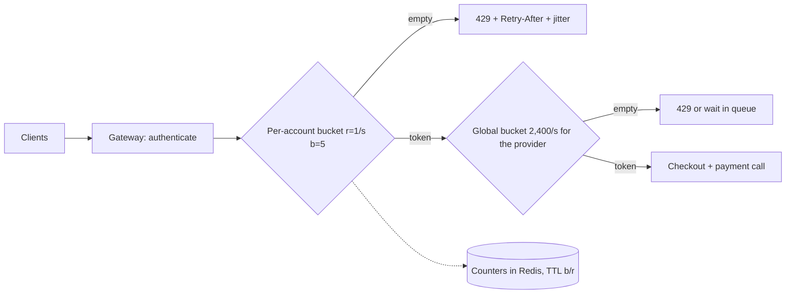

The flash sale opens and checkout's dashboards look like a capacity problem: 12,200 checkout attempts a second against a payment quota of 2,500/s (illustrative), the provider answering 429 to ~80% of calls, real shoppers seeing "payment failed". Adding servers won't help — the quota is fixed and most of the traffic comes from 200 accounts running bots at 50 requests a second each. The fix is a decision per request: *may this caller do this now?* — made in well under a millisecond, before any expensive work. The algorithms, their burst bounds and the distributed-counter trade-offs are derived in [§28 Rate limiter](/c/system-design/28-rate-limiter); this section is when and how to apply one.

:::key[First principle]
A shared resource is split by whoever asks fastest unless you split it on purpose. A **token bucket per identity** (rate $r$, burst $b$) caps any caller at $b + r\,t$ in any interval $t$, and a **global bucket per dependency** keeps the total under what the dependency can take. Rejecting with a 429 costs microseconds; serving the excess costs the quota honest callers needed.
:::

## 44.1 The symptom, and how to diagnose it

- One API key, account, IP or tenant sends a share of traffic far beyond its share of users.
- A dependency with a fixed quota (payment provider, third-party API, licence) starts returning 429s.
- Honest users see errors while total traffic looks "only" 2–5× normal.
- You sell tiered quotas and have no way to enforce them.

| Metric | How to get it | Threshold that says "rate limit" (rules of thumb) |
|---|---|---|
| Top-key share | Requests per key, sorted, over 1 min | Top 1% of keys send > 25% of requests |
| Per-key rate vs honest p99 | Rate percentiles per key | Some keys at > 10× the p99 of the rest |
| Downstream rejections | 429/503 from quota-bound dependencies | Any sustained rate; you are spending quota on rejections |
| Attempts per completed action | e.g. checkout calls per paid order | > 2 for a human-driven action |
| Cost per tenant | CPU or DB time by tenant | One tenant > 3× its paid share |

:::example[Worked example · reading the flash-sale traffic]
Honest shoppers: 2,000 new accounts a second, each sending one `POST /checkout` and 10% tapping a second time 1–3 s later — 2,200 requests/s, about 1 per account per sale. Bots: 200 accounts at 50 requests/s each, 10,000/s. The top 200 keys (under 0.2% of active accounts) send 82% of requests, and their per-key rate is 50× the honest maximum. Every threshold in the table trips; the dependency is the scarce resource, so this is a fairness problem, not a capacity one.
:::

## 44.2 The mechanism

A bucket per key holds up to $b$ tokens and refills at $r$ per second; a request spends one or gets a 429 with `Retry-After` = time to the next token, $(1 - \text{tokens})/r$, plus jitter. Layer two kinds of limit:

- **Per identity** (account, API key; IP only as a loose backstop) — fairness between callers.
- **Global per dependency** at ~95% of its quota — protects the dependency and leaves room for retries.

Distributed enforcement needs either a central counter store with an atomic update (exact, ~0.5 ms per check) or each key hashed to one limiter instance; splitting a limit evenly across $N$ gateways rejects honest bursts ([§28.3](/c/system-design/28-rate-limiter)).



## 44.3 Before and after: bots in the flash sale

The simulation sends 30 s of the traffic above through three designs: no limit of our own (the provider's quota does the rejecting, burst 250), a global 2,400/s bucket only, and a per-account bucket ($r$ = 1/s, $b$ = 5, as in [§28.2](/c/system-design/28-rate-limiter)) in front of the global one.

```python run
"""Flash sale: 2,000 shoppers/s plus bot accounts hammering POST /checkout. Where should the limit live?"""
import numpy as np

T, HONEST, BOT_RATE = 30, 2_000, 50       # seconds; new shoppers/s; requests/s per bot account
QUOTA = 2_500                             # payment provider quota, calls/s (illustrative)


def traffic(bots, seed=44):
    rng = np.random.default_rng(seed)
    n = HONEST * T
    t = rng.uniform(0, T, n)
    again = rng.random(n) < 0.1                               # 10% tap Buy a second time 1-3 s later
    times = np.concatenate([t, t[again] + rng.uniform(1, 3, again.sum())])
    acct = np.concatenate([np.arange(n), np.arange(n)[again]])
    m = rng.poisson(BOT_RATE * T * bots)
    times = np.concatenate([times, rng.uniform(0, T, m)])
    acct = np.concatenate([acct, -1 - rng.integers(0, bots, m)])   # bot accounts are negative ids
    order = np.argsort(times)
    keep = times[order] < T
    return times[order][keep], acct[order][keep]


def bucket(rate, burst):
    state = {}
    def allow(key, t):
        tok, last = state.get(key, (burst, t))
        tok = min(burst, tok + (t - last) * rate)
        ok = tok >= 1
        state[key] = (tok - ok, t)
        return ok
    return allow


def run(bots, per_account, global_limit):
    times, acct = traffic(bots)
    acc = bucket(1.0, 5.0) if per_account else None           # per account: 1/s, burst 5
    glob = bucket(2_400.0, 400.0) if global_limit else None   # ours: 96% of quota
    prov = bucket(QUOTA, 250.0)                               # the provider's own enforcement
    sent = served = served_honest = 0
    for t, a in zip(times, acct):
        if acc and not acc(a, t):
            continue
        if glob and not glob(0, t):
            continue
        sent += 1
        if prov(0, t):
            served += 1
            served_honest += a >= 0
    honest = (acct >= 0).sum()
    return honest, served_honest, served - served_honest, sent - served


print("bots  policy                       honest served   bot calls/s   provider 429s/s")
for bots in (0, 200):
    for name, pa, gl in (("none (provider quota only)", 0, 0), ("global 2,400/s", 0, 1),
                         ("per-account 1/s b=5 + global", 1, 1)):
        honest, ok, bot_ok, rejected = run(bots, pa, gl)
        print("%4d  %-28s %10.1f%% %13.0f %17.0f" % (bots, name, 100 * ok / honest,
                                                    bot_ok / T, rejected / T))
```

```output
bots  policy                       honest served   bot calls/s   provider 429s/s
   0  none (provider quota only)        100.0%             0                 0
   0  global 2,400/s                    100.0%             0                 0
   0  per-account 1/s b=5 + global      100.0%             0                 0
 200  none (provider quota only)         20.4%          2061              9690
 200  global 2,400/s                     19.9%          1974                 5
 200  per-account 1/s b=5 + global       99.6%           209                 5
```

:::chart[Honest checkout requests served vs number of bot accounts at 50 req/s each (simulated, 10 s runs)]{type="line" x="bot accounts" y="honest requests served" yfmt="pct" ymin="0" ymax="1" points="true"}
bot accounts, global limit only, per-account + global
0, 1.000, 1.000
25, 0.714, 1.000
50, 0.522, 1.000
100, 0.340, 0.997
200, 0.197, 0.992
400, 0.110, 0.956
800, 0.059, 0.928
:::

What the numbers say:

- **Without bots, no limit ever fires.** Honest traffic (2,200/s) fits under 2,400/s, so a well-sized limiter is invisible to the people it protects.
- **A global limit alone protects the provider, not the shoppers.** It cuts provider 429s from 9,690/s to 5/s — rejections now cost us microseconds instead of a provider round trip — but honest shoppers still get only ~20%, because the bucket admits whoever arrives, and 82% of arrivals are bots.
- **Per-account limits restore fairness.** Each bot gets 5 + 1/s: 200 bots fall from ~2,000 to 209 provider calls/s and honest shoppers get 99.6%. A human tapping twice never notices.
- **Per-account limits weaken as accounts multiply.** At 800 bot accounts their 1/s each is 800/s, total demand 3,000/s > 2,400/s, and honest service falls to 92.8%. Cheap accounts need limits on account creation, per device or IP (loosely, because of carrier NAT), and bot detection — the limiter caps each identity, it can't tell you which identities are real.

## 44.4 When to reach for it, and when not

- A small number of callers can monopolise a shared or quota-bound resource.
- You need per-tenant fairness or paid tiers.
- Expensive endpoints (search, checkout, export) need tighter limits than cheap cached reads.

:::warn[When it is the wrong move]
- **Legitimate demand above capacity.** If all 12,000 requests/s were real shoppers, rejecting 80% loses sales; queue them in a waiting room ([§47](/c/system-design/47-write-spikes-queue)) or add capacity.
- **Internal service-to-service calls.** A caller you control should be fixed, not throttled; protect the callee with concurrency limits and load shedding.
- **Failures, not volume.** If the dependency is erroring, a [circuit breaker](/c/system-design/38-one-service-failing-breaker) is the tool; retries are [§43](/c/system-design/43-temporary-failures-retry).
:::

| Option | Use when | What the caller sees | Flash sale fit |
|---|---|---|---|
| **Per-key token bucket + global limit** | A few callers take more than their share | 429 + `Retry-After` for the excess | Yes: honest 20% → 99.6% |
| Global limit only | Protecting a dependency from total overload | Random 429s, unfair under abuse | Necessary, not sufficient |
| Waiting room / queue | Demand is legitimate and can wait | Position in line, then service | Yes for honest overflow (§47) |
| Load shedding / concurrency limit | Protecting your own servers from overload or slowdowns | 503 under overload | Yes, as a backstop ([§28.2](/c/system-design/28-rate-limiter)) |
| Autoscaling | Your servers are the bottleneck and demand is real | Nothing, after scale-up lag | No: the quota, not servers, is the limit |
| Bot detection / CAPTCHA | Many cheap identities | A challenge | Yes, alongside per-account limits |

## 44.5 Trade-offs

- **Rejections are a product decision.** A 429 must be documented with `Retry-After`, and your own clients must honour it with jitter, or rejected callers return in a synchronised wave.
- **Shared state costs a round trip and is a dependency.** ~0.5 ms per check against Redis; decide in advance whether the limiter fails open (guardrails) or closed (contractual quotas) ([§28.4](/c/system-design/28-rate-limiter)).
- **Fairness versus utilisation.** Strict per-key limits leave capacity idle when few callers are active; work-conserving schemes (borrowing unused quota) are fairer to bursts but let one tenant take everything when others are quiet.
- **Identity is the weak point.** Limits are per key; an attacker with 10,000 keys has 10,000 buckets.

## 44.6 Failure modes

| Failure | What you see | Fix |
|---|---|---|
| Limit split across gateways | Honest clients get 429s below quota | Central store, or hash each key to one limiter ([§28.3](/c/system-design/28-rate-limiter)) |
| Fixed-window boundary burst | 2× the limit around each window edge | Token bucket or sliding-window counter |
| Limiter after the expensive call | Rejected requests cost as much as served ones | Check right after authentication |
| Counter keys without TTL | Store memory grows for months | TTL = $b/r$ on every write |
| Per-IP limits behind carrier NAT | One busy address blocks thousands of users | Prefer per-account keys; loose IP limits |
| Limiter store down, failing closed | The protection becomes the outage | Fail open with a local backstop |

## 44.7 Sizing it

| Limit | Value | Derivation |
|---|---|---|
| Global, payment provider | $r$ = 2,400/s, $b$ = 400 | 96% of a 2,500/s quota; 400 = a 200 ms spike at double rate |
| Per account, `POST /checkout` | $r$ = 1/s, $b$ = 5 | A person checks out a few times a minute; a bot at 50/s gets \(5 + 60\) = 65 per minute, 2% of what it asks |
| Per IP, backstop | 10–20× the per-account limit | Carrier NAT puts many users behind one address |
| Pulse API, per user | $r$ = 10/s, $b$ = 20 | [§28.4](/c/system-design/28-rate-limiter) |
| Counter store | ~11,200 keys × ~100 B ≈ 1.1 MB | Keys live $b/r$ = 5 s: \(2{,}200 \times 5\) honest + 200 bot |
| Checks per second | ~12,200 during the attack | One Redis primary; shard by key hash beyond its measured ceiling |

## 44.8 Interview soundbite

> "A token bucket per account in front of checkout — one a second, burst of five — and a global 2,400-a-second bucket in front of the payment provider's 2,500 quota, counters in Redis with a TTL, 429 with a jittered Retry-After. A global limit alone would protect the provider but let 200 bots take 80% of the quota."

## 44.9 Check yourself

:::qa[Honest traffic is 2,200 req/s and the global limit is 2,400/s. Bots add 10,000/s. Roughly what share of honest requests does a global limit alone serve?]
About 20%. The bucket can't tell honest from bot, so every request has the same chance of finding a token: \(2{,}400 / 12{,}200\) ≈ 19.7%. The simulation measured 19.9%.
:::

:::qa[With a per-account limit of 1/s and burst 5, how much does one bot at 50 req/s get in its first 30 seconds?]
\(5 + 1 \times 30\) = 35 requests — 2.3% of the 1,500 it sent.
:::

:::qa[Attackers switch to 5,000 fresh accounts at 2 req/s each. Does the per-account limit help?]
Barely: 2/s is above the 1/s limit, so each account still gets 1/s plus its burst — ~5,000/s of bot traffic, which alone exceeds the 2,400/s global limit. Limit account creation and new-account activity, add per-device and IP limits, and challenge suspicious sessions.
:::

:::qa[Why put the limiter after authentication but before the inventory and payment calls?]
Before authentication you don't know the account, so you can only limit by IP. After the expensive calls, a rejected request has already cost a database write and a provider call. Right after authentication is the cheapest point that knows who is asking.
:::

Next: [Too much traffic → add a load balancer](/c/system-design/45-traffic-load-balancer) — when the demand is real and one machine is the limit.
