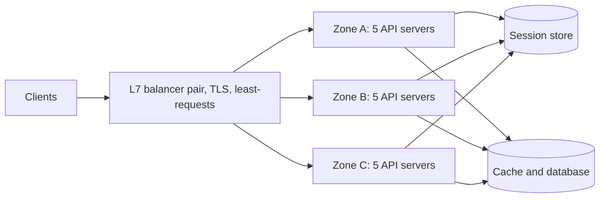

Pulse launched on one 8-core API server: 10 ms of CPU per request, 800 requests/s of capacity ([§10.4](/c/system-design/10-latency-and-throughput)). At launch the evening peak was 600 req/s and the p99 a comfortable 49 ms. The plan in [§2](/c/system-design/02-estimation) is 10M daily users and a 6,000 req/s peak — 7.5× what that server can do at 100%. Every deploy restarts the only process, and the day it dies, Pulse is down. A load balancer is the standard fix, but the balancer is the easy part: the work is making the servers interchangeable and buying the right number of them. The balancing policies, health checks and draining are in [§24 Load balancer](/c/system-design/24-load-balancer); fleet-sizing theory is in [§13](/c/system-design/13-scalability).

:::key[First principle]
Latency is flat until a server is ~80% busy and then explodes ([§10.3](/c/system-design/10-latency-and-throughput)), so capacity is not what a server *can* do but what it can do at a utilisation where queues stay short. Spreading load across $n$ **stateless** servers keeps each in the flat part — $\rho = \lambda / (n \mu)$ — and removes the single process whose restart or crash is an outage. Size $n$ for peak with a zone down, not for the average.
:::

## 45.1 The symptom, and how to diagnose it

- p99 latency steps up at the evening peak while the average looks fine.
- One instance near its CPU, worker-pool or connection ceiling.
- Every deploy is a few minutes of downtime; a crash is a full outage.

| Metric | How to get it | Threshold (rules of thumb) |
|---|---|---|
| CPU utilisation at peak | Per instance, 1-min resolution | Sustained > 70%: the knee is near |
| p99 vs utilisation | Plot one against the other across a day | p99 rising faster than load: you're past the knee |
| In-flight requests vs worker pool | Little's law: rate × mean response time | > 70% of the pool at peak |
| Deploy and crash downtime | Minutes of unavailability per month | More than ~25% of the error budget (99.9% = 43.2 min/month) |
| Instances serving traffic | Count | 1: any failure is an outage |

:::example[Worked example · Pulse at 600 req/s on one server]
CPU 75% at peak; p99 49 ms against a 46 ms floor (the p99 of a 10 ms exponential service time is \(10 \ln 100\) ≈ 46 ms). By Little's law ([§10.2](/c/system-design/10-latency-and-throughput)), 600 req/s × ~10 ms ≈ 6 requests in flight on 8 cores. Healthy today, but traffic grows ~25% a month (illustrative), so it crosses 88% (p99 62 ms) in under a month and 95% (124 ms) soon after. Deploys restart the process for ~60 s (illustrative); 20 deploys a month is 20 minutes, 46% of a 99.9% budget before anything breaks.
:::

## 45.2 The mechanism

A balancer accepts connections on one stable address and sends each request to a healthy backend chosen by policy. **Least-requests or power-of-two-choices**, not round robin, because they adapt to slow or mixed servers ([§24.3](/c/system-design/24-load-balancer)). Active health checks (every 5 s, eject after 2) plus passive outlier detection remove dead servers; draining and slow start make deploys invisible.

The prerequisite is that **any server can serve any request**:

| State on the server | Moves to | Pulse sizing (illustrative) |
|---|---|---|
| Login session in memory | Shared session store, or a signed token | 10M sessions × ~1 KB = ~10 GB, one cache node plus replica; 6,000 lookups/s |
| Uploaded files on local disk | [Object storage](/c/system-design/26-object-storage) | Photos never touch the API servers |
| In-process cache treated as truth | Shared cache; database stays authoritative | [§18](/c/system-design/18-cache) |
| Scheduled jobs on "the" server | A scheduler with a lock or a queue | One runner, not fifteen |



## 45.3 Before and after: one server to fifteen

Each server is 8 cores with one shared queue (M/M/8 in queueing terms); requests take 10 ms of CPU on average, exponentially distributed; the balancer spreads load evenly across identical servers. Erlang's C formula gives the probability a request waits and, from it, the exact p99 of the response time.

```python run
"""Pulse API: p99 latency of n identical 8-core servers behind a balancer (Erlang C, M/M/c per server)."""
import math

CORES, S = 8, 0.010                   # 8 cores per server, 10 ms CPU per request -> 800 req/s each


def erlang_c(c, a):                   # P(an arrival has to queue), offered load a = lambda * S
    term = sum(a ** k / math.factorial(k) for k in range(c))
    top = a ** c / math.factorial(c) * c / (c - a)
    return top / (term + top)


def p99_ms(rate_per_server):
    a = rate_per_server * S
    if a >= CORES * 0.999:
        return float("inf")
    c, mu = CORES, 1 / S
    pq, gap = erlang_c(c, a), c * mu - rate_per_server

    def tail(t):                      # P(response > t): exponential service + Erlang-C wait
        if abs(gap - mu) < 1e-9:
            return math.exp(-mu * t) * (1 + pq * mu * t)
        return math.exp(-mu * t) + pq * mu / (gap - mu) * (math.exp(-mu * t) - math.exp(-gap * t))

    lo, hi = 0.0, 100.0
    for _ in range(60):
        mid = (lo + hi) / 2
        lo, hi = (mid, hi) if tail(mid) > 0.01 else (lo, mid)
    return 1000 * hi


print("Pulse at launch: one server")
for qps in (300, 480, 600, 700, 760):
    print("  %5d req/s  util %4.0f%%  p99 %6.1f ms" % (qps, qps / 8, p99_ms(qps)))
print("\nPulse at 6,000 req/s peak, n servers behind a balancer (equal split)")
for n, note in ((8, ""), (10, ""), (13, "60% target, 3 zones 5/4/4"), (15, "5 per zone"),
                (10, "15 with one zone down"), (8, "13 with the 5-server zone down")):
    per = 6_000 / n
    print("  n = %2d  %4.0f req/s each  util %4.0f%%  p99 %8.1f ms  %s"
          % (n, per, per / 8, p99_ms(per), note))
```

```output
Pulse at launch: one server
    300 req/s  util   38%  p99   46.1 ms
    480 req/s  util   60%  p99   46.7 ms
    600 req/s  util   75%  p99   49.1 ms
    700 req/s  util   88%  p99   62.0 ms
    760 req/s  util   95%  p99  123.7 ms

Pulse at 6,000 req/s peak, n servers behind a balancer (equal split)
  n =  8   750 req/s each  util   94%  p99    101.6 ms  
  n = 10   600 req/s each  util   75%  p99     49.1 ms  
  n = 13   462 req/s each  util   58%  p99     46.5 ms  60% target, 3 zones 5/4/4
  n = 15   400 req/s each  util   50%  p99     46.2 ms  5 per zone
  n = 10   600 req/s each  util   75%  p99     49.1 ms  15 with one zone down
  n =  8   750 req/s each  util   94%  p99    101.6 ms  13 with the 5-server zone down
```

:::chart[p99 latency vs total traffic for n 8-core servers behind a balancer (M/M/8 per server; curves end at 95% utilisation)]{type="line" x="total requests per second" y="p99 latency (ms)" marks="600:launch peak;6000:Pulse peak" ymin="40"}
req/s, 1 server, 2 servers, 4 servers, 8 servers, 15 servers
200, 46.1, 46.1, 46.1, 46.1, 46.1
400, 46.2, 46.1, 46.1, 46.1, 46.1
600, 49.1, 46.1, 46.1, 46.1, 46.1
700, 62.0, 46.1, 46.1, 46.1, 46.1
760, 123.7, 46.2, 46.1, 46.1, 46.1
1000, -, 46.9, 46.1, 46.1, 46.1
1400, -, 62.0, 46.1, 46.1, 46.1
1520, -, 123.7, 46.2, 46.1, 46.1
2000, -, -, 46.9, 46.1, 46.1
2800, -, -, 62.0, 46.1, 46.1
3000, -, -, 101.6, 46.2, 46.1
3600, -, -, -, 46.5, 46.1
4400, -, -, -, 47.6, 46.1
5200, -, -, -, 52.5, 46.1
5600, -, -, -, 62.0, 46.2
6000, -, -, -, 101.6, 46.2
6080, -, -, -, 123.7, 46.3
7000, -, -, -, -, 46.6
8000, -, -, -, -, 47.3
9000, -, -, -, -, 49.1
10000, -, -, -, -, 54.5
11000, -, -, -, -, 80.6
11400, -, -, -, -, 123.7
:::

What the numbers say:

- **An 8-core server has a sharp knee.** Eight cores share one queue, so p99 barely moves until ~75% (49 ms vs a 46 ms floor) and then doubles between 88% and 95%. The step-shaped p99 in the symptom list is this curve.
- **Every fleet has the same curve, shifted right.** Fifteen servers hit the knee at ~11,000 req/s; eight hit it at 6,000 — Pulse's peak.
- **The fleet is sized by the zone loss.** 13 servers is the 60% target on paper (58%, 46.5 ms) but split 5/4/4 across zones, losing the big zone leaves 8 at 94% and a 102 ms p99 during an incident. 15 servers, 5 per zone, run at 50% and still sit at 75% (49 ms) with a zone down — the same answer as [§10.4](/c/system-design/10-latency-and-throughput) and [§13.5](/c/system-design/13-scalability).
- **Availability changes too.** Deploys drain and replace up to 5 servers at a time with the rest at ≤ 75% ([§24.5](/c/system-design/24-load-balancer)); a crashed server costs the requests sent to it before ejection, ~400 req/s × 10 s = 4,000 with active checks alone, milliseconds with passive outlier detection.

## 45.4 When to reach for it, and when not

- Peak traffic needs more than one server at ~60%, now or within a quarter.
- You need zero-downtime deploys or to survive an instance or zone failure.
- The app tier can be made stateless (it almost always can).

:::warn[When it is the wrong move]
- **The bottleneck is behind the app tier.** Fifteen app servers in front of one saturated primary is expensive theatre: check database utilisation first; reads → [cache](/c/system-design/42-slow-reads-cache) or [replicas](/c/system-design/39-read-heavy-replicas), writes → [shard](/c/system-design/46-write-heavy-shard) or [queue](/c/system-design/47-write-spikes-queue).
- **The excess is abuse, not demand.** Rate-limit it ([§44](/c/system-design/44-too-many-requests-rate-limit)).
- **Static content.** Images and scripts belong on a [CDN](/c/system-design/40-slow-files-object-storage-cdn), not on more API servers.
:::

| Option | Use when | Limit | Pulse at 6,000 req/s |
|---|---|---|---|
| **Stateless servers behind an L7 balancer** | Traffic beyond one server; deploys without downtime | The shared tier behind it | Yes: 15 servers, 5 per zone |
| Bigger machine (scale up) | Short of capacity, no time to refactor | Largest machine; still one failure domain | Buys time: 64 cores reach 6,400 req/s at 94% |
| DNS round robin | Coarse spread across regions | TTL caching: minutes to remove a dead server | In front of balancers, not instead |
| Client-side balancing (service mesh) | Service-to-service calls inside the cluster | Every client needs the logic | For internal hops |
| Cache or CDN | Repeated reads of the same data | Only cacheable requests | Yes, alongside: fewer requests reach the servers |

## 45.5 Trade-offs

- **The balancer is a new single point of failure** unless it is a redundant pair, a managed service, or a fleet behind DNS or anycast.
- **Sticky sessions undo the pattern.** They pin users to servers, unbalance load and lose state on deploy. Use only for protocols that can't carry a token.
- **Health checks are a design decision.** A readiness check that queries the shared database ejects the whole fleet during a 20 s failover ([§24.4](/c/system-design/24-load-balancer)); check local state and cap ejection.
- **Per-request work on the balancer** (TLS, auth, rewriting) makes it a bottleneck; scale it out like any other tier.

## 45.6 Failure modes

| Failure | What you see | Fix |
|---|---|---|
| Round robin over mixed servers | Slow servers at 100% while the fleet is at 60% | Least-requests or power of two choices |
| Fleet-wide ejection | All traffic refused during a database blip | Local readiness checks; panic threshold |
| No draining | 502s on every deploy | Deregistration delay ≥ p99 request time |
| Cold start | New servers slow for their first minute | Slow start over 30–60 s |
| Long-lived connections behind L4 | One server hot, others idle | Balance at L7; cap connection age |
| Fleet sized for the average | Fine normally, p99 in seconds with a zone down | Size for peak with one zone lost |

## 45.7 Sizing it

$$
n = Z \cdot \left\lceil \frac{\text{peak}}{(Z - 1)\,\mu\,\rho_{\text{target}}} \right\rceil
= 3 \cdot \left\lceil \frac{6{,}000}{2 \times 800 \times 0.75} \right\rceil = 3 \times 5 = 15
$$

with $\rho_{\text{target}}$ the utilisation you accept with a zone down (75% here; 60% gives 21). Measure $\mu$ in a load test at your p99 target, not from CPU arithmetic — locks, GC and I/O lower it. The balancer's own capacity rarely binds at 6,000 req/s; the shared tier behind it does, so recheck the cache, database and session store at the new peak.

## 45.8 Interview soundbite

> "Stateless API servers — sessions in a shared store — behind a redundant L7 balancer doing least-requests with local readiness checks, outlier ejection and draining. Fifteen 8-core servers, five per zone: 50% at peak, 75% with a zone down, which is still before the latency knee."

## 45.9 Check yourself

:::qa[Pulse runs 13 servers split 5/4/4 across zones at a 6,000 req/s peak. What happens when the five-server zone fails?]
Eight servers carry 750 req/s each, 94% utilisation: p99 jumps from ~46 ms to ~102 ms and climbs with any burst. Fifteen servers, 5 per zone, leave 10 at 75% (49 ms).
:::

:::qa[A single server's CPU is 60% at peak but users complain about slow pages during deploys. Is a load balancer the fix?]
Yes, for a different reason than capacity: with one server every restart is downtime. Two servers behind a balancer with draining make deploys invisible, and the second server also covers crashes.
:::

:::qa[After adding 10 app servers, p99 didn't improve. What do you check?]
The shared tier. If the database or cache was the bottleneck, more app servers only send it the same load (or more, via larger connection pools). Check database utilisation and connection counts before scaling the stateless tier.
:::

:::qa[Why not just buy a 64-core machine for 6,000 req/s?]
It fits — 6,400 req/s of capacity — but at 94% utilisation, with no headroom, one failure domain and downtime on every restart. It's a fine bridge while the app is made stateless, not the destination.
:::

Next: [Write-heavy database → shard the data](/c/system-design/46-write-heavy-shard) — when the tier that runs out is the one that can't be copied.
