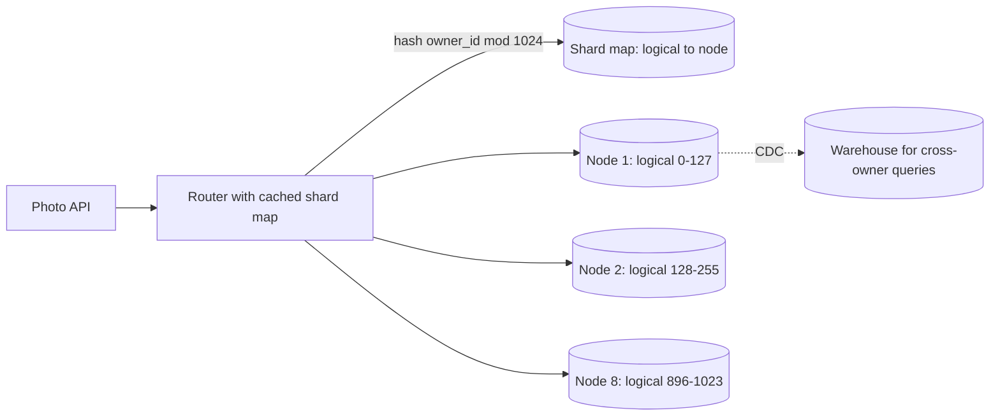

The photo service writes one metadata row per upload: 40M rows a day, 1,200 writes/s at peak, about 1 KB per row with indexes. The primary isn't busy — 24% of the 5,000 rows/s it sustained in a load test (illustrative, [§34](/c/system-design/34-sharding)) — but the table grows 14.6 TB a year, and old photos are still viewed, so archiving won't keep it small. At 12 months a full restore takes 20 hours. Meanwhile checkout's flash sale pushes 8,000 rows/s at a database that tops out at 5,000, and someone proposes sharding that too. One of these needs sharding; the other needs a queue. Sharding mechanics — logical shards, key choice, resharding, what you lose — are in [§34 Sharding](/c/system-design/34-sharding) and the theory in [§12](/c/system-design/12-replication-and-partitioning); this section is the decision.

:::key[First principle]
Reads scale by copying, writes by splitting ([§13.6](/c/system-design/13-scalability)): every replica applies every write, so only partitioning adds write capacity and storage. Shard when a **sustained** single-node ceiling — write rate, storage, or restore time — is within about a year and cheaper levers are spent. A **spike** above the ceiling for minutes is a queueing problem, not a partitioning one.
:::

## 46.1 The symptom, and how to diagnose it

- Write latency and replication lag grow with the data, not just with traffic.
- Storage growth puts the database past what you're willing to back up and restore.
- Index maintenance, vacuum or compaction can't keep up with the write rate.
- You've already batched, pruned indexes, archived cold rows and bought the bigger machine.

| Metric | How to get it | Shard when (rules of thumb) | Not when |
|---|---|---|---|
| Sustained write utilisation | Daily peak writes ÷ load-tested ceiling | > 50% and rising | Only a short spike exceeds it → queue (§47) |
| Months to storage ceiling | Ceiling ÷ monthly growth | < 12 | Old data is cold → archive |
| Restore / replica rebuild time | Size ÷ measured restore rate | Beyond your recovery-time objective | Smaller after archiving |
| Replication lag at peak | Replica metrics | Grows during every daily peak | Lag only on bulk jobs → throttle them |
| Peak ÷ average write rate | Write rate over a week | ~3× (daily cycle) | ≫ 10× for minutes: a spike |

## 46.2 Triage three write workloads

```python run
"""Shard, queue or neither? Triage three write workloads against one node's tested ceilings (§34)."""
import math

WRITE_CEIL, STORE_TB, RESTORE_MBS = 5_000, 10, 200    # rows/s, TB, MB/s - illustrative, as in §34
workloads = {  # name: (steady rows/s, peak rows/s, peak lasts (min), TB per year at 1 KB/row)
    "Pulse posts": (200, 600, 1_440, 7.3),            # 2 posts/user/day x 10M; peak 3x avg
    "Checkout flash sale": (200, 8_000, 10, 6.3),     # 4 rows/order: 50/s steady, 2,000/s for 10 min
    "Photo metadata": (400, 1_200, 1_440, 14.6),      # 40M rows/day; peak 3x avg
}
print(f"{'workload':20s} {'steady':>7s} {'peak':>6s} {'months to':>10s} {'restore':>8s}  verdict")
print(f"{'':20s} {'util':>7s} {'util':>6s} {'10 TB':>10s} {'at 1 yr':>8s}")
for name, (steady, peak, minutes, tb_yr) in workloads.items():
    months = STORE_TB / tb_yr * 12
    restore = tb_yr * 1e6 / RESTORE_MBS / 3600
    if peak > 0.7 * WRITE_CEIL and minutes < 60:
        verdict = "spike: queue it (§47)"
    elif steady > 0.5 * WRITE_CEIL or months < 12:
        verdict = "shard"
    else:
        verdict = "don't shard: archive, re-measure"
    print(f"{name:20s} {steady / WRITE_CEIL:7.0%} {peak / WRITE_CEIL:6.0%} {months:10.1f}"
          f" {restore:6.1f} h  {verdict}")

print("\nphoto metadata, 1,024 logical shards, double the nodes when a node would pass 2 TB:")
nodes, imp = 8, 20_001 / 419_887                      # bulk importer's share of a day (§34.3)
for month in (1, 6, 12, 13, 18, 24, 27, 36):
    tb = 14.6 * month / 12
    while tb / nodes > 2:
        nodes *= 2
    print(f"  month {month:>2}: {tb:4.1f} TB = {nodes:>2} x {tb / nodes:4.2f} TB, restore"
          f" {tb / nodes * 1e6 / RESTORE_MBS / 3600:3.1f} h (1 node: {tb * 1e6 / RESTORE_MBS / 3600:4.1f} h),"
          f" peak w/s per node {1_200 / nodes:3.0f}, importer's {1_200 * ((1 - imp) / nodes + imp):3.0f}")
print(f"\nlogical shards per node at 32 nodes: {1024 // 32}; data per logical shard at 36 months:"
      f" {14.6 * 3 / 1024 * 1e3:.0f} GB -> one move at 200 MB/s = {14.6 * 3 / 1024 * 1e6 / 200 / 60:.1f} min")
```

```output
workload              steady   peak  months to  restore  verdict
                        util   util      10 TB  at 1 yr
Pulse posts               4%    12%       16.4   10.1 h  don't shard: archive, re-measure
Checkout flash sale       4%   160%       19.0    8.8 h  spike: queue it (§47)
Photo metadata            8%    24%        8.2   20.3 h  shard

photo metadata, 1,024 logical shards, double the nodes when a node would pass 2 TB:
  month  1:  1.2 TB =  8 x 0.15 TB, restore 0.2 h (1 node:  1.7 h), peak w/s per node 150, importer's 200
  month  6:  7.3 TB =  8 x 0.91 TB, restore 1.3 h (1 node: 10.1 h), peak w/s per node 150, importer's 200
  month 12: 14.6 TB =  8 x 1.82 TB, restore 2.5 h (1 node: 20.3 h), peak w/s per node 150, importer's 200
  month 13: 15.8 TB =  8 x 1.98 TB, restore 2.7 h (1 node: 22.0 h), peak w/s per node 150, importer's 200
  month 18: 21.9 TB = 16 x 1.37 TB, restore 1.9 h (1 node: 30.4 h), peak w/s per node  75, importer's 129
  month 24: 29.2 TB = 16 x 1.82 TB, restore 2.5 h (1 node: 40.6 h), peak w/s per node  75, importer's 129
  month 27: 32.9 TB = 32 x 1.03 TB, restore 1.4 h (1 node: 45.6 h), peak w/s per node  38, importer's  93
  month 36: 43.8 TB = 32 x 1.37 TB, restore 1.9 h (1 node: 60.8 h), peak w/s per node  38, importer's  93

logical shards per node at 32 nodes: 32; data per logical shard at 36 months: 43 GB -> one move at 200 MB/s = 3.6 min
```

Three workloads, three answers:

- **Pulse posts: don't shard.** Writes peak at 12% of the ceiling and storage takes 16 months to reach 10 TB; archiving posts older than a year keeps the hot table near 7 TB ([§34.1](/c/system-design/34-sharding)).
- **Checkout: queue, don't shard.** 8,000 rows/s is 160% of the ceiling — for ten minutes. Steady load is 4%. Sixteen-fold sharding for a ten-minute spike buys N× the operations for a problem that a queue and a backlog solve ([§47](/c/system-design/47-write-spikes-queue)).
- **Photo metadata: shard.** Writes are fine, but storage crosses 10 TB in 8 months and a full restore grows past a day.

## 46.3 Before and after: photo metadata

:::example[Worked example · one primary vs 1,024 logical shards on 8 → 16 → 32 nodes]
**Before (month 12):** 14.6 TB on one primary. A restore or replica rebuild at 200 MB/s takes 20.3 h; by month 36, 60.8 h. Peak writes 1,200/s, 24% of the ceiling — fine, but every maintenance operation scales with the 14.6 TB.

**After:** `hash(owner_id) mod 1024` picks a logical shard; a table maps logical shards to nodes. Start with 8 nodes (128 logical shards each), double when a node would pass 2 TB — at month 13 and month 26. The largest restore stays ≤ 2.7 h, peak writes are 150/s per node (200/s on the node holding the bulk importer's shard, [§34.3](/c/system-design/34-sharding)), and each logical shard is ~43 GB at 36 months, so moving one takes minutes and can be paused or rolled back.

**What it costs:** 8–32× the backups, migrations and monitoring; a router with a cached shard map; "photo X" lookups need the shard number embedded in the photo id ([§52](/c/system-design/52-id-generator)); and cross-owner queries become scatter-gather.
:::

:::chart[Largest database to back up and restore: one node vs sharded (photo metadata, 14.6 TB/year)]{type="line" x="months" y="TB in one database" ylog="true" points="true" hmarks="10:single-node ceiling;2:per-node restore budget"}
month, one node, largest shard (8 -> 16 -> 32 nodes)
1, 1.22, 0.15
3, 3.65, 0.46
6, 7.30, 0.91
9, 10.95, 1.37
12, 14.60, 1.82
13, 15.82, 1.98
14, 17.03, 1.06
18, 21.90, 1.37
21, 25.55, 1.60
24, 29.20, 1.82
26, 31.63, 1.98
27, 32.85, 1.03
30, 36.50, 1.14
36, 43.80, 1.37
:::

## 46.4 The mechanism, in one paragraph

Route every query by a **shard key** that the dominant query contains (`owner_id` for the photo grid), hash it into many more **logical shards** than nodes (1,024), and keep a small table from logical shard to node. Each node is an independent primary with its own replicas, CPU, disk and failure domain, so write capacity and storage add up. Growing the fleet moves whole logical shards (copy, tail changes, fence, flip the map entry) instead of re-keying rows ([§34.5](/c/system-design/34-sharding)).



## 46.5 When to reach for it, and when not

- A sustained ceiling (writes > ~50%, storage or restore time within a year) after cheaper levers.
- One key dominates access — owner, tenant, conversation — so the hot queries stay on one shard.
- Growth is predictable enough to plan logical shards for years.

:::warn[When it is the wrong move]
- **Reads are the bottleneck.** Replicas and caches add read capacity without splitting anything ([§39](/c/system-design/39-read-heavy-replicas), [§42](/c/system-design/42-slow-reads-cache)).
- **The load is a spike.** Ten minutes at 160% is a queue (§47), not 16 shards.
- **The data is cold.** Archive old rows to object storage and keep the hot table small.
- **The hot queries are cross-entity.** Reporting and analytics belong in a warehouse fed by CDC; sharding makes them scatter-gather.
:::

| Option | Fixes | Doesn't fix | Photo metadata |
|---|---|---|---|
| **Shard by `owner_id`** | Write capacity, storage, restore time | Hot keys; cross-owner queries | Yes |
| Bigger machine | Writes and storage, once | Restore time grows with the data | Buys months, not years |
| Archive cold rows | Storage, restore time | Old data still read | No: old photos are viewed |
| Queue + steady consumers | Short write spikes | Sustained growth | No: not a spike |
| Batch writes | Per-write overhead | Storage | Helps a little; already done |
| Read replicas / cache | Read load | Writes, storage | Not the problem |

## 46.6 Trade-offs

- **Cross-shard queries** become application fan-out or a warehouse. `COUNT(*)` over all users is N queries; a 16-shard fan-out hits a 1%-slow shard on \(1 - 0.99^{16}\) ≈ 15% of requests ([§10.5](/c/system-design/10-latency-and-throughput)).
- **Cross-shard transactions** disappear. Keep invariants inside one owner; otherwise use a [saga](/c/system-design/31-sagas).
- **The key is nearly irreversible.** Re-keying migrates every row. Choose by the dominant query, spread and stability.
- **Hot keys don't spread.** Hashing evens keys, not traffic: a celebrity's reads or a bulk importer's writes stay on one shard. Cache hot reads; rate-limit bulk imports ([§44](/c/system-design/44-too-many-requests-rate-limit)).
- **Operations multiply.** N× backups, schema migrations and failure modes, plus a resharding process.

## 46.7 Failure modes

| Failure | What you see | Fix |
|---|---|---|
| Sharded too early | N× operations for 12% of one node's capacity | Shard on a measured, sustained ceiling |
| Timestamp-led key | All new writes on the newest shard | Hash the owner; time as a secondary column |
| Key missing from the hot query | Every page view fans out to all shards | Key = what the hot path filters on |
| `hash mod N` placement | Adding a node moves ~89% of rows | Logical shards or consistent hashing |
| Resharding without a fence | Writes lost to the old location | Fence, flip, verify |
| Even keys, uneven bytes | One node fills first | Move logical shards by size, not count |

## 46.8 Sizing it

| Knob | Photo metadata | Rule |
|---|---|---|
| Logical shards | 1,024 | ≥ 10× the largest node count you can imagine |
| Physical nodes | 8 → 16 (month 13) → 32 (month 26) | Largest node ≤ restore budget (2 TB ≈ 2.8 h) |
| Per-node write load | 150/s at 8 nodes, 200/s on the importer's | Keep < 50% of the tested ceiling |
| Data per logical shard | ~43 GB at 36 months | Small enough to move in minutes |
| Shard key | `hash(owner_id)`; shard id embedded in photo id | The grid query hits one shard |

## 46.9 Interview soundbite

> "Photo metadata doesn't need write capacity, it needs a smaller restore: 14.6 TB a year would be a 20-hour restore at one year. I'd hash owner_id into 1,024 logical shards on 8 nodes, double at about 2 TB per node, embed the shard in the photo id, and keep checkout unsharded — its 8,000 writes a second last ten minutes, which is a queue's job."

## 46.10 Check yourself

:::qa[Pulse grows 10×: 100M users, 6,000 post writes/s at peak, 73 TB a year. Shard?]
Yes: peak writes are 120% of a 5,000 rows/s ceiling and storage crosses 10 TB in under 2 months. Shard posts by `author_id` (the profile and fan-out queries are per author): 4 nodes put peak writes at 30% each, and storage, not writes, will set the node count as it grows.
:::

:::qa[A database sustains 5,000 writes/s. A nightly import pushes 20,000/s for 15 minutes; the rest of the day runs at 800/s. Shard?]
No. Steady load is 16% of the ceiling; the import is a spike. Throttle it through a queue at ~3,000/s: 18M rows take 100 minutes instead of 15, and production traffic never notices.
:::

:::qa[Why double from 8 to 16 nodes at month 13 rather than adding one node at a time?]
With logical shards either works — adding a ninth node moves ~1/9 of the data. Doubling keeps logical shards spread evenly (64 per node), halves every node's restore time in one step, and is a planned event every year rather than a monthly one.
:::

:::qa[Photo metadata is sharded by owner_id. A brand account bulk-imports 20,000 photos. What happens, and what do you do?]
Its logical shard's node takes ~200 writes/s instead of 150 at 8 nodes — fine at 4% of the ceiling. At 1,024 logical shards on many nodes the import is ~50× its shard's mean ([§34.3](/c/system-design/34-sharding)): rate-limit imports per owner and run them through a queue at a steady rate.
:::

Next: [Write spikes → buffer with a queue](/c/system-design/47-write-spikes-queue) — what checkout does with 8,000 writes a second for ten minutes.
