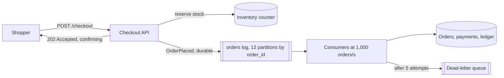

Checkout's flash sale brings 2,000 orders/s for ten minutes against a steady 50/s. Each order writes four rows — order, line items, payment record, ledger entry — so the database sees 8,000 rows/s, 160% of the 5,000 rows/s it sustained in a load test (illustrative, [§34](/c/system-design/34-sharding)), while its daily average is 4%. Shoppers time out, tap again, and the database spends the sale committing orders for people who have already left. The capacity exists — across the day the database has ~20× more than it needs — just not in those ten minutes. A queue moves the work from the minutes when it arrives to the minutes after, at the cost of the shopper waiting for a confirmation. Queue internals — at-least-once delivery, visibility timeouts, partitions, dead letters — are in [§25 Message queue](/c/system-design/25-message-queue); this section is when and how to use one for a write spike.

:::key[First principle]
While arrivals λ exceed service rate μ, the excess has to go somewhere. In a synchronous path it becomes waiting requests that time out, so the server does work nobody receives. In a queue it becomes **backlog**, growing at $\lambda - \mu$ and draining at $\mu$ afterwards, and every message waits about backlog ÷ μ. So: accept durably and fast, apply at a rate the database sustains, size μ from the delay you can accept, and make every consumer idempotent.
:::

## 47.1 The symptom, and how to diagnose it

- Traffic is bursty — a sale, a launch, a batch import, the top of the hour.
- Write latency and timeouts spike during bursts while the daily average utilisation is low.
- Requests that time out in a burst succeed when retried minutes later.
- Slow follow-up work (email, thumbnails, fraud checks) sits on the request path.

| Metric | How to get it | Queue it if (rules of thumb) | Look elsewhere if |
|---|---|---|---|
| Peak ÷ average write rate | Writes/s over a week | ≫ 3×, e.g. 40× for minutes | ~3× daily cycle: sustained, see [§46](/c/system-design/46-write-heavy-shard) |
| Spike duration × excess | (λ − μ) × T = backlog | Backlog drains within your delay target | Backlog never drains: capacity, not burst |
| Utilisation outside spikes | DB writes ÷ ceiling | < 50% | > 70%: shard or scale |
| Timeouts vs burst timing | Error rate overlaid on arrival rate | Errors only during bursts | Errors at all times: a bug or a dependency |
| Does the caller need the result now? | Read the API contract | "Accepted, confirming" is acceptable | Reads, auth checks, payment authorisation |

:::example[Worked example · reading checkout's numbers]
Peak ÷ average: 2,000 ÷ 50 = 40×. The database commits at most \(5{,}000 / 4\) = 1,250 orders/s, so during the sale the excess is 750 orders/s and ten minutes of it is 450,000 orders. Outside sales, utilisation is 4%. The shopper needs to know the order was *accepted* and stock reserved, not that the ledger row exists. Every row of the table says queue.
:::

## 47.2 Why the synchronous path collapses

With requests served first-in-first-out and an 8 s client timeout, the database falls behind by 750 orders every second. Once the backlog exceeds \(8 \times 1{,}250\) = 10,000 orders — after ~13 s — every order it commits has waited more than 8 s: the shopper has gone and half of them have tapped again, adding load. From then on the database is 100% busy and 0% useful until the backlog clears, long after the sale. The simulation runs the sale (minutes 5–15) through three designs:

```python run
"""Checkout's 10-minute flash sale against a database that commits 1,250 orders/s. Three designs."""
from collections import deque

STEADY, PEAK, START, SALE, END = 50, 2_000, 300, 600, 2_700   # orders/s and seconds, as in §25
DB = 5_000 // 4                       # 5,000 rows/s ceiling (illustrative) / 4 rows per order
DEADLINE = 8                          # the shopper's app gives up after 8 s and retries once


def run(design, mu=DB):
    q, useful, wasted, rejected, worst, clear, series = deque(), 0, 0, 0, 0, None, []
    retries = {}                                   # second -> shoppers retrying then
    for t in range(END):
        new = PEAK if START <= t < START + SALE else STEADY
        arrivals = new + retries.pop(t, 0)
        if design == "sync, shed above capacity":
            ok = min(arrivals, mu)
            useful, rejected = useful + ok, rejected + arrivals - ok
            series.append(ok)
            continue
        q.append([t, arrivals])
        done, budget = 0, mu
        while q and budget:
            take = min(budget, q[0][1])
            q[0][1], budget = q[0][1] - take, budget - take
            if design == "queue" or t - q[0][0] <= DEADLINE:
                useful, done, worst = useful + take, done + take, max(worst, t - q[0][0])
            else:
                wasted += take                     # committed, but the shopper left long ago
            if q[0][1] == 0:
                q.popleft()
        if design == "sync, FIFO" and q and q[0][0] <= t - DEADLINE:
            timed_out = q[t - DEADLINE - q[0][0]][1]           # still waiting after 8 s
            retries[t + 1] = retries.get(t + 1, 0) + timed_out // 2   # half of them try again
        if not q and clear is None and t >= START + SALE:
            clear = t
        series.append(done)
    return useful, wasted, rejected, worst, clear, series


shoppers = STEADY * (END - SALE) + PEAK * SALE
print(f"{shoppers:,} orders placed; database commits at most {DB:,}/s; consumers run at 1,000/s\n")
print("design                        completed for   committed for    rejected   worst     backlog")
print("                              a shopper       nobody (wasted)  (503)      wait      clear at")
for name, mu in (("sync, FIFO", DB), ("sync, shed above capacity", DB), ("queue", 1_000)):
    useful, wasted, rejected, worst, clear, _ = run(name, mu)
    print(f"{name:29s} {useful:>10,} {wasted:>15,} {rejected:>12,} {worst:>7,} s {clear or '-':>9} s")
```

```output
1,305,000 orders placed; database commits at most 1,250/s; consumers run at 1,000/s

design                        completed for   committed for    rejected   worst     backlog
                              a shopper       nobody (wasted)  (503)      wait      clear at
sync, FIFO                        63,700       2,482,020            0       8 s      2308 s
sync, shed above capacity        855,000               0      450,000       0 s         - s
queue                          1,305,000               0            0     600 s      1531 s
```

:::chart[Orders completed for a shopper per second, flash sale from minute 5 to 15 (simulated)]{type="line" x="minutes" y="useful orders per second" band="5:15:sale, 2,000 orders/s offered" hmarks="1250:database ceiling"}
minute, sync FIFO, sync + shed, queue
0, 50, 50, 50
4, 50, 50, 50
5, 471, 1250, 1000
6, 0, 1250, 1000
8, 0, 1250, 1000
10, 0, 1250, 1000
12, 0, 1250, 1000
14, 0, 1250, 1000
15, 0, 50, 1000
18, 0, 50, 1000
21, 0, 50, 1000
24, 0, 50, 1000
25, 0, 50, 550
26, 0, 50, 50
30, 0, 50, 50
34, 0, 50, 50
37, 0, 50, 50
38, 41, 50, 50
39, 50, 50, 50
44, 50, 50, 50
:::

What the numbers say:

- **Synchronous FIFO is the worst of all worlds.** 63,700 orders completed for a waiting shopper out of 1.3M; the database committed 2.5M orders for nobody — stale originals and their retries, and every retry that lands is a duplicate order without an [idempotency key](/c/system-design/37-duplicate-requests-idempotency). Ordinary steady-state shoppers fail for 23 minutes after the sale ends, until the backlog clears at t = 2,308 s.
- **Shedding is honest but loses sales.** Rejecting what exceeds 1,250/s with a fast 503 keeps the database useful: 855,000 orders, 450,000 turned away (more if they retry). That's [§44](/c/system-design/44-too-many-requests-rate-limit)'s tool, right when the excess is abuse — not when it's customers.
- **The queue completes every order.** Consumers apply 1,000 orders/s (4,000 rows/s, 80% of the ceiling, a load the database holds for the drain). The backlog peaks at 600,000, the longest wait is 10 minutes, and the queue is empty at t = 1,531 s — the same numbers as [§25.3](/c/system-design/25-message-queue).

## 47.3 The mechanism

The API does only what the shopper must see now — authenticate, reserve stock with an atomic decrement ([§59](/c/system-design/59-ticket-booking)), write `OrderPlaced` to a durable log keyed by `order_id` — and returns `202 Accepted` with the order in a *confirming* state. Consumers write the order rows, capture payment and update the ledger at their own pace, idempotently on the event id, and the app shows *confirmed* when they finish.



## 47.4 When to reach for it, and when not

- The caller can accept "received, confirming" — or the work after the write is follow-up the user doesn't wait for.
- Arrivals exceed capacity in bursts, and the backlog drains within an acceptable delay.
- Work must survive a consumer crash or a deploy, or several consumers need the same event.

:::warn[When it is the wrong move]
- **The caller needs the answer now:** reads, permission checks, payment *authorisation*.
- **Load is sustained above capacity.** The backlog never drains; a queue just moves the outage. Add capacity or [shard](/c/system-design/46-write-heavy-shard).
- **The work is trivially fast and the spike small.** A queue adds latency, duplicates and a component for nothing.
:::

| Option | Use when | Shopper sees | Flash sale result |
|---|---|---|---|
| **Durable queue + steady consumers** | Bursts that drain within the delay target | "Confirming", confirmed within minutes | All 1,305,000 orders, ≤ 10 min |
| Shed with 429/503 | Excess is abuse, or delay is unacceptable | Errors for the excess | 855,000 orders, 450,000 rejected |
| Waiting room in front | Demand is legitimate and must be paced before stock is reserved | A place in line | Similar to the queue, before checkout |
| Autoscale the database | Load ramps over hours | Nothing | Too slow for a 10-minute spike |
| Batch writes | Per-write overhead dominates | Nothing | Raises μ; combine with the queue |
| Shard | Sustained load or growth | Nothing | 16× operations for 10 minutes a week |

## 47.5 Trade-offs

- **Completion becomes asynchronous.** The API returns a pending state; the app needs a confirmation path (push, poll) and a way to cancel when a consumer can't complete the order. A product change, not just a technical one.
- **At-least-once delivery.** Duplicates will happen; consumers dedupe on the event id ([§9](/c/system-design/09-delivery-semantics)).
- **Ordering is per partition.** Key by `order_id` so an order's events stay in order; global order would cap throughput at one consumer.
- **Depth hides delay.** 600,000 messages is 10 minutes at 1,000/s and 10 seconds at 60,000/s. Alert on the age of the oldest message.
- **Another system to operate:** partitions, retention, consumer groups, rebalances.

## 47.6 Failure modes

| Failure | What you see | Fix |
|---|---|---|
| Consumers sized for the average | Age grows for hours after the spike | μ ≥ λT/(T + A) from the delay target |
| Consumers above the database's ceiling | The queue moves the overload to the database | Cap consumer concurrency at the DB's sustainable rate |
| Poison message | One partition's age climbs; others fine | Max attempts → dead-letter queue, alert, redrive |
| Visibility timeout below the processing tail | Duplicate processing mid-flight | Timeout ≫ p99, heartbeats, idempotent consumer ([§25.2](/c/system-design/25-message-queue)) |
| Alerting on depth | Pages on harmless bursts, silence on a stuck consumer | Alert on oldest-message age |
| Enqueue fails after stock is reserved | Stock held for orders that don't exist | Reservations expire unless confirmed; return an error so the shopper retries with the same key |

## 47.7 Sizing it

For a spike of rate λ lasting $T$ and a worst-case delay target $A$ ([§25.3](/c/system-design/25-message-queue) derives it):

$$
\mu \ge \frac{\lambda T}{T + A}, \qquad \text{backlog} = (\lambda - \mu)\,T, \qquad \text{drain time after the spike} = \frac{(\lambda - \mu)\,T}{\mu - \lambda_{\text{steady}}}
$$

| Target $A$ | μ needed | Rows/s at 4 per order | Feasible on one 5,000 rows/s database? |
|---:|---:|---:|---|
| 10 min | 1,000/s | 4,000 (80%) | Yes — the design above |
| 5 min | 1,333/s | 5,333 (107%) | No: batch writes or split the tables |
| 2 min | 1,667/s | 6,667 (133%) | No |

Consumers: by Little's law, 1,000 orders/s × ~20 ms per four-row transaction (illustrative) ≈ 20 in flight — a handful of consumer instances; 12 partitions leave room to double. Log retention of 7 days covers replay after a bad deploy ([§25.4](/c/system-design/25-message-queue)). Page when the oldest message is older than the target plus margin (here > 12 minutes), or still growing once the sale has ended.

## 47.8 Interview soundbite

> "Checkout reserves stock synchronously and enqueues OrderPlaced to a durable log, returning 202 with a confirming state. Consumers write the order and ledger at 1,000 orders a second — 80% of what the database sustains — so the ten-minute sale drains ten minutes later; consumers are idempotent on the event id, and I page on the age of the oldest message, not queue depth."

## 47.9 Check yourself

:::qa[Arrivals 2,000/s for 10 minutes, consumers 1,000/s, steady 50/s afterwards. When is the queue empty?]
Backlog at the end of the sale: \((2{,}000 - 1{,}000) \times 600\) = 600,000. It drains at \(1{,}000 - 50\) = 950/s: 632 s, so ~10.5 minutes after the sale — t ≈ 1,532 s, matching the simulation's 1,531 s.
:::

:::qa[In the synchronous design, after how long does the database stop doing useful work, and why?]
After about \(10{,}000 / 750\) ≈ 13 s. The backlog grows 750/s; once it holds more than 8 s × 1,250 = 10,000 orders, every order reaching the front has waited past the shopper's timeout. FIFO serves the oldest first, so it never catches up while load exceeds capacity.
:::

:::qa[Product wants confirmation within 2 minutes during the sale. What changes?]
μ ≥ \(2{,}000 \times 600 / 720\) ≈ 1,667 orders/s, 6,667 rows/s — beyond one database. Options: batch the four writes into fewer round trips, move the ledger to its own database, or pace demand with a waiting room so less work arrives per second.
:::

:::qa[Queue depth is 400,000 during a sale. Should someone be paged?]
Not on depth alone. Divide by drain rate: at 1,000/s it's ~400 s old, inside a 10-minute target. Page on the oldest message's age crossing ~12 minutes, or on age still rising after arrivals have dropped.
:::

Next: [Autocomplete](/c/system-design/48-autocomplete) — the case studies start here, combining these patterns under one set of requirements.
