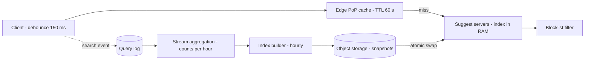

A user types `sys` into a search box and expects ten completions before the next keystroke. The request is on the typing path, so it must come back faster than a person types (~100–200 ms between keys), it is sent many times per search, and it is almost identical for everyone who types the same prefix. Those three facts — tight latency, multiplied volume, shared answers — decide the whole design.

:::key[First principle]
Autocomplete is a **read-only lookup of a precomputed answer per prefix**. Precompute the top-$k$ completions offline, keep the whole index in RAM on every serving node, and let the edge cache shared prefixes. The online path does no ranking; the offline path does no serving.
:::

## 48.1 Requirements

**Functional**

- Given a prefix (and a locale), return up to 10 completions ranked by recent popularity.
- Rankings follow trends within an hour; the long tail may refresh daily.
- Remove blocked terms everywhere within minutes of being blocked.
- Light personalisation: the user's own recent searches appear first.

**Non-functional**

- p99 under 100 ms end to end, including the network.
- Suggestions are an enhancement: on any failure return an empty list fast — never block the search itself.
- Read-heavy beyond anything else in the product: one search is several suggest calls.

**Out of scope:** spelling correction, full-text search ([§32](/c/system-design/32-search-index)), query understanding.

## 48.2 Estimates

Scale assumption (this case study's own, using [§2](/c/system-design/02-estimation) conventions): **100M DAU × 10 searches = 1B searches/day**. Each search sends one suggest request per *pause* in typing, so the real input is the client's debounce: wait $d$ ms after a keystroke, and send only if no new key arrived. The simulation uses an illustrative typing model — 10 characters typed per search on average, median 180 ms between keystrokes.

```python run
import numpy as np

rng = np.random.default_rng(7)
SEARCHES = 200_000
# Illustrative typing model: characters typed before submit/select ~ 1 + Poisson(9) (mean 10);
# gap between keystrokes lognormal, median 180 ms (search-box typing, not touch-typing).
typed = 1 + rng.poisson(9, SEARCHES)
gaps = [rng.lognormal(np.log(0.18), 0.6, n) for n in typed]   # gap after each keystroke (last = pause)


def requests_per_search(debounce_s, min_chars=1):
    """A request fires when the user pauses longer than the debounce after a keystroke."""
    total = 0
    for n, g in zip(typed, gaps):
        fire = g > debounce_s
        fire[-1] = True                      # the final prefix is always fetched
        fire[: min_chars - 1] = False
        total += fire.sum()
    return total / SEARCHES


print(f"mean characters typed per search: {typed.mean():.2f}")
print("debounce ms | requests/search | avg QPS | peak QPS")
SEARCHES_DAY = 1e9                           # 100M DAU x 10 searches
for d in (0, 50, 100, 150, 200, 300, 500):
    r = requests_per_search(d / 1000)
    avg = SEARCHES_DAY * r / 1e5
    print(f"{d:11d} | {r:15.2f} | {avg:7,.0f} | {3 * avg:8,.0f}")
r2 = requests_per_search(0.1, min_chars=2)
print(f"100 ms debounce + min 2 chars: {r2:.2f} requests/search")
```

```output
mean characters typed per search: 10.00
debounce ms | requests/search | avg QPS | peak QPS
          0 |           10.00 |  99,979 |  299,938
         50 |            9.85 |  98,493 |  295,480
        100 |            8.52 |  85,235 |  255,705
        150 |            6.57 |  65,741 |  197,222
        200 |            4.87 |  48,702 |  146,108
        300 |            2.78 |  27,754 |   83,261
        500 |            1.40 |  14,014 |   42,043
100 ms debounce + min 2 chars: 7.69 requests/search
```

:::chart[Suggest requests per search vs client debounce (simulated, median keystroke gap 180 ms)]{type="line" x="debounce (ms)" y="requests per search" ymin="0" marks="150:chosen 150 ms;180:median keystroke gap" points="true" yfmt="dec1"}
debounce ms, requests per search
0, 10.00
50, 9.85
100, 8.52
150, 6.57
200, 4.87
300, 2.78
500, 1.40
:::

The curve is an S, not a straight line: a debounce well below the typical gap between keys saves almost nothing (100 ms cuts only 15%), and one well above it makes suggestions appear late. **Pick the debounce near the median keystroke gap**: 150 ms gives 6.6 requests per search. Measure the gap from client telemetry — a mobile keyboard and a desktop keyboard differ.

:::example[Worked example · the numbers the design uses]
- Suggest traffic: \(10^9 \times 6.57 / 10^5\) ≈ **66,000 QPS average, ~200,000 at peak** (3×).
- Query log (for rankings): one event per completed search, \(10^9\)/day = 10,000/s average, 30,000 peak; at ~100 B each, **100 GB/day**.
- Suggestible queries: assume the 10M queries seen often enough in 30 days to be worth suggesting (illustrative threshold). §48.6 sizes their index at **~0.4 GB**.
- Response: 10 completions × ~30 B + framing ≈ 0.5–1 KB. 200,000 × 1 KB = 200 MB/s ≈ 1.6 Gbit/s at peak, spread over the edge.
:::

## 48.3 API

```http
GET /v1/suggest?q=sys&locale=en-GB&limit=10
    -> 200 {"q": "sys", "suggestions": [{"text": "system design", "score": 0.82}, ...]}
    Cache-Control: public, max-age=60
POST /v1/search-events   {"query": "system design", "locale": "en-GB", "ts": ...}  -> 202
```

`/suggest` is a cacheable GET keyed only by `(q, locale)`: no user ID, no cookies in the cache key. Personalisation happens on the client (§48.8). The search event is fire-and-forget into a log.

## 48.4 Data model

| Store | Key → value | Size | Written by |
| --- | --- | --- | --- |
| Query log (Kafka-style topic) | event → `(query, locale, ts)` | 100 GB/day, 7-day retention | Search frontends |
| `query_counts` | `(locale, query, hour)` → count | Rolling 30 days, aggregated | Stream job |
| Index snapshot | `(locale, version)` → immutable file | ~0.4 GB per locale | Hourly build |
| `blocklist` | term → reason | Thousands of rows | Trust & safety tools |

## 48.5 High-level design



The read path (left) touches no database. The write path (bottom) never touches a serving request. Each side can fail without breaking the other.

## 48.6 Deep dive: the index

A **trie** stores each character as a node, so all completions of `sys` sit in the subtree under `s → y → s`. Two refinements make it fast and small:

1. **Precompute the top 10 at each node.** Walking the subtree at query time costs its size — 7,235 completions under `t` in the simulation below. Storing the answer makes a lookup one walk of `len(prefix)` steps (or one hash probe on the prefix) plus a list read: microseconds.
2. **Compress.** A **radix tree** merges single-child chains into one edge; a node exists only where queries branch or end. Deep prefixes have few completions, so store top-10 lists only on nodes with more than 10 completions and scan the (tiny) subtree for the rest.

The block builds both over a synthetic corpus — 100,000 queries of 1–4 "words" from English letter frequencies, Zipf popularity (illustrative; real queries share even more prefixes) — checks the precomputed lists against brute force, and scales the counts to 10M queries.

```python run
from collections import Counter
import numpy as np

rng = np.random.default_rng(3)
# Synthetic corpus (illustrative): 30k "words" from English letter frequencies, queries of 1-4 words
LET = "etaoinshrdlcumwfgypbvkjxqz"
f = np.array([12.7, 9.1, 8.2, 7.5, 7.0, 6.7, 6.3, 6.1, 6.0, 4.3, 4.0, 2.8, 2.8, 2.4, 2.4,
              2.2, 2.0, 2.0, 1.9, 1.5, 1.0, 0.8, 0.2, 0.2, 0.1, 0.1]); f /= f.sum()
words = ["".join(rng.choice(list(LET), rng.integers(2, 11), p=f)) for _ in range(30_000)]
wp = 1 / np.arange(1, len(words) + 1); wp /= wp.sum()
queries = set()
while len(queries) < 100_000:
    n = rng.choice([1, 2, 3, 4], p=[0.3, 0.4, 0.2, 0.1])
    queries.add(" ".join(words[i] for i in rng.choice(len(words), n, p=wp)))
queries = sorted(queries)
count = dict(zip(rng.permutation(queries), 1e6 / np.arange(1, len(queries) + 1)))  # Zipf s=1

subtree = Counter(q[:i] for q in queries for i in range(1, len(q) + 1))
children = Counter(p[:-1] for p in subtree if len(p) > 1)
qset = set(queries)
radix = sum(1 for p in subtree if children[p] != 1 or p in qset)
K = 10
heavy = sum(1 for c in subtree.values() if c > K)
chars = sum(map(len, queries))
print(f"queries {len(queries):,}  avg length {chars / len(queries):.1f}  total chars {chars:,}")
print(f"trie nodes {len(subtree):,} ({len(subtree) / len(queries):.2f}/query)  "
      f"radix nodes {radix:,} ({radix / len(queries):.2f}/query)  "
      f"nodes with >{K} completions {heavy:,} ({heavy / len(queries):.2f}/query)")

top = {}                                     # top-K precompute: visit queries by popularity
for q in sorted(queries, key=count.get, reverse=True):
    for i in range(1, len(q) + 1):
        lst = top.setdefault(q[:i], [])
        if len(lst) < K:
            lst.append(q)
for p in ("t", "th", "tha"):              # check the precompute against a brute-force scan
    brute = sorted((q for q in queries if q.startswith(p)), key=count.get, reverse=True)[:K]
    print(f"prefix {p!r}: {subtree[p]:,} completions, stored top-{K} == brute force: {top[p] == brute}")

# Scale to 10M suggestible queries, linear in queries (an upper bound: sharing grows with size)
N = 10e6
str_b = N * chars / len(queries)             # query strings, 1 B/char in one flat array
node_b = N * radix / len(queries) * 16       # radix node: edge offset, child pointer, count
topk_b = N * heavy / len(queries) * K * 4    # top-K as 4-byte query ids, only on heavy nodes
naive = N * len(subtree) / len(queries) * (16 + K * 4 + 48)  # every char a node, object overhead
print(f"10M queries: strings {str_b / 1e9:.2f} GB + nodes {node_b / 1e9:.2f} GB + top-k "
      f"{topk_b / 1e9:.2f} GB = {(str_b + node_b + topk_b) / 1e9:.2f} GB; naive trie {naive / 1e9:.1f} GB")
```

```output
queries 100,000  avg length 16.5  total chars 1,653,744
trie nodes 892,395 (8.92/query)  radix nodes 131,124 (1.31/query)  nodes with >10 completions 8,517 (0.09/query)
prefix 't': 7,235 completions, stored top-10 == brute force: True
prefix 'th': 391 completions, stored top-10 == brute force: True
prefix 'tha': 17 completions, stored top-10 == brute force: True
10M queries: strings 0.17 GB + nodes 0.21 GB + top-k 0.03 GB = 0.41 GB; naive trie 9.3 GB
```

What the numbers decide:

- **Compression is 23×.** A character-per-node trie with per-object overhead is ~9 GB for 10M queries; a radix tree in flat arrays (strings in one byte array, nodes as offsets, top-10 lists as 4-byte query IDs) is ~0.4 GB. Node and object sizes are illustrative; the ratio is the point.
- **Only 1 node in 100 needs a stored list** (0.09 per query vs 8.92 trie nodes per query): most prefixes are deep and have ≤ 10 completions.
- **Replicate, don't shard.** 0.4 GB per locale fits in every server's RAM — even 40 locales is ~16 GB. Sharding by prefix would add a network hop and a hot shard (every query starts with one of ~26 letters), to save memory nobody needs. Shard only if the index outgrows one machine, and then by locale first.

:::tip[Build offline, serve immutable]
The builder writes a new snapshot file; servers download it, memory-map it, and swap a pointer. No locks on the read path, rollback is "load the previous version", and a server that restarts is warm as soon as the file is mapped.
:::

## 48.7 Deep dive: the edge cache does the heavy lifting

Every user who types `sys` in `en-GB` gets the same answer, so a CDN or edge proxy can serve it. How much it absorbs follows from [§7.4](/c/system-design/07-caching): a key requested at rate $r$ with TTL $T$ has hit ratio $rT/(1+rT)$. Summing over a Zipf distribution of prefixes (rank $i$ requested with probability $\propto i^{-s}$, assumed over 10M distinct prefixes) gives the PoP's hit rate:

$$
h(R, T) = \sum_{i=1}^{N} p_i \,\frac{R\,p_i\,T}{1 + R\,p_i\,T}, \qquad \text{origin QPS} = (1 - h)\cdot \text{peak QPS}
$$

```python run
import numpy as np

N = 10_000_000                       # distinct prefixes users request (illustrative)
rank = np.arange(1, N + 1, dtype=float)


def edge(R, T, s=1.0):
    """TTL cache at one PoP: prefix i arrives at rate R*p_i; hit ratio per key is rT/(1+rT) (§7.4)."""
    p = rank ** -s
    p /= p.sum()
    x = R * p * T
    cached = x / (1 + x)             # fraction of time each prefix sits in the cache
    return (p * cached).sum(), cached.sum()


print(f"top 1% of prefixes carry {(rank[:N // 100] ** -1).sum() / (rank ** -1).sum():.1%} of requests (s=1)")
print("TTL s | hit @1k/s | hit @10k/s | hit @50k/s | @10k/s s=0.8 | @10k/s s=1.2 | entries @10k/s")
for T in (1, 5, 15, 30, 60, 120, 300, 600):
    h1, _ = edge(1_000, T)
    h10, n10 = edge(10_000, T)
    h50, _ = edge(50_000, T)
    h08, _ = edge(10_000, T, 0.8)
    h12, _ = edge(10_000, T, 1.2)
    print(f"{T:5d} | {h1:9.3f} | {h10:10.3f} | {h50:10.3f} | {h08:12.3f} | {h12:12.3f} | {n10:14,.0f}")

PEAK, POPS = 197_000, 20             # peak suggest QPS from the estimator, spread over 20 PoPs
for T in (30, 60):
    h, n = edge(PEAK / POPS, T)
    print(f"TTL {T} s at {PEAK / POPS:,.0f}/s per PoP: hit {h:.1%}, origin {PEAK * (1 - h):,.0f} QPS,"
          f" {n:,.0f} entries x 1 KB = {n / 1e6:.2f} GB per PoP")
```

```output
top 1% of prefixes carry 72.4% of requests (s=1)
TTL s | hit @1k/s | hit @10k/s | hit @50k/s | @10k/s s=0.8 | @10k/s s=1.2 | entries @10k/s
    1 |     0.280 |      0.418 |      0.514 |        0.102 |        0.760 |          5,823
    5 |     0.376 |      0.514 |      0.610 |        0.170 |        0.825 |         24,299
   15 |     0.442 |      0.580 |      0.676 |        0.234 |        0.861 |         63,033
   30 |     0.483 |      0.621 |      0.717 |        0.285 |        0.880 |        113,627
   60 |     0.525 |      0.663 |      0.758 |        0.344 |        0.897 |        202,408
  120 |     0.566 |      0.704 |      0.799 |        0.412 |        0.912 |        355,253
  300 |     0.621 |      0.758 |      0.851 |        0.517 |        0.930 |        725,397
  600 |     0.663 |      0.799 |      0.887 |        0.606 |        0.942 |      1,207,977
TTL 30 s at 9,850/s per PoP: hit 62.0%, origin 74,793 QPS, 112,189 entries x 1 KB = 0.11 GB per PoP
TTL 60 s at 9,850/s per PoP: hit 66.2%, origin 66,635 QPS, 199,905 entries x 1 KB = 0.20 GB per PoP
```

:::chart[Edge hit rate vs TTL for one PoP (Zipf prefixes over 10M, model)]{type="line" x="TTL (s)" y="hit rate" xlog="true" yfmt="pct" ymin="0" ymax="1" points="true" marks="60:chosen TTL" dash="10k/s s=0.8,10k/s s=1.2"}
TTL s, 1k/s, 10k/s, 50k/s, 10k/s s=0.8, 10k/s s=1.2
1, 0.280, 0.418, 0.514, 0.102, 0.760
5, 0.376, 0.514, 0.610, 0.170, 0.825
15, 0.442, 0.580, 0.676, 0.234, 0.861
30, 0.483, 0.621, 0.717, 0.285, 0.880
60, 0.525, 0.663, 0.758, 0.344, 0.897
120, 0.566, 0.704, 0.799, 0.412, 0.912
300, 0.621, 0.758, 0.851, 0.517, 0.930
600, 0.663, 0.799, 0.887, 0.606, 0.942
:::

Reading it:

1. **Skew decides more than TTL.** At 10,000 req/s and 60 s, hit rate is 34% at $s = 0.8$, 66% at $s = 1.0$, 90% at $s = 1.2$. Short prefixes are shared by every query that passes through them, which pushes real prefix traffic towards the skewed end — but fit $s$ from your own logs before promising a number.
2. **Busier PoPs hit more.** Hit rate depends on $R\,T$: fewer, larger PoPs (or a regional shield cache behind them) beat many small ones.
3. **The cache is tiny**: ~200,000 entries × 1 KB = 0.2 GB per PoP at 60 s.
4. **Origin load**: with $s = 1$ and a 60 s TTL, 66% of 197,000 peak is absorbed and the origin serves ~67,000 QPS. An in-memory lookup is cheap; at an illustrative 20,000 QPS per server run at 60%, that is \(\lceil 66{,}635 / 12{,}000 \rceil = 6\) servers + 2 spares = **8 per region-set** — and each holds the full 0.4 GB index.

:::warn[One cookie destroys the cache]
If the cache key includes a user ID, a session cookie or an unnormalised query (`Sys`, `sys `, `sys`), the hit rate collapses toward the one-user curve. Normalise `q` (lowercase, trim, collapse spaces) on the client *and* at the edge, and keep personal data out of the request.
:::

## 48.8 Deep dive: freshness and ranking

Rankings come from counts in the query log, aggregated per hour by a stream job ([§17](/c/system-design/17-batch-and-stream)). A score that favours recent traffic without forgetting steady favourites is an **exponentially decayed count**:

$$
\text{score}(q) = \sum_{h \ge 0} c_{q,h} \cdot 2^{-h / \tau}
$$

where $c_{q,h}$ is the count $h$ hours ago and $\tau$ the half-life. A query searched steadily $c$ times an hour converges to $c / (1 - 2^{-1/\tau})$.

:::example[Worked example · how fast a trend overtakes a favourite]
A steady query runs at 200 searches/hour. A new one jumps to 1,000/hour.

- $\tau$ = 24 h: the steady query's score is \(200 / (1 - 2^{-1/24}) \approx 7{,}025\). The trend passes it after **8 hours** (score 7,247).
- $\tau$ = 2 h: the steady score is only 683; the trend passes it in the **first hour** (1,000).

Short half-lives make suggestions jumpy and easy to game; long ones miss breaking news. A common answer is two layers — a daily build with a long half-life for the tail, and an hourly build over the hottest prefixes with a short one — merged by weight.
:::

The build is a batch job over `query_counts`: compute scores, drop blocked and rare queries, build the radix tree and top-10 lists, write a snapshot. At 10M queries and ~0.4 GB it is minutes of work (illustrative), so hourly is comfortable. **Blocked terms** are filtered at build time *and* by a small in-memory set at serve time, so a newly blocked term disappears on the next config push rather than the next build.

**Personalisation** stays off the shared path: the client keeps the user's last ~50 searches locally, and merges those matching the prefix above the shared top 10. The edge cache keeps working.

## 48.9 Latency budget

| Stage | Budget (illustrative) | How |
| --- | ---: | --- |
| Client debounce | 150 ms *before* the request | Overlaps typing; not counted in the 100 ms |
| Client → edge PoP RTT | 20–40 ms | Nearby PoP, reused TLS connection ([§11](/c/system-design/11-networking)) |
| Edge hit | < 1 ms | 66% of requests stop here |
| Edge → origin (same region) | 1–5 ms | Origin in every region; a cross-region miss would add ~150 ms |
| Lookup + filter + serialise | < 1 ms | Hash probe + 10-item list |
| Render | 10–20 ms | Client |
| Headroom for p99 | ~30 ms | Mobile networks, GC pauses |

Two client rules keep the path honest: **cancel** the in-flight request when a new one is sent, and **discard** any response whose prefix is no longer what is in the box — otherwise a slow `sy` response overwrites the fresh `sys` one.

## 48.10 Bottlenecks and failure modes

| Failure | Mechanism | Detect with | Mitigation |
| --- | --- | --- | --- |
| Debounce removed in a client release | 6.6 → 10 requests/search: +52% load | Requests per search by client version | Server-side rate limit per client; staged rollout |
| Edge hit rate drops (66% → 30%) | Origin load 67k → 138k QPS | Edge hit-rate alert | Normalise keys; strip cookies; shield cache |
| Bad snapshot (empty or corrupt) | Every prefix returns garbage | Build checks: row counts, sample queries vs previous | Keep last good version; refuse to swap on diff > threshold |
| Aggregation lags | Rankings go stale | Consumer lag ([§25](/c/system-design/25-message-queue)) | Serving unaffected; alert only if > a few hours |
| Ranking poisoning (bots) | Bot searches lift a term | Spikes from few users/IPs | Count distinct users, not events; cap per user |
| Suggest servers slow | Search box feels laggy | p99 at origin | Short client timeout (~300 ms) → show nothing |

## 48.11 Trade-offs

| Decision | Choice | Alternative | Why |
| --- | --- | --- | --- |
| Index location | Full replica in RAM per server | Prefix-sharded cluster | 0.4 GB fits; sharding adds a hop and hot letters |
| Ranking freshness | Hourly hot layer + daily tail | Real-time counters | Minutes of staleness are invisible; real-time costs a stateful serving tier |
| Edge TTL | 60 s | 5 s / 600 s | 66% hit at 60 s; 600 s adds only ~14 points and delays block removals |
| Personalisation | Client-side merge | Per-user server results | Keeps the response cacheable |
| Debounce | 150 ms (≈ median gap) | 100 ms / 300 ms | 100 ms saves 15%; 300 ms makes suggestions feel late |

## 48.12 What I'd say in 45 minutes

1. **(5 min) Requirements**: top-10 per prefix, p99 < 100 ms, trends within an hour, failure = empty list.
2. **(8 min) Estimates**: 1B searches/day; debounce at ~150 ms gives 6.6 requests/search → 66k QPS average, 200k peak. Index: 10M queries ≈ 0.4 GB as a radix tree with top-10 at the ~1% of nodes that need it.
3. **(5 min) API + design**: cacheable `GET /suggest?q=&locale=`; edge → stateless suggest servers with the index in RAM; query log → stream counts → hourly build → snapshot swap.
4. **(15 min) Deep dives**: trie vs radix vs flat arrays (23× smaller); why replicate not shard; edge hit $h = \sum p_i\,rT/(1+rT)$ → 66% at 60 s, origin ~67k QPS, 8 servers; decayed scores with a 24 h half-life let a 5× trend overtake in 8 hours.
5. **(7 min) Failures and trade-offs**: bad snapshot guarded by diff checks; cookies killing the cache; bot poisoning counted by distinct users.
6. **(5 min) Extensions**: per-locale indexes, spelling correction, typo-tolerant prefixes.

## 48.13 Check yourself

:::qa[Product asks to drop the debounce "to feel snappier". What happens to load?]
From the simulation, 0 ms debounce sends 10 requests per search instead of 6.57: average QPS goes from 65,741 to ~100,000 and peak from ~197,000 to ~300,000 (+52%). With a 66% edge hit rate the origin goes from ~67,000 to ~102,000 QPS, so the 8-server fleet needs ~11. Most of the extra requests are for prefixes the user types past within 180 ms, so the user sees little difference.
:::

:::qa[Why not store the top 10 at every trie node?]
Because 99% of nodes are deep prefixes with ≤ 10 completions (0.09 heavy nodes per query vs 8.92 nodes per query). Their answer is the whole subtree, found by a short scan. Storing lists everywhere would multiply the top-k storage ~100× for no speed gain.
:::

:::qa[Your logs show prefix popularity with s = 0.8, not 1.0. What changes?]
At 10,000 req/s per PoP and a 60 s TTL, edge hit rate falls from 66% to 34%: origin load rises from ~67,000 to ~130,000 QPS at peak, roughly doubling the origin fleet. Levers: a regional shield cache (raises the effective $R$), a longer TTL for short prefixes only (they change slowly), and checking key normalisation — unnormalised keys look like lower skew.
:::

:::qa[A term must be removed from suggestions now. How long does it take, and how do you make it faster?]
Without a serve-time filter: up to the next build (an hour) plus the edge TTL (60 s). With the in-memory blocklist pushed as config, it disappears from origin responses within seconds; cached edge responses still serve it for up to 60 s unless you purge the affected prefixes — purge by prefix list, since the blocked term appears under each of its prefixes.
:::

Next: [§49 Design a chat system](/c/system-design/49-chat) — the opposite shape: every message is unique, pushed, and must not be lost.
