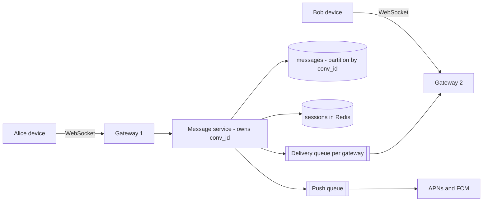
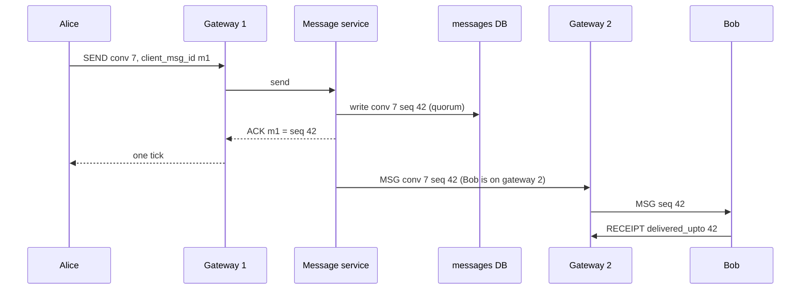

Alice sends "on my way" to a family group of eight. Her phone shows one tick when the server has it, two when it reaches the others' devices, blue when they read it. Bob's phone was in a tunnel; when it reconnects it must show the message in the right place, exactly once, even though the server may have pushed it twice. Doing that for 50 million people a day is mostly a question of where sequence numbers come from, how many sockets one machine holds, and what happens when one of those machines dies.

:::key[First principle]
Make **order a property of one conversation**, not of the system: a single writer per conversation assigns a gap-free `seq`. Then delivery can be cheap and unreliable — at-least-once, any order, any path — because the client sorts by `seq`, drops duplicates, and fetches the gaps it can see.
:::

## 49.1 Requirements

**Functional**

- 1:1 and group conversations (up to 500 members).
- Real-time delivery to online devices; push notification otherwise.
- Multiple devices per user, each with full history.
- Delivery and read receipts; typing indicators and presence (best effort).

**Non-functional**

- An acknowledged message is never lost (durable before ack).
- Every member sees a conversation in the same order.
- p99 under ~500 ms from send to delivery when both sides are online in the same region.
- Duplicates on the wire are allowed; duplicates on screen are not.

**Out of scope:** end-to-end encryption key exchange, media upload (it goes through [object storage](/c/system-design/26-object-storage) and the message carries a URL), broadcast channels with 100k+ followers.

## 49.2 Estimates

Scale assumption, from the [§2](/c/system-design/02-estimation) check-yourself example: **50M DAU × 40 messages/day**. The group mix, message size, online share and per-socket memory are illustrative and labelled in the code.

```python run
import numpy as np

rng = np.random.default_rng(11)
DAU, MSGS, MSG_B = 50e6, 40, 200          # §2: 50M DAU x 40 messages; 200 B stored per message (illustrative)
day = DAU * MSGS
avg, peak = day / 1e5, 3 * day / 1e5
print(f"messages {day:,.0f}/day -> {avg:,.0f} avg, {peak:,.0f} peak writes/s")
print(f"storage {day * MSG_B / 1e9:,.0f} GB/day, {day * MSG_B * 365 / 1e12:,.0f} TB/yr, x3 replicas "
      f"{3 * day * MSG_B * 365 / 1e12:,.0f} TB/yr")

# Fan-out: 70% of messages are 1:1; 30% go to groups, sizes 3..500 with P(size) ~ size^-2 (illustrative)
sizes = np.arange(3, 501)
pg = sizes ** -2.0; pg /= pg.sum()
group = rng.choice(sizes, 1_000_000, p=pg)
recips = 0.7 * 1 + 0.3 * (group - 1).mean()
print(f"mean group size {group.mean():.1f}; recipients per message {recips:.2f}; "
      f"messages to groups >100: {0.3 * (group > 100).mean():.2%}")
deliv = peak * recips
ONLINE = 0.6                              # share of recipients connected when a message lands (illustrative)
print(f"peak deliveries {deliv:,.0f}/s: {ONLINE * deliv:,.0f} over sockets, {(1 - ONLINE) * deliv:,.0f} push/s")

# Receipts: naive = delivered + read per recipient per message; watermark = 'read up to seq' per open
naive = 2 * deliv
BATCH = 5                                 # messages a reader catches up on per conversation open (illustrative)
print(f"receipts at peak: per-message {naive:,.0f}/s vs watermarks {naive / BATCH:,.0f}/s")

# Connections: 20% of DAU online at peak; memory per socket illustrative (kernel buffers + TLS + session)
CONN = 0.2 * DAU
per_conn = {"kernel TCP buffers": 8e3, "TLS state": 10e3, "session + outbound queue": 12e3}
mem = sum(per_conn.values())
print(f"concurrent sockets {CONN:,.0f} x {mem / 1e3:.0f} KB = {CONN * mem / 1e9:,.0f} GB fleet-wide")
for per_gw in (50_000, 200_000, 1_000_000):
    n = int(np.ceil(CONN / per_gw))
    print(f"  {per_gw:>9,} sockets/gateway: {n:>3} gateways, {per_gw * mem / 1e9:5.1f} GB RAM each, "
          f"a crash reconnects {per_gw:,} clients")
HB = 30                                   # heartbeat interval, s
print(f"heartbeats every {HB} s: {CONN / HB:,.0f}/s fleet, {200_000 / HB:,.0f}/s per 200k-socket gateway")
```

```output
messages 2,000,000,000/day -> 20,000 avg, 60,000 peak writes/s
storage 400 GB/day, 146 TB/yr, x3 replicas 438 TB/yr
mean group size 13.5; recipients per message 4.45; messages to groups >100: 0.61%
peak deliveries 266,895/s: 160,137 over sockets, 106,758 push/s
receipts at peak: per-message 533,790/s vs watermarks 106,758/s
concurrent sockets 10,000,000 x 30 KB = 300 GB fleet-wide
     50,000 sockets/gateway: 200 gateways,   1.5 GB RAM each, a crash reconnects 50,000 clients
    200,000 sockets/gateway:  50 gateways,   6.0 GB RAM each, a crash reconnects 200,000 clients
  1,000,000 sockets/gateway:  10 gateways,  30.0 GB RAM each, a crash reconnects 1,000,000 clients
heartbeats every 30 s: 333,333/s fleet, 6,667/s per 200k-socket gateway
```

| Quantity | Value | What it decides |
| --- | ---: | --- |
| Message writes | 20,000/s avg, 60,000/s peak | Partitioned store; a single primary is out |
| Storage | 146 TB/yr per copy, 438 TB/yr with 3 replicas | ~21 nodes per year at 21 TB usable ([§2](/c/system-design/02-estimation)); tier old history |
| Deliveries | 4.45 per message → 267,000/s peak | Fan-out on write to connections, not to storage |
| Push notifications | 107,000/s peak | Batched push service with its own queue |
| Open sockets | 10M at peak, 300 GB of RAM | 50 gateways at 200k sockets each (+ spares) |
| Receipts | 534,000/s naive → 107,000/s as watermarks | Watermarks (§49.9) |

The write path is dominated by **fan-out and receipts, not by messages**: one message produces 4.45 deliveries and up to 9 receipts.

## 49.3 API

The client holds one WebSocket ([§11](/c/system-design/11-networking)) per device and speaks a small frame protocol; history and setup use HTTP.

```text
client -> server   SEND     {conv_id, client_msg_id, body}
server -> client   ACK      {client_msg_id, seq, server_ts}           # one tick
server -> client   MSG      {conv_id, seq, sender, body, server_ts}
client -> server   RECEIPT  {conv_id, delivered_upto, read_upto}      # watermarks, not per message
client -> server   SYNC     {cursors: {conv_id: last_seq, ...}}       # after reconnect
both               PING / PONG every 30 s
```

```http
GET  /v1/conversations?updated_since=...            -> conversations with last_seq
GET  /v1/conversations/{id}/messages?before_seq=&limit=50
POST /v1/conversations  {members[]}                  -> {conv_id}
```

## 49.4 Data model

| Table | Partition key → clustering | Columns | Notes |
| --- | --- | --- | --- |
| `messages` | `conv_id` → `seq` desc | sender, body, client_msg_id, server_ts | One partition per conversation; wide-column store |
| `conversations` | `conv_id` | type, members, last_seq | Members cached; groups ≤ 500 |
| `user_conversations` | `user_id` → `last_activity` desc | conv_id, last_seq, read_upto, muted | The chat list; updated per message for each member |
| `sessions` | `user_id` → `device_id` | gateway_id, connected_at | In Redis with a 60 s TTL refreshed by heartbeat |
| `send_dedupe` | `(conv_id, client_msg_id)` | seq | TTL 24 h ([§22](/c/system-design/22-idempotency)) |

A message's identity is `(conv_id, seq)`. `client_msg_id` is generated once on the sender's device and makes `SEND` idempotent; a time-ordered global ID ([§52](/c/system-design/52-id-generator)) is not needed for ordering, though one can be added for cross-conversation search.

## 49.5 High-level design





The order on the sender's side is **persist, then ack, then deliver**. If the service crashes after the write but before the ack, Alice's client resends `m1`; the dedupe table returns seq 42 instead of writing seq 43.

## 49.6 Deep dive: 10 million sockets

A WebSocket costs memory whether or not it carries traffic: kernel send/receive buffers, TLS state, and the gateway's per-session data and outbound queue. The estimate uses ~30 KB per socket (illustrative — measure it with a load test that opens idle connections and reads RSS). That gives **300 GB** across the fleet: memory is not what limits a gateway. What does:

- **Blast radius.** A crashed gateway disconnects all its clients at once. At 200,000 sockets per gateway, 50 gateways (+ ~10% spares) hold 10M, and one crash means 200,000 reconnects.
- **Per-socket work.** Heartbeats every 30 s are 6,667/s per gateway; deliveries are 267,000/s ÷ 50 ≈ 5,300/s per gateway at peak. Both are fine; the reconnect storm is not.
- **Deploys.** Rolling 50 gateways means draining 200,000 sockets 50 times. Drain gradually (close 1–2% of sockets per second with a "reconnect elsewhere" frame) instead of killing the process.

The routing table is `user → (device → gateway)` in Redis with a TTL: the message service looks up each recipient and puts the message on that gateway's delivery queue. A socket is pinned to one gateway, so there is nothing to balance — only to route.

**The reconnect storm.** When a gateway dies, its 200,000 clients reconnect, re-authenticate and send `SYNC`. Suppose the session/sync service can absorb 20,000 reconnects/s (illustrative); the simulation compares three client behaviours.

```python run
import numpy as np

rng = np.random.default_rng(5)
CLIENTS, CAP, SECS = 200_000, 20_000, 60  # one gateway dies; resume service takes 20k reconnects/s (illustrative)


def storm(first_delay, backoff):
    """Each second the service accepts up to CAP attempts; the rest fail and retry later."""
    t = first_delay(CLIENTS)
    tries = np.zeros(CLIENTS, int)
    attempts, done_at = np.zeros(SECS), None
    pending = np.ones(CLIENTS, bool)
    for s in range(SECS):
        now = pending & (t < s + 1)
        idx = np.flatnonzero(now)
        attempts[s] = len(idx)
        ok = rng.permutation(idx)[:CAP]
        pending[ok] = False
        fail = np.setdiff1d(idx, ok)
        tries[fail] += 1
        t[fail] = s + 1 + backoff(tries[fail])
        if done_at is None and not pending.any():
            done_at = s + 1
    return attempts, done_at


cases = {
    "at once, retry next second": (lambda n: rng.uniform(0, 1, n), lambda k: np.zeros(len(k))),
    "at once, backoff + jitter": (lambda n: rng.uniform(0, 1, n),
                                  lambda k: rng.uniform(0, np.minimum(30, 2.0 ** k))),
    "spread 0-10 s, backoff + jitter": (lambda n: rng.uniform(0, 10, n),
                                        lambda k: rng.uniform(0, np.minimum(30, 2.0 ** k))),
}
res = {}
for name, (d, b) in cases.items():
    a, done = storm(d, b)
    res[name] = a
    print(f"{name:32s} peak attempts {a.max():>7,.0f}/s  rejected {a.sum() - CLIENTS:>9,.0f}"
          f"  all back after {done} s")
print("second, " + ", ".join(res))
for s in range(0, 25, 2):
    print(f"{s}, " + ", ".join(f"{res[k][s]:.0f}" for k in res))
```

```output
at once, retry next second       peak attempts 200,000/s  rejected   900,000  all back after 10 s
at once, backoff + jitter        peak attempts 200,000/s  rejected   404,065  all back after 37 s
spread 0-10 s, backoff + jitter  peak attempts  20,241/s  rejected     1,152  all back after 12 s
second, at once, retry next second, at once, backoff + jitter, spread 0-10 s, backoff + jitter
0, 200000, 200000, 20080
2, 160000, 107337, 19738
4, 120000, 39866, 19957
6, 80000, 26958, 20135
8, 40000, 9596, 20119
10, 0, 9687, 186
12, 0, 5617, 0
14, 0, 1093, 0
16, 0, 509, 0
18, 0, 519, 0
20, 0, 467, 0
22, 0, 167, 0
24, 0, 4, 0
```

:::chart[Reconnect attempts per second after a 200,000-socket gateway dies (capacity 20,000/s, simulated, every 2 s)]{type="line" x="seconds after the crash" y="reconnect attempts per second" yfmt="int" hmarks="20000:service capacity" dash="spread 0-10 s + backoff"}
second, at once + retry next second, at once + backoff, spread 0-10 s + backoff
0, 200000, 200000, 20080
2, 160000, 107337, 19738
4, 120000, 39866, 19957
6, 80000, 26958, 20135
8, 40000, 9596, 20119
10, 0, 9687, 186
12, 0, 5617, 0
14, 0, 1093, 0
16, 0, 509, 0
18, 0, 519, 0
20, 0, 467, 0
22, 0, 167, 0
24, 0, 4, 0
:::

The model is generous — it treats a rejected attempt as free. In reality each one costs a TCP and TLS handshake and an auth check, so "everyone retries every second" hammers the service with 900,000 wasted attempts and 10× its capacity in the first second; with real rejection costs that is how a recovery turns into an outage. Backoff alone cuts the waste by half but stretches recovery to 37 s, because unlucky clients back off for up to 30 s. **Spreading the first reconnect over 10 s** (the server sends the window with the close frame, or clients add jitter on their own) keeps arrivals at capacity, wastes 1,152 attempts and is done in 12 s — the floor is 200,000 ÷ 20,000 = 10 s. The general machinery is in [§30 Retry](/c/system-design/30-retry).

## 49.7 Deep dive: ordering and sequence numbers

Global order is expensive and useless; users only compare messages within a conversation. So each conversation has **one writer** — the message-service instance that owns its `conv_id` (by consistent hashing, [§64](/c/system-design/64-consistent-hashing)) — which assigns `seq = last_seq + 1` and writes `(conv_id, seq)`. A busy group sends a few messages per second, so one writer per conversation is never a throughput limit; 60,000 messages/s are spread over millions of conversations.

Two rules keep it correct when ownership moves (deploy, crash):

- The new owner reads `last_seq` from the database before accepting writes.
- The write is conditional — "insert seq 42 only if absent" — so a stale former owner cannot write a second seq 42. That is a fencing check ([§21](/c/system-design/21-distributed-locks)).

The client side turns a gap-free `seq` into exactly-once display. The block simulates a conversation of 1,000 messages where 5% of acks are lost (the sender retries), and the push path drops 3%, duplicates 5% and reorders by up to ±3 positions.

```python run
import random

random.seed(4)


class Conversation:
    """Server side: one writer per conversation assigns seq; client_msg_id makes sends idempotent."""
    def __init__(self):
        self.seq, self.log, self.seen = 0, [], {}

    def send(self, client_msg_id, text):
        if client_msg_id in self.seen:              # sender retried after a lost ack
            return self.seen[client_msg_id]
        self.seq += 1
        self.log.append((self.seq, text))
        self.seen[client_msg_id] = self.seq
        return self.seq


class Client:
    """Receiver: applies messages in seq order, dedupes, fetches gaps from history."""
    def __init__(self, conv):
        self.conv, self.applied, self.buffer = conv, 0, {}
        self.dupes = self.gap_fetches = 0

    def receive(self, seq, text):
        if seq <= self.applied or seq in self.buffer:
            self.dupes += 1
            return
        self.buffer[seq] = text
        while self.applied + 1 in self.buffer:
            self.applied += 1
            del self.buffer[self.applied]

    def sync(self):                                 # gap timer or reconnect: range-fetch what is missing
        missing = [(s, t) for s, t in self.conv.log[self.applied:] if s not in self.buffer]
        self.gap_fetches += len(missing)
        for seq, text in missing:
            self.receive(seq, text)


conv, retries = Conversation(), 0
for i in range(1_000):
    cid = f"m{i}"
    conv.send(cid, f"hello {i}")
    if random.random() < 0.05:                      # 5% of acks lost: the sender retries
        retries += 1
        assert conv.send(cid, f"hello {i}") == i + 1
print(f"sends {1_000 + retries} (incl. {retries} retries), stored {len(conv.log)}, last seq {conv.seq}")

bob = Client(conv)
wire = []
for seq, text in conv.log:                          # at-least-once push: drops, dupes, reordering
    if random.random() < 0.03:
        continue                                    # lost (never pushed)
    wire.append((seq + random.uniform(-3, 3), seq, text))
    if random.random() < 0.05:
        wire.append((seq + random.uniform(-3, 3), seq, text))
for _, seq, text in sorted(wire):
    bob.receive(seq, text)
print(f"pushed {len(wire)}, applied in order {bob.applied}, buffered behind a gap {len(bob.buffer)},"
      f" dupes dropped {bob.dupes}")
bob.sync()
print(f"after sync: applied {bob.applied}, buffered {len(bob.buffer)}, gaps fetched {bob.gap_fetches}")
```

```output
sends 1055 (incl. 55 retries), stored 1000, last seq 1000
pushed 1010, applied in order 17, buffered behind a gap 952, dupes dropped 41
after sync: applied 1000, buffered 0, gaps fetched 31
```

- **Idempotent sends**: 55 retries stored nothing extra — the server returned the original `seq`.
- **Duplicates are free**: 41 duplicate pushes were dropped by `seq <= applied`.
- **One lost push stalls the conversation.** The first drop was at seq 18, so 952 messages sat in the buffer, invisible. A client must not wait for reconnect: run a **gap timer** (if a gap is older than ~1–2 s, range-fetch it). Here one sync fetched the 31 missing messages and everything applied in order.

:::warn[Don't order by timestamp]
Two devices' clocks disagree by seconds, and two messages in the same millisecond tie. Sorting by `server_ts` reorders messages between clients, and gap detection is impossible — you cannot tell that a timestamp is "missing". Use `seq` for order and timestamps only for display.
:::

## 49.8 Deep dive: group fan-out

Store a group message **once** in its conversation partition, then fan out *notifications* to members:

- Look up each member's sessions (one Redis `MGET` for up to 500 users), and enqueue the message for each gateway that holds a member's device. A gateway receiving it for several members sends it to each socket.
- Members with no session get a push notification (107,000/s at peak, batched per provider connection).
- Update `user_conversations` for every member (`last_seq`, `last_activity`) so the chat list sorts correctly — this is the real write amplification: 4.45 row updates per message on average, 499 for a full group.

With the illustrative mix, 0.61% of messages go to groups over 100 members, but they cost up to 499 deliveries each. A 500-member group sending 1 message/s is 499 deliveries/s, which one message-service instance handles easily. What does not scale is the same design for 100,000-member channels: there, deliver only to *online* members and let everyone else pull on open (fan-out on read) — the same switch as celebrity posts in a [news feed](/c/system-design/54-news-feed).

## 49.9 Deep dive: receipts and presence

Per-message receipts multiply traffic: every recipient sends "delivered" and "read" for every message — 534,000 receipts/s at peak, twice the deliveries. Because order is a `seq`, a receipt can be a **watermark** instead: "delivered up to 42", "read up to 40". A reader catching up on 5 messages (illustrative) sends one read watermark instead of five, cutting receipts to **107,000/s**, and the sender's ticks are computed as `seq ≤ min(read_upto)` over members (for groups, show "read by 6 of 8").

Presence and typing are best effort: keep `last_seen` in the sessions store with a TTL, and send typing indicators only to members with an open socket in that conversation, never persisted and never retried. Rate-limit them (e.g. one per 3 s per user per conversation) — they are pure fan-out with zero durability value.

## 49.10 Deep dive: offline sync and multiple devices

Each device keeps a cursor per conversation (`last_seq` it has applied). On reconnect it sends `SYNC`:

1. Server returns conversations from `user_conversations` with `last_seq` greater than the device's cursor (ordered by activity).
2. For each, the device fetches up to the latest 50 messages; if the gap is larger, it shows "jump to latest" and pages backward on scroll. A phone that was off for a month should not download 100,000 messages before showing the chat list.
3. Messages written by the user's *other* devices arrive the same way — they are just messages with a `seq`.

At 200 B per message, catching up on 1,000 messages is 200 KB — small; the cost is round trips, so the sync response batches many conversations per request.

## 49.11 Bottlenecks and failure modes

| Failure | Mechanism | Detect with | Mitigation |
| --- | --- | --- | --- |
| Gateway crash | 200,000 reconnects at once | Connection count drop, reconnect rate | Jittered reconnect over ~10 s; backoff; spare gateways |
| Lost push | Recipient stalls behind a gap | Client gap-age metric | Gap timer + range fetch; at-least-once queue |
| Duplicate send after lost ack | Same message twice | Duplicate `client_msg_id` rate | Dedupe table, TTL 24 h |
| Owner change mid-write | Two writers assign the same `seq` | Conditional-write conflicts | Read `last_seq` on takeover; conditional insert (fencing) |
| Hot conversation partition | Huge group writes one partition | Per-partition write rate | Rate-limit per conversation; large channels use a different design |
| Push provider slow | Push queue grows | Queue age ([§25](/c/system-design/25-message-queue)) | Separate queue, collapse duplicates per device |
| Storage growth | 438 TB/yr with replicas | Disk per node | Tier messages older than N months to cheaper storage |

## 49.12 Trade-offs

| Decision | Choice | Alternative | Why |
| --- | --- | --- | --- |
| Ordering | Per-conversation `seq` | Global timestamp / global ID | Gap detection and identical order; global order buys nothing |
| Delivery | At-least-once + client dedupe | Exactly-once transport | Impossible end to end ([§9](/c/system-design/09-delivery-semantics)); dedupe is one comparison |
| Transport | WebSocket, long-poll fallback | Polling | 10M clients polling every 5 s = 2M req/s for mostly nothing |
| Sockets per gateway | ~200k | 1M | 5× smaller blast radius for 5× more gateways (50 vs 10) |
| Receipts | Watermarks | Per message | 5× less traffic with the same information |
| Group fan-out | Write once, notify members | Copy into each member's inbox | 4.45× fewer message writes; inbox rows hold only pointers |

## 49.13 What I'd say in 45 minutes

1. **(5 min) Requirements**: 1:1 and groups ≤ 500, durable before ack, same order for all, multi-device, receipts.
2. **(7 min) Estimates**: 50M DAU × 40 → 20k/s avg, 60k peak; 146 TB/yr per copy; 4.45 recipients/message → 267k deliveries/s; 10M sockets, 300 GB RAM; 107k pushes/s.
3. **(5 min) API + data model**: WebSocket frames with `client_msg_id`, `seq` and watermarks; messages partitioned by `conv_id`, clustered by `seq`.
4. **(18 min) Deep dives**: single writer per conversation and fencing; client dedupe + gap timer (one lost push hid 952 messages); gateways at 200k sockets, reconnect jitter (12 s vs 900k wasted attempts); group fan-out and the switch to fan-out on read for channels; watermarks.
5. **(7 min) Failures and trade-offs**: the table above.
6. **(3 min) Extensions**: E2E encryption, media, search.

## 49.14 Check yourself

:::qa[The sender's app shows one tick but the recipient never got the message. Where can it be, and how does the design recover?]
One tick means it is persisted with a `seq`. Either the push was lost (the recipient's client sees a gap at the next message, or its gap timer fires and range-fetches) or the recipient is offline (it gets it on `SYNC`, and a push notification was queued). Nothing is lost because delivery is retried from durable storage, never from memory.
:::

:::qa[Why not let each client assign the message order with its own timestamp?]
Clocks differ between devices, so two members would sort the same messages differently, and a missing message cannot be detected. A single writer per conversation gives a gap-free `seq`: identical order everywhere and "I have 41, 43 — fetch 42".
:::

:::qa[You move from 200,000 to 1,000,000 sockets per gateway to save machines. What changes?]
10 gateways instead of 50 (30 GB of socket memory each). A crash now reconnects 1,000,000 clients: at 20,000 reconnects/s that is at least 50 s of degraded service even with perfect jitter, against 10 s before — and deploys drain 5× more sockets per gateway. Usually not worth 40 machines.
:::

:::qa[A 500-member group is busy. Estimate the receipt traffic for one message with and without watermarks.]
Per-message receipts: 499 delivered + 499 read = 998 frames. With watermarks, members reading several messages at once send one read watermark per catch-up; at 5 messages per catch-up that is ~200 per message, and delivered watermarks can piggyback on the next `SYNC` or ping. For the sender, show "read by N" from `read_upto` instead of listing every receipt.
:::

Next: [§50 Design a distributed cache](/c/system-design/50-distributed-cache) — the cache behind systems like this one, built rather than used.
