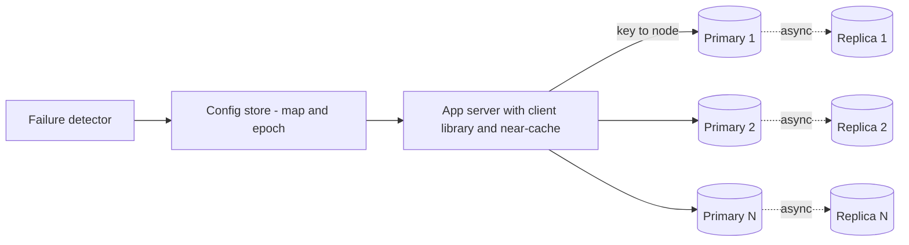

Every team at the company wants "a Redis". Pulse needs 231 GB for timelines and posts ([§18](/c/system-design/18-cache)), the chat service needs its session routing table ([§49](/c/system-design/49-chat)), and a dozen smaller services need a few GB each. The platform team decides to run one shared cache service instead of fifty snowflakes. This case study designs it: how keys find nodes, how many nodes, what happens when one dies, and what one celebrity key does to the whole cluster.

:::key[First principle]
A distributed cache is **a hash function from key to node plus a hash table on each node**. Design the first for even spread and small movement when nodes change; size the second by memory *and* operations; and accept that a cache can lose data — the design goal is that losing a node costs the origin a bounded, survivable amount of extra load.
:::

## 50.1 Requirements

**Functional**

- `get`, `set` with TTL, `delete`, batch `mget`, and compare-and-set for versioned values.
- Eviction when full; expiry exactly at TTL (never return an expired value).
- Multi-tenant: per-tenant memory quotas and key prefixes.

**Non-functional**

- p50 ≈ one intra-DC round trip (~0.5 ms), p99 under ~2 ms.
- Adding or removing a node moves about \(1/N\) of the keys, not most of them.
- Losing one node must not take the origin past its capacity.
- No coordinator on the request path: clients route directly.

## 50.2 Estimates

Scale assumption (illustrative): **400M keys of ~1 KB, 1M key operations/s at peak, 10% writes** — Pulse's ~250k ops/s plus other tenants. Per-key overhead, fragmentation and the 40 GB `maxmemory` per 64 GB node follow §18.4's method.

```python run
import math

# Shared cache platform (illustrative scale): 400M keys, ~1 KB values, 1M key ops/s at peak, 10% writes
KEYS, VALUE_B, OPS, WRITE_FRAC = 400e6, 1_000, 1_000_000, 0.10
KEY_OVERHEAD, FRAG = 80, 1.2               # per-key bytes and fragmentation, as in §18.4 (illustrative)
MAXMEM, NODE_RAM = 40e9, 64e9              # maxmemory per shard on a 64 GB node (fork headroom)
SHARD_OPS = 100_000                        # simple ops/s one Redis thread does (illustrative)
TARGET = 0.5                               # keep each shard under 50% of that

data = KEYS * (KEY_OVERHEAD + VALUE_B) * FRAG
by_mem = math.ceil(data / MAXMEM)
by_ops = math.ceil(OPS / (SHARD_OPS * TARGET))
shards = max(by_mem, by_ops)
print(f"memory: {KEYS / 1e6:.0f}M x {KEY_OVERHEAD + VALUE_B} B x {FRAG} = {data / 1e9:,.0f} GB "
      f"-> {by_mem} shards by memory")
print(f"ops: {OPS:,}/s / ({SHARD_OPS:,} x {TARGET:.0%}) -> {by_ops} shards by throughput")
print(f"=> {shards} primaries + {shards} replicas = {2 * shards} nodes, "
      f"{2 * shards * NODE_RAM / 1e12:.2f} TB RAM; {data / shards / 1e9:.1f} GB and "
      f"{OPS / shards:,.0f} ops/s per primary")
gbit = OPS * (VALUE_B + 100) * 8 / 1e9     # +100 B protocol and key per op
print(f"network: {gbit:.1f} Gbit/s cluster, {gbit / shards * 1e3:,.0f} Mbit/s per primary")

H = math.log(KEYS) + 0.5772                # harmonic number H_N for Zipf s = 1
hot = OPS / H
print(f"Zipf s=1 over {KEYS / 1e6:.0f}M keys: hottest key {1 / H:.1%} of ops = {hot:,.0f}/s "
      f"= {hot / (OPS / shards):.1f}x a shard's mean load")
for L1_TTL, APPS in ((1, 300), (0.1, 300)):
    print(f"  near-cache TTL {L1_TTL} s on {APPS} app servers: hot key reaches the shard at "
          f"<= {APPS / L1_TTL:,.0f}/s")

writes = OPS * WRITE_FRAC / shards
for lag_ms in (1, 10, 100):
    print(f"replica lag {lag_ms:>3} ms: failover loses ~{writes * lag_ms / 1e3:,.0f} writes/deletes per shard")
miss_db = OPS * 0.95 / shards               # 95% hit rate: a shard's hits become origin reads if lost
print(f"shard lost without replica: origin +{miss_db:,.0f} reads/s on top of {OPS * 0.05:,.0f}/s of misses"
      f" ({(OPS * 0.05 + miss_db) / (OPS * 0.05):.1f}x)")
```

```output
memory: 400M x 1080 B x 1.2 = 518 GB -> 13 shards by memory
ops: 1,000,000/s / (100,000 x 50%) -> 20 shards by throughput
=> 20 primaries + 20 replicas = 40 nodes, 2.56 TB RAM; 25.9 GB and 50,000 ops/s per primary
network: 8.8 Gbit/s cluster, 440 Mbit/s per primary
Zipf s=1 over 400M keys: hottest key 4.9% of ops = 49,058/s = 1.0x a shard's mean load
  near-cache TTL 1 s on 300 app servers: hot key reaches the shard at <= 300/s
  near-cache TTL 0.1 s on 300 app servers: hot key reaches the shard at <= 3,000/s
replica lag   1 ms: failover loses ~5 writes/deletes per shard
replica lag  10 ms: failover loses ~50 writes/deletes per shard
replica lag 100 ms: failover loses ~500 writes/deletes per shard
shard lost without replica: origin +47,500 reads/s on top of 50,000/s of misses (1.9x)
```

:::example[Worked example · what the estimate decides]
- **Throughput binds, not memory.** 518 GB needs 13 shards; 1M ops/s at 50% of an illustrative 100k ops/s per thread needs 20. Pulse alone was memory-bound (§18.4: 41% ops per shard); a platform with many small hot values is ops-bound. Compute both and take the max.
- **40 nodes, 2.56 TB of RAM** for 518 GB of data: ~5× the data, from overhead, fork headroom and one replica each.
- **Network is not the limit**: 440 Mbit/s per primary.
- **One key can equal a whole shard**: under Zipf $s = 1$ the hottest of 400M keys draws 4.9% of all operations, the same as a shard's average share — so the shard holding it runs at ~2×. §50.8 deals with it.
- **Losing a primary without a replica nearly doubles origin reads** (50,000 → 97,500/s). That is the number the origin team must sign off on — or the cache needs replicas.
:::

## 50.3 API

```text
get(key)                          -> value | MISS
mget(keys[])                      -> values[]        # one round trip per shard, in parallel
set(key, value, ttl_s)            -> OK              # ttl required, capped server-side (e.g. 7 days)
set_if_version(key, value, ver)   -> OK | CONFLICT   # stale writers cannot overwrite newer values
delete(key)                       -> OK
```

Clients use a library that holds the cluster map and routes each key directly to its node. Keys are prefixed by tenant (`pulse:post:42`), which is also how quotas and per-tenant metrics are enforced.

## 50.4 Data model

| Where | Structure | Purpose |
| --- | --- | --- |
| Each node | Hash table key → (value, expiry, eviction metadata) | O(1) lookup |
| Each node | Approximate LRU/LFU state (sampled clock bits) | Eviction without a global lock ([§18.3](/c/system-design/18-cache)) |
| Each node | Expiry index or sampled expiry sweep | Reclaim memory of keys nobody reads again |
| Config store (etcd/ZooKeeper-style) | Ring or slot map + epoch number | Who owns which keys; changed by consensus only |
| Each client | Cached copy of the map + epoch | Route without a hop; refresh on `MOVED` replies |

## 50.5 High-level design



The request path is client → one node. The control path (failure detector → config store → clients) changes ownership. Keeping them separate means a slow config store delays failovers but never slows reads.

## 50.6 Deep dive: which node owns a key

`hash(key) mod N` is perfectly even and perfectly fragile: going from 20 to 21 nodes changes the owner of 95% of keys, which for a cache means a 95% miss storm on the origin. **Consistent hashing** puts nodes and keys on a ring; a key belongs to the next node clockwise, so a new node only takes keys from the arcs it lands in ([§12.5](/c/system-design/12-replication-and-partitioning), implementation in [§64](/c/system-design/64-consistent-hashing)).

With one point per node the arcs are wildly uneven. **Virtual nodes** give each physical node $v$ points; its share becomes a sum of $v$ arcs, whose relative spread shrinks roughly as \(1/\sqrt{v}\). The simulation measures 20 nodes over 20 random rings each, plus what happens when one node fails: how much of its load lands on the single unluckiest survivor.

```python run
import numpy as np

M = 2 ** 64


def arcs(nodes, vnodes, seed):
    """Fraction of the ring each physical node owns: a point owns the arc back to its predecessor."""
    rng = np.random.default_rng(seed)
    pos = rng.integers(0, M, (len(nodes), vnodes), dtype=np.uint64).astype(np.float64) / M
    owner = np.repeat(nodes, vnodes)
    order = np.argsort(pos.ravel())
    p, o = pos.ravel()[order], owner[order]
    length = np.diff(np.concatenate([[p[-1] - 1], p]))
    return p, o, np.bincount(o, length, minlength=max(nodes) + 1)[nodes]


N = 20
print("vnodes | max/mean | min/mean | sd/mean | failed node: largest share to one survivor")
for v in (1, 4, 16, 64, 128, 256, 512, 1024):
    mx, mn, sd, heir = [], [], [], []
    for seed in range(20):
        p, o, own = arcs(np.arange(N), v, seed)
        mx.append(own.max() * N); mn.append(own.min() * N); sd.append(own.std() * N)
        # node 0 fails: each of its arcs goes to the next point clockwise that is not node 0
        nxt = np.roll(o, -1)
        k = 1
        while (nxt == 0).any():
            k += 1
            nxt = np.where(nxt == 0, o[(np.arange(len(o)) + k) % len(o)], nxt)
        length = np.diff(np.concatenate([[p[-1] - 1], p]))
        gained = np.bincount(nxt[o == 0], length[o == 0], minlength=N)
        heir.append(gained.max() / gained.sum())
    print(f"{v:6d} | {np.mean(mx):8.2f} | {np.mean(mn):8.2f} | {np.mean(sd):7.3f} | {np.mean(heir):.1%}")

# Adding a 21st node: share of keys that move (consistent hashing vs hash mod N)
keys = np.random.default_rng(99).integers(0, M, 200_000, dtype=np.uint64)
kpos = keys.astype(np.float64) / M
for v in (1, 128):
    p20, o20, _ = arcs(np.arange(N), v, 1)
    p21, o21, _ = arcs(np.arange(N + 1), v, 1)          # same seed: nodes 0-19 keep their points
    own = lambda p, o: o[np.searchsorted(p, kpos) % len(p)]
    print(f"add node 21, {v} vnodes: {np.mean(own(p20, o20) != own(p21, o21)):.1%} of keys move "
          f"(ideal 1/21 = {1 / 21:.1%})")
print(f"hash mod N, 20 -> 21: {np.mean(keys % np.uint64(20) != keys % np.uint64(21)):.1%} of keys move")
```

```output
vnodes | max/mean | min/mean | sd/mean | failed node: largest share to one survivor
     1 |     3.37 |     0.03 |   0.911 | 100.0%
     4 |     2.19 |     0.27 |   0.483 | 53.9%
    16 |     1.55 |     0.58 |   0.251 | 25.1%
    64 |     1.23 |     0.79 |   0.113 | 15.3%
   128 |     1.17 |     0.84 |   0.087 | 11.5%
   256 |     1.11 |     0.89 |   0.059 | 9.2%
   512 |     1.09 |     0.92 |   0.043 | 8.3%
  1024 |     1.05 |     0.94 |   0.029 | 7.2%
add node 21, 1 vnodes: 20.2% of keys move (ideal 1/21 = 4.8%)
add node 21, 128 vnodes: 4.1% of keys move (ideal 1/21 = 4.8%)
hash mod N, 20 -> 21: 95.2% of keys move
```

:::chart[Load on the busiest and idlest of 20 nodes vs virtual nodes per node (simulated, mean of 20 rings)]{type="line" x="virtual nodes per physical node" y="node load ÷ mean" xlog="true" ymin="0" points="true" hmarks="1:perfectly even;1.2:20% over" dash="idlest node"}
vnodes, busiest node, idlest node
1, 3.37, 0.03
4, 2.19, 0.27
16, 1.55, 0.58
64, 1.23, 0.79
128, 1.17, 0.84
256, 1.11, 0.89
512, 1.09, 0.92
1024, 1.05, 0.94
:::

What to take from it:

1. **One point per node is unusable**: the busiest of 20 nodes owns 3.4× its share — sized for the mean, it runs at 340%. The sd/mean column falls as \(1/\sqrt{v}\) (0.91 → 0.06 from 1 to 256 points, a factor of ~16 = $\sqrt{256}$).
2. **Pick ~256 vnodes per node**: busiest at 1.11×, so size each node for ~15% over the mean. Going to 1,024 buys 6 more points at 4× the ring size in every client.
3. **Failures spread too.** With one point, a dead node's whole load lands on its successor (100%) — which then has 2× load and may fall over next: a cascade. With 256 points the unluckiest survivor gets 9.2% of it, about 1.7× the fair \(1/19 = 5.3\%\).
4. **Adding a node moves ~1/N.** 4.1% with 128 vnodes against the ideal 4.8%; `mod N` moves 95%.

:::tip[Slots instead of a random ring]
Redis Cluster's alternative: hash keys into a fixed 16,384 slots and keep an explicit slot → node table. The operator (or an automated balancer) assigns slots, so balance is exact rather than statistical, and a migration moves named slots. Same idea as logical shards ([§34.2](/c/system-design/34-sharding)); either works in an interview if you can say how keys move.
:::

## 50.7 Deep dive: replication and failover

Each primary streams its writes asynchronously to one replica in another zone. A failover then takes three steps: detect (e.g. 3 missed 1 s heartbeats ≈ 3 s, illustrative), elect the replica in the config store with a new **epoch**, and push the new map to clients. Two costs remain:

- **Misses during detection.** For ~3 s the shard's 50,000 ops/s fail; clients treat errors as misses, so the origin sees up to +47,500 reads/s for those seconds. Without a replica, it sees that until the replacement node warms up — minutes.
- **Lost writes and deletes.** Async lag × write rate: at 5,000 writes/s per shard and 10 ms of lag, ~50 writes are lost. A lost `set` is a harmless miss later. A lost **`delete`** is not: the replica still holds the old value, which is served until its TTL. Bound it with the TTL (every key has one), versioned values (`set_if_version`), or, for keys that must never be stale, read from the database.

**Split brain.** If a partitioned old primary keeps accepting writes, two nodes own one key. Ownership therefore lives only in the config store (consensus), every map has an epoch, nodes reject requests carrying an older epoch, and a primary that cannot reach the config store for longer than the failover timeout stops serving. [Replication and partitioning](/c/system-design/12-replication-and-partitioning) covers lag and quorums in general.

## 50.8 Deep dive: hot keys

A hot key concentrates load on one shard no matter how good the ring is. The block uses a 1M-key keyspace (scaled down, so the hottest key is even hotter: 69,480 ops/s) at the platform's 1M ops/s over 20 shards, then applies two fixes: a **near-cache** on 300 app servers (each refreshes a key at most once per 1 s TTL, so the shard sees at most 300/s per key) and **key replication** (keys above 5,000/s written under 8 suffixes, read from a random one).

```python run
import numpy as np

rng = np.random.default_rng(8)
KEYS, OPS, SHARDS, APPS = 1_000_000, 1_000_000, 20, 300   # scaled keyspace; platform peak from the estimator
rate = OPS / np.arange(1, KEYS + 1) / (np.log(KEYS) + 0.5772)   # Zipf s = 1, ops/s per key
shard = rng.integers(0, SHARDS, KEYS)                           # placement by hash (uniform)


def report(name, r):
    load = np.bincount(shard, r, minlength=SHARDS)
    print(f"{name:40s} hottest shard {load.max():>9,.0f}/s = {load.max() / load.mean():.2f}x mean; "
          f"total to cache tier {r.sum():>9,.0f}/s")
    return load


base = report("no mitigation", rate)
print(f"  top keys: {', '.join(f'{x:,.0f}' for x in rate[:3])} ops/s; keys above 5,000/s: {(rate > 5_000).sum()}")

# 1. near-cache: each app server keeps keys it reads > 1/s for TTL=1 s, so a key costs <= APPS refreshes/s
near = np.minimum(rate, APPS * 1.0)
report("near-cache (1 s TTL, 300 app servers)", near)

# 2. replicate keys above 5,000/s under 8 suffixes, read a random copy
rep = rate.copy()
hot = np.flatnonzero(rate > 5_000)
extra_r, extra_s = [], []
for k in hot:
    rep[k] = rate[k] / 8
    extra_r += [rate[k] / 8] * 7
    extra_s += list(rng.integers(0, SHARDS, 7))
load = np.bincount(np.concatenate([shard, extra_s]), np.concatenate([rep, extra_r]), minlength=SHARDS)
print(f"{'replicate hot keys x8':40s} hottest shard {load.max():>9,.0f}/s = {load.max() / load.mean():.2f}x mean; "
      f"writes to a hot key now cost 8")
```

```output
no mitigation                            hottest shard   108,877/s = 2.18x mean; total to cache tier 1,000,001/s
  top keys: 69,480, 34,740, 23,160 ops/s; keys above 5,000/s: 13
near-cache (1 s TTL, 300 app servers)    hottest shard    35,665/s = 1.10x mean; total to cache tier   650,909/s
replicate hot keys x8                    hottest shard    63,511/s = 1.27x mean; writes to a hot key now cost 8
```

:::chart[Hottest shard ÷ mean shard under Zipf s = 1 (20 shards, 1M ops/s, simulated)]{type="bar" x="mitigation" y="hottest shard ÷ mean" ymin="0" hmarks="1:even" labels="true" yfmt="dec2"}
mitigation, hottest ÷ mean
no mitigation, 2.18
replicate hot keys x8, 1.27
near-cache 1 s TTL, 1.10
:::

- **Unmitigated, the hottest shard runs at 2.18× the mean** — 108,877 ops/s, beyond one thread's illustrative 100k. More shards make the ratio worse ([§12.6](/c/system-design/12-replication-and-partitioning)): the mean falls, the hot key does not.
- **The near-cache wins on both counts**: hottest shard 1.10×, and 35% of all cache traffic disappears, because every key above 300/s is served from app-server RAM. The price is up to 1 s of staleness, so apply it to keys that tolerate that (detect them by sampling per-key rates in the client).
- **Key replication** gets to 1.27× and costs 8 writes per update of a hot key; use it for hot keys that must be fresher than a near-cache allows.

## 50.9 Inside a node

The single-node internals are [§18](/c/system-design/18-cache) (Redis/Memcached, encodings, sampled LRU) and the [LRU implementation in §66](/c/system-design/66-lru-cache). Three rules a design review checks:

- **Eviction is not expiry.** Eviction picks a victim when memory is full; expiry makes a key invalid at its TTL whether or not memory is full. Check expiry on every read (lazy) *and* sweep a sample of keys with TTLs in the background, or keys nobody reads hold memory forever.
- **Cap TTLs and value sizes server-side.** A tenant that forgets a TTL leaks memory into everyone's quota; a 10 MB value blocks a single-threaded node for milliseconds.
- **Batch.** `mget` of 20 keys over 20 shards is up to 20 parallel requests and the page waits for the slowest ([§10](/c/system-design/10-latency-and-throughput)); co-locate keys that are always read together with a hash tag.

## 50.10 Bottlenecks and failure modes

| Failure | Mechanism | Detect with | Mitigation |
| --- | --- | --- | --- |
| Node lost, no replica | Its share misses: origin 50k → 97.5k reads/s | Miss rate per shard, origin QPS | Replica per primary; origin load shedding |
| Failover with lag | Lost deletes serve stale values | Replica lag, stale-read audits | TTL on everything; versioned sets |
| Split brain | Two owners for one key | Epoch mismatches | Ownership by consensus + epochs; fenced primaries |
| Too few vnodes | Busiest node 2–3× mean | Per-node ops and memory | ~256 vnodes or an explicit slot map |
| Hot key | One shard at 2.2× | Sampled per-key rates | Near-cache; replicate hot keys |
| Cascading failure | Dead node's load lands on one neighbour | Correlated node failures | Many vnodes spread it (9% vs 100% to one survivor) |
| Tenant without TTLs | Memory fills with dead keys | Keys without TTL per tenant | Server-side max TTL and quotas |

## 50.11 Trade-offs

| Decision | Choice | Alternative | Why |
| --- | --- | --- | --- |
| Routing | Smart client with cached map | Proxy tier | No extra hop; proxy simplifies clients at +0.5 ms per op |
| Partitioning | Ring with 256 vnodes, or slot table | `mod N` | 4–5% of keys move per node added instead of 95% |
| Replication | 1 async replica | None / sync | Seconds of misses instead of minutes; sync doubles write latency for data that is a copy anyway |
| Shard count | max(memory, ops) | Memory only | Here ops bind: 20 shards, not 13 |
| Hot keys | Near-cache (1 s) | More shards | More shards worsen the hot ratio |

## 50.12 What I'd say in 45 minutes

1. **(5 min) Requirements**: get/set/delete with TTL, \(1/N\) movement, survive a node loss, no coordinator on the path.
2. **(7 min) Estimates**: 400M × 1 KB → 518 GB → 13 shards by memory; 1M ops/s at 50k per shard → **20 by ops**; 40 nodes with replicas; hottest key = one shard's whole mean load.
3. **(5 min) Design**: smart clients, primaries with async replicas, config store with epochs, failure detector.
4. **(18 min) Deep dives**: `mod N` moves 95%; ring with 256 vnodes → busiest node 1.11×, failed node's load spread 9% max per survivor; failover costs ~3 s of misses (+47.5k origin reads/s) and lag × writes of lost deletes; hot keys: near-cache takes the hottest shard from 2.18× to 1.10×.
5. **(5 min) Failures and trade-offs**: split brain and epochs; proxy vs smart client.
6. **(5 min) Extensions**: multi-region (independent caches per region, invalidations over a stream), persistence for warm restarts.

## 50.13 Check yourself

:::qa[The origin can absorb at most 70,000 reads/s. Is a cache with no replicas acceptable?]
No. Normal misses are 50,000/s (95% hit on 1M ops/s); losing one of 20 primaries adds its 47,500/s of hits as misses, for 97,500/s — 39% over the limit until the node is replaced and warm. With a replica the excess lasts only the ~3 s detection window, which load shedding or request coalescing can absorb.
:::

:::qa[Why does going from 20 to 40 shards not fix a hot key?]
The hot key's 49,000 ops/s still lands on one shard, while the mean per shard halves from 50,000 to 25,000/s. The hot shard goes from ~2× to ~3× the mean. Hot keys need the load spread *per key* — near-cache or replication — not more shards.
:::

:::qa[With 16 virtual nodes per node, how should you size each node?]
The busiest of 20 nodes averaged 1.55× the mean in the simulation, and a failure dumps 25% of a dead node's load on one survivor. You would have to provision ~60% headroom on every node. Raising vnodes to 256 cuts the busiest to 1.11× and the failure share to 9%, for a ring of 5,120 entries — under 100 KB in each client.
:::

:::qa[After a failover, users see a profile photo they deleted an hour ago. What happened, and what fixes it?]
The `delete` reached the old primary but not the async replica before failover, so the replica still had the old value. It will be served until the key's TTL expires. Fixes: a shorter TTL on such keys, versioned writes so a delete becomes a tombstone with a higher version, or invalidating again from the source of truth's change stream after a failover (replaying recent deletes).
:::

Next: [§51 Design a file storage and sync service](/c/system-design/51-file-sync) — where the data is too big to cache and the hard part is metadata.
