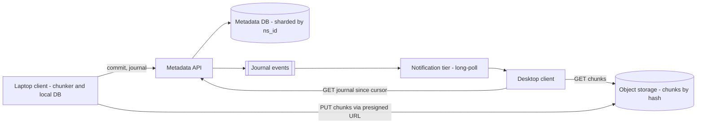
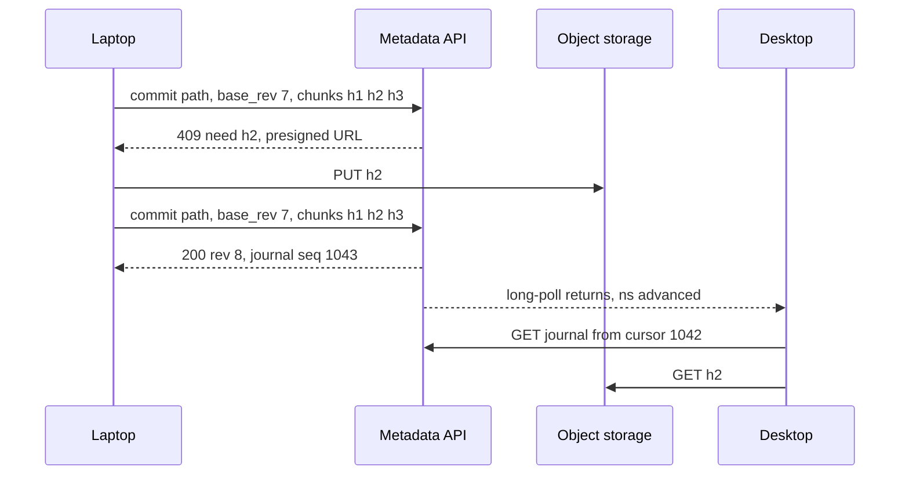

Priya edits a 1 GB video project on her laptop on a train, inserting a few seconds of footage near the middle. When the laptop gets Wi-Fi, the change should reach her desktop in seconds and upload in about the time the new footage takes — not the whole gigabyte. Her colleague may have edited the same project from home. The service must ship only what changed, notice the conflict, and lose neither edit.

:::key[First principle]
Separate **bytes** from **meaning**. Bytes are immutable, content-addressed chunks in [object storage](/c/system-design/26-object-storage): a chunk's name is its hash, so identical chunks are stored and uploaded once. Meaning — paths, versions, who changed what — lives in a metadata store as an ordered **journal** per folder. Syncing a device is replaying the journal from its cursor and fetching the chunks it lacks.
:::

## 51.1 Requirements

**Functional**

- Upload, download, move, delete files and folders; share a folder with read or write access.
- Changes on one device appear on the others within seconds when online.
- Offline edits sync on reconnect; concurrent edits never silently lose data.
- Version history (30 days) and restore.

**Non-functional**

- Durability of acknowledged files: object-storage class (11 nines claimed by providers; design as if it is the weakest link you control).
- Upload cost proportional to what changed, not to file size.
- A file is visible only when all its bytes are stored — never half a file.
- Metadata strongly consistent within a folder; eventual across devices (seconds).

## 51.2 Estimates

Scale assumption (illustrative): **10M users, 4M daily active, 10 GB stored per user, 2 MB average file, 30 file writes per active user per day, 40% of them new files.** Edits upload ~10% of the file's bytes — the content-defined chunking result for a few small edits in §51.6.

```python run
import math

# File sync service (illustrative scale)
USERS, DAU, STORED = 10e6, 4e6, 10e9            # users, daily active, average bytes stored per user
FILE_B, WRITES = 2e6, 30                        # average file size; file writes per DAU per day
NEW, DELTA = 0.4, 0.10                          # share of writes that are new files; bytes sent per edit (CDC)
files = USERS * STORED / FILE_B
w = DAU * WRITES
print(f"logical data {USERS * STORED / 1e15:.0f} PB in {files / 1e9:.0f}B files")
print(f"file writes {w:,.0f}/day -> {w / 1e5:,.0f} avg, {3 * w / 1e5:,.0f} peak metadata commits/s")
full = w * FILE_B
sent = w * FILE_B * (NEW + (1 - NEW) * DELTA)
print(f"upload if whole files: {full / 1e12:,.0f} TB/day; with chunk dedupe: {sent / 1e12:,.0f} TB/day "
      f"({sent / 86_400 / 1e9:.2f} GB/s avg ingress)")

ROW_B, REF_B = 300, 40                          # bytes per file row; per chunk reference (32 B hash + offset)
print(f"file rows: {files / 1e9:.0f}B x {ROW_B} B = {files * ROW_B / 1e12:.0f} TB (+30% indexes "
      f"{files * ROW_B * 1.3 / 1e12:.1f} TB)")
for chunk in (64e3, 1e6, 4e6):
    refs = USERS * STORED / chunk
    print(f"  chunk {chunk / 1e6:>5.3g} MB: {refs:.2e} chunk refs x {REF_B} B = {refs * REF_B / 1e12:6.1f} TB; "
          f"{max(1, FILE_B / chunk):.0f} chunk(s) per 2 MB file")

DEVICES, ONLINE = 2.5, 0.2
print(f"devices {USERS * DEVICES / 1e6:.0f}M, connected at peak {USERS * DEVICES * ONLINE / 1e6:.0f}M "
      f"(notification sockets)")

UP = 20e6 / 8                                   # 20 Mbit/s uplink (illustrative), bytes/s
print("1 GB file, 1 MB edit in the middle, 20 Mbit/s uplink:")
for name, b in (("whole file", 1e9), ("fixed 4 MB blocks: insert shifts the rest", 0.5e9),
                ("fixed 4 MB blocks: 1 MB overwritten in place", 8e6), ("CDC 64 KB average: insert", 1e6 + 2 * 64e3)):
    print(f"  {name:46s} {b / 1e6:7,.1f} MB  {b / UP:7.1f} s")

print("P(conflict) when a collaborator edits the same file 4 times a day:")
for label, sec in (("online, 5 s sync", 5), ("1 min", 60), ("1 h offline", 3600),
                   ("8 h offline", 8 * 3600), ("3 days offline", 3 * 86_400)):
    print(f"  {label:18s} {1 - math.exp(-4 / 86_400 * sec):8.3%}")
```

```output
logical data 100 PB in 50B files
file writes 120,000,000/day -> 1,200 avg, 3,600 peak metadata commits/s
upload if whole files: 240 TB/day; with chunk dedupe: 110 TB/day (1.28 GB/s avg ingress)
file rows: 50B x 300 B = 15 TB (+30% indexes 19.5 TB)
  chunk 0.064 MB: 1.56e+12 chunk refs x 40 B =   62.5 TB; 31 chunk(s) per 2 MB file
  chunk     1 MB: 1.00e+11 chunk refs x 40 B =    4.0 TB; 2 chunk(s) per 2 MB file
  chunk     4 MB: 2.50e+10 chunk refs x 40 B =    1.0 TB; 1 chunk(s) per 2 MB file
devices 25M, connected at peak 5M (notification sockets)
1 GB file, 1 MB edit in the middle, 20 Mbit/s uplink:
  whole file                                     1,000.0 MB    400.0 s
  fixed 4 MB blocks: insert shifts the rest        500.0 MB    200.0 s
  fixed 4 MB blocks: 1 MB overwritten in place       8.0 MB      3.2 s
  CDC 64 KB average: insert                          1.1 MB      0.5 s
P(conflict) when a collaborator edits the same file 4 times a day:
  online, 5 s sync     0.023%
  1 min                0.277%
  1 h offline         15.352%
  8 h offline         73.640%
  3 days offline      99.999%
```

| Quantity | Value | What it decides |
| --- | ---: | --- |
| Logical data | 100 PB, 50B files | Object storage with erasure coding; cost is the storage bill ([§26](/c/system-design/26-object-storage)) |
| Metadata commits | 1,200/s avg, 3,600/s peak | Modest rate — but over 19.5 TB of rows |
| Metadata size | 19.5 TB of file rows + 1–62 TB of chunk refs | Near one node's 21 TB usable ([§2](/c/system-design/02-estimation)): shard by namespace |
| Upload | 110 TB/day ≈ 1.3 GB/s instead of 240 TB/day | Chunk-level dedupe halves ingress |
| Connected devices | 5M at peak | A notification tier like chat gateways ([§49](/c/system-design/49-chat)) |

## 51.3 API

```http
POST /v1/commit   {namespace_id, path, base_rev, size, chunks: [h1, h2, ...]}
  -> 200 {rev, journal_seq}                       # all chunks present: committed
  -> 409 {need: [h2], upload_urls: {h2: "..."}}   # upload these, then retry the same commit
  -> 412 {current_rev}                            # base_rev is stale: conflict
PUT  <presigned object-storage URL for chunk h2>  (body = chunk bytes)
GET  /v1/journal?namespace_id=&cursor=123&limit=1000 -> {entries[], next_cursor, has_more}
GET  /v1/chunks/{hash} -> 302 to a presigned download URL
GET  /v1/longpoll?cursors={ns: seq,...} -> returns as soon as any namespace advances (or after 60 s)
```

`commit` is idempotent — retrying it with the same chunk list is safe ([§22](/c/system-design/22-idempotency)) — and atomic: the file's new revision appears only after every chunk it names exists. Presigned URLs let clients send bytes straight to object storage, so the API servers never carry file data.

## 51.4 Data model

| Table | Key | Columns | Notes |
| --- | --- | --- | --- |
| `namespaces` | `ns_id` | owner, type (user root or shared folder) | The shard key for everything below |
| `files` | `(ns_id, path)` | file_id, rev, size, chunk_list_id, deleted | Current state; 50B rows |
| `revisions` | `(ns_id, file_id, rev)` | chunk list, author device, ts | 30 days of history |
| `journal` | `(ns_id, seq)` | op (add/edit/move/delete), path, rev | Gap-free per namespace; what devices replay |
| `chunks` | `hash` | location, size, refcount | Global, so identical chunks are stored once |
| `devices` | `(user_id, device_id)` | cursor per namespace | Where each device has synced to |

A shared folder is its own namespace, mounted into each member's tree. That keeps every write inside one shard and one journal, even when 50 people share it.

## 51.5 High-level design





## 51.6 Deep dive: chunking

Split each file into chunks, hash each one (SHA-256), and upload only hashes the server lacks. How the boundaries are chosen decides what an edit costs:

- **Fixed-size chunks** cut every $B$ bytes. Overwriting bytes in place changes one chunk. But *inserting* bytes shifts every later boundary, so every later chunk gets a new hash — on average half the file re-uploads.
- **Content-defined chunking (CDC)** cuts where a rolling hash of the last few bytes matches a pattern (here: low 16 bits of a gear hash are zero, so a cut every ~64 KB on average, with 16 KB minimum and 256 KB maximum). Boundaries depend on content, not position, so after an insert they resynchronise within one chunk.

The block chunks a 4 MB random file both ways, applies $k$ random 100-byte inserts or overwrites, and measures the share of the new version that must be uploaded (mean of 4 trials).

```python run
import hashlib
import numpy as np

rng = np.random.default_rng(1)
G = rng.integers(0, 2 ** 63, 256, dtype=np.uint64)          # gear table: one random word per byte value
SIZE, AVG, MIN, MAX = 4 << 20, 64 << 10, 16 << 10, 256 << 10   # 4 MB file, 64 KB average chunk
MASK_BITS = 16                                               # boundary when low 16 bits are 0: p = 1/65536


def cdc(data):
    """Content-defined chunking with a gear rolling hash: h = (h << 1) + G[byte]."""
    b = np.frombuffer(data, np.uint8)
    h = np.zeros(len(b), np.uint64)
    for j in range(MASK_BITS):                               # low 16 bits depend on the last 16 bytes only
        h[j:] += G[b[: len(b) - j]] << np.uint64(j)
    cand = np.flatnonzero((h & np.uint64((1 << MASK_BITS) - 1)) == 0) + 1
    cuts, last = [], 0
    for c in cand:
        while c - last > MAX:
            last += MAX; cuts.append(last)
        if c - last >= MIN:
            last = c; cuts.append(c)
    cuts += list(range(last + MAX, len(b), MAX)) + [len(b)]
    return [data[a:z] for a, z in zip([0] + cuts[:-1], cuts) if z > a]


def fixed(data, size=AVG):
    return [data[i:i + size] for i in range(0, len(data), size)]


def upload_share(have, new, chunker):
    """Bytes of the new version whose chunk hash the server does not already have."""
    return sum(len(c) for c in chunker(new) if hashlib.sha256(c).digest() not in have) / len(new)


base = rng.integers(0, 256, SIZE, dtype=np.uint8).tobytes()
sizes = [len(c) for c in cdc(base)]
print(f"CDC on 4 MB: {len(sizes)} chunks, mean {np.mean(sizes) / 1024:.0f} KB, "
      f"min {min(sizes) / 1024:.0f} KB, max {max(sizes) / 1024:.0f} KB")
have = {f: {hashlib.sha256(c).digest() for c in f(base)} for f in (fixed, cdc)}
print("edits, fixed: inserts, CDC: inserts, fixed: overwrites, CDC: overwrites  (mean of 4 trials)")
for k in (1, 2, 5, 10, 20, 50):
    out = np.zeros(4)
    for trial in range(4):
        for i, kind in enumerate(("insert", "overwrite")):
            d = bytearray(base)
            for pos in sorted(rng.integers(0, SIZE - 100, k), reverse=True):
                patch = rng.integers(0, 256, 100, dtype=np.uint8).tobytes()
                d[pos:pos + (0 if kind == "insert" else 100)] = patch
            out[2 * i:2 * i + 2] += [upload_share(have[f], bytes(d), f) / 4 for f in (fixed, cdc)]
    print(f"{k}, " + ", ".join(f"{x:.3f}" for x in out))
```

```output
CDC on 4 MB: 43 chunks, mean 95 KB, min 17 KB, max 256 KB
edits, fixed: inserts, CDC: inserts, fixed: overwrites, CDC: overwrites  (mean of 4 trials)
1, 0.680, 0.030, 0.016, 0.045
2, 0.727, 0.067, 0.031, 0.079
5, 0.883, 0.190, 0.074, 0.161
10, 0.836, 0.345, 0.145, 0.285
20, 0.988, 0.492, 0.285, 0.478
50, 0.996, 0.790, 0.531, 0.777
```

:::chart[Share of a 4 MB file re-uploaded after k small edits (simulated, 64 KB fixed vs ~64 KB-target CDC)]{type="line" x="number of 100-byte edits" y="share of file re-uploaded" xlog="true" yfmt="pct" ymin="0" ymax="1" points="true" dash="fixed: overwrites,CDC: overwrites"}
edits, fixed: inserts, CDC: inserts, fixed: overwrites, CDC: overwrites
1, 0.680, 0.030, 0.016, 0.045
2, 0.727, 0.067, 0.031, 0.079
5, 0.883, 0.190, 0.074, 0.161
10, 0.836, 0.345, 0.145, 0.285
20, 0.988, 0.492, 0.285, 0.478
50, 0.996, 0.790, 0.531, 0.777
:::

1. **Inserts are where CDC pays**: one insert re-uploads 3% with CDC against 68% with fixed chunks (everything after the insert point; 50% on average over positions, 4 trials here). Documents, archives and media projects are edited by insertion all the time.
2. **For pure overwrites fixed chunks are slightly better** (1.6% vs 4.5% for one edit): CDC chunks came out larger (mean 95 KB, because of the 16 KB minimum), and an overwrite can erase a boundary and merge two chunks. Databases and VM images that rewrite pages in place are the case where fixed blocks are fine.
3. **Many scattered edits defeat both** — 50 edits touch most chunks. Then the file is effectively new, and compression is the remaining lever.

## 51.7 Deep dive: chunk size and delta bandwidth

Smaller chunks mean less re-upload per edit and more metadata. From the estimator:

| Average chunk | Chunk refs for 100 PB | Ref storage | Re-upload for a 1 MB insert |
| ---: | ---: | ---: | ---: |
| 64 KB | 1.56 × 10¹² | 62.5 TB | ~1.1 MB |
| 1 MB | 10¹¹ | 4.0 TB | ~3 MB (1 MB + the two chunks it straddles) |
| 4 MB | 2.5 × 10¹⁰ | 1.0 TB | ~9 MB with CDC; ~500 MB with fixed blocks |

For Priya's 1 GB project on an illustrative 20 Mbit/s uplink: whole-file upload is **400 s**; fixed 4 MB blocks after an insert still send half the file, **200 s**; CDC sends ~1.1 MB, **0.5 s**. A CDC average of ~1 MB (illustrative choice) keeps chunk refs at 4 TB — small next to 19.5 TB of file rows — while a typical edit uploads a few MB. Most 2 MB files are then one or two chunks, so the overhead is paid only by large files, which are exactly the ones that benefit.

Downloads mirror uploads: the desktop already has most chunks of revision 7 locally, so fetching revision 8 means downloading only the chunk hashes it does not have.

## 51.8 Deep dive: metadata and the journal

The metadata store is the hard part: 19.5 TB of file rows plus chunk lists and journals is beyond one node's ~21 TB usable once growth is included, and every operation is scoped to a namespace. So **shard by `ns_id`** ([§34](/c/system-design/34-sharding)): a commit touches one shard and can be a single transaction — check `base_rev`, insert the revision, update `files`, append `journal(ns_id, seq+1)`, increment chunk refcounts. 3,600 commits/s at peak spread over dozens of shards is light.

The **journal** turns sync into a cheap delta query. Each device stores a cursor per namespace; `GET /journal?cursor=1042` returns entries 1043 onward. A device offline for a week replays a week of entries, not a full listing of 5,000 files. Journals are trimmed after (say) 30 days; a device with an older cursor does a full listing and reconciles by hash.

**Notification** tells devices *that* something changed, never *what*: the long-poll returns `{ns_id: latest_seq}`, and the device pulls the journal. Lost notifications are harmless — the next poll catches up — so the notification tier can be stateless and best-effort. At 5M connected devices it is the chat gateway problem again ([§49.6](/c/system-design/49-chat)), with the same reconnect-jitter rules.

## 51.9 Deep dive: conflicts

Every commit carries `base_rev`, the revision the client started from. If the server's current revision differs, the commit fails with 412 and the client must reconcile. How often? If a collaborator edits a file $\lambda$ times per day and your edit sits unsynced for $w$, then

$$
P(\text{conflict}) = 1 - e^{-\lambda w}
$$

With 4 edits a day: **0.02%** while online (5 s), **15%** after an hour offline, **74%** after a working day offline. Conflicts are rare for online users and routine for offline ones, so the resolution must be safe and automatic:

| Strategy | What happens | Loses data? | Use for |
| --- | --- | --- | --- |
| Last writer wins | Later commit overwrites | Yes, silently | Never for user files |
| **Keep both** | Second commit lands as `report (Priya's conflicted copy).docx` | No | Default for arbitrary files |
| Three-way merge | Merge against `base_rev` | No, if mergeable | Text-like formats the client understands |
| OT / CRDT | Character-level merge, live | No | Collaborative editors — a different product |

Deletes conflict too: one device deletes a folder while another adds a file inside it. Keep the new file (restore its parent) — a delete must never destroy data the deleting device has not seen.

## 51.10 Deep dive: dedupe, garbage collection and trust

- **Refcounts and GC.** Each chunk has a refcount from revisions that name it. When old revisions expire (30 days), refcounts fall; chunks at zero are deleted after a grace period (e.g. 24 h), because a client may be mid-commit with that hash. Run a periodic mark-and-sweep against object storage to catch refcount drift.
- **Verify every upload.** The server (or a verification job before commit succeeds) recomputes the hash of uploaded bytes. A chunk whose content does not match its name would corrupt every file that dedupes against it.
- **Cross-user dedupe leaks information.** If "upload skipped, we already have it" is visible, an attacker can test whether *anyone* stores a specific file by hash. Scope dedupe to the user or organisation, or always require the bytes for chunks the user has not uploaded before (and never let a hash alone grant read access).

## 51.11 Bottlenecks and failure modes

| Failure | Mechanism | Detect with | Mitigation |
| --- | --- | --- | --- |
| Partial upload | Commit names chunks not yet stored | 409 rate | Commit is atomic: file appears only when all chunks exist |
| Fixed chunks + inserts | 50–70% of large files re-uploaded per edit | Upload bytes ÷ changed bytes | CDC chunking |
| Hot shared namespace | One shard takes a team's whole write load | Per-shard commit rate | Split huge shared folders; rate-limit per namespace |
| Offline device past journal retention | Cursor older than the trimmed journal | 410 from journal API | Full listing + hash reconcile |
| GC race | Chunk deleted while a commit references it | Commit errors after GC runs | Grace period; refcount in the commit transaction |
| Notification storm | 5M devices reconnect after a tier deploy | Long-poll reconnect rate | Jittered reconnect; notifications are hints only |
| Corrupt chunk | Bytes do not match hash | Verification failures | Server-side hash check; erasure-coded storage |

## 51.12 Trade-offs

| Decision | Choice | Alternative | Why |
| --- | --- | --- | --- |
| Chunking | CDC, ~1 MB average | Fixed 4 MB | Inserts cost a few MB instead of half the file; refs stay at ~4 TB |
| Bytes path | Presigned URLs to object storage | Through API servers | API tier stays small; 1.3 GB/s never touches it |
| Metadata shard key | `ns_id` (user root or shared folder) | `user_id` | A shared folder is one shard, one journal, one transaction |
| Change propagation | Journal + cursor + long-poll hint | Push full changes | Lost hints are harmless; replay is the source of truth |
| Conflicts | Keep both copies | Last writer wins | 74% conflict odds after a day offline make silent loss unacceptable |
| Dedupe scope | Per user or org | Global | Global dedupe leaks file existence |

## 51.13 What I'd say in 45 minutes

1. **(5 min) Requirements**: sync across devices in seconds, offline edits, never lose data, upload proportional to change, version history.
2. **(7 min) Estimates**: 10M users × 10 GB = 100 PB in 50B files; 3,600 commits/s peak; 19.5 TB of file rows → shard metadata by namespace; 110 TB/day upload with dedupe; 5M connected devices.
3. **(5 min) API + design**: commit with chunk hashes → 409 with missing chunks → presigned PUTs → commit; journal per namespace; long-poll hints.
4. **(18 min) Deep dives**: fixed vs CDC (one insert: 68% vs 3%); chunk size vs metadata (62.5 TB of refs at 64 KB, 4 TB at 1 MB); 1 GB file edit: 400 s → 0.5 s; journal replay from cursors; conflict odds 15% after 1 h offline → keep both.
5. **(5 min) Failures**: atomic commits, GC grace period, verify hashes, dedupe scope.
6. **(5 min) Extensions**: LAN sync between devices, selective sync, collaborative editing via CRDTs.

## 51.14 Check yourself

:::qa[A user appends 10 MB to the end of a 2 GB log file. What does each chunking scheme upload?]
Appending changes nothing before the old end. Fixed blocks: the last partial block plus the new ones, ~10–14 MB. CDC: the last chunk (whose end boundary may move) plus the new chunks, also ~10 MB plus one chunk. Appends are the easy case for both; inserts in the middle are what separate them (68% vs 3% in §51.6).
:::

:::qa[Why shard metadata by namespace rather than by user?]
A shared folder has many users. Sharded by user, one commit to a shared folder would have to update every member's shard, and the journal would no longer be one ordered sequence. Sharded by namespace, the folder's files, revisions and journal live together, a commit is one local transaction, and members subscribe to the namespace's journal.
:::

:::qa[A device was offline for 45 days and journals are kept for 30. What happens?]
Its cursor points at trimmed entries, so the journal API answers "cursor expired". The device lists the namespace's current files with their chunk lists, compares with its local database by hash, downloads what differs, and commits its own offline edits with their old `base_rev` — which will mostly conflict and land as conflicted copies, losing nothing.
:::

:::qa[Ingress at peak: roughly how much upload bandwidth must the object store accept?]
110 TB/day with chunk dedupe is 1.28 GB/s on average (exact seconds); at 3× peak, ~3.8 GB/s ≈ 31 Gbit/s. Because clients PUT directly via presigned URLs, that load lands on object storage, which scales by request partitioning; the API servers see only the 3,600 commits/s.
:::

Next: [§52 Design a unique ID generator](/c/system-design/52-id-generator) — the numbers that every one of these systems hands out.
