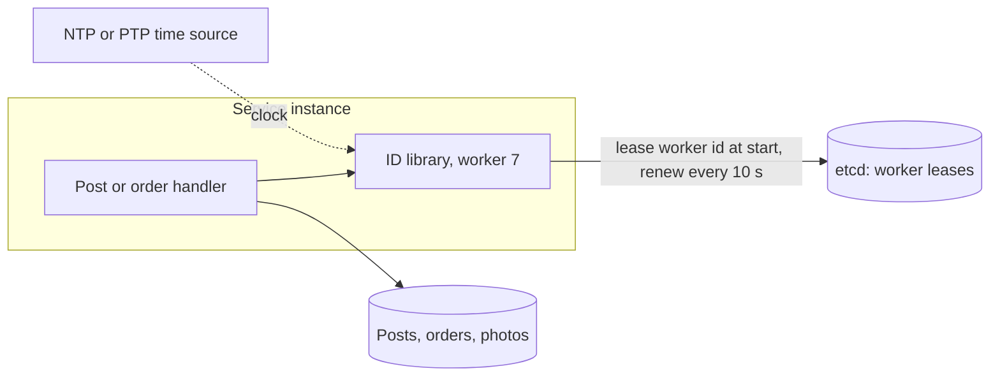

Pulse's `post_id` is the feed cursor and half of every 16-byte timeline entry; checkout's `order_id` is the idempotency anchor for the flash sale; every photo needs a key before its bytes reach object storage. All three are minted on the write path, so an ID service that costs a round trip — or goes down — puts itself in front of every write in the company. This case study designs the generator: 64 bits, roughly ordered by time, unique across a thousand machines and their restarts, minted locally in well under a microsecond.

:::key[First principle]
Uniqueness comes from **partitioning the ID space**, not from coordinating per ID: give each worker its own slice (a worker number), and inside it, count. Coordination happens once — when a worker leases its number — not once per ID. Random IDs skip even that, but only if there are enough bits: collisions arrive after roughly $\sqrt{2^b}$ IDs, not $2^b$.
:::

## 52.1 Requirements

**Functional**

- `next_id()` returns a unique 64-bit integer, callable from any service instance.
- IDs sort roughly by creation time, so they work as a feed cursor and append to the end of a B-tree index.
- Decodable: the creation time can be read back from the ID (useful for debugging and time-range scans).

**Non-functional**

- No network hop per ID; at least 10,000 IDs/s per process with no shared state on the hot path.
- Zero collisions across machines, restarts and clock corrections — a duplicate primary key is a data-loss bug, not an error rate.
- Fits a signed 64-bit integer (`bigint`, Java `long`), half the size of a UUID.
- Keeps working when the coordination service is down (only new workers may fail to start).

## 52.2 Estimates

Demand is one ID per created entity, taken from the running examples ([§2](/c/system-design/02-estimation)): Pulse posts, photo uploads and checkout orders, at the peaks the course already uses.

```python run
"""ID demand from the running examples, bit-layout capacity, and what 8 vs 16 bytes per ID costs."""
YEAR_MS = 365.25 * 86_400 * 1000

demand = {                                # (IDs per day, peak IDs per second)
    "Pulse posts": (10e6 * 2, 600),
    "photo uploads": (20e6 * 2, 1_200),
    "checkout orders": (50 * 86_400, 2_000),   # steady 50/s all day; flash-sale peak 2,000/s
}
per_day = sum(d for d, _ in demand.values())
peak = sum(p for _, p in demand.values())
for name, (d, p) in demand.items():
    print(f"{name:16s} {d:>12,.0f}/day  peak {p:>5,}/s")
print(f"{'total':16s} {per_day:>12,.0f}/day  peak {peak:>5,}/s  ({per_day * 365 / 1e9:.1f}B per year)")

print("\nlayout (time/worker/seq bits, tick)    range     workers   IDs/s per worker")
for name, t, w, s, tick_ms in [("Snowflake 41/10/12, 1 ms", 41, 10, 12, 1),
                               ("Instagram-style 41/13/10, 1 ms", 41, 13, 10, 1),
                               ("Sonyflake-style 39/16/8, 10 ms", 39, 16, 8, 10),
                               ("42/8/13, 1 ms", 42, 8, 13, 1)]:
    years = 2 ** t * tick_ms / YEAR_MS
    rate = 2 ** s * 1000 / tick_ms
    print(f"{name:34s} {years:6.1f} yr {2 ** w:>9,} {rate:>14,.0f}")

one = 2 ** 12 * 1000
print(f"\none Snowflake worker: {one:,} IDs/s = {one / peak:,.0f}x the combined peak of {peak:,}/s")
print(f"41-bit ms clock from a 2026 epoch runs out in {2026 + 2 ** 41 / YEAR_MS:.0f}")

posts_yr = 10e6 * 2 * 365
for size in (8, 16):
    pk = posts_yr * size / 1e9
    tl = 10e6 * 800 * (size + 8) / 1e9          # timeline entry = post id + 8-byte timestamp
    print(f"{size:2d}-byte IDs: Pulse post keys {pk:5.1f} GB/yr, raw timeline cache {tl:4.0f} GB")
```

```output
Pulse posts        20,000,000/day  peak   600/s
photo uploads      40,000,000/day  peak 1,200/s
checkout orders     4,320,000/day  peak 2,000/s
total              64,320,000/day  peak 3,800/s  (23.5B per year)

layout (time/worker/seq bits, tick)    range     workers   IDs/s per worker
Snowflake 41/10/12, 1 ms             69.7 yr     1,024      4,096,000
Instagram-style 41/13/10, 1 ms       69.7 yr     8,192      1,024,000
Sonyflake-style 39/16/8, 10 ms      174.2 yr    65,536         25,600
42/8/13, 1 ms                       139.4 yr       256      8,192,000

one Snowflake worker: 4,096,000 IDs/s = 1,078x the combined peak of 3,800/s
41-bit ms clock from a 2026 epoch runs out in 2096
 8-byte IDs: Pulse post keys  58.4 GB/yr, raw timeline cache  128 GB
16-byte IDs: Pulse post keys 116.8 GB/yr, raw timeline cache  192 GB
```

What the numbers decide:

- **Throughput is a non-issue.** The whole company peaks at 3,800 IDs/s; one Snowflake worker can mint 4.1 million. You run many workers for availability and locality (one per service instance), never for rate.
- **Range is the binding constraint.** 41 bits of milliseconds is 69.7 years — from a custom 2026 epoch, until 2096. A Unix-1970 epoch would waste 56 of those years before the first ID.
- **Size matters downstream.** 16-byte UUIDs instead of 8-byte IDs double Pulse's primary-key bytes (58 → 117 GB a year, before every secondary index that stores the key) and grow the timeline cache from 128 to 192 GB raw — one more cache shard for nothing ([§18.4](/c/system-design/18-cache)).

## 52.3 API

A library call inside each service, not an HTTP service — that is the point of the design:

```text
id = ids.next_id()                 # in-process, ~sub-microsecond, no I/O
ts, worker, seq = ids.decode(id)   # for logs, debugging, time-range scans
```

If some callers can't embed the library (another language, a batch job), expose a thin sidecar that hands out batches, so the round trip is amortised:

```http
POST /v1/ids:batch {count: 1000}  -> 200 {ids: ["112012383475712007", ...]}
```

:::warn[Send IDs to browsers as strings]
JavaScript numbers are doubles, exact only up to \(2^{53}\). With 22 bits below the timestamp, IDs pass \(2^{53}\) once the timestamp reaches \(2^{31}\) ms — **24.9 days after the epoch**. From then on `JSON.parse` silently rounds IDs, and two posts can share a rounded ID in the client. Serialize IDs as strings in JSON (`"id": "112012383475712007"`).
:::

## 52.4 Data model

The ID itself is the data model:

| Bits | Field | Size | Meaning |
|---:|---|---|---|
| 63 | sign | 1 | Always 0, so the ID is a positive signed 64-bit integer |
| 62–22 | timestamp | 41 | Milliseconds since 2026-01-01T00:00Z — 69.7 years |
| 21–12 | worker | 10 | 1,024 concurrently live workers |
| 11–0 | sequence | 12 | 4,096 IDs per millisecond per worker |

$$
\text{id} = (t - t_0) \ll 22 \;\;|\;\; \text{worker} \ll 12 \;\;|\;\; \text{seq}
$$

The only shared state is a small registry, kept in a consistent store (etcd, ZooKeeper, or the orchestrator's stable pod ordinal):

| Key | Value | Notes |
|---|---|---|
| `/ids/workers/{n}` | holder instance, lease (TTL 30 s, illustrative), last-seen timestamp | Leased at start-up, renewed every 10 s; the last-seen timestamp is the high-water mark a restarted holder must wait past |

## 52.5 High-level design



Generation never leaves the process. The lease is the only network dependency, and it is off the hot path: if etcd is down, running instances keep minting IDs with the workers they already hold; only instances that start during the outage can't get one.

## 52.6 Deep dive: sizing the bit layout

With $t$ timestamp bits at tick $\tau$, $w$ worker bits and $s$ sequence bits ($t + w + s = 63$):

$$
\text{range} = 2^{t}\,\tau, \qquad \text{workers} = 2^{w}, \qquad \text{rate per worker} = \frac{2^{s}}{\tau}
$$

Every bit moved between fields doubles one capacity and halves another, so start from the binding constraint:

:::example[Worked example · choosing a layout for the company]
- **Range**: the IDs must outlive the system. 41 bits at 1 ms = 69.7 years. 40 bits would be 34.8 years — too tight for primary keys that will still exist in 2060.
- **Workers**: one worker per service instance. Pulse runs 12 feed servers ([§2.5](/c/system-design/02-estimation)), and the posting, photo and checkout services add a few hundred at most; 1,024 leaves several times headroom for autoscaling and rolling deploys (a deploy briefly runs old and new instances at once, so both hold leases).
- **Sequence**: the flash sale averages 2,000 orders/s ≈ 2 per millisecond, spread over several checkout instances. 12 bits (4,096/ms) is thousands of times more than one worker needs; a 41/13/9 layout (8,192 workers, 512/ms) would also work.
- **Tick**: a 10 ms tick (Sonyflake-style) buys 174 years but caps a worker at 25,600 IDs/s — still 7× the company's peak, but a single bulk import could hit it.

Choose **41/10/12 at 1 ms** and a 2026 epoch. The decision that actually needs care is not the layout — it's how worker numbers are assigned (§52.9).
:::

## 52.7 Deep dive: why not just random IDs?

A random $b$-bit ID needs no workers, leases or clocks. The catch is the **birthday bound**: among $n$ random values from $2^b$, the probability that any two collide is

$$
P(n) = 1 - \prod_{i=0}^{n-1}\left(1 - \frac{i}{2^b}\right) \approx 1 - e^{-n(n-1)/2^{b+1}},
\qquad n_{50\%} \approx 1.18\,\sqrt{2^{b}}
$$

because there are \(n(n-1)/2\) pairs, each colliding with probability \(2^{-b}\). The square root is the trap: 64 bits sound like \(1.8 \times 10^{19}\) IDs, but a collision becomes likely after about \(5 \times 10^9\).

```python run
"""Birthday bound for random IDs: formula, a simulation check, and the numbers for Pulse."""
import math
import numpy as np


def p_collide(n, bits):
    return -math.expm1(-n * (n - 1) / 2 ** (bits + 1))


def n_for(p, bits):
    return math.sqrt(2 * 2 ** bits * math.log(1 / (1 - p)))


rng = np.random.default_rng(52)
n, trials = 77_163, 400
hits = sum(len(np.unique(rng.integers(0, 2 ** 32, n))) < n for _ in range(trials))
print(f"32-bit, n={n:,}: formula {p_collide(n, 32):.3f}, simulated {hits / trials:.3f} over {trials} trials")

print("\nbits  n at P=1e-6        n at P=50%")
for b in (32, 48, 64, 122):
    print(f"{b:4d}  {n_for(1e-6, b):14.3g}  {n_for(0.5, b):14.3g}")

pulse = {"one day of posts": 2e7, "one year": 7.3e9, "ten years": 7.3e10}
print("\nPulse posts with random IDs   64 random bits   122 bits (UUIDv4)")
for name, k in pulse.items():
    print(f"{name:28s} {p_collide(k, 64):14.3g} {p_collide(k, 122):18.3g}")

ms_per_year = 365.25 * 86_400_000                 # UUIDv7: 48-bit ms + 74 random bits
k = 3_800 / 1000                                  # IDs per ms at the combined peak, all year
print(f"\nUUIDv7 at 3,800 IDs/s for a year: P(any collision) = {ms_per_year * k * k / 2 ** 75:.2g}")
```

```output
32-bit, n=77,163: formula 0.500, simulated 0.480 over 400 trials

bits  n at P=1e-6        n at P=50%
  32            92.7        7.72e+04
  48        2.37e+04        1.98e+07
  64        6.07e+06        5.06e+09
 122        3.26e+15        2.71e+18

Pulse posts with random IDs   64 random bits   122 bits (UUIDv4)
one day of posts                   1.08e-05           3.76e-23
one year                              0.764           5.01e-18
ten years                                 1           5.01e-16

UUIDv7 at 3,800 IDs/s for a year: P(any collision) = 1.2e-11
```

The simulation agrees with the formula (0.480 vs 0.500; 400 trials have a standard error of 0.025).

:::chart[Probability that at least two random IDs collide, vs IDs generated]{type="line" x="IDs generated" y="P(at least one collision)" xlog="true" yfmt="pct" marks="20000000:one day of Pulse posts;7300000000:one year of Pulse posts"}
IDs generated, 32 random bits, 48 random bits, 64 random bits
1000, 0.0001, 0.0000, 0.0000
3162, 0.0012, 0.0000, 0.0000
10000, 0.0116, 0.0000, 0.0000
31623, 0.1099, 0.0000, 0.0000
100000, 0.6878, 0.0000, 0.0000
316228, 1.0000, 0.0002, 0.0000
1000000, 1.0000, 0.0018, 0.0000
3162278, 1.0000, 0.0176, 0.0000
10000000, 1.0000, 0.1628, 0.0000
17782794, 1.0000, 0.4298, 0.0000
31622777, 1.0000, 0.8307, 0.0000
100000000, 1.0000, 1.0000, 0.0003
316227766, 1.0000, 1.0000, 0.0027
1000000000, 1.0000, 1.0000, 0.0267
3162277660, 1.0000, 1.0000, 0.2374
5623413252, 1.0000, 1.0000, 0.5756
10000000000, 1.0000, 1.0000, 0.9335
31622776602, 1.0000, 1.0000, 1.0000
100000000000, 1.0000, 1.0000, 1.0000
:::

- **64 random bits fail Pulse within a year**: 7.3 billion posts give a 76% chance of a duplicate key. Even one day carries a 1-in-100,000 risk, every day.
- **122 random bits (UUIDv4) are safe at any realistic volume** — \(5 \times 10^{-16}\) after ten years — but cost 16 bytes and scatter inserts across the index (§52.10).
- **UUIDv7** spends 48 bits on milliseconds and 74 on randomness, so collisions can only happen within one millisecond: at the company's peak all year, \(1.2 \times 10^{-11}\). That is why it is the default when you can afford 16 bytes and don't want worker leases.

A useful inversion: to keep the lifetime collision probability below $p$ for $n$ IDs, you need \(b \ge \log_2\!\big(n^2 / 2p\big)\) random bits. For Pulse's ten years (\(7.3 \times 10^{10}\)) at \(p = 10^{-9}\): \(\log_2(5.3 \times 10^{21} / 2 \times 10^{-9})\) ≈ 101 bits — more than fits in 64, whatever you do.

## 52.8 Deep dive: the generator, and clocks that go backwards

The algorithm is a few lines; the care is in two edge cases. **Sequence overflow**: the 4,097th ID in one millisecond must wait for the next millisecond. **Clock rollback**: NTP steps, VM live migration or a leap-second smear can move the wall clock backwards; emitting IDs at the earlier time could reproduce IDs already issued with the same worker and sequence. The block below handles both and tests them with a fake clock (10,000 clock reads per simulated millisecond, faster than the sequence can absorb):

```python run
"""A Snowflake-style generator (41-bit ms | 10-bit worker | 12-bit sequence), tested with a fake clock."""
import threading

EPOCH_MS = 1_767_225_600_000              # 2026-01-01T00:00:00Z
WORKER_BITS, SEQ_BITS = 10, 12
SEQ_MASK = (1 << SEQ_BITS) - 1


class ClockMovedBack(Exception):
    pass


class Snowflake:
    def __init__(self, worker, clock, max_wait_ms=10):
        if not 0 <= worker < 1 << WORKER_BITS:
            raise ValueError("worker id out of range")
        self.worker, self.clock, self.max_wait = worker, clock, max_wait_ms
        self.last, self.seq, self.waits = -1, 0, 0
        self.lock = threading.Lock()

    def _wait_until(self, target):
        now = self.clock()
        while now < target:                  # spin: waits are at most a few ms
            self.waits += 1
            now = self.clock()
        return now

    def next_id(self):
        with self.lock:
            now = self.clock()
            if now < self.last:              # clock went backwards (NTP step, VM migration)
                if self.last - now > self.max_wait:
                    raise ClockMovedBack(f"{self.last - now} ms behind last issued ID")
                now = self._wait_until(self.last)
            if now == self.last:
                self.seq = (self.seq + 1) & SEQ_MASK
                if self.seq == 0:            # 4,096 IDs used this ms: wait for the next one
                    now = self._wait_until(self.last + 1)
            else:
                self.seq = 0
            self.last = now
            return ((now - EPOCH_MS) << (WORKER_BITS + SEQ_BITS)) | (self.worker << SEQ_BITS) | self.seq


def decode(i):
    return (i >> 22) + EPOCH_MS, (i >> 12) & 1023, i & SEQ_MASK


class FakeClock:                             # 10,000 reads per simulated ms: faster than 4,096 IDs/ms
    def __init__(self, ms):
        self.t = ms * 10_000

    def __call__(self):
        self.t += 1
        return self.t // 10_000


clock = FakeClock(EPOCH_MS + 86_400_000)
gen = Snowflake(worker=7, clock=clock)
ids = [gen.next_id() for _ in range(200_000)]
print(f"200,000 IDs: unique={len(set(ids)) == len(ids)}, increasing={ids == sorted(ids)}, "
      f"sequence-overflow spins={gen.waits:,}")
print(f"first ID {ids[0]} -> (ms, worker, seq) = {decode(ids[0])}; bits used: {ids[-1].bit_length()}")

for back in (5, 50):                         # step the clock backwards and keep generating
    clock.t -= back * 10_000
    before = gen.last
    try:
        nxt = gen.next_id()
        print(f"clock -{back} ms: waited, next ID still larger: {nxt > ids[-1]}, "
              f"issued at ms {decode(nxt)[0] - before:+d} vs last")
        ids.append(nxt)
    except ClockMovedBack as e:
        print(f"clock -{back} ms: refused ({e})")
```

```output
200,000 IDs: unique=True, increasing=True, sequence-overflow spins=283,343
first ID 362387865628672 -> (ms, worker, seq) = (1767312000000, 7, 0); bits used: 49
clock -5 ms: waited, next ID still larger: True, issued at ms +0 vs last
clock -50 ms: refused (50 ms behind last issued ID)
```

Two policies, chosen by the size of the jump:

| Rollback | Policy | Cost |
|---|---|---|
| ≤ `max_wait_ms` (10 ms here) | Spin until the clock passes the last issued timestamp | A few ms of added latency on a rare event |
| Larger | Refuse (raise), alert, and let the caller retry another instance | That instance stops minting until its clock recovers |
| Never acceptable | Keep minting at the earlier time | Silent duplicate primary keys |

Prevent large steps in the first place: run the time daemon in **slew** mode (adjust the clock rate, never step it) after boot, and alert on clock offset.

**Ordering across workers is only approximate.** Each worker's IDs are strictly increasing, but two workers whose clocks differ by ε can order two IDs minted less than ε apart the wrong way round. With clocks synced to within a few milliseconds (illustrative for NTP inside one data centre), two posts made 2 ms apart may sort in either order — invisible in a feed, which is why the cursor is `(created_at, post_id)` and never relies on IDs for business ordering. If you need a true total order (a ledger sequence), you need a single sequencer ([§56](/c/system-design/56-payments-ledger)) and its round trip.

## 52.9 Deep dive: leasing worker numbers

Two live workers with the same number will eventually mint the same ID. The lease protocol prevents it:

1. At start-up, claim a free `/ids/workers/{n}` key with a TTL lease (30 s, illustrative) in a linearizable store ([§8](/c/system-design/08-consistency)). Refuse to start if none is free.
2. Read the stored high-water timestamp and wait until the local clock passes it — this protects against a previous holder of `n` whose clock ran ahead.
3. Renew every 10 s and write the current timestamp as the new high-water mark.
4. If a renewal hasn't succeeded for 20 s (TTL minus a safety margin), **stop minting** — the lease may already belong to someone else. Fail closed: an instance that can't create orders is an outage; one that creates duplicate order IDs corrupts data.

In Kubernetes, a StatefulSet's stable ordinal (`checkout-17`) is a simpler worker number, provided the orchestrator guarantees no two pods share an ordinal at the same time; across clusters or regions, reserve high worker bits for the cluster (e.g. 3 bits → 8 clusters × 128 workers).

## 52.10 Alternatives, compared

| Scheme | Bytes | Time-ordered | Per-ID coordination | Failure mode | Fits |
|---|---:|---|---|---|---|
| DB auto-increment | 8 | Strictly | Yes: one writer, one round trip (~0.5 ms intra-DC) | Single writer is a bottleneck and SPOF | One database, < ~thousands of inserts/s |
| Ticket server, ranges of 10,000 | 8 | Per range only | Once per 10,000 IDs | Ranges lost on crash (gaps); ordering across servers broken | Compact IDs without clocks |
| UUIDv4 | 16 | No | None | Index inserts scattered: B-tree pages split in random places and settle ~69% full | Opaque public IDs, low insert rate |
| UUIDv7 / ULID | 16 | By ms | None | 16 bytes everywhere | Default when you don't control the fleet |
| **Snowflake** | **8** | **By ms, per worker exact** | **Lease at start-up** | Clock rollback, lease mistakes | High-volume keys, feed cursors |

**Time-ordered keys and sharding.** Time-ordered IDs make B-tree inserts append to the rightmost leaf — cache-friendly on one node. On a **range**-partitioned store, though, every new ID lands in the last range: one hot shard takes all writes ([§34](/c/system-design/34-sharding)). Shard by `hash(id)` or by owner (`author_id`), never by ID range.

## 52.11 Bottlenecks and failure modes

| Failure | Symptom | Fix | Cost |
|---|---|---|---|
| Clock steps back ≤ 10 ms | Brief spin | Wait it out (§52.8) | Milliseconds of latency |
| Clock steps back > 10 ms | Generator refuses | Alert; slew-only time sync; caller retries elsewhere | One instance out of rotation |
| Lease lost (network partition) | Instance can't renew | Stop minting after TTL − margin | Instance unavailable for writes |
| All 1,024 workers in use | New instances fail to start | Release leases on shutdown; widen worker bits | Fewer sequence or time bits |
| > 4,096 IDs in one ms on one worker | Spin to next ms | Batch callers across workers | ≤ 1 ms per 4,096 IDs |
| IDs sent to JavaScript as numbers | Rounded IDs, wrong item opened | Strings in JSON | A few bytes per ID |
| Range-sharded table keyed by ID | One shard takes all inserts | Hash or owner-based shard key | Range scans by ID need scatter-gather |
| Epoch or layout changed later | Old and new IDs collide or misorder | Treat the layout as a permanent contract; version via a reserved bit | — |

## 52.12 Trade-offs

- **8 bytes and order vs operational simplicity.** Snowflake costs a lease protocol and clock hygiene; UUIDv7 costs 8 extra bytes per key and per reference. For Pulse that's 64 GB of timeline cache — a shard — so Snowflake wins; for a low-volume internal tool, UUIDv7 wins.
- **Wait vs refuse on rollback.** Waiting trades latency for availability on small jumps; refusing trades availability for correctness on large ones. Never trade correctness.
- **Exposed time.** Anyone can decode creation time (and the worker) from a Snowflake ID, and sequential IDs reveal volume. For public URLs where that matters, map to an opaque token ([§60](/c/system-design/60-url-shortener)).

## 52.13 What I'd say in 45 minutes

> "The company peaks at 3,800 new entities a second — posts, photos, orders — so throughput is trivial;
> the requirements that bite are 64 bits, time order for cursors, and no round trip. Random 64-bit IDs
> are out: by the birthday bound, a year of Pulse posts collides with 76% probability. I'd use a
> Snowflake layout: 41 bits of milliseconds from a 2026 epoch (69.7 years), 10 bits of worker (1,024),
> 12 bits of sequence (4.1M IDs/s per worker). Generation is in-process; the only coordination is a
> worker-number lease in etcd at start-up, renewed every 10 s, and an instance that loses its lease stops
> minting. The generator spins through clock rollbacks up to 10 ms and refuses beyond that, and time
> sync runs in slew mode. IDs go to clients as strings, and tables keyed by ID are hash-sharded so the
> newest IDs don't all hit one shard. If 16-byte keys were acceptable, UUIDv7 removes the lease."

## 52.14 Check yourself

:::qa[You need 2,000 live workers and IDs must last 100 years with 1 ms ticks. Does a 63-bit layout work, and what's left for the sequence?]
100 years needs \(\lceil \log_2(100 \times 3.156 \times 10^{10}) \rceil\) = 42 timestamp bits (\(2^{42}\) ms = 139 years); 2,000 workers need 11 bits. That leaves 63 − 42 − 11 = 10 sequence bits: 1,024 IDs per ms per worker, ~1M/s — still far above any one instance's need.
:::

:::qa[A team proposes 64-bit random IDs for photos "because UUIDs are too big". Is it safe?]
No. The photo service creates \(4 \times 10^7\) photos/day, \(1.46 \times 10^{10}\) a year. \(P \approx 1 - e^{-n^2/2^{65}}\) with \(n^2 = 2.1 \times 10^{20}\) and \(2^{65} = 3.7 \times 10^{19}\): \(1 - e^{-5.8}\) ≈ 99.7% chance of a duplicate within the first year.
:::

:::qa[An NTP step moves a host's clock back 200 ms. What does each design do?]
Snowflake as written refuses (200 ms > the 10 ms wait limit) until the clock passes its last issued timestamp — ~200 ms of unavailability for that instance, no duplicates. A naive generator that ignores rollback reissues timestamps from the last 200 ms with sequences restarting at 0: duplicates of IDs it already handed out. UUIDv7 is unaffected for uniqueness (74 random bits), but its IDs briefly go backwards in time.
:::

:::qa[Why does the restart protocol wait past a stored high-water timestamp, if the lease already guarantees one holder?]
The lease guarantees one *live* holder, not that the new holder's clock is ahead of the old one's. If the previous holder of worker 7 ran 50 ms fast and minted IDs up to its clock, a new holder with a correct clock would re-mint those 50 ms of (timestamp, worker 7, sequence) combinations. Waiting past the recorded high-water mark closes that gap.
:::

Next: [§53 Design a metrics and alerting pipeline](/c/system-design/53-metrics-pipeline) — ingesting every service's telemetry without letting one label take the system down.
