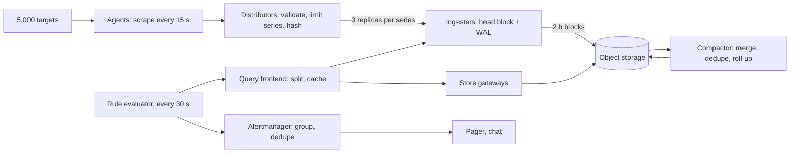

[§27](/c/system-design/27-observability) sized telemetry for one service: Pulse's request histogram is 31,500 series and fine. Now the platform team must run metrics for the whole company — 12 Pulse feed servers, the photo service's storage and CDN fleet, checkout's API and capture consumers, databases, caches, queues and the Kubernetes nodes under them. On-call engineers need "p99 of checkout, right now" in under a second during an incident, and the system that pages them must not be the thing that's down. This case study designs that platform and sizes it from first principles.

:::key[First principle]
Every cost in a metrics system is a product. **Series** = product of label cardinalities; **bytes** = series × samples per second × bytes per sample; **query work** = series touched × (range ÷ step). Bound the first product at ingestion (it is the only place a limit can be enforced), and shrink the third with pre-aggregation and rollups — the second then takes care of itself.
:::

## 53.1 Requirements

**Functional**

- Collect counters, gauges and histograms with labels from every instance (scrape or push).
- Query by metric and label matchers over a time range: rates, sums, quantiles from histogram buckets.
- Evaluate alert rules continuously; route, group and deduplicate notifications.
- Retention: raw for 15 days, coarser for 2 years (capacity planning, year-over-year).

**Non-functional**

- Ingest ≥ 1M samples/s with 50% growth headroom; emitting a metric never blocks the application.
- Dashboard queries over the last hour: p99 < 1 s; 30-day panels: < 5 s.
- Alert evaluation every 30 s; a burn-rate page within minutes of an outage ([§27.3](/c/system-design/27-observability)).
- Survive the loss of a zone, and alert even when the platform itself is degraded.

## 53.2 Estimates

Fleet inputs are illustrative: **5,000 scrape targets** (pods and nodes across all services) exposing **2,000 series each** (runtime, HTTP, client libraries, node metrics), scraped every **15 s**. Per-unit costs come from §27: ~1.5 bytes per compressed sample and ~4 KB of RAM per in-memory series (both illustrative — measure yours).

```python run
"""Metrics platform sizing: series, samples/s, bytes, RAM, ingesters, churn (per-unit sizes illustrative)."""
import math

TARGETS, SERIES_PER_TARGET, SCRAPE_S = 5_000, 2_000, 15
RAW_B, DISK_B, RAM_B = 16, 1.5, 4_000      # bytes/sample raw (ts+value), compressed, RAM per head series
RF, INGESTER_SAMPLES, UTIL = 3, 250_000, 0.6

series = TARGETS * SERIES_PER_TARGET
sps = series / SCRAPE_S
print(f"active series {series / 1e6:.0f}M, samples {sps:,.0f}/s, raw {sps * RAW_B / 1e6:.1f} MB/s "
      f"({sps * RAW_B * 8 / 1e6:.0f} Mbit/s)")
day = sps * 86_400 * DISK_B
print(f"compressed disk {day / 1e9:.0f} GB/day per copy; 15 days raw = {15 * day / 1e12:.1f} TB")
print(f"head RAM {series * RAM_B / 1e9:.0f} GB per copy, {RF * series * RAM_B / 1e9:.0f} GB at RF={RF}")
n = math.ceil(RF * sps / (INGESTER_SAMPLES * UTIL))
print(f"ingesters: {RF} x {sps:,.0f} / ({INGESTER_SAMPLES:,} x {UTIL}) -> {n}, "
      f"{RF * series * RAM_B / 1e9 / n:.1f} GB head RAM each")

print("\none latency histogram, platform-wide (30 routes, 14 buckets incl. _sum/_count)")
for name, mult in [("route x status class(5)", 5), ("x method(4)", 20), ("x pod(5,000)", 20 * 5_000),
                   ("x pod, method dropped", 5 * 5_000), ("pod aggregated away", 5)]:
    print(f"  {name:24s} {30 * 14 * mult:>12,} series")

print("\nchurn: every deploy gives each pod a new name -> new series; head block spans 2 h")
for name, deploys, in_window in [("1 deploy/day, spread out", 1, 1 * 2 / 24),
                                 ("4 deploys/day, spread out", 4, 4 * 2 / 24),
                                 ("12 deploys/day, spread out", 12, 12 * 2 / 24),
                                 ("3 fleet-wide deploys in 2 h", 3, 3)]:
    head = series * (1 + in_window)        # old pods' series stay in the head until it is cut
    print(f"  {name:28s} head {head / 1e6:5.1f}M series, {head * RAM_B / 1e9:5.0f} GB RAM per copy, "
          f"{series * deploys / 1e6:4.0f}M new series/day")
```

```output
active series 10M, samples 666,667/s, raw 10.7 MB/s (85 Mbit/s)
compressed disk 86 GB/day per copy; 15 days raw = 1.3 TB
head RAM 40 GB per copy, 120 GB at RF=3
ingesters: 3 x 666,667 / (250,000 x 0.6) -> 14, 8.6 GB head RAM each

one latency histogram, platform-wide (30 routes, 14 buckets incl. _sum/_count)
  route x status class(5)         2,100 series
  x method(4)                     8,400 series
  x pod(5,000)               42,000,000 series
  x pod, method dropped      10,500,000 series
  pod aggregated away             2,100 series

churn: every deploy gives each pod a new name -> new series; head block spans 2 h
  1 deploy/day, spread out     head  10.8M series,    43 GB RAM per copy,   10M new series/day
  4 deploys/day, spread out    head  13.3M series,    53 GB RAM per copy,   40M new series/day
  12 deploys/day, spread out   head  20.0M series,    80 GB RAM per copy,  120M new series/day
  3 fleet-wide deploys in 2 h  head  40.0M series,   160 GB RAM per copy,   30M new series/day
```

Reading the numbers:

- **Bytes are small.** 667,000 samples/s is 10.7 MB/s before compression and 86 GB/day after — one machine's disk could hold the 15-day raw tier (1.3 TB). Bandwidth and disk don't shape this design.
- **Memory is the constraint.** Each active series costs RAM for its in-memory chunk and index entry: 40 GB per copy, 120 GB replicated three ways, split over 14 ingesters (250,000 samples/s each, illustrative, run at 60%).
- **One label can multiply everything.** A single histogram with a `pod` label is 42M series — four times the whole platform's budget. Drop the label at ingestion, or keep it only in a per-pod recording rule that is aggregated away.
- **Churn counts, not just cardinality.** A series that existed for ten minutes still occupies the head block until it's cut. Three fleet-wide deploys in two hours quadruple the head to 40M series (160 GB per copy) with no change in what's being measured.

## 53.3 API

```http
POST /api/v1/push        (snappy-compressed protobuf: series labels + samples)    -> 204
GET  /api/v1/query_range?query=histogram_quantile(0.99, sum by (le, route)
       (rate(http_request_duration_seconds_bucket{service="checkout"}[5m])))&start&end&step=30s
                                                                                  -> 200 {series[]}
GET  /api/v1/series?match[]={__name__="http_requests_total",service="checkout"}   -> 200 {series[]}
PUT  /api/v1/rules/{group}   {interval: 30s, rules: [{alert, expr, for, labels}]}  -> 204
```

Responses that read from a degraded shard carry `"partial": true` — a dashboard showing half the fleet as if it were the whole is worse than an error.

## 53.4 Data model

| Concept | Shape | Notes |
|---|---|---|
| Series | `metric name + sorted label set` → series ID (hash) | The unit of memory, index and cardinality |
| Sample | `(series ID, timestamp ms, float64)` | 16 bytes raw; append-only |
| Chunk | ~120 samples of one series, compressed | Delta-of-delta timestamps + XOR'd floats: ~1.4 B/sample in Facebook's Gorilla paper; 1.5 B used here |
| Head block | Last ~2 h of chunks + in-memory index, in RAM, with a write-ahead log | Where queries for "now" are served |
| Block | Immutable 2 h (later compacted to 24 h) directory: chunks + inverted index | Uploaded to object storage; deleting a block is how retention works |
| Inverted index | label pair → sorted list of series IDs | `service="checkout"` ∩ `route="/pay"` is a sorted-list intersection |

## 53.5 High-level design



- **Agents** scrape locally (pull keeps a dead target visible as `up == 0`) and push upstream, buffering a few minutes on disk if the platform is unreachable.
- **Distributors** are stateless: they enforce per-tenant and per-metric series limits, then hash each series to 3 of the ingesters and acknowledge on 2 of 3 ([§8.3](/c/system-design/08-consistency)).
- **Ingesters** hold the head block in memory and a WAL on disk; every 2 hours they cut an immutable block to object storage. Queries for the last few hours hit ingesters; older ranges hit object storage through store gateways.
- **Compactor** merges the three replicas' blocks into one (deduplicating samples), merges 2 h blocks into 24 h blocks, and writes the rollups of §53.7.

A message queue between distributors and ingesters (sized as in [§25](/c/system-design/25-message-queue)) is optional: 10.7 MB/s is trivial for a log, and it lets ingesters restart without back-pressuring agents — at the cost of another system on the critical path of the system that tells you when systems break.

## 53.6 Deep dive: cardinality and churn

The series count of a metric is the product of its labels' value counts ([§27.4](/c/system-design/27-observability) derives it for one service):

$$
\text{series} = (\text{buckets} + 2) \times \prod_{\ell \in \text{labels}} |\ell|, \qquad
\text{head series} = S_\text{active} \times \left(1 + \text{replacements in the head window}\right)
$$

The first formula is why one bad label is fatal: `pod` (5,000 values) turns a 2,100-series histogram into 10.5M even after `method` is dropped. The second is why deploys matter: Kubernetes gives every new pod a new name, so every rollout creates a full new set of series while the old ones linger in the head until it's cut.

:::example[Worked example · a developer adds `user_id` to checkout's request counter]
Checkout's counter has 30 routes × 5 status classes = 150 series. During the flash sale, 2,000 orders/s from distinct users add up to 1.2M new `user_id` values in 10 minutes — 180M series, 720 GB of head RAM per copy. Ingesters run out of memory within minutes, and **every** service loses its metrics in the middle of the company's busiest event.

The defence is at the distributor, before the series exists anywhere: a per-metric limit (e.g. 50,000 series) rejects new series for that metric only, increments `samples_rejected_total{reason="series_limit", metric=...}`, and alerts the owning team. Checkout loses one metric; everything else keeps working.
:::

| Rule | Enforced where | Number |
|---|---|---|
| Label values must be bounded and known (route template, status class, region) | Code review + lint | — |
| Per-metric series limit | Distributor | ~50,000 (illustrative) |
| Per-tenant (team) series limit | Distributor | e.g. 10% of platform capacity |
| Drop or aggregate `pod`-level series that dashboards never use | Agent relabelling / recording rules | 10.5M → 2,100 for the histogram above |
| Spread deploys out, or shorten the head window under churn | Deploy tooling | 3 deploys in 2 h → 4× head |

## 53.7 Deep dive: rollups and retention

Raw 15-second samples are needed for incidents (the last hours to days); capacity planning over a year needs hourly points. Store each resolution only as long as it's useful: **raw for 15 days, 5-minute rollups for 90 days, 1-hour rollups for 2 years.** A rollup keeps enough aggregates to answer the usual questions: a counter or histogram bucket keeps its last value (rates still work), a gauge keeps min, max, sum and count. With an illustrative 70/30 split between counters and gauges and 4 bytes per rollup value (aggregates compress worse than raw samples):

```python run
"""Retention tiers: raw 15 s for 15 days, 5-min rollups for 90 days, 1-h rollups for 2 years."""
SERIES, SCRAPE_S = 10e6, 15
RAW_B, ROLL_B = 1.5, 4.0                  # bytes per stored value: raw sample, rollup aggregate (illustrative)
VALUES = 0.7 * 1 + 0.3 * 4                # 70% counters/buckets keep 1 value, 30% gauges keep min/max/sum/count

raw_day = SERIES * 86_400 / SCRAPE_S * RAW_B
r5_day = SERIES * 288 * VALUES * ROLL_B
r1h_day = SERIES * 24 * VALUES * ROLL_B
print(f"per day: raw {raw_day / 1e9:.1f} GB, 5-min {r5_day / 1e9:.1f} GB ({raw_day / r5_day:.1f}x smaller), "
      f"1-h {r1h_day / 1e9:.2f} GB ({raw_day / r1h_day:.0f}x smaller)")


def stored(days, tiered):
    if not tiered:
        return days * raw_day
    return (min(days, 15) * raw_day + min(days, 90) * r5_day + days * r1h_day)


for d in (15, 90, 365, 730):
    a, b = stored(d, False), stored(d, True)
    print(f"retain {d:3d} days: raw only {a / 1e12:6.1f} TB, tiered {b / 1e12:5.1f} TB ({a / b:4.1f}x)")

print("\npoints scanned by a 30-day panel over one histogram (30 routes x 5 status x 14 buckets)")
for name, series, step_s in [("raw, every pod (x5,000)", 2_100 * 5_000, 15),
                             ("recording rule, pods summed", 2_100, 15),
                             ("recording rule + 5-min rollup", 2_100, 300),
                             ("recording rule + 1-h rollup", 2_100, 3600)]:
    pts = series * 30 * 86_400 / step_s
    print(f"  {name:31s} {pts:>16,.0f} points, {pts / 50e6:9.2f} core-s at 50M points/s")
```

```output
per day: raw 86.4 GB, 5-min 21.9 GB (3.9x smaller), 1-h 1.82 GB (47x smaller)
retain  15 days: raw only    1.3 TB, tiered   1.7 TB ( 0.8x)
retain  90 days: raw only    7.8 TB, tiered   3.4 TB ( 2.3x)
retain 365 days: raw only   31.5 TB, tiered   3.9 TB ( 8.0x)
retain 730 days: raw only   63.1 TB, tiered   4.6 TB (13.7x)

points scanned by a 30-day panel over one histogram (30 routes x 5 status x 14 buckets)
  raw, every pod (x5,000)         1,814,400,000,000 points,  36288.00 core-s at 50M points/s
  recording rule, pods summed          362,880,000 points,      7.26 core-s at 50M points/s
  recording rule + 5-min rollup         18,144,000 points,      0.36 core-s at 50M points/s
  recording rule + 1-h rollup            1,512,000 points,      0.03 core-s at 50M points/s
```

:::chart[Stored metrics vs retention horizon: raw only vs raw 15 d + 5-min 90 d + 1-h rollups (10M series)]{type="line" x="retention (days)" y="stored, one copy (TB)" unit=" TB" marks="15:raw tier ends;90:5-min tier ends"}
days, raw only, tiered
0, 0.0, 0.00
15, 1.3, 1.65
30, 2.6, 2.01
60, 5.2, 2.72
90, 7.8, 3.43
120, 10.4, 3.48
180, 15.6, 3.59
240, 20.7, 3.70
300, 25.9, 3.81
365, 31.5, 3.93
450, 38.9, 4.09
540, 46.7, 4.25
630, 54.4, 4.42
730, 63.1, 4.60
:::

Three conclusions:

1. **Rollups pay off with time, not immediately.** For the first 15 days tiering costs *more* (all three resolutions are written); by two years it's 13.7× smaller — 4.6 TB instead of 63 TB per copy. The 1-hour tier is what makes long retention cheap (47× per day); the 5-minute tier saves only 3.9×.
2. **The real win of rollups is query cost.** A 30-day panel over raw per-pod data scans 1.8 trillion points — ~10 core-hours at an illustrative 50M points/s per core: it will time out. Pre-aggregating pods away with a **recording rule** (evaluated every 15 s, stored as its own 2,100 series) cuts that 5,000×; reading the 5-minute rollup cuts another 20× to 0.36 core-seconds. Query frontends pick the coarsest resolution whose step still gives ≥ 1 point per pixel.
3. **Rollups lose information.** You can't compute a p99 over 5-minute windows from averaged p99s — but you can from summed histogram buckets, which is why buckets (counters) are rolled up by keeping their values, never their quantiles ([§27.2](/c/system-design/27-observability)).

## 53.8 Deep dive: aggregation windows

`rate(x[w])` divides the counter increase over the window by its length. Two constraints pick $w$:

- **Enough scrapes**: the window needs at least two samples; with one missed scrape it still needs two, so $w \ge 4 \times$ the scrape interval (1 minute at 15 s) is the usual floor.
- **Enough events**: requests arrive roughly as a Poisson process, so a window that sees $\lambda w$ events has relative noise

$$
\frac{\sigma(\hat{r})}{r} = \frac{1}{\sqrt{\lambda\,w}}
$$

```python run
"""How noisy is rate() over a window? Poisson requests, a counter scraped every 15 s."""
import numpy as np

rng = np.random.default_rng(53)
SCRAPE, HOURS = 15, 24
for lam in (5, 50, 500):                       # true requests per second
    counter = np.cumsum(rng.poisson(lam * SCRAPE, HOURS * 3600 // SCRAPE))
    cells = []
    for w in (60, 300, 900, 3600):
        k = w // SCRAPE                        # scrapes per window
        est = (counter[k:] - counter[:-k]) / w
        cells.append(f"{w // 60:>3d} min {np.std(est) / lam:6.2%} (theory {1 / np.sqrt(lam * w):6.2%})")
    print(f"{lam:>3d} req/s | " + " | ".join(cells))
```

```output
  5 req/s |   1 min  5.81% (theory  5.77%) |   5 min  2.68% (theory  2.58%) |  15 min  1.57% (theory  1.49%) |  60 min  0.82% (theory  0.75%)
 50 req/s |   1 min  1.76% (theory  1.83%) |   5 min  0.79% (theory  0.82%) |  15 min  0.49% (theory  0.47%) |  60 min  0.24% (theory  0.24%)
500 req/s |   1 min  0.57% (theory  0.58%) |   5 min  0.26% (theory  0.26%) |  15 min  0.15% (theory  0.15%) |  60 min  0.07% (theory  0.07%)
```

:::chart[Relative noise of rate() vs window length (Poisson arrivals, 1/√(λw))]{type="line" x="window (minutes)" y="noise, 1 standard deviation" ylog="true" unit="%" points="true"}
window min, 5 req/s, 50 req/s, 500 req/s
1, 5.77, 1.83, 0.577
2, 4.08, 1.29, 0.408
5, 2.58, 0.816, 0.258
10, 1.83, 0.577, 0.183
15, 1.49, 0.471, 0.149
30, 1.05, 0.333, 0.105
60, 0.745, 0.236, 0.0745
:::

The noise matters most for **ratios of small counts** — error rates. Checkout at its steady 50 orders/s with a 0.1% error rate sees 0.05 errors/s: a 5-minute window holds ~15 errors, so the measured error rate has ~26% noise (\(1/\sqrt{15}\)). That is why burn-rate rules pair a long window (stable) with a short one (fast reset), and why low-traffic services need a minimum event count before alerting ([§27.3](/c/system-design/27-observability)). Longer windows also delay detection: a rate over $w$ reflects a step change fully only after $w$.

## 53.9 Deep dive: evaluating alerts you can trust

- **Evaluate recording rules first, alerts on top.** Each burn-rate rule reads a few pre-aggregated series, so 5,000 rules every 30 s is cheap; the same rules over raw per-pod data would not be.
- **Don't evaluate on stale data.** If an ingester shard is missing, `rate()` over the gap reads as zero errors — a false "all clear". Rules check the query's `partial` flag and the freshness of `up` before evaluating, and fire a "rules evaluating on partial data" alert instead.
- **Group and deduplicate.** One dead database makes 40 services' error alerts fire together. Alertmanager groups by `cluster` and `dependency`, waits ~30 s (`group_wait`) to collect the burst, and sends one page; inhibition rules suppress symptoms when the cause alert (`DatabaseDown`) is already firing.
- **Watch the watcher.** A permanently firing `Watchdog` alert is sent every minute to an external heartbeat service in a different failure domain; if it stops arriving, that service pages. Without it, a dead alerting pipeline looks exactly like a quiet night.

## 53.10 Bottlenecks and failure modes

| Failure | Symptom | Fix | Cost |
|---|---|---|---|
| Unbounded label (`user_id`, raw URL) | Ingester OOM, all metrics gone | Per-metric series limit at the distributor | That metric's new series dropped |
| Deploy churn | Head RAM 2–4× for hours | Stagger rollouts; size head for churn; stable label for replicas | Slower deploys or more RAM |
| Long-range dashboard over raw data | Query timeouts, querier OOM | Recording rules + rollups; max points per query | Less detail on long ranges |
| Ingester crash | Recent data on that node gone | RF = 3 with 2/3 write quorum, WAL replay on restart | 3× head RAM |
| Object storage slow or down | Old ranges fail; recent still fine | Store-gateway caches; queries return `partial` | Degraded history during the outage |
| Platform down during an incident | Blind and silent | Watchdog to an external heartbeat; agents buffer on disk | A second, tiny monitoring path |
| Ratio alerts on low traffic | Flapping pages | Minimum event counts, longer windows (§53.8) | Slower detection |

## 53.11 Trade-offs

- **Pull vs push.** Scraping makes a dead target visible (`up == 0`) and lets the platform control load; push suits short-lived jobs and crosses firewalls. The design scrapes locally and pushes upstream — both properties, one more hop.
- **Precision vs cost.** Raw per-pod data for two years is 63 TB and unqueryable; rollups keep 4.6 TB and answer capacity questions but can't replay an old incident at 15-second resolution.
- **Queue in the ingest path.** Smooths ingester restarts and lets you replay; adds latency and a dependency to the system that must be the last one standing.
- **Exactness.** Metrics are approximate by design (sampled every 15 s, windowed, rolled up). Per-request truth lives in traces and logs ([§27](/c/system-design/27-observability)); billing-grade counts come from a batch job over events ([§17](/c/system-design/17-batch-and-stream)).

## 53.12 What I'd say in 45 minutes

> "5,000 targets × 2,000 series scraped every 15 s is 10M active series and 667,000 samples a second.
> Bytes are easy — 86 GB a day compressed — memory is the constraint: about 4 KB per active series, 120 GB
> across 14 ingesters with three replicas. So the first defence is a per-metric series limit at the
> distributor, because one `user_id` label during the flash sale is 180M series and takes down
> everyone's metrics; churn from deploys is the second, quieter multiplier. Ingesters keep a 2-hour head
> block with a WAL and ship immutable blocks to object storage; a compactor deduplicates replicas and
> writes 5-minute and 1-hour rollups, which take two-year retention from 63 TB to 4.6 TB and a 30-day
> panel from 1.8 trillion points to 18 million when combined with recording rules. Alerts are burn-rate
> rules on recording rules, evaluated every 30 s, never on partial data, grouped in Alertmanager, and a
> watchdog alert to an external heartbeat tells us when the platform itself is down."

## 53.13 Check yourself

:::qa[The fleet grows to 12,000 targets and the scrape interval drops to 10 s. Recompute samples/s, head RAM per copy and the ingester count.]
Series: 12,000 × 2,000 = 24M; samples/s: 24M / 10 = 2.4M. Head RAM: 24M × 4 KB = 96 GB per copy, 288 GB at RF 3. Ingesters: \(3 \times 2.4\text{M} / (250{,}000 \times 0.6)\) = 48. The interval change alone raises samples by 1.5× but not RAM; the targets raise both.
:::

:::qa[Why is a 1-minute rate() window on a 15 s scrape the minimum, and what's its noise for a service doing 20 requests/s?]
A 1-minute window holds 4 scrapes, so it still has ≥ 2 samples if one scrape is missed. Noise is \(1/\sqrt{20 \times 60}\) ≈ 2.9% for the request rate — but its error rate at 0.5% is based on ~6 errors per minute, \(1/\sqrt{6}\) ≈ 41% noise: use longer windows for error ratios.
:::

:::qa[Storage cost is fine but a 90-day dashboard times out. What do you change?]
Query work, not storage: points = series × range ÷ step. Add a recording rule that aggregates away high-cardinality labels (pod, instance), and make the query frontend read 5-minute or 1-hour rollups for long ranges. The per-pod histogram over 90 days drops from ~5.4 trillion raw points to ~54 million with the recording rule at 5-minute resolution.
:::

:::qa[An ingester shard is down for 10 minutes. What should the checkout burn-rate alert do?]
Not evaluate as if the missing series were zero. The query reports `partial`; the rule evaluator skips the rule (or evaluates on the replicas, which RF = 3 normally provides) and raises a "partial data" alert of its own. Silence computed from missing data is the most dangerous output a monitoring system has.
:::

Next: [§54 Design a news feed](/c/system-design/54-news-feed) — Pulse's fan-out, sized end to end.
