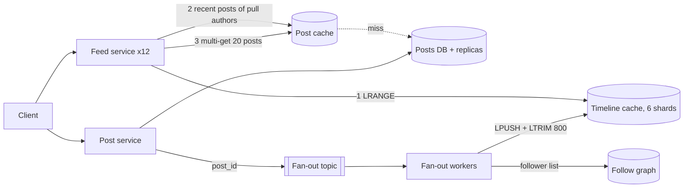

Pulse is the course's running example: 10M daily users who each open their feed 20 times and post twice a day, with posts of ~1 KB and an average of 200 followers. Earlier sections built pieces of it — the answering framework sketched the design ([§1](/c/system-design/01-answering-framework)), the cache section sized its Redis cluster ([§18](/c/system-design/18-cache)), the queue section the spike buffer ([§25](/c/system-design/25-message-queue)). This case study puts them together and settles the question every feed interview turns on: when a user posts, do you do the work now, for every follower, or later, for every reader?

:::key[First principle]
A feed read must merge posts from ~200 people in well under 200 ms. Precompute the merge at **write** time (push each post ID into every follower's timeline) and a read becomes one key lookup; the price is that a post's cost grows with its author's follower count. Total work favours push for everyone — but push turns a big account's post into a **burst** that takes followers ÷ insert rate seconds. Pull exactly the accounts whose burst would break the freshness target.
:::

## 54.1 Requirements

**Functional**

- Post (text + media references), follow and unfollow.
- Read a feed of followees' posts, newest first with light ranking, paginated.
- See your own post in your feed immediately; like counts may lag.

**Non-functional**

- Feed read p99 < 200 ms at 6,000 reads/s peak.
- Freshness: a new post appears in followers' feeds within **5 s** (p99).
- Availability over consistency: a slightly stale feed beats an error ([§8](/c/system-design/08-consistency)).
- No account — even one with a million followers — can delay other users' posts.

## 54.2 Estimates

All inputs are the course's Pulse numbers ([§2](/c/system-design/02-estimation)); per-key memory overheads are the illustrative ones measured in [§18.4](/c/system-design/18-cache).

```python run
"""Pulse news feed: every capacity number derived from the running example (sizes illustrative)."""
import math

DAU, READS, POSTS, FOLLOWERS, PEAK = 10e6, 20, 2, 200, 3
reads, posts = DAU * READS / 1e5, DAU * POSTS / 1e5          # the 10^5 s/day shortcut
inserts = posts * FOLLOWERS
print(f"feed reads {reads:,.0f}/s avg, {PEAK * reads:,.0f} peak; posts {posts:,.0f}/s avg, {PEAK * posts:,.0f} peak")
print(f"fan-out on write: {inserts:,.0f} timeline inserts/s avg, {PEAK * inserts:,.0f} peak "
      f"({FOLLOWERS}x the post rate)")
print(f"fan-out on read instead: {PEAK * reads:,.0f} x {FOLLOWERS} = {PEAK * reads * FOLLOWERS / 1e6:.1f}M "
      f"followee lookups/s at peak, all on the request path")

servers = math.ceil(PEAK * reads / (1_000 * 0.6)) + 2         # 1,000 QPS per server, 60% target, 2 spares
print(f"feed servers: ceil(6,000 / 600) + 2 spares = {servers}")

ENTRIES, ENTRY_B, KEY_B, FRAG = 800, 16, 80, 1.2
raw = DAU * ENTRIES * ENTRY_B
tl = DAU * (KEY_B + ENTRIES * (ENTRY_B + 2)) * FRAG          # Redis list encoding, from section 18.4
posts_cache = 44e6 * (KEY_B + 1_000) * FRAG
print(f"timelines: raw {raw / 1e9:.0f} GB -> {tl / 1e9:.0f} GB in RAM; post bodies {posts_cache / 1e9:.0f} GB; "
      f"{math.ceil((tl + posts_cache) / 40e9)} primaries at 40 GB maxmemory")
print(f"timeline holds {ENTRIES // 20} pages of 20; ~{ENTRIES / (POSTS * FOLLOWERS):.0f} days of posts "
      f"for an average user")

for h in (0.90, 0.94, 0.99):
    print(f"post-cache hit {h:.0%}: database {(1 - h) * PEAK * reads:,.0f} batched queries/s at peak")

edges = DAU * FOLLOWERS
print(f"follow graph: {edges / 1e9:.0f}B edges x 16 B x 2 directions = {edges * 32 / 1e9:.0f} GB")
print(f"posts: {DAU * POSTS * 1e3 / 1e9:.0f} GB/day, {DAU * POSTS * 1e3 * 365 / 1e12:.1f} TB/yr; "
      f"feed egress {PEAK * reads * 20e3 / 1e6:.0f} MB/s at peak")
for f in (10_000, 250_000, 1_000_000, 10_000_000):
    print(f"post by an account with {f:>10,} followers at 50,000 inserts/s: {f / 50_000:6.1f} s to deliver")
```

```output
feed reads 2,000/s avg, 6,000 peak; posts 200/s avg, 600 peak
fan-out on write: 40,000 timeline inserts/s avg, 120,000 peak (200x the post rate)
fan-out on read instead: 6,000 x 200 = 1.2M followee lookups/s at peak, all on the request path
feed servers: ceil(6,000 / 600) + 2 spares = 12
timelines: raw 128 GB -> 174 GB in RAM; post bodies 57 GB; 6 primaries at 40 GB maxmemory
timeline holds 40 pages of 20; ~2 days of posts for an average user
post-cache hit 90%: database 600 batched queries/s at peak
post-cache hit 94%: database 360 batched queries/s at peak
post-cache hit 99%: database 60 batched queries/s at peak
follow graph: 2B edges x 16 B x 2 directions = 64 GB
posts: 20 GB/day, 7.3 TB/yr; feed egress 120 MB/s at peak
post by an account with     10,000 followers at 50,000 inserts/s:    0.2 s to deliver
post by an account with    250,000 followers at 50,000 inserts/s:    5.0 s to deliver
post by an account with  1,000,000 followers at 50,000 inserts/s:   20.0 s to deliver
post by an account with 10,000,000 followers at 50,000 inserts/s:  200.0 s to deliver
```

What the numbers say:

- **The database is not the problem.** 600 post writes/s and 7.3 TB a year fit one primary; with a 94% post-cache hit rate it serves 360 batched reads/s at peak. Pulse doesn't shard posts ([§34](/c/system-design/34-sharding)).
- **Fan-out is the biggest number in the design**: 120,000 timeline inserts/s at peak, 200× the post rate. It happens off the request path, behind a queue.
- **The timeline cache fits in RAM**: 128 GB of raw entries becomes 174 GB as Redis lists, plus 57 GB of post bodies — 6 primaries with 40 GB `maxmemory` each, plus 6 replicas.
- **The cliff**: at an illustrative 50,000 inserts/s for a single post's fan-out, a 1M-follower account takes 20 s to reach everyone — 4× the freshness target — while its fan-out competes with everyone else's.

## 54.3 API

```http
POST   /v1/posts              Idempotency-Key: <uuid>  {text, media_ids[]}  -> 201 {post_id, created_at}
GET    /v1/feed?cursor=<opaque>&limit=20                                    -> 200 {items[], next_cursor}
PUT    /v1/follows/{user_id}                                                -> 204
DELETE /v1/follows/{user_id}                                                -> 204
GET    /v1/users/{id}/posts?cursor=<opaque>                                 -> 200 {items[], next_cursor}
```

The cursor encodes the last item's `(score or created_at, post_id)`; offsets skip and repeat items in a feed that changes every second ([§1.4](/c/system-design/01-answering-framework)). The idempotency key stops a mobile retry from double-posting ([§22](/c/system-design/22-idempotency)).

## 54.4 Data model

| Data | Key | Size | Store |
|---|---|---|---|
| `posts` | `post_id` (64-bit, time-ordered, [§52](/c/system-design/52-id-generator)); index (`author_id`, `created_at`) | 1 KB × 20M/day | Relational primary + read replicas; > 1 year to object storage |
| `follows` | (`follower_id`, `followee_id`) + reverse index | 2B edges, 64 GB | Same database, cached per user |
| `timeline:{user}` | Redis list of newest 800 (`post_id`, `ts`) | 16 B/entry, 174 GB total | Timeline cache, 6 shards by `user_id` |
| `post:{id}` | Post body | ~1 KB, 57 GB for the hot 44M | Post cache |
| `recent:{author}` | Last 100 post IDs of pull-path authors | ~30 keys | Post cache, replicated (hot) |
| `counts:{post}` | Likes, comments | Approximate, async | Counter cache, flushed to DB |
| `pull_authors` | Set of author IDs above the threshold | ~30 IDs | Config, cached in every feed server |

## 54.5 High-level design



**Write**: the post service inserts the post (600/s peak), publishes `post_id` via an outbox ([§9.4](/c/system-design/09-delivery-semantics)) and returns. Fan-out workers page through the author's followers in batches of ~1,000 and pipeline `LPUSH`/`LTRIM` to each follower's timeline shard. Authors in `pull_authors` skip this step — only `recent:{author}` is updated.

**Read**: the feed service reads the timeline, the `recent:` lists of any pull authors the user follows, merges and ranks the candidates, multi-gets 20 post bodies and counts, and returns.

## 54.6 Deep dive: fan-out on write vs on read

Count the work for one author with $F$ followers who posts $p$ times a day, where each follower reads the feed $r$ times a day:

$$
\text{push: } p \cdot F \ \text{inserts/day (async)}, \qquad
\text{pull: } r \cdot F \ \text{lookups/day (on the read path)}, \qquad
\frac{\text{pull}}{\text{push}} = \frac{r}{p} = \frac{20}{2} = 10
$$

For Pulse, pull does 10× more work at every follower count (§54.2: 1.2M lookups/s vs 120,000 inserts/s at peak), and puts it on the latency-critical path. So **push is the default**. Push's problem is not total work but its *shape*: one post becomes $F$ inserts that must complete before the last follower sees it,

$$
t_\text{deliver} = \frac{F}{r_\text{fan-out}}, \qquad F^\ast = r_\text{fan-out} \times t_\text{fresh} = 50{,}000 \times 5\ \text{s} = 250{,}000
$$

where $r_\text{fan-out}$ is how fast one post's fan-out may run (50,000 inserts/s, illustrative — capped so one post can't starve the shared worker pool) and $t_\text{fresh}$ the 5-second target.

:::chart[Seconds until the last follower's timeline has the post, by author's followers (push)]{type="line" x="followers of the author" y="seconds to deliver" xlog="true" ylog="true" points="true" hmarks="5:5 s freshness target" marks="250000:pull threshold"}
followers, push at 50k inserts/s, push at 10k inserts/s (busy pool)
100, 0.002, 0.01
316, 0.006325, 0.03162
1000, 0.02, 0.1
3162, 0.06325, 0.3162
10000, 0.2, 1
31623, 0.6325, 3.162
100000, 2, 10
316228, 6.325, 31.62
1000000, 20, 100
3162278, 63.25, 316.2
10000000, 200, 1000
:::

An average author (200 followers) is delivered in 4 ms; the line crosses the 5-second target at 250,000 followers — or at 50,000 if the pool is busy and a post only gets 10,000 inserts/s. Beyond the threshold, the fix isn't more workers: the burst also lands on the timeline shards and delays every other post queued behind it. Those authors switch to **pull**: their posts go only to `recent:{author}`, and followers merge them at read time.

## 54.7 Deep dive: choosing the threshold

Who would be pulled? Follower counts are heavy-tailed. The block draws 10M accounts from a Pareto distribution (α = 1.5, scaled to Pulse's mean of 200 — illustrative; use your real follower histogram), then asks, for each threshold: how many accounts are pulled, what share of fan-out inserts disappears (assuming every account posts at the same rate), and what fraction of feed reads must merge at least one pulled account (followers spread at random, so pulled accounts per user ≈ Poisson):

```python run
"""Hybrid fan-out: pick the follower threshold above which an author's posts are pulled, not pushed."""
import numpy as np

USERS, MEAN, ALPHA = 10_000_000, 200, 1.5        # follower counts: Pareto tail (illustrative)
rng = np.random.default_rng(54)
f = (1 - rng.random(USERS)) ** (-1 / ALPHA)
f = np.floor(f * MEAN / f.mean()).astype(np.int64)
f.sort()
edges, top = f.sum(), f[::-1]
print(f"mean {f.mean():.0f} followers, median {np.median(f):.0f}, p99 {np.percentile(f, 99):,.0f}, "
      f"max {f.max():,}; top 0.01% of accounts hold {top[:USERS // 10_000].sum() / edges:.1%} of edges")

PEAK_INSERTS, PER_POST = 120_000, 50_000         # peak fan-out rate (all push), inserts/s for one post
print("threshold | pull accounts | inserts avoided | peak inserts/s | reads merging >=1 | worst push")
for t in (1_000, 10_000, 50_000, 100_000, 250_000, 1_000_000):
    pulled = f[f >= t]
    share = pulled.sum() / edges                 # assumes every account posts at the same rate
    per_user = pulled.sum() / USERS              # pull accounts per user, followers spread at random
    print(f"{t:>9,} | {len(pulled):>13,} | {share:>15.1%} | {PEAK_INSERTS * (1 - share):>14,.0f} | "
          f"{1 - np.exp(-per_user):>17.1%} | {min(t, f.max()) / PER_POST:>7.1f} s")
```

```output
mean 199 followers, median 106, p99 1,447, max 1,286,254; top 0.01% of accounts hold 3.9% of edges
threshold | pull accounts | inserts avoided | peak inserts/s | reads merging >=1 | worst push
    1,000 |       174,335 |           25.3% |         89,639 |            100.0% |     0.0 s
   10,000 |         5,417 |            7.4% |        111,172 |            100.0% |     0.2 s
   50,000 |           482 |            2.9% |        116,570 |             99.7% |     1.0 s
  100,000 |           162 |            1.8% |        117,885 |             97.0% |     2.0 s
  250,000 |            30 |            0.8% |        119,046 |             79.5% |     5.0 s
1,000,000 |             5 |            0.3% |        119,661 |             43.1% |    20.0 s
```

:::chart[What the pull threshold trades: fan-out kept on push vs reads that must merge pulled posts (simulated)]{type="line" x="pull threshold (followers)" y="share" xlog="true" yfmt="pct" points="true" marks="250000:chosen threshold"}
threshold, fan-out inserts still pushed, feed reads that merge pulled posts
316, 0.5434, 1.0000
562, 0.6597, 1.0000
1000, 0.7470, 1.0000
1778, 0.8127, 1.0000
3162, 0.8618, 1.0000
5623, 0.8986, 1.0000
10000, 0.9264, 1.0000
17783, 0.9471, 1.0000
31623, 0.9619, 0.9995
56234, 0.9736, 0.9948
100000, 0.9824, 0.9703
177828, 0.9893, 0.8828
316228, 0.9927, 0.7651
562341, 0.9958, 0.5700
1000000, 0.9972, 0.4306
:::

:::example[Worked example · Pulse's threshold]
At **250,000 followers**, 30 accounts are pulled. They hold only 0.8% of follow edges, so peak fan-out barely moves (120,000 → 119,046 inserts/s) — the hybrid is **not** a volume optimisation. What it buys is the worst case: no push ever takes more than 5 s.

The price is on the read side: 79.5% of feed reads merge at least one pulled account, on average \(0.8\% \times 199\) ≈ 1.6 of them — 1–2 extra parallel lookups of hot, replicated `recent:` keys. Lowering the threshold to 10,000 would pull 5,417 accounts and make every read merge ~15 lists ([§10.5](/c/system-design/10-latency-and-throughput): with 1% slow lookups, \(1 - 0.99^{15}\) ≈ 14% of reads hit at least one slow one). Raising it to 1M leaves the 250k–1M accounts taking up to 20 s.

If big accounts post more often than average (they usually do), the inserts avoided grow in proportion — re-run the block with your posting rates.
:::

## 54.8 Deep dive: timeline cache sizing

[§18.4](/c/system-design/18-cache) derives the layout; the decisions that matter here:

- **800 entries per user** = 40 pages of 20 and ~2 days of posts for an average user (200 followees × 2 posts/day). Deeper scrolls fall back to a pull query on the posts table; at 16 B per entry, every extra 100 entries costs 16 GB raw across 10M users.
- **List, not sorted set**: `LPUSH` + `LTRIM 0 799` is enough for newest-first; sorted sets cost 4.4× the memory (769 vs 174 GB).
- **Only active users get timelines.** A user returning after weeks has no cached timeline; it is rebuilt on first read with one indexed query over their ~200 followees (`author_id IN (...) ORDER BY created_at DESC LIMIT 800`) and then maintained by fan-out. Fan-out skips users with no timeline key, which also saves inserts for inactive followers.
- **Shards by `user_id`**, 6 primaries + 6 replicas. Peak load: 126,000 reads + 120,000 writes ≈ 41,000 ops/s per shard — memory, not throughput, sets the shard count.

## 54.9 Deep dive: the read path, budgeted

| Step | Round trips | Latency (illustrative) | Notes |
|---|---:|---:|---|
| `LRANGE timeline:{u} 0 199` | 1 | 0.5 ms | One shard |
| `recent:{author}` for ~1.6 pull authors | 1 (parallel) | 0.5 ms | Hot keys, read from replicas |
| Merge + rank ≤ ~1,000 candidates | 0 | < 1 ms | In memory (§54.10) |
| Multi-get 20 posts + 20 counts | 1 (pipelined to 6 shards) | 0.5–1 ms | 94% hit; misses batched to one DB query (~5 ms) |
| **Server total** | **3** | **~3–8 ms** | Far inside the 200 ms p99; the client's network dominates |

The risk is the tail, not the mean. A multi-get spread over 6 shards waits for the slowest: if each shard is slow 1% of the time, \(1 - 0.99^{6}\) ≈ 5.9% of reads see a slow shard. Mitigations: short client timeouts that turn a slow cache read into a miss, hedged reads to replicas for the `recent:` keys, and keeping the number of shards touched per read small ([§10.5](/c/system-design/10-latency-and-throughput)).

## 54.10 Deep dive: ranking

The requirement is "newest first, lightly ranked". A cheap score computed at read time over the ~200 candidates fetched:

$$
\text{score} = a_{u,\text{author}} \times \big(1 + \ln(1 + \text{likes})\big) \times 2^{-\text{age}/h}
$$

with affinity $a$ (how often the reader interacts with the author, 0–1, precomputed daily in batch, [§17](/c/system-design/17-batch-and-stream)), log-damped engagement, and a half-life $h$ = 6 h (illustrative).

:::example[Worked example · a friend's post vs a celebrity's]
- Friend ($a$ = 0.9), 3 likes, 1 h old: \(0.9 \times (1 + \ln 4) \times 2^{-1/6}\) = **1.913**.
- Celebrity ($a$ = 0.2), 50,000 likes, 6 h old: \(0.2 \times (1 + \ln 50{,}001) \times 2^{-1}\) = **1.182** — the friend wins.
- The same celebrity post at 1 h old: **2.106** — it wins; and the friend's post at 12 h old drops to **0.537**.

The log keeps 50,000 likes from being worth 12,500× 3 likes (it's worth ~5×); the half-life lets fresh posts from close friends compete.
:::

A heavier ML ranker fits as a second stage with its own latency budget (e.g. score the top 200 candidates in < 30 ms, illustrative), fed by features cached per post and per user. The cursor then encodes the score of the last item returned, and pages are ranked within the candidate window — rankings shift between page loads, so clients deduplicate by `post_id`.

**Read-your-own-post** ([§8.4](/c/system-design/08-consistency)): the post service pushes the author's own post into their timeline synchronously before returning 201, so the author never sees their post missing while fan-out runs. **Deletes** are filtered at read time (the post body is gone or flagged) and purged from timelines in the background.

## 54.11 Bottlenecks and failure modes

| Failure | Symptom | Fix | Cost |
|---|---|---|---|
| Big account posts | Fan-out backlog, others' posts late | Pull path above 250k followers; per-post rate cap | 1–2 extra lookups per read |
| Fan-out falling behind | "My follower can't see my post" | Alert on topic age > 30 s; autoscale workers on lag ([§25.6](/c/system-design/25-message-queue)) | Workers, shard write capacity |
| Timeline shard lost (no replica) | Those users' timelines empty | Replica failover; else rebuild by pull on read | DB load 360 → ~1,300 QPS at peak ([§18.4](/c/system-design/18-cache)) |
| Post-cache stampede on a viral post | Many misses for one key | Request coalescing, short TTL jitter ([§7.6](/c/system-design/07-caching)) | Slight staleness |
| Hot `recent:` key for a pulled account | One shard's CPU | Replicate the key, read from replicas, local in-process cache for 1–2 s | Seconds of staleness |
| Unfollow during fan-out | Unfollowed author's posts linger | Filter by follow graph at read time for recent unfollows | One set lookup |
| Duplicate fan-out after a worker crash | Same post twice in a timeline | Dedupe by `post_id` when merging | Idempotent at read |

## 54.12 Trade-offs

- **Push vs pull** is write cost now vs read cost always; Pulse's 10:1 read-to-write ratio makes push the default and pull the exception.
- **Threshold**: lower moves work to the read path and raises tail latency; higher lets big accounts miss the freshness target. Set it from $F^\ast = r_\text{fan-out} \times t_\text{fresh}$ and check it against your follower histogram.
- **Timeline depth vs memory**: 800 entries (174 GB) cover 40 pages; deeper scrolls pay a database query.
- **Ranking vs predictability**: ranked feeds engage more but make pagination unstable; chronological feeds paginate perfectly.

## 54.13 What I'd say in 45 minutes

> "10M DAU at 20 reads and 2 posts a day is 6,000 feed reads/s and 600 posts/s at peak. Posts fit one
> database — 7.3 TB a year — so the design is about the read path. I'd precompute timelines: on post, a
> queue feeds workers that push the post ID into each follower's Redis list, 120,000 inserts/s at peak,
> 174 GB of timelines on 6 shards plus replicas. A read is one LRANGE, a multi-get of 20 cached posts,
> and a cheap rank — three round trips, a few milliseconds. Push does a tenth of pull's work for us, but
> it's bursty: a post fans out in followers divided by 50,000 a second, so above 250,000 followers it
> misses the 5-second freshness target. Those ~30 accounts are pulled at read time from a replicated
> recent-posts key, which costs the average read 1–2 extra lookups. I'd watch fan-out topic age, feed p99
> and post-cache hit rate; the first thing to break is a shard without a replica, which pushes the
> database from 360 to 1,300 queries a second."

## 54.14 Check yourself

:::qa[Pulse doubles to 20M DAU with the same behaviour. What changes in the design?]
Everything scales 2×: 12,000 reads/s and 240,000 inserts/s at peak, ~350 GB of timelines plus ~115 GB of post bodies (12 primaries at 40 GB), 1,200 post writes/s (still one primary), 22 feed servers (\(\lceil 12{,}000/600 \rceil + 2\)). The threshold doesn't change — it depends on the per-post fan-out rate and the freshness target, not on DAU — but more accounts cross it.
:::

:::qa[Freshness is relaxed from 5 s to 30 s. What's the new threshold, and what does it buy?]
\(F^\ast = 50{,}000 \times 30\) = 1.5M followers: in the simulated population, no account is pulled, so every read is a single timeline lookup. The cost is that a 1.29M-follower account's post takes ~26 s to reach its last follower, and that burst competes with everyone else's fan-out for those seconds.
:::

:::qa[Why does fan-out on read do 10× more work than fan-out on write for Pulse, independent of follower counts?]
Per author with F followers: push does p·F inserts a day (p = 2 posts), pull does r·F lookups (r = 20 feed reads per follower). The ratio r/p = 10 has no F in it. Follower count changes the burst size, not the ratio.
:::

:::qa[A timeline shard dies and has no replica. Estimate the load on the posts database.]
1 of 6 shards' users (1/6 of reads) must rebuild timelines by pull, and their post lookups miss too: §18.4's estimate is a miss rate of ~21.7% instead of 6%, so ~1,300 batched queries/s at peak instead of 360 — and the rebuild queries over 200 authors each are heavier than post lookups. Run replicas.
:::

Next: [§55 Design a notification system](/c/system-design/55-notifications) — telling those 10M users about likes, receipts and one-time codes without sending anything twice.
