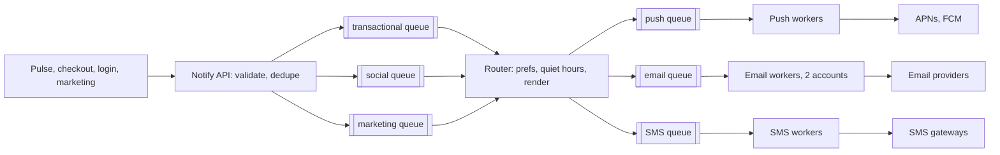

Three teams want to reach users. Pulse sends a push when someone likes your post or follows you. Checkout sends an email receipt and a push for every order — 50 a second normally, 2,000 a second during the flash sale. Login sends a one-time code by SMS. Marketing sends a weekly email to all 10M users. None of these teams wants to integrate with APNs, FCM, an email provider and an SMS gateway, or to learn that the email provider caps them at 1,000 messages a second. The notification service does that once — and its design is mostly about what happens when those providers say *no*, *slow down*, or nothing at all.

:::key[First principle]
A notification system is a set of queues in front of rate-limited, unreliable providers. Each channel's throughput is **min(your workers, the provider's limit)**, so latency for urgent messages comes from **isolation** (separate queues and capacity), not speed. A send can't be made exactly-once to a human: deduplicate what you enqueue, and decide per message type whether an ambiguous send is worth risking a duplicate.
:::

## 55.1 Requirements

**Functional**

- Accept `notify(user, template, data, priority, dedupe_key)` from other services; render per locale.
- Channels: push (iOS/Android, all of a user's devices), email, SMS, in-app inbox.
- Preferences: per-channel opt-in, quiet hours, unsubscribe; transactional messages bypass marketing opt-outs.
- Track per-delivery status (queued, sent, delivered, bounced, failed).

**Non-functional**

- Transactional (receipts, OTPs) delivered to the provider within **60 s**, even during a flash sale and a campaign; OTP useless after 5 minutes.
- Marketing: best effort within hours.
- No duplicate notifications from our own retries; at-least-once internally.
- Respect every provider's rate limit; one provider failing must not stall other channels.

## 55.2 Estimates

Volumes come from the running examples ([§2](/c/system-design/02-estimation)); per-user rates, devices per user and the email provider's limit are illustrative.

```python run
"""Notification volumes, channel fan-out and provider sizing from the running examples (rates illustrative)."""
import math

DAU, DEVICES = 10e6, 1.5                       # Pulse users; push tokens per user (illustrative)
orders_day = 50 * 86_400                        # checkout at its steady 50 orders/s
per_day = {                                     # (notifications/day, channel, deliveries per notification)
    "Pulse social (5 per DAU)": (5 * DAU, "push", DEVICES),
    "order receipt, email": (orders_day, "email", 1),
    "order receipt, push": (orders_day, "push", DEVICES),
    "login OTP (2% of DAU)": (0.02 * DAU, "sms", 1),
    "weekly campaign (10M / 7)": (DAU / 7, "email", 1),
}
by_channel = {}
for name, (n, ch, k) in per_day.items():
    by_channel[ch] = by_channel.get(ch, 0) + n * k
    print(f"{name:27s} {n:>12,.0f}/day -> {n * k:>12,.0f} {ch} sends")
total = sum(by_channel.values())
print(f"deliveries: {total:,.0f}/day = {total / 1e5:,.0f}/s avg (10^5 s/day), "
      + ", ".join(f"{c} {v / total:.0%}" for c, v in by_channel.items()))

FLASH, SALE_S = 2_000, 600                      # flash-sale orders/s for 10 minutes
EMAIL_ACCOUNT = 1_000                           # sends/s allowed per email-provider account (illustrative)
print(f"\nflash sale: {FLASH:,} receipts/s by email + {FLASH * DEVICES:,.0f} push sends/s")
backlog = (FLASH - EMAIL_ACCOUNT) * SALE_S
print(f"one email account: backlog {backlog:,} after 10 min, oldest receipt {backlog / EMAIL_ACCOUNT:.0f} s late")
for target in (60, 300):
    mu = FLASH * SALE_S / (SALE_S + target)     # section 25.3: mu >= lambda T / (T + A)
    print(f"receipts within {target:3d} s need {mu:,.0f}/s -> {math.ceil(mu / EMAIL_ACCOUNT)} accounts")
campaign = 10e6
for accounts in (1, 2, 4):
    print(f"10M-email campaign on {accounts} account(s): {campaign / (accounts * EMAIL_ACCOUNT) / 3600:.1f} h")

notifs = sum(n for n, _, _ in per_day.values())
print(f"\ndedupe keys: {notifs / 1e6:.0f}M/day x 24 h TTL x 100 B = {notifs * 100 / 1e9:.1f} GB "
      f"(x3 replicas {3 * notifs * 100 / 1e9:.0f} GB)")
print(f"delivery rows: {total / 1e6:.0f}M/day x 200 B x 90 days = {total * 200 * 90 / 1e12:.1f} TB")
print(f"OTP SMS at an illustrative USD 0.01 each: USD {0.02 * DAU * 0.01:,.0f}/day")
```

```output
Pulse social (5 per DAU)      50,000,000/day ->   75,000,000 push sends
order receipt, email           4,320,000/day ->    4,320,000 email sends
order receipt, push            4,320,000/day ->    6,480,000 push sends
login OTP (2% of DAU)            200,000/day ->      200,000 sms sends
weekly campaign (10M / 7)      1,428,571/day ->    1,428,571 email sends
deliveries: 87,428,571/day = 874/s avg (10^5 s/day), push 93%, email 7%, sms 0%

flash sale: 2,000 receipts/s by email + 3,000 push sends/s
one email account: backlog 600,000 after 10 min, oldest receipt 600 s late
receipts within  60 s need 1,818/s -> 2 accounts
receipts within 300 s need 1,333/s -> 2 accounts
10M-email campaign on 1 account(s): 2.8 h
10M-email campaign on 2 account(s): 1.4 h
10M-email campaign on 4 account(s): 0.7 h

dedupe keys: 60M/day x 24 h TTL x 100 B = 6.0 GB (x3 replicas 18 GB)
delivery rows: 87M/day x 200 B x 90 days = 1.6 TB
OTP SMS at an illustrative USD 0.01 each: USD 2,000/day
```

What the numbers decide:

- **The average is tiny and irrelevant.** 874 sends/s on average; the design is shaped by two events: the flash sale (2,000 email + 3,000 push sends/s for 10 minutes) and the campaign (10M emails at once).
- **Email is the bottleneck channel**, because of the provider, not us. One account at 1,000/s leaves the last flash-sale receipt 10 minutes late; the 60-second target needs \(\lambda T/(T + A)\) = 1,818/s ([§25.3](/c/system-design/25-message-queue)) — **two accounts**, 2,000/s, illustratively 2 × 1,200 = 2,400/s below.
- **Push is 93% of volume** but its providers accept high rates; its problem is hygiene (dead tokens, §55.9).
- **State is small**: 6 GB of dedupe keys a day, 1.6 TB of delivery rows over 90 days. Storage doesn't shape this design.
- **SMS is the expensive channel** — USD 2,000/day for OTPs alone (illustrative), so it's used only where nothing cheaper works.

## 55.3 API

```http
POST /v1/notifications
     {user_id, template_id, data, priority: transactional|social|marketing,
      dedupe_key: "receipt:order_8812", expires_at?}                -> 202 {notification_id}
POST /v1/campaigns {segment_id, template_id, send_window}           -> 202 {campaign_id}
GET  /v1/notifications/{id}   -> 200 {deliveries: [{channel, device, status, attempts}]}
PUT  /v1/users/{id}/preferences {channels, quiet_hours, timezone}   -> 204
POST /v1/providers/{name}/webhook   (delivery receipts, bounces, complaints)  -> 204
```

The API only enqueues — it returns 202 as soon as the notification is durably stored. Campaigns are a separate endpoint so a 10M-recipient job is never 10M calls through the transactional path.

## 55.4 Data model

| Table | Key | Notes |
|---|---|---|
| `notifications` | `notification_id` | user, template, priority, data, `expires_at`; partitioned by day |
| `dedupe` | `dedupe_key` (unique), TTL 24 h | Insert-if-absent before enqueueing; 6 GB/day |
| `deliveries` | (`notification_id`, `channel`, `device_id`) | status, attempts, provider message ID; 90-day retention, 1.6 TB |
| `devices` | (`user_id`, `device_id`) | push token, platform, `last_seen`; tokens pruned on provider "unregistered" |
| `preferences` | `user_id` | opt-ins per channel and category, quiet hours, timezone, locale |
| `suppression` | address or number | Hard bounces, complaints, unsubscribes — never send again |
| `templates` | (`template_id`, `locale`, `version`) | Cached in every worker |

## 55.5 High-level design



Each priority class has its own queue and consumers; each channel has its own queue and worker pool with a token bucket per provider account ([§28](/c/system-design/28-rate-limiter)) and a circuit breaker per provider ([§20](/c/system-design/20-circuit-breaker)). Provider webhooks update `deliveries` and the suppression list.

## 55.6 Deep dive: channel fan-out and preferences

One `notify` call becomes several deliveries: a receipt goes to email and to every registered device (1.5 on average), so checkout's 2,000 orders/s at the sale's peak become 2,000 email and 3,000 push sends/s. The router decides per notification:

1. **Expired?** Drop OTPs past `expires_at` (5 minutes) — a late code is worse than none, since the user has already requested another.
2. **Preferences, at send time, not enqueue time.** A user who opts out at 23:59 must not get a marketing push at 00:01 that was queued at 23:58. Transactional messages ignore marketing opt-outs but respect hard suppressions (bounced address).
3. **Quiet hours** (user's timezone): *defer* social and marketing to the window's end; never defer transactional.
4. **Collapse.** 40 likes on one post in 10 minutes should be one push ("Ana and 39 others liked your post"): social notifications for the same (user, post) are held for a short window (e.g. 60 s, illustrative) and merged. This cuts social push volume and is the single biggest lever on user annoyance.

## 55.7 Deep dive: provider limits are the real capacity

Each worker pool sends through a **token bucket per provider account**: rate = the contracted limit, burst = a few seconds' worth. Sizing in-flight requests uses Little's law ([§10.2](/c/system-design/10-latency-and-throughput)): at 2,400 emails/s and an illustrative 200 ms provider API latency, \(2{,}400 \times 0.2\) = 480 requests in flight across the email workers.

When the provider pushes back:

- **429 with `Retry-After`**: pause that account's bucket for the stated time; don't retry sooner.
- **5xx or timeouts above a threshold**: the provider's breaker opens, traffic shifts to the secondary provider (and its accounts), and probes test recovery.
- **Email reputation**: complaint and bounce rates above the provider's thresholds get the sender throttled or blocked for *all* traffic, receipts included. Hence the suppression list, double opt-in for marketing, and sending marketing from a separate domain and IP pool so a bad campaign can't block receipts.

## 55.8 Deep dive: priority queues, simulated

The worst day: marketing enqueues its 10M-email campaign at 18:00, and at 18:05 the flash sale starts — 2,000 receipts/s for 10 minutes, 50/s otherwise. Both share the email accounts. The block simulates three policies — one FIFO queue, strict priority for receipts, and a 90/10 weighted share — at 2,400 sends/s (2 accounts × 1,200, illustrative) and at 1,200/s (one account lost):

```python run
"""Flash-sale receipts vs a 10M-email campaign sharing email capacity: FIFO, priority, weighted share."""
from collections import deque
import numpy as np

HORIZON = 10_000                                # seconds simulated
CAMPAIGN, SALE = 10_000_000, (300, 900)         # campaign enqueued at t=0; flash sale minutes 5-15


def serve(q, budget, t, delays):
    """Send from the head of q; items are [enqueued_at, count, is_receipt]."""
    while q and budget:
        take = min(budget, q[0][1])
        q[0][1] -= take
        budget -= take
        if q[0][2]:
            delays.append((t - q[0][0], take))
        if q[0][1] == 0:
            q.popleft()
    return budget


def run(policy, CAP, seed=55):
    rng = np.random.default_rng(seed)
    tx, mk = deque(), deque([[0, CAMPAIGN, False]])
    delays, age, done = [], [], None
    for t in range(HORIZON):
        receipts = [t, rng.poisson(2_000 if SALE[0] <= t < SALE[1] else 50), True]
        if policy == "fifo":                    # one queue in arrival order: receipts behind the campaign
            mk.append(receipts)
            serve(mk, CAP, t, delays)
        else:
            tx.append(receipts)
            share = CAP if policy == "priority" else int(0.9 * CAP)
            left = serve(tx, share, t, delays)
            left = serve(mk, left + CAP - share, t, delays)
            serve(tx, left, t, delays)          # marketing's unused share goes back to receipts
        oldest = next((m[0] for m in (tx or mk) if m[2]), t)
        age.append(t - oldest)
        if done is None and not (mk and not mk[0][2]):
            done = t
    d = np.array(delays, dtype=float)
    order = np.argsort(d[:, 0], kind="stable")
    cum = np.cumsum(d[order, 1]) / d[:, 1].sum()
    pct = lambda p: d[order, 0][np.searchsorted(cum, p)]
    return pct(0.5), pct(0.99), d[:, 0].max(), done, age


for policy, cap in (("fifo", 2_400), ("priority", 2_400), ("weighted 90/10", 2_400),
                    ("priority", 1_200), ("weighted 90/10", 1_200)):
    p50, p99, mx, done, age = run(policy, cap)       # 2,400/s = 2 accounts x 1,200 (illustrative)
    print(f"{policy:14s} {cap:,}/s: receipts p50 {p50:4.0f} s, p99 {p99:4.0f} s, max {mx:4.0f} s; "
          f"campaign sent by minute {done / 60:.0f}")
```

```output
fifo           2,400/s: receipts p50 3805 s, p99 3873 s, max 4166 s; campaign sent by minute 69
priority       2,400/s: receipts p50    0 s, p99    0 s, max    0 s; campaign sent by minute 79
weighted 90/10 2,400/s: receipts p50    0 s, p99    0 s, max    0 s; campaign sent by minute 79
priority       1,200/s: receipts p50  126 s, p99  395 s, max  401 s; campaign sent by minute 162
weighted 90/10 1,200/s: receipts p50  163 s, p99  505 s, max  512 s; campaign sent by minute 162
```

:::chart[Age of the oldest unsent receipt (minutes): campaign enqueued at 0, flash sale from minute 5 to 15]{type="line" x="minutes" y="oldest receipt waiting (min)" band="5:15:flash sale" hmarks="1:60 s target"}
minutes, FIFO 2,400/s, priority 2,400/s, priority 1,200/s, weighted 90/10 1,200/s
0, 0, 0, 0, 0
2, 2.00, 0, 0, 0
4, 4.00, 0, 0, 0
6, 6.00, 0, 0.40, 0.47
8, 8.00, 0, 1.20, 1.38
10, 10.00, 0, 2.00, 2.30
12, 12.00, 0, 2.80, 3.22
14, 14.00, 0, 3.60, 4.15
16, 16.00, 0, 4.40, 5.07
18, 18.00, 0, 5.22, 5.98
20, 20.00, 0, 6.00, 6.92
22, 22.00, 0, 0, 7.83
24, 24.00, 0, 0, 0
28, 28.00, 0, 0, 0
32, 32.00, 0, 0, 0
36, 36.00, 0, 0, 0
40, 40.00, 0, 0, 0
44, 44.00, 0, 0, 0
48, 48.00, 0, 0, 0
52, 52.00, 0, 0, 0
56, 56.00, 0, 0, 0
60, 60.00, 0, 0, 0
64, 64.00, 0, 0, 0
68, 68.00, 0, 0, 0
70, 64.45, 0, 0, 0
72, 64.05, 0, 0, 0
74, 63.65, 0, 0, 0
76, 63.27, 0, 0, 0
78, 56.72, 0, 0, 0
80, 0, 0, 0, 0
:::

1. **One queue is a disaster.** Every receipt waits behind the campaign: a median of 63 minutes and up to 69. Customers who just paid get no confirmation for an hour and retry the purchase.
2. **Separate queues fix it completely with enough capacity.** With 2,400/s, receipts (≤ 2,000/s) never wait; the campaign finishes 10 minutes later (minute 79 instead of 69) because it yields during the sale.
3. **Priority can't create capacity.** With one account lost (1,200/s < 2,000/s), even strict priority leaves receipts up to 401 s late — the §55.2 backlog arithmetic: \((2{,}000 - 1{,}200) \times 600 / 1{,}200\) = 400 s. The 60-second target needs the second account (or a second provider), not a cleverer scheduler.
4. **Weighted shares cost the urgent class when capacity is short** (512 s vs 401 s) but guarantee marketing progress. Use strict priority between transactional and the rest, and weights only *within* non-urgent classes.

## 55.9 Deep dive: duplicates and dead tokens

**Dedupe at enqueue.** The caller supplies `dedupe_key` (`receipt:order_8812`); the API inserts it with a unique constraint and a 24 h TTL before enqueueing. A retried upstream request, or checkout's own at-least-once event consumer ([§9](/c/system-design/09-delivery-semantics)), then becomes a no-op returning the original `notification_id`. The TTL must exceed the longest window in which the caller can retry ([§22.5](/c/system-design/22-idempotency)); 24 h costs 6 GB.

**Dedupe at send.** Workers are at-least-once too: a crash after sending but before acking redelivers the message. Record `deliveries.status = sending` with the provider's idempotency key where the provider supports one, and skip deliveries already marked `sent`.

**The case you can't dedupe**: the provider accepted the message but the response timed out. Resending may duplicate; not resending may lose it. Decide per type:

| Type | Ambiguous timeout | Why |
|---|---|---|
| OTP | Resend (or let the user tap "resend") | A duplicate code is harmless; a missing one blocks login |
| Receipt | Resend once, same provider idempotency key | Losing it causes support tickets and repeat purchases |
| Social / marketing | Don't resend | A duplicate is annoying; a missing like-notification is invisible |

```python run
"""Delivery rate per channel after retries, with fallback, and the duplicates at-least-once creates."""
CHANNELS = {          # permanent failure share, transient failure per attempt, attempts (illustrative)
    "push": (0.08, 0.02, 3),     # stale or uninstalled device tokens are permanent
    "email": (0.01, 0.03, 4),    # hard bounces are permanent
    "sms": (0.02, 0.05, 3),
}
deliv = {}
for ch, (perm, trans, k) in CHANNELS.items():
    one, after = (1 - perm) * (1 - trans), (1 - perm) * (1 - trans ** k)
    deliv[ch] = after
    print(f"{ch:5s} 1 attempt {one:.4%} -> {k} attempts {after:.4%}; "
          f"ceiling (1 - permanent) {1 - perm:.0%}")

otp = 1 - (1 - deliv["push"]) * (1 - deliv["sms"])
print(f"OTP by push, SMS if no receipt in 30 s: {otp:.4%} (independent channels assumed)")

N = 87_430_000                     # sends per day (section 55.2 estimator)
for name, rate in (("consumer redelivery (crash, ack timeout)", 0.001),
                   ("provider timeout after it accepted", 0.0005)):
    print(f"{name:41s} {rate:.2%} -> {N * rate:>8,.0f} duplicates/day if resent blindly")

stale, sends = 0.08, 50e6 * 1.5    # social push sends/day
print(f"never pruning dead tokens wastes {stale * sends / 1e6:.0f}M push sends/day "
      f"({stale:.0%} of {sends / 1e6:.0f}M)")
```

```output
push  1 attempt 90.1600% -> 3 attempts 91.9993%; ceiling (1 - permanent) 92%
email 1 attempt 96.0300% -> 4 attempts 98.9999%; ceiling (1 - permanent) 99%
sms   1 attempt 93.1000% -> 3 attempts 97.9877%; ceiling (1 - permanent) 98%
OTP by push, SMS if no receipt in 30 s: 99.8390% (independent channels assumed)
consumer redelivery (crash, ack timeout)  0.10% ->   87,430 duplicates/day if resent blindly
provider timeout after it accepted        0.05% ->   43,715 duplicates/day if resent blindly
never pruning dead tokens wastes 6M push sends/day (8% of 75M)
```

Without send-side dedupe, a 0.1% redelivery rate is ~87,000 duplicate notifications a day — each one a user who got the same message twice. Dead tokens are the push channel's equivalent of bounces: when APNs or FCM reports a token as unregistered, delete it, or 8% of push volume (6M sends/day here, illustrative) goes nowhere and inflates every rate metric.

## 55.10 Deep dive: retries and delivery rate

With a permanent failure share $f_p$ (bad address, dead token) and an independent transient failure probability $f_t$ per attempt, $k$ attempts deliver

$$
D_k = (1 - f_p)\,(1 - f_t^{\,k}), \qquad D_\text{fallback} = 1 - (1 - D_\text{push})(1 - D_\text{SMS})
$$

The block above shows the consequences:

- **Retries approach a ceiling, not 100%.** Email goes from 96.0% to 99.0% in 4 attempts; push stops at 92% because 8% of tokens are dead. Past ~3 attempts, the remaining failures are permanent — fix the data (prune tokens, suppress bounces), not the retry count.
- **A fallback channel multiplies failures.** OTP by push with an SMS fallback after 30 s reaches 99.84% — if the channels fail independently, which a phone with no signal violates (it gets neither).
- **Retries must fit the message's life.** Backoff with full jitter ([§30.2](/c/system-design/30-retry)) — e.g. 1, 2, 4, 8 s for OTPs, capped by `expires_at` = 5 min; minutes to hours for marketing. Cap retries per provider with a budget (e.g. ≤ 10% of sends, [§30.4](/c/system-design/30-retry)) so a provider outage doesn't triple its load when it recovers.
- **"Delivered" means different things.** Email providers report delivered/bounced; push providers report accepted, not displayed; SMS delivery receipts are best effort. Measure what you can (accepted, bounced, opened) and say which one the SLO uses.

## 55.11 Bottlenecks and failure modes

| Failure | Symptom | Fix | Cost |
|---|---|---|---|
| Campaign and flash sale overlap | Receipts an hour late | Separate priority queues and consumers (§55.8) | Campaign finishes later |
| Email account lost or throttled | Receipts minutes late even with priority | Second account/provider sized for λT/(T+A) | Contract cost |
| Provider outage | Rising timeouts, 5xx | Per-provider breaker, failover, retry budget | Secondary provider's price |
| Upstream retries | Duplicate receipts | `dedupe_key` unique insert, 24 h TTL | 6 GB/day of keys |
| Worker crash after send | Duplicate push | Delivery state + provider idempotency key | One write per delivery |
| Dead tokens / bounces | Wasted sends, reputation damage | Prune on provider feedback; suppression list | — |
| Like storm on a viral post | Hundreds of pushes to one user | Collapse window per (user, post) | Up to 60 s delay for social |
| Preferences store down | Can't check opt-outs | Fail closed for marketing, open for transactional | Marketing delayed |

## 55.12 Trade-offs

- **Isolation vs utilisation.** Reserved capacity for receipts sits idle most of the day; sharing it would let campaigns finish faster, at the price of the 64-minute day in §55.8.
- **Duplicate vs loss** on ambiguous sends is a per-type decision, not a global one (§55.9).
- **Collapse vs immediacy.** Batching social pushes cuts volume and annoyance but adds up to a minute of delay.
- **One provider vs two.** Two per channel doubles integration work and splits volume discounts, and is the only defence against a provider outage or a reputation block.

## 55.13 What I'd say in 45 minutes

> "About 87M sends a day — 874 a second on average — but the average doesn't matter: the flash sale
> produces 2,000 receipt emails and 3,000 pushes a second for ten minutes, and marketing drops 10M
> emails at once. The API dedupes on a caller-supplied key with a 24-hour TTL, stores the
> notification and returns 202. Separate queues per priority class feed a router that applies
> preferences and quiet hours at send time, then per-channel queues and workers with a token bucket per
> provider account and a breaker per provider. Email is the binding channel: at an illustrative 1,000
> per second per account, receipts within 60 seconds need 1,818 a second — two accounts. I simulated the
> overlap: in one FIFO queue receipts wait an hour behind the campaign; with separate queues they don't
> wait at all. Retries use jittered backoff bounded by each message's expiry; delivery tops out at
> one minus the permanent failure rate, so pruning dead tokens and bounces matters more than more
> retries. OTPs fall back to SMS after 30 seconds."

## 55.14 Check yourself

:::qa[The flash sale grows to 3,000 orders/s for 10 minutes. How many 1,000/s email accounts keep receipts within 60 s?]
\(\mu \ge \lambda T/(T + A) = 3{,}000 \times 600 / 660\) ≈ 2,727/s → 3 accounts. And make sure the push side's 4,500 sends/s (1.5 devices per order) is within the push workers' capacity.
:::

:::qa[Push has a 2% transient failure rate per attempt and 8% dead tokens. A PM wants 99% push delivery. What do you tell them?]
It's impossible by retrying: the ceiling is 1 − 0.08 = 92%. Three attempts already give 91.9993%. Raising it means pruning dead tokens (so they're not counted, or are replaced when the app re-registers) and adding a fallback channel for the messages that need it.
:::

:::qa[Why evaluate preferences at send time rather than at enqueue time?]
A marketing message can sit in the queue for hours. A user who unsubscribes or enters quiet hours in that time must not receive it; checking at enqueue would send based on stale preferences. The cost is a preferences lookup per send, cached per worker for a few seconds.
:::

:::qa[A worker's call to the email provider times out after 10 s. The message is a receipt. What happens?]
The provider may or may not have accepted it. For receipts, resend once using the same provider idempotency key (the provider then deduplicates if the first attempt landed); mark the delivery `ambiguous` if the provider has no such key, and accept a rare duplicate over a missing receipt. For a marketing email, mark it failed and don't resend.
:::

Next: [§56 Design a payments ledger](/c/system-design/56-payments-ledger) — the checkout money path, where a duplicate is not an annoyance but a double charge.
