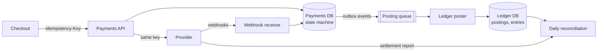
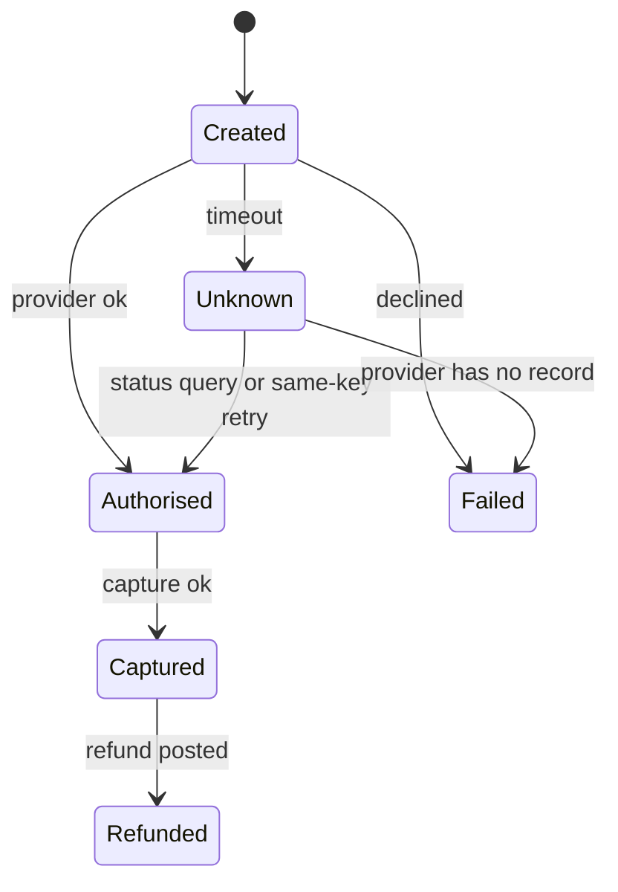

The flash sale is over: 1.2 million orders in ten minutes, each paid through a provider that took 300 ms at p50 and 2 s at p99 (illustrative). Tomorrow finance asks three questions. How much do we owe each merchant? Does that match what the provider says it paid us? And for the 2,853 payments whose provider call timed out, did we charge the customer or not? A payments ledger is the system that can answer all three, from data, for every cent.

:::key[First principle]
Money is never updated in place. Every movement is a **posting** — a set of entries that sum to zero — written once, atomically, under a unique **posting key**. Balances are a derived view of the entries, and correctness is not assumed but *checked*: by invariants inside the ledger and by reconciliation against the provider and the bank outside it.
:::

## 56.1 Requirements

**Functional**

- Record captures, refunds, settlements (provider pays us) and payouts (we pay merchants).
- Per-account balance and full, paginated history.
- Accept payments from checkout with an `Idempotency-Key`; ingest provider webhooks.
- Reconcile daily against the provider's settlement report and the bank statement.

**Non-functional**

- No money created, lost or counted twice — including under retries, duplicate webhooks and crashes.
- Every posting balanced; entries immutable; corrections are new postings.
- Postings may lag the payment by minutes; a balance read must not scan history.
- Retention 7 years (illustrative regulatory requirement).

**Out of scope:** card processing (the provider does it), currency conversion, fraud scoring.

## 56.2 Estimates

Derive everything from the checkout example ([§2](/c/system-design/02-estimation)):

1. **Payments per day.** Steady \(50 \times 86{,}400\) = 4.32M, plus one 10-minute sale at \(2{,}000 \times 600\) = 1.2M → **5.52M/day** (the same count [§22](/c/system-design/22-idempotency) sized keys for).
2. **Postings.** One per capture, plus refunds on 2% of orders (illustrative) → 5.63M postings, × 2 entries = **11.3M entries/day**.
3. **Row rate.** A posting writes a header and two entries: 3 rows. At the 2,000/s peak that is 6,000 rows/s — 120% of the 5,000 rows/s one primary sustained in [§34](/c/system-design/34-sharding)'s illustrative load test. So the ledger does **not** post synchronously at the peak: captures already flow through a queue after the saga's pivot ([§31](/c/system-design/31-sagas)), drained at 1,000/s ([§47](/c/system-design/47-write-spikes-queue)) → 3,000 rows/s, 60% of the ceiling.
4. **Storage.** ~200 B per entry and ~150 B per header including indexes (illustrative) → 3.1 GB/day, 1.1 TB/year, ~8 TB for 7 years per copy.
5. **Key store.** 5.52M keys/day × ~500 B → 2.8 GB at a 24 h TTL, 8.3 GB at 72 h (§22).

```python run
"""Payments ledger: rates, row budget, storage and key store, derived from the checkout numbers."""
STEADY, FLASH, SALE_S = 50, 2_000, 600   # orders/s steady, flash-sale peak, 10-minute sale (§2, §25)
ENTRIES = 2                              # one balanced posting per capture: debit + credit (§2)
REFUND = 0.02                            # illustrative: share of orders later refunded (2 more entries)
ENTRY_B = 200                            # illustrative bytes per entry row incl. indexes
HEADER_B = 150                           # illustrative bytes per posting header (txn row) incl. indexes
KEEP_YEARS = 7                           # illustrative retention for financial records
ROW_CEIL = 5_000                         # rows/s one primary sustains in a load test (illustrative, §34)
DRAIN = 1_000                            # orders/s the capture queue applies (§47)

orders = STEADY * 86_400 + FLASH * SALE_S                  # one sale per day, worst case
postings = orders * (1 + REFUND)
entries = postings * ENTRIES
day_gb = (entries * ENTRY_B + postings * HEADER_B) / 1e9
print(f"orders/day {orders:,} -> postings {postings:,.0f}, entries {entries:,.0f}")
print(f"storage {day_gb:.2f} GB/day, {day_gb * 365 / 1e3:.2f} TB/yr,"
      f" {day_gb * 365 * KEEP_YEARS / 1e3:.1f} TB for {KEEP_YEARS} years (one copy)")

rows = 1 + ENTRIES                                          # header + entries per posting
for label, rate in (("synchronous at the peak", FLASH), ("from the queue", DRAIN), ("steady", STEADY)):
    r = rate * rows
    print(f"posting {label:24s} {rate:>5,}/s x {rows} rows = {r:>6,} rows/s = {r / ROW_CEIL:4.0%} of ceiling")

backlog = (FLASH - DRAIN) * SALE_S
print(f"queue backlog after the sale {backlog:,}; ledger catches up"
      f" {backlog / (DRAIN - STEADY):,.0f} s after the sale ends")

for ttl_h, bytes_per in ((24, 500), (72, 500)):
    print(f"idempotency keys, TTL {ttl_h} h: {orders * ttl_h / 24 * bytes_per / 1e9:.1f} GB (~{bytes_per} B each, §22)")
```

```output
orders/day 5,520,000 -> postings 5,630,400, entries 11,260,800
storage 3.10 GB/day, 1.13 TB/yr, 7.9 TB for 7 years (one copy)
posting synchronous at the peak  2,000/s x 3 rows =  6,000 rows/s = 120% of ceiling
posting from the queue           1,000/s x 3 rows =  3,000 rows/s =  60% of ceiling
posting steady                      50/s x 3 rows =    150 rows/s =   3% of ceiling
queue backlog after the sale 600,000; ledger catches up 632 s after the sale ends
idempotency keys, TTL 24 h: 2.8 GB (~500 B each, §22)
idempotency keys, TTL 72 h: 8.3 GB (~500 B each, §22)
```

| Quantity | Value | What it decides |
| --- | ---: | --- |
| Postings | 5.63M/day; 2,000/s offered at peak | Post from a queue, not on the request path |
| Ledger rows at the queue's drain rate | 3,000/s (60% of one primary) | One primary; no sharding for writes |
| Ledger lag after a sale | ≤ 10 min backlog, empty 632 s after the sale | Merchant balances are "as of" a few minutes |
| Storage | 1.1 TB/yr, ~8 TB over 7 years | One node (21 TB usable, §2) with monthly partitions |
| Idempotency keys | 2.8–8.3 GB | A column on the payment row, not a separate cluster |

## 56.3 API

```http
POST /payments                      Idempotency-Key: <uuid>
     {merchant_id, amount_minor, currency, payment_method} -> 201 {payment_id, state}
POST /payments/{id}/refunds         Idempotency-Key: <uuid>
     {amount_minor} -> 201 {refund_id, state}
GET  /accounts/{id}/balance         -> 200 {balance_minor, currency, as_of_posting}
GET  /accounts/{id}/entries?after=<posting_id>&limit=100 -> 200 {entries[], next}
POST /webhooks/provider             {event_id, type, payment_ref, amount} -> 204
```

Amounts are integers in minor units (cents) — never floats. The balance response carries `as_of_posting` so a caller knows how fresh it is.

## 56.4 Data model

| Table | Key | Columns and rules |
| --- | --- | --- |
| `accounts` | `account_id` | type (asset, liability, income), currency, owner |
| `postings` | `posting_id` | `posting_key` **UNIQUE**, kind, reference, created_at — immutable |
| `entries` | `(posting_id, account_id)` | `amount` signed BIGINT (+debit, −credit); partitioned by month |
| `balances` | `account_id` (or `account_id, bucket`) | amount, `as_of_posting` — derived, rebuildable |
| `payments` | `payment_id` | `(merchant_id, idem_key)` UNIQUE, state, provider_ref |
| `provider_events` | `event_id` | UNIQUE — duplicate webhooks stop here |

The `posting_key` is derived from the business event, e.g. `pay_123:capture` or `pay_123:refund:1`, so every path that might post the same event — webhook, queue redelivery, reconciliation — produces the same key and the unique constraint keeps exactly one.

## 56.5 High-level design



The request path ends at the payments database: it records the intent, calls the provider with the same idempotency key, and moves the payment's state. Every state change that moves money writes an outbox event ([§31](/c/system-design/31-sagas)); the poster consumes them at a rate the ledger can sustain and turns each into one balanced posting. Reconciliation compares the ledger with the provider's report and the bank statement.

## 56.6 Double-entry: the invariants

Give every entry a signed amount $a_e$ (debit positive, credit negative). For every posting $t$ and every account $x$:

$$
\sum_{e \in t} a_e = 0, \qquad B_x = \sum_{e:\ \text{acct}(e) = x} a_e \quad\Longrightarrow\quad \sum_x B_x = 0 .
$$

Money can only move between accounts, never appear or vanish, and the check is a SQL query, not a code review.

:::example[Worked example · one order's life in postings (amounts illustrative)]
| Event | Debit | Credit | Effect |
| --- | --- | --- | --- |
| Capture USD 120.00 | `provider_clearing` +12,000 | `merchant_42` −12,000 | Provider owes us; we owe the merchant |
| Provider settles | `bank` +12,000 | `provider_clearing` −12,000 | Clearing back to zero |
| Payout to merchant | `merchant_42` +12,000 | `bank` −12,000 | Merchant paid, bank back to zero |

A non-zero `provider_clearing` after settlement is money the provider owes and hasn't paid — reconciliation's first question.
:::

The ledger below enforces the three rules in SQLite: a posting is rejected unless balanced, a replayed posting key writes nothing, and header, entries and balance commit in one transaction. It then checks the invariants and reconciles against a provider report with injected discrepancies.

```python run
"""A double-entry ledger in SQLite: balanced postings, idempotent replays, rebuildable balances."""
import random
import sqlite3

db = sqlite3.connect(":memory:")
db.executescript("""
CREATE TABLE txn (id INTEGER PRIMARY KEY, posting_key TEXT UNIQUE NOT NULL, kind TEXT NOT NULL);
CREATE TABLE entry (txn_id INT NOT NULL, account TEXT NOT NULL, amount INT NOT NULL);  -- cents, +debit -credit
CREATE TABLE balance (account TEXT PRIMARY KEY, amount INT NOT NULL);
""")


def post(key, kind, legs):
    """Write one balanced posting atomically; a replayed key returns the original id, writes nothing."""
    if sum(amount for _, amount in legs) != 0:
        raise ValueError(f"unbalanced posting {key}")
    try:
        with db:                                    # header, entries and balances commit together
            tid = db.execute("INSERT INTO txn (posting_key, kind) VALUES (?, ?)", (key, kind)).lastrowid
            db.executemany("INSERT INTO entry VALUES (?, ?, ?)", [(tid, a, x) for a, x in legs])
            db.executemany("INSERT INTO balance VALUES (?, ?) ON CONFLICT(account)"
                           " DO UPDATE SET amount = amount + excluded.amount", legs)
            return tid
    except sqlite3.IntegrityError:                 # unique posting_key: this posting already happened
        return db.execute("SELECT id FROM txn WHERE posting_key = ?", (key,)).fetchone()[0]


rng = random.Random(56)
captures = {f"pay_{i}": rng.randrange(500, 20_000) for i in range(1_000)}
for key, cents in captures.items():               # provider owes us; we owe the merchant
    post(key + ":capture", "capture", [("provider_clearing", cents), (f"merchant_{rng.randrange(20)}", -cents)])
first = db.execute("SELECT COUNT(*) FROM entry").fetchone()[0]
for key in rng.sample(sorted(captures), 50):       # duplicate webhooks replay the same posting key
    post(key + ":capture", "capture", [("provider_clearing", captures[key]), ("merchant_0", -captures[key])])
try:
    post("bad", "capture", [("provider_clearing", 100), ("merchant_1", -99)])
except ValueError as e:
    print("rejected:", e)
print(f"entries after 1,000 captures {first:,}; after 50 replays {db.execute('SELECT COUNT(*) FROM entry').fetchone()[0]:,}")

checks = {
    "sum of all entries": "SELECT SUM(amount) FROM entry",
    "unbalanced postings": "SELECT COUNT(*) FROM (SELECT txn_id FROM entry GROUP BY txn_id HAVING SUM(amount) != 0)",
    "balances != sum(entries)": """SELECT COUNT(*) FROM balance b JOIN (SELECT account, SUM(amount) s FROM entry
                                   GROUP BY account) e USING (account) WHERE b.amount != e.s""",
}
for name, sql in checks.items():
    print(f"invariant {name:25s} = {db.execute(sql).fetchone()[0]}")

# Reconciliation against the provider's settlement file, with injected discrepancies.
settled = dict(captures)
for k in ("pay_7", "pay_8"):
    del settled[k]                                 # we captured, provider did not settle
settled["pay_3"] += 1                              # amount mismatch
settled.update({"pay_x1": 4_200, "pay_x2": 900, "pay_x3": 1_500})  # settled, but our webhook was lost
ours = {k.split(":")[0]: v for k, v in db.execute(
    "SELECT posting_key, amount FROM txn JOIN entry ON id = txn_id WHERE account = 'provider_clearing'")}
buckets = {"matched": [k for k in ours if settled.get(k) == ours[k]],
           "amount mismatch": [k for k in ours if k in settled and settled[k] != ours[k]],
           "missing at provider": [k for k in ours if k not in settled],
           "missing in ledger": [k for k in settled if k not in ours]}
for name, keys in buckets.items():
    print(f"reconcile {name:20s} {len(keys):>5}" + (f"  {sorted(keys)[:3]}" if name != "matched" else ""))
```

```output
rejected: unbalanced posting bad
entries after 1,000 captures 2,000; after 50 replays 2,000
invariant sum of all entries        = 0
invariant unbalanced postings       = 0
invariant balances != sum(entries)  = 0
reconcile matched                997
reconcile amount mismatch          1  ['pay_3']
reconcile missing at provider      2  ['pay_7', 'pay_8']
reconcile missing in ledger        3  ['pay_x1', 'pay_x2', 'pay_x3']
```

- **Replays are free.** Fifty duplicate webhooks — one even naming the wrong merchant — added zero entries, because the posting key was claimed by the first. The unique constraint is the idempotency mechanism; no read-then-check.
- **The invariants are monitors.** Run the three queries hourly on the latest partition and page on any non-zero. A bug that writes one leg without the other is caught within the hour, not at year-end audit.
- **Balances are a cache.** The third check proves `balance` can be rebuilt from `entry`. Lose the balances and you replay; lose entries and you have lost money — so entries get the strongest replication.

:::warn[Three ways to break a ledger]
Floats for money (0.1 + 0.2 ≠ 0.3: use integer minor units). `UPDATE entries` to fix a mistake (post a reversal instead; history must explain itself). A balance updated in a different transaction from its entries (a crash between them creates or destroys money).
:::

## 56.7 Idempotency and the exactly-once illusion

Duplicates enter at three doors, and each has its own guard:

| Door | Duplicate source | Guard |
| --- | --- | --- |
| Checkout → payments API | Client retries, double taps | `(merchant_id, idem_key)` UNIQUE on the payment row ([§22](/c/system-design/22-idempotency)) |
| Provider → webhook receiver | Provider retries webhooks | `provider_events.event_id` UNIQUE |
| Queue → ledger poster | At-least-once redelivery ([§9](/c/system-design/09-delivery-semantics)) | `postings.posting_key` UNIQUE |

"Exactly once" is at-least-once delivery plus an idempotent effect at every door. The hard case is the provider call that **times out**: the charge may or may not have happened. With provider latency lognormal (p50 300 ms, p99 2 s, so $\sigma = \ln(2000/300)/2.326 = 0.816$) and a timeout $\tau$:

$$
P(\text{ambiguous}) = P(L > \tau) = 1 - \Phi\!\left(\frac{\ln \tau - \ln 300\,\text{ms}}{\sigma}\right)
$$

```python run
"""Ambiguous payment outcomes vs timeout, and a hot balance row vs number of buckets."""
import math
from statistics import NormalDist

MU, SIGMA = math.log(300), math.log(2000 / 300) / 2.326   # provider: p50 300 ms, p99 2 s (illustrative)
SALE = 2_000 * 600                                        # calls in a 10-minute flash sale

print("timeout   P(call outlives it)   ambiguous per sale")
for t in (0.5, 0.75, 1, 1.5, 2, 3, 4, 5, 7, 10):
    p = 1 - NormalDist().cdf((math.log(t * 1000) - MU) / SIGMA)
    print(f"{t:5.2f} s   {p:19.4%}   {p * SALE:18,.0f}")

T = 1.0                                                   # ms the balance row stays locked (illustrative)
print("\nbuckets   rho @1,000/s   wait ms @1,000/s   rho @2,000/s   wait ms @2,000/s")
for n in (1, 2, 4, 8, 16, 32):
    row = []
    for rate in (1_000, 2_000):
        rho = rate / n * T / 1000
        w = T * (1 + rho / (2 * (1 - rho))) if rho < 1 else float("inf")   # M/D/1 (§15.5)
        row += [f"{rho:12.3f}", f"{w:16.2f}" if w != float("inf") else f"{'saturated':>16}"]
    print(f"{n:7d}  " + "   ".join(row))
```

```output
timeout   P(call outlives it)   ambiguous per sale
 0.50 s              26.5557%              318,668
 0.75 s              13.0626%              156,752
 1.00 s               6.9951%               83,942
 1.50 s               2.4232%               29,078
 2.00 s               1.0009%               12,011
 3.00 s               0.2378%                2,853
 4.00 s               0.0747%                  896
 5.00 s               0.0281%                  337
 7.00 s               0.0056%                   67
10.00 s               0.0009%                   10

buckets   rho @1,000/s   wait ms @1,000/s   rho @2,000/s   wait ms @2,000/s
      1         1.000          saturated          2.000          saturated
      2         0.500               1.50          1.000          saturated
      4         0.250               1.17          0.500               1.50
      8         0.125               1.07          0.250               1.17
     16         0.062               1.03          0.125               1.07
     32         0.031               1.02          0.062               1.03
```

:::chart[Payments per 10-minute flash sale whose provider call outlives the timeout (lognormal p50 300 ms, p99 2 s, illustrative)]{type="line" x="timeout (s)" y="ambiguous payments per sale" ylog="true" points="true" yfmt="int" marks="1:1 s;3:3 s (saga timeout, §31)"}
timeout s, ambiguous per sale
0.5, 318668
0.75, 156752
1, 83942
1.5, 29078
2, 12011
3, 2853
4, 896
5, 337
7, 67
10, 10
:::

A 1 s timeout sends 7% of the sale — 83,942 payments — into the "did it happen?" path; the saga's 3 s timeout leaves 2,853. Never resolve one by retrying with a *new* key. The payment moves to `unknown`, and a resolver retries with the **same** provider idempotency key (the provider returns the original result) or queries the provider's status, then makes a guarded transition:



```sql
UPDATE payments SET state = 'captured', provider_ref = :ref
 WHERE payment_id = :id AND state = 'authorised';   -- 0 rows: duplicate or out-of-order event, ignore
```

Each transition is conditional on the current state, so a late webhook can't move a payment backwards, and only the transition that succeeds emits the outbox event that leads to a posting.

## 56.8 Hot accounts

Every capture debits `provider_clearing`, and during the sale one merchant receives every credit. If each posting also updates that account's balance row, the row is locked for the transaction's commit — ~1 ms (illustrative). Contention is $\rho = \lambda T$ ([§15.5](/c/system-design/15-transactions)): at the queue's 1,000 postings/s, $\rho = 1$ — the row is saturated; at 2,000/s it's 2. The table above splits the balance into $n$ bucket rows, each posting picking one at random, with an M/D/1 wait $T\left(1 + \frac{\rho}{2(1-\rho)}\right)$:

| Fix | ρ at 1,000/s | Cost |
| --- | ---: | --- |
| One balance row | 1.0 (saturated) | — |
| 16 bucket rows, balance = Σ buckets | 0.06 (1.03 ms) | A balance read sums 16 rows |
| No synchronous balance: snapshot + Σ entries since it | 0 on the hot path | Reads scan entries since the last snapshot (e.g. every 10 s → ≤ 10,000 rows) |
| Batch 100 postings per transaction | 0.01 | Up to one batch interval of extra lag |

Use buckets or snapshots for system and large-merchant accounts, and keep the simple single-row balance for the long tail of small accounts — the same split as [§15.5](/c/system-design/15-transactions)'s stock buckets.

## 56.9 Reconciliation

The ledger can be internally perfect and still wrong about the world: a webhook lost, a capture the provider silently dropped, a fee deducted on their side. Daily, a job joins three sources on the payment reference: the ledger's postings, the provider's settlement report and the bank statement. 5.52M rows × ~60 B (reference + amount + date) ≈ 330 MB per side — an in-memory hash join or a sort-merge in SQL, minutes not hours.

| Bucket | Likely cause | Action |
| --- | --- | --- |
| Matched | — | None |
| Amount mismatch | Fees, partial capture, currency rounding | Post an adjustment with its own posting key; investigate if no rule explains it |
| Missing at provider | Capture recorded, provider never settled it | Query provider; if not captured, post a reversal and fix the payment state |
| Missing in ledger | Webhook lost | Post from the report with the *same* posting key a webhook would use, so a late webhook is a no-op |
| Timing (either side) | Cut-off: payment at 23:59 settles tomorrow | Carry forward for N days before it becomes an exception |

If 0.01% of webhooks were lost (illustrative), that is ~550 payments a day in "missing in ledger" — invisible without this job. Track bucket counts as metrics; an exception queue with an owner is part of the design, not an afterthought.

## 56.10 Storage growth and partitioning

At 1.1 TB/year the ledger fits one node for its whole 7-year retention (~8 TB per copy against 21 TB usable). Partition `entries` by month ([§12.5](/c/system-design/12-replication-and-partitioning)): indexes stay small, hourly invariant checks touch only the newest partition, and partitions past retention are dropped or archived whole.

Shard only if postings outgrow ~50% of the primary's write ceiling for months — about 10× today's volume. Then **shard by posting, not by account**: a posting's entries must commit in one local transaction, and an account-sharded ledger turns every transfer between accounts on different shards into a distributed transaction ([§34](/c/system-design/34-sharding)). Account balances then become an asynchronous aggregate across shards.

## 56.11 Bottlenecks and failure modes

| Failure | Symptom | Design response |
| --- | --- | --- |
| Flash-sale posting rate | 6,000 rows/s = 120% of the primary | Post from the queue at 1,000/s (60%); balances lag ≤ ~10 min |
| Provider timeout | 2,853 ambiguous payments per sale at 3 s | `unknown` state, same-key retry or status query; never a new key |
| Duplicate webhook or redelivery | Second posting attempt | Unique `event_id` and `posting_key`; replay writes nothing |
| Hot clearing or merchant account | Balance row ρ ≥ 1 | Bucket rows, snapshots, or batched postings |
| Poster crashes mid-batch | Partial batch | One DB transaction per posting or batch; redelivery is idempotent |
| Balance table corrupted | Wrong balances | Rebuild from entries; invariant check pages within the hour |
| Lost webhook | Customer charged, ledger silent | Daily reconciliation posts it with the canonical key |

## 56.12 Trade-offs

| Decision | Option A | Option B | Choose |
| --- | --- | --- | --- |
| When to post | Synchronously at the saga pivot | From the outbox queue | Queue: the peak is 120% of the primary; minutes of lag are acceptable for a ledger |
| Balances | Updated in the posting transaction | Derived asynchronously | Synchronous for small accounts; buckets or snapshots for hot ones |
| Provider timeout | Short (1 s): fast failure, 83,942 ambiguous per sale | Long (3 s): slower failure, 2,853 ambiguous | 3 s with a breaker ([§20](/c/system-design/20-circuit-breaker)) |
| Sharding | By account | By posting | Don't shard; if forced, by posting |
| Corrections | Update the entry | Reversal posting | Always a reversal |

## 56.13 What I'd say in 45 minutes

| Minutes | Topic | What to say, with the number |
| ---: | --- | --- |
| 0–5 | Requirements | No money created, lost or duplicated; auditable; minutes of lag OK |
| 5–10 | Estimates | 5.52M payments/day, 2,000/s peak; 3 rows per posting → 6,000 rows/s = 120% of a primary → queue at 1,000/s |
| 10–15 | API + model | Idempotency-Key; postings with UNIQUE posting_key; signed integer entries; balances derived |
| 15–22 | Design | Payments state machine → outbox → poster → ledger; reconciliation off to the side |
| 22–30 | Double entry | Σ per posting = 0 ⇒ Σ balances = 0; invariants as hourly SQL monitors |
| 30–36 | Exactly once | Three doors, three unique constraints; 3 s timeout → 2,853 unknowns per sale, resolved with the same key |
| 36–41 | Hot accounts | ρ = 1,000/s × 1 ms = 1 → 16 bucket rows (ρ 0.06) or snapshots |
| 41–45 | Ops | Daily three-way reconciliation, buckets with owners; 1.1 TB/yr, monthly partitions, no sharding |

## 56.14 Check yourself

:::qa[Why can't the ledger post every capture synchronously during the flash sale, and what does the queue cost?]
2,000 postings/s × 3 rows = 6,000 rows/s, 120% of the illustrative 5,000 rows/s primary. Draining at 1,000 postings/s uses 60%; the backlog peaks at \((2{,}000 - 1{,}000) \times 600\) = 600,000 and clears 632 s after the sale, so merchant balances lag by up to ~10 minutes. For a ledger that is acceptable; for the payment itself it isn't, which is why the payment state machine stays synchronous.
:::

:::qa[A provider call times out after 1 s. The engineer retries with a fresh idempotency key "to be safe". What happens during a sale?]
About 7% of calls (83,942 per sale) outlive a 1 s timeout; each of those, if it actually succeeded, is charged twice. Retry with the same key — the provider deduplicates and returns the original result — or query status first. Raising the timeout to 3 s also cuts the ambiguous set to 2,853.
:::

:::qa[Finance reports that the sum of all balances is −4,200 cents. Which invariant failed, and where do you look?]
Σ balances must be 0 if every posting balances and balances equal Σ entries. Check unbalanced postings first (a code path writing one leg); then balances ≠ Σ entries (a balance updated outside the posting transaction). If both pass, the balances table was edited directly — rebuild it from entries.
:::

:::qa[Reconciliation finds 550 payments in the provider's report but not in the ledger. How do you fix them without risking a double posting?]
Post each with the canonical key the webhook path would have used (`pay_123:capture`). If the lost webhook arrives later, its posting hits the unique constraint and writes nothing. Then find why webhooks were lost — 550/day is a monitoring gap, not just a data fix.
:::

Next: [§57 Design a rate limiter service](/c/system-design/57-rate-limiter-service) — protecting checkout and the provider from the traffic that created all of this.
