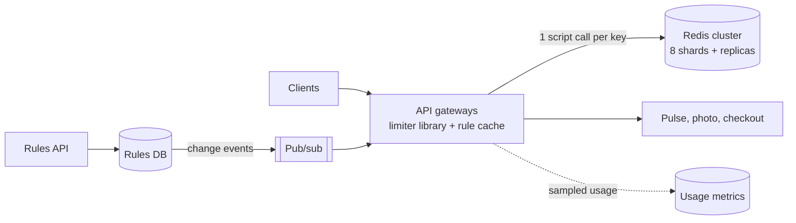

Pulse, the photo service and checkout sit behind one fleet of API gateways. Each team has written its own limiter: one counts per gateway instance (so the real limit is 16× the configured one), one calls a database on every request, one has no limit at all on photo metadata. The platform team is asked to replace them with one service that decides, for every request, "may this proceed?" — in well under a millisecond, for every product, without becoming the outage it exists to prevent.

:::key[First principle]
A rate limiter is a counter shared by everyone who serves a key. Exactness costs one atomic round trip to wherever the counter lives; anything cheaper — local counters, split budgets — trades a **bounded, computable** overshoot for fewer round trips. Size the counter store for decisions per second, not memory, and decide per limit what happens when the store is down.
:::

The algorithms themselves (token bucket, sliding windows, burst sizing) are in [§28](/c/system-design/28-rate-limiter); a tested implementation is in [§69](/c/system-design/69-token-bucket). This section designs the service around them.

## 57.1 Requirements

**Functional**

- Enforce limits per API key or account, per IP, and per endpoint tier; return `429` with `Retry-After`.
- Rules changeable at runtime without a deploy; usage visible per key.

**Non-functional**

- Adds < 1 ms at p50 and < 5 ms at p99 to a request — it sits on every request path.
- Overshoot bounded and stated per limit type (e.g. "≤ 2× for abuse limits, exact for billing quotas").
- A limiter outage must not become a platform outage.

**Out of scope:** volumetric DDoS (absorbed at the edge and CDN, [§19](/c/system-design/19-cdn)); concurrency limits inside services ([§28.2](/c/system-design/28-rate-limiter)).

## 57.2 Estimates

1. **Requests at the gateway, peak** ([§2](/c/system-design/02-estimation)): Pulse 6,000 reads + 600 writes; photo views 30,000 (each view calls the metadata API; the bytes come from the CDN — an assumption to confirm); photo uploads 1,200; checkout 2,000 orders/s → **39,800 req/s**.
2. **Decisions.** Two checks per request (account and IP) → 79,600/s. Retries during incidents and abusive clients add load exactly when it matters, so design for 3× (illustrative): **238,800 decisions/s**.
3. **Redis shards.** Assume one shard runs ~50,000 limiter-script calls/s (illustrative — scripts cost more than a plain `GET`; measure yours). At 60% utilisation: \(\lceil 238{,}800 / 30{,}000 \rceil\) = **8 shards**, each with a replica.
4. **Memory** is not the constraint: ~100 B per key ([§28.4](/c/system-design/28-rate-limiter)); 159,200 live keys → 16 MB; even a 1M-IP botnet is 100 MB.
5. **Latency.** Service time per script ≈ 1/50,000 s = 20 µs; at ρ = 0.6, M/M/1 gives 20/(1 − 0.6) = 50 µs. The 0.5 ms network round trip dominates; the two checks run in parallel.

```python run
"""Rate limiter service: decisions/s, Redis shards, memory and latency from the three running examples."""
import math

peak_requests = {                      # requests/s through the API gateways at peak (§2)
    "Pulse reads + writes": 6_000 + 600,
    "photo views (metadata API; bytes via CDN)": 30_000,
    "photo uploads": 1_200,
    "checkout orders": 2_000,
}
CHECKS = 2                             # per-account and per-IP limit on every request
HEADROOM = 3                           # illustrative: size for 3x legitimate peak (retries, abuse)
SCRIPT_OPS = 50_000                    # illustrative: limiter script calls/s one Redis shard sustains
UTIL = 0.6                             # target utilisation (§2)
KEY_B = 100                            # bytes per token-bucket key incl. overhead (§28)
RTT_MS, TIMEOUT_MS = 0.5, 5            # intra-DC round trip (§2); limiter call timeout (illustrative)

req = sum(peak_requests.values())
checks = req * CHECKS
design = checks * HEADROOM
shards = math.ceil(design / (SCRIPT_OPS * UTIL))
for name, q in peak_requests.items():
    print(f"  {name:42s} {q:>7,}/s")
print(f"legitimate peak {req:,} req/s x {CHECKS} checks = {checks:,} decisions/s;"
      f" designed for x{HEADROOM}: {design:,}/s")
print(f"Redis shards at {SCRIPT_OPS:,} script calls/s and {UTIL:.0%}: {shards}"
      f" (each at {design / shards / SCRIPT_OPS:.0%} when the design load arrives)")

service_ms = 1_000 / SCRIPT_OPS
rho = design / shards / SCRIPT_OPS
print(f"decision latency ~ RTT {RTT_MS} ms + M/M/1 {service_ms / (1 - rho) * 1000:.0f} us"
      f" at rho {rho:.2f}; timeout {TIMEOUT_MS} ms = {TIMEOUT_MS / RTT_MS:.0f} RTTs")

for label, keys in (("keys alive at peak (TTL 2 s)", checks * 2), ("botnet, 1M IPs at their limit", 1_000_000)):
    print(f"memory, {label}: {keys:,} x {KEY_B} B = {keys * KEY_B / 1e6:,.0f} MB")

per_shard = SCRIPT_OPS * UTIL
for big in (5_000, 20_000, 50_000):
    print(f"one API key at {big:>6,} req/s -> {big / per_shard:4.0%} of its shard's budget")

down = req / shards
print(f"one shard down: {down:,.0f} req/s ({1 / shards:.1%}) lose their shared limit for the outage")
```

```output
  Pulse reads + writes                         6,600/s
  photo views (metadata API; bytes via CDN)   30,000/s
  photo uploads                                1,200/s
  checkout orders                              2,000/s
legitimate peak 39,800 req/s x 2 checks = 79,600 decisions/s; designed for x3: 238,800/s
Redis shards at 50,000 script calls/s and 60%: 8 (each at 60% when the design load arrives)
decision latency ~ RTT 0.5 ms + M/M/1 50 us at rho 0.60; timeout 5 ms = 10 RTTs
memory, keys alive at peak (TTL 2 s): 159,200 x 100 B = 16 MB
memory, botnet, 1M IPs at their limit: 1,000,000 x 100 B = 100 MB
one API key at  5,000 req/s ->  17% of its shard's budget
one API key at 20,000 req/s ->  67% of its shard's budget
one API key at 50,000 req/s -> 167% of its shard's budget
one shard down: 4,975 req/s (12.5%) lose their shared limit for the outage
```

| Quantity | Value | What it decides |
| --- | ---: | --- |
| Decisions at legitimate peak | 79,600/s | Throughput, not memory, sizes the store |
| Design load (3×) | 238,800/s | 8 Redis shards at 60% |
| Memory | 16 MB normal, 100 MB under a botnet | Any shard holds it all; no eviction tuning needed |
| Added latency | ~0.55 ms p50 | One round trip; the limiter must not add a second hop |
| Hottest single key | 167% of a shard at 50,000 req/s | Hot keys need local pre-aggregation (§57.8) |

## 57.3 API

```http
# Data plane: called by gateways, or inlined as a client library
POST /v1/check   {keys: ["acct:42", "ip:203.0.113.7"], cost: 1}
     -> 200 {allowed: true, remaining: [57, 18]}
     -> 200 {allowed: false, retry_after_ms: 140, limited_by: "ip:203.0.113.7"}

# Control plane: rules and usage
PUT  /v1/rules/{scope}   {rate_per_s, burst, fail_mode: "open" | "closed"} -> 204
GET  /v1/usage/{key}     -> 200 {tokens, rate_per_s, burst, rejected_last_minute}
```

Clients see `429` with `Retry-After` set to time-to-next-token plus jitter ([§28.2](/c/system-design/28-rate-limiter)). `fail_mode` is part of each rule, so the outage behaviour is decided when the limit is created.

## 57.4 Data model

| Store | Key | Value | Notes |
| --- | --- | --- | --- |
| Redis cluster (8 shards) | `rl:{scope}:{id}` | hash: tokens, last_refill_ms | TTL = burst / rate; sharded by key hash |
| Rules DB | `scope` (e.g. `tier:free`, `endpoint:checkout`) | rate, burst, fail_mode, version | ~10,000 rows (illustrative); source of truth |
| Gateway memory | rule cache, hot-key local buckets | — | Rules pushed on change, polled every 5 s as backstop |
| Usage stream | `(key, minute)` | allowed, rejected | Sampled counts for dashboards; never on the decision path |

## 57.5 High-level design



The decision path is a library inside the gateway that runs one atomic script on the shard owning the key: one network round trip. A separate limiter tier (gateway → limiter → Redis) would add a second round trip and another fleet to keep up; it's worth it only if many non-gateway callers need decisions, and then it should own the counters itself — keys consistent-hashed to limiter instances ([§64](/c/system-design/64-consistent-hashing)) so each bucket lives whole in one process's memory.

## 57.6 Deep dive: one atomic round trip

Two gateways reading "1 token left" and both writing "0" admit two requests. Refill and decrement must be one atomic step on the server — a Redis Lua script:

```lua
-- KEYS[1] bucket key; ARGV: rate_per_ms, burst, now_ms, cost
local rate, burst = tonumber(ARGV[1]), tonumber(ARGV[2])
local now, cost   = tonumber(ARGV[3]), tonumber(ARGV[4])
local b = redis.call('HMGET', KEYS[1], 'tokens', 'ts')
local tokens = math.min(burst, (tonumber(b[1]) or burst) + (now - (tonumber(b[2]) or now)) * rate)
local allowed = tokens >= cost
if allowed then tokens = tokens - cost end
redis.call('HSET', KEYS[1], 'tokens', tokens, 'ts', now)
redis.call('PEXPIRE', KEYS[1], math.ceil(burst / rate))   -- a full bucket is the same as no key
return {allowed and 1 or 0, math.floor(tokens)}
```

Pass `now_ms` from the caller only if gateway clocks are disciplined; otherwise read Redis `TIME` inside the script so every decision on a key uses one clock. Multi-key checks (account and IP) live on different shards, so they are two scripts sent in parallel, not one transaction: a request rejected by the IP limit may already have spent an account token. That's a small, one-sided error and cheaper than co-locating keys.

## 57.7 Deep dive: local counters and over-admission

The tempting optimisation: each gateway counts locally and syncs with Redis every Δ ms (`INCRBY` its local count, read the global total). Between syncs a gateway can't see what the others admitted. For a key with limit $L$ per window, offered $\lambda$ requests/s across $N$ gateways, the excess per window is bounded by

$$
\text{excess} \le \min\big(\lambda\,\Delta,\ (N-1)\,L\big)
$$

— whatever arrives during one sync lag, but no more than every other gateway spending the whole limit. The simulation runs a fixed 1 s window of $L$ = 100 against an attacker at 10,000 requests/s spread by a random load balancer, with staggered syncs; "share" lets each gateway spend only $1/N$ of the remaining budget per sync interval.

```python run
"""Local counters synced every D ms vs one central counter: how much does a key get past its limit?"""
import numpy as np

LIMIT, WINDOWS = 100, 5                       # 100 requests per 1 s fixed window, 5 windows measured


def run(n, sync_ms, rate, share=False, seed=0):
    rng = np.random.default_rng(seed)
    t = np.sort(rng.uniform(0, WINDOWS, rng.poisson(rate * WINDOWS)))
    events = [(x, 0, g) for x, g in zip(t, rng.integers(0, n, len(t)))]     # arrivals, random LB
    if sync_ms:                                                               # periodic, staggered syncs
        d = sync_ms / 1000
        events += [(p + k * d, 1, g) for g, p in enumerate(rng.uniform(0, d, n))
                   for k in range(int(WINDOWS / d) + 1)]
    events.sort()
    glob, local, seen, win = {}, [0] * n, [0] * n, [-1] * n
    admitted = 0
    for x, kind, g in events:
        w = int(x)                                                            # window id
        if w != win[g]:
            win[g], local[g], seen[g] = w, 0, 0
        if kind == 1:                                                         # INCRBY global, read total
            glob[w] = glob.get(w, 0) + local[g]
            seen[g], local[g] = glob[w], 0
        elif sync_ms == 0:                                                    # central: exact, 1 op each
            if glob.get(w, 0) < LIMIT:
                glob[w] = glob.get(w, 0) + 1
                admitted += 1
        elif local[g] < ((LIMIT - seen[g]) / n if share else LIMIT - seen[g]):
            local[g] += 1
            admitted += 1
    return admitted / WINDOWS, len(t) / WINDOWS


schemes = {"central": (0, False), "sync 10 ms": (10, False), "sync 100 ms": (100, False),
           "sync 1 s": (1000, False), "share 100 ms": (100, True)}
print("attacker at 10,000/s, admitted per window / limit")
print("gateways " + "".join(f"{s:>14s}" for s in schemes))
for n in (1, 2, 4, 8, 16, 32, 64):
    print(f"{n:8d} " + "".join(f"{run(n, d, 10_000, sh)[0] / LIMIT:14.2f}" for d, sh in schemes.values()))

print("\nhonest client at 95/s (just under its limit), 16 gateways: share of its requests admitted")
honest = {s: np.array([run(16, d, 95, sh, k) for k in range(10)]) for s, (d, sh) in schemes.items()}
print("         " + "".join(f"{h[:, 0].sum() / h[:, 1].sum():14.1%}" for h in honest.values()))
print("\nRedis ops/s for the attacker's key, 16 gateways:"
      f" central {10_000:,}; sync 10 ms {16 * 100:,}; sync 100 ms {16 * 10}; sync 1 s {16}")
```

```output
attacker at 10,000/s, admitted per window / limit
gateways        central    sync 10 ms   sync 100 ms      sync 1 s  share 100 ms
       1           1.00          1.00          1.00          1.00          1.00
       2           1.00          1.53          2.00          2.00          1.25
       4           1.00          1.76          3.99          4.00          1.39
       8           1.00          1.93          6.32          8.00          1.49
      16           1.00          1.92          8.07         15.89          1.60
      32           1.00          2.02          8.89         28.40          1.76
      64           1.00          2.03          9.10         47.51          1.95

honest client at 95/s (just under its limit), 16 gateways: share of its requests admitted
                  97.9%         98.2%         99.7%        100.0%         98.0%

Redis ops/s for the attacker's key, 16 gateways: central 10,000; sync 10 ms 1,600; sync 100 ms 160; sync 1 s 16
```

:::chart[Admitted ÷ limit for a key flooded at 10,000/s (limit 100/s), by number of gateways (simulated)]{type="line" x="gateways" y="admitted ÷ limit" xlog="true" ylog="true" points="true" hmarks="1:the limit" dash="central"}
gateways, central, sync 10 ms, sync 100 ms, sync 1 s, share 100 ms
1, 1.00, 1.00, 1.00, 1.00, 1.00
2, 1.00, 1.53, 2.00, 2.00, 1.25
4, 1.00, 1.76, 3.99, 4.00, 1.39
8, 1.00, 1.93, 6.32, 8.00, 1.49
16, 1.00, 1.92, 8.07, 15.89, 1.60
32, 1.00, 2.02, 8.89, 28.40, 1.76
64, 1.00, 2.03, 9.10, 47.51, 1.95
:::

- **Overshoot follows the bound.** Sync every 10 ms: λΔ = 10,000 × 0.01 = 100 = $L$, so at most 2× — measured 1.9–2.0×. Every 100 ms: λΔ = 1,000 caps the excess near 10× once $N$ is large (8–9× measured). Once per window: up to $N$× (15.9× at 16 gateways).
- **Honest clients don't notice.** A client at 95/s is admitted 98–100% under every scheme; the differences only appear under floods. Over-admission is a property of abuse traffic.
- **The payoff is Redis load.** Central costs one op per request — 10,000 ops/s for this one key, a third of a shard's budget. Syncing every 10 ms across 16 gateways costs 1,600.

Rule: **central for everything by default; local sync (Δ ≈ 10 ms, ≤ 2× overshoot) only for keys above a hot threshold**; never once-per-window syncing for anything that protects a dependency.

## 57.8 Deep dive: hot keys and shard sizing

A key lives on one shard. A partner integration at 50,000 req/s is 167% of its shard's 30,000 ops/s budget — every other key on that shard slows down with it. Detect keys above ~5,000 req/s (17% of a shard) from the sampled usage stream and push them to gateways as "hot": those keys switch to local counting with 10 ms sync, cutting their Redis load from 50,000 to \(16 \times 100\) = 1,600 ops/s at a bounded ≤ 2× overshoot. For a contract quota where 2× isn't acceptable, give the partner a dedicated limit split per gateway with a large per-gateway burst (§28.3's split works when per-instance buckets stay big).

Add shards when sustained per-shard load passes 60%; resharding moves keys, which resets those buckets to full — acceptable, since a full bucket is at most one burst of extra admission.

## 57.9 Deep dive: fail open or fail closed

The gateway gives each check a 5 ms timeout (10 round trips; well above the ~0.55 ms p50) and a circuit breaker per shard ([§20](/c/system-design/20-circuit-breaker)). When a shard is unreachable, 1 of 8 shards' keys — about 4,975 req/s at peak — have no shared counter. What happens next is part of each rule:

| Limit type | Fail mode | Fallback while the shard is down | Why |
| --- | --- | --- | --- |
| Per-account fairness, per-IP abuse | Open | Local bucket at $r/N$, burst $b/N$ per gateway | Rejecting 12.5% of legitimate traffic is worse than brief unfairness |
| Checkout's provider quota | Closed-ish | Local bucket at $r/N$ (no shared borrowing) | Exceeding a contract costs money; zero admission costs more |
| Billing meter (paid units) | Closed | Reject with `503`, not `429` | Over-delivering paid quota can't be clawed back |
| Login / credential endpoints | Closed-ish | Local bucket at $r/N$ | Credential stuffing is the attack this limit exists for |

"Fail open" with no fallback means a Redis outage removes every limit at once — exactly the moment a retry storm arrives ([§30](/c/system-design/30-retry)). The local $r/N$ bucket is the floor: it can under-admit honest clients (§28.3) but never over-admits.

## 57.10 Rules and configuration

~10,000 rules (illustrative) × ~200 B = 2 MB: every gateway holds all of them. Changes publish an event with the rule's version; gateways apply it in milliseconds and also poll every 5 s, so a lost event costs at most 5 s of the old limit. Stamp each rule with its version in the `usage` stream so "why was I limited?" can be answered after the fact.

## 57.11 Bottlenecks and failure modes

| Failure | Symptom | Design response |
| --- | --- | --- |
| Redis shard saturates | Decision latency climbs, timeouts trip | 8 shards sized at 60% of 3× peak; add shards at sustained 60% |
| Hot key | One shard at 167% from one partner | Hot-key list → local counting, sync 10 ms (≤ 2×) |
| Shard outage | 12.5% of keys lose shared state | Per-rule fail mode; local $r/N$ bucket as floor |
| Per-instance counting | Effective limit = N × configured | Shared counter; never once-per-window sync |
| Clock skew | Refill computed with different clocks | Redis `TIME` in the script |
| Rule event lost | Old limit persists | 5 s poll backstop; versioned rules |
| Synchronised retries after 429 | Waves at window boundaries | Token bucket, `Retry-After` with jitter |

## 57.12 Trade-offs

| Decision | Option A | Option B | Choose |
| --- | --- | --- | --- |
| Where the decision runs | Library in gateway → Redis (1 RTT) | Separate limiter tier (2 RTTs) | Library, unless many non-gateway callers |
| Counter placement | Central (exact, 1 op/request) | Local + sync (≤ 1 + λΔ/L overshoot) | Central; local only for hot keys |
| Algorithm | Token bucket (2 numbers per key) | Sliding log (exact, up to 49× memory, §28.4) | Token bucket |
| Outage behaviour | Fail open | Fail closed | Per rule; local $r/N$ floor in both |
| Multi-key check | Two parallel scripts | Co-locate keys with hash tags | Parallel; accept the one-sided error |

## 57.13 What I'd say in 45 minutes

| Minutes | Topic | What to say, with the number |
| ---: | --- | --- |
| 0–5 | Requirements | Per-account, per-IP, per-tier limits; < 1 ms added; bounded overshoot; outage ≠ platform outage |
| 5–10 | Estimates | 39,800 req/s × 2 checks = 79,600 decisions/s; ×3 → 238,800; 50k script calls/shard at 60% → 8 shards; memory 16–100 MB |
| 10–15 | API + data | `/check` with keys and cost; bucket = tokens + timestamp, TTL = b/r; rules with fail_mode |
| 15–22 | Design | Library in gateway → Redis by key hash, 1 RTT; rules via pub/sub + 5 s poll |
| 22–28 | Atomicity | Lua: refill + decrement in one step; Redis TIME |
| 28–36 | Accuracy | Local sync overshoot ≤ min(λΔ, (N−1)L): 10 ms → ≤ 2×, once per window → N× |
| 36–41 | Hot keys + failure | 50k req/s key = 167% of a shard → local sync; 5 ms timeout, breaker, fail mode per rule |
| 41–45 | Wrap-up | What I'd monitor: decision p99, per-shard ops, rejected/s per rule, hot-key list |

## 57.14 Check yourself

:::qa[Traffic grows 2× next year. How many Redis shards, and what else changes?]
Design load 2 × 238,800 = 477,600 decisions/s ÷ 30,000 per shard at 60% = 16 shards. Memory stays trivial (≤ 200 MB under a botnet). Check the hottest keys again: a key that was 17% of a shard is now 33%, so the hot threshold may need lowering.
:::

:::qa[Gateways sync local counts every 100 ms. With 16 gateways and a limit of 100/s, how much can a flood at 10,000/s get through, and how do you cut it?]
Excess ≤ min(λΔ, (N − 1)L) = min(1,000, 1,500) = 1,000 per window — up to ~11× the limit; measured 8×. Sync every 10 ms: λΔ = 100, so ≤ 2× (measured 1.9×), at 1,600 Redis ops/s for that key instead of 10,000 with a central counter.
:::

:::qa[A Redis shard dies at peak. What happens to the ~4,975 req/s whose keys lived there under fail-open with no fallback, and what should happen instead?]
They run with no limit at all for the outage — including any abusive client among them, and every retrying client. Instead, each gateway falls back to a local bucket at $r/N$ per key: no over-admission, some under-admission of honest bursty clients, and billing-meter rules fail closed with `503`.
:::

:::qa[Why not put the limiter behind its own load-balanced service tier?]
It doubles the round trips (gateway → limiter → store) and adds a fleet whose failure is a platform failure. The decision is one script call; a library in the gateway does it in one hop. A dedicated tier pays off only if it owns the counters in memory — keys consistent-hashed to instances — and serves many callers besides the gateway.
:::

Next: [§58 Design a ride-hailing service](/c/system-design/58-ride-hailing) — a write stream of 50,000 location updates a second and a matching problem in two dimensions.
