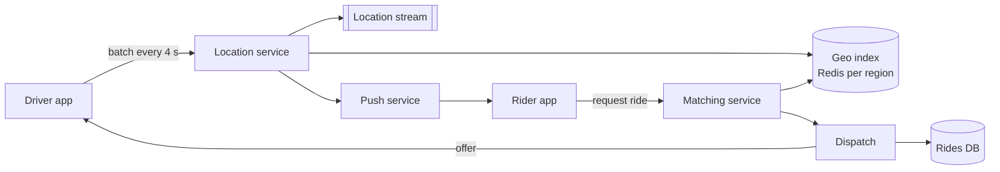

It is Friday evening. 200,000 drivers are online, each phone sending its position every 4 seconds, and a rider downtown taps **Request**. Within a couple of seconds the system must find the free drivers near the pickup, rank them by time-to-pickup, offer the ride to one, and make sure no other rider gets the same driver — while the rider in the suburbs, with a tenth of the drivers around, still gets a match. The design is about two numbers: how many writes the location stream produces, and how many drivers a "nearby" query returns.

:::key[First principle]
A driver's location is **ephemeral, rewritten every few seconds, and only useful near other points** — so it lives in memory, indexed by spatial cell, and is never queried by scanning. Matching is a lookup of a few cells sized to local density, followed by a ranking of tens of candidates; dispatch is a lease on one driver, taken with an atomic conditional write.
:::

This is not one of the course's three running examples; its inputs are illustrative and labelled, and everything else is derived from them with the methods of [§2](/c/system-design/02-estimation).

## 58.1 Requirements

**Functional**

- Rider: request a ride (pickup, drop-off), see fare estimate and ETA, see the driver approach.
- Driver: go online/offline, stream location, accept or decline offers.
- Trip lifecycle: requested → offered → accepted → arrived → in progress → completed (or cancelled); fare charged at the end.

**Non-functional**

- Match in < 10 s for most requests; nearby-driver queries < 100 ms.
- A driver is never assigned to two rides; a ride never has two drivers.
- Location data may be lost for a few seconds without harm; trips and payments are durable.

## 58.2 Estimates

Inputs (illustrative): 200,000 drivers online at the global peak, a report every 4 s of ~100 B, 5M rides/day, a driver busy ~15 minutes per ride (pickup plus trip), 2 KB per durable trip record.

1. **Location writes**: \(200{,}000 / 4\) = **50,000 updates/s** at peak. Average online is a third of peak (the §2 factor): 16,667/s, 1.44B updates/day. Ingress 5 MB/s at peak — trivial bandwidth, but a lot of individual writes.
2. **Rides**: \(5 \times 10^6 / 10^5\) = 50/s average, **150/s** at peak.
3. **Busy drivers** by Little's law: \(L = \lambda W = 150 \times 900\) s = 135,000 — 68% of those online. The other 65,000 are the matching pool.
4. **Rider-side pushes**: each rider on a trip sees the driver move every 4 s: 135,000 / 4 = 33,750 pushes/s.
5. **Storage**: live index 200,000 × ~200 B = 40 MB (in memory, easily); location history 144 GB/day if kept; trips 10 GB/day, 3.65 TB/year.

```python run
"""Ride hailing: location write rate, storage, trips in flight and geohash cell sizes (inputs illustrative)."""
import math

DRIVERS_PEAK = 200_000          # illustrative: drivers online at the global peak
EVERY_S = 4                     # each online driver reports its location every 4 s
UPDATE_B = 100                  # bytes per update: id, lat/lng, heading, speed, status, timestamp
RIDES_DAY = 5_000_000           # illustrative
TRIP_S = 900                    # illustrative: mean time a driver is busy per ride (pickup + trip)
TRIP_B = 2_000                  # bytes per durable trip record
PEAK = 3                        # peak-to-average factor (§2)

upd_peak = DRIVERS_PEAK / EVERY_S
upd_avg = upd_peak / PEAK
hist_day = upd_avg * 86_400 * UPDATE_B
print(f"location updates: {upd_peak:,.0f}/s at peak, {upd_avg:,.0f}/s average,"
      f" {upd_avg * 86_400 / 1e9:.2f}B/day; ingress {upd_peak * UPDATE_B / 1e6:.0f} MB/s at peak")
print(f"location history {hist_day / 1e9:,.0f} GB/day = {hist_day * 365 / 1e12:.1f} TB/yr (if kept)")

rides_avg = RIDES_DAY / 1e5
rides_peak = rides_avg * PEAK
busy = rides_peak * TRIP_S
print(f"ride requests {rides_avg:.0f}/s average, {rides_peak:.0f}/s peak;"
      f" busy drivers at peak (Little) {busy:,.0f} = {busy / DRIVERS_PEAK:.0%} of those online")
print(f"rider-side location pushes on trips {busy / EVERY_S:,.0f}/s;"
      f" trip records {RIDES_DAY * TRIP_B / 1e9:.0f} GB/day, {RIDES_DAY * TRIP_B * 365 / 1e12:.2f} TB/yr")
print(f"live index: {DRIVERS_PEAK:,} drivers x ~200 B = {DRIVERS_PEAK * 200 / 1e6:.0f} MB in memory")

print("\ngeohash  bits(lat,lng)  cell at equator     cell at 40.7 deg N   3x3 block at 40.7")
for length in (5, 6, 7):
    lng_bits = math.ceil(5 * length / 2)
    lat_bits = 5 * length - lng_bits
    h = 180 / 2 ** lat_bits * 111.2                         # km per degree of latitude
    w0 = 360 / 2 ** lng_bits * 111.3                        # km per degree of longitude at the equator
    w = w0 * math.cos(math.radians(40.7))
    print(f"{length:7d}  ({lat_bits},{lng_bits}){'':6s} {w0:6.3f} x {h:5.3f} km    {w:6.3f} x {h:5.3f} km"
          f"     {3 * w:5.2f} x {3 * h:5.2f} km")

p, accept_s, fail_s = 0.7, 5, 9   # illustrative: accept prob, mean s to accept, mean s to decline/timeout
print(f"\ndispatch: offers per match {1 / p:.2f}; P(no match after 3 offers) {(1 - p) ** 3:.1%};"
      f" mean time to accept {(1 - p) / p * fail_s + accept_s:.1f} s")
```

```output
location updates: 50,000/s at peak, 16,667/s average, 1.44B/day; ingress 5 MB/s at peak
location history 144 GB/day = 52.6 TB/yr (if kept)
ride requests 50/s average, 150/s peak; busy drivers at peak (Little) 135,000 = 68% of those online
rider-side location pushes on trips 33,750/s; trip records 10 GB/day, 3.65 TB/yr
live index: 200,000 drivers x ~200 B = 40 MB in memory

geohash  bits(lat,lng)  cell at equator     cell at 40.7 deg N   3x3 block at 40.7
      5  (12,13)        4.891 x 4.887 km     3.708 x 4.887 km     11.12 x 14.66 km
      6  (15,15)        1.223 x 0.611 km     0.927 x 0.611 km      2.78 x  1.83 km
      7  (17,18)        0.153 x 0.153 km     0.116 x 0.153 km      0.35 x  0.46 km

dispatch: offers per match 1.43; P(no match after 3 offers) 2.7%; mean time to accept 8.9 s
```

| Quantity | Value | What it decides |
| --- | ---: | --- |
| Location writes | 50,000/s peak | In-memory index, partitioned by region; no durable DB on this path |
| Ride requests | 150/s peak | Matching compute is small; correctness of dispatch is the hard part |
| Busy drivers | 135,000 (68%) | The free pool is 65,000 — and unevenly spread |
| Rider pushes | 33,750/s | Long-lived connections (WebSocket/push), fanned out by trip |
| Live index | 40 MB | Memory is not the constraint; write rate and locality are |

## 58.3 API

```http
POST /drivers/{id}/locations       [{lat, lng, heading, speed, ts}, ...]   -> 204   (batched, every 4 s)
PUT  /drivers/{id}/status          {online | offline}                       -> 204
POST /rides                        Idempotency-Key: <uuid>
                                   {pickup, dropoff} -> 201 {ride_id, fare_estimate, eta_s}
GET  /rides/{id}                   -> 200 {state, driver, driver_location, eta_s}
POST /offers/{offer_id}/accept     -> 200 {ride_id} | 409 {reason: "expired" | "taken"}
POST /rides/{id}/cancel            -> 204
```

Location is a fire-and-forget batch: if one is lost, the next arrives in 4 s. Ride creation carries an idempotency key ([§22](/c/system-design/22-idempotency)) — a rider's double tap must not dispatch two cars.

## 58.4 Data model

| Store | Key | Value | Durability |
| --- | --- | --- | --- |
| Geo index (Redis, per region) | cell id → set of free driver ids (or a `GEO` sorted set) | positions | Memory only; rebuilt from the next 4 s of updates |
| Driver state (Redis) | `driver:{id}` | status (free / offered / on trip), last position, ts; TTL 30 s | Memory; TTL removes vanished phones |
| Offer lease | `lease:driver:{id}` | ride_id; `SET NX PX 15000` | Memory; expiry returns driver to pool |
| Rides DB | `ride_id` | state, rider, driver, pickup, drop-off, fare, timestamps | Durable, replicated; sharded by city if needed |
| Location stream | `(driver_id, ts)` | raw updates | Log (e.g. Kafka) → analytics, ETA models, disputes |

## 58.5 High-level design



Two paths that share only the geo index: a high-rate, lossy **write path** (location service → index, stream, and rider pushes for drivers on a trip) and a low-rate, correctness-critical **request path** (matching → dispatch → rides DB).

## 58.6 Deep dive: the location write path

50,000 updates/s is a modest rate for an in-memory store but too many for a durable database on the request path, and it doesn't need durability: **the whole index is rebuilt by the next 4 seconds of updates**. Three choices follow:

- **Partition by region**, not by driver id. Matching queries are local; a region (a metro area) owns its drivers. The biggest city in this design has ~20,000 drivers online (illustrative) → 5,000 updates/s, a fraction of one Redis node; 50,000/s globally spreads over tens of regional nodes. A driver crossing a region boundary is removed from one and added to the other.
- **Update only what changed.** A driver who stays in the same cell needs only a position refresh in `driver:{id}`; the cell set changes only on a cell crossing. Drivers on a trip aren't in the free index at all — 68% of updates at peak touch only driver state and the rider push.
- **Heartbeat by TTL.** `driver:{id}` expires after 30 s (about 7 missed updates). A phone that loses signal drops out of matching on its own; no cleanup job.

The raw stream goes to a log for ETA models and disputes; nothing on the request path reads it.

## 58.7 Deep dive: cells and their size

A geohash interleaves longitude and latitude bits and writes them in base-32: each character adds 5 bits, so cells shrink 32× per character, alternately narrower and shorter. Longitude degrees shrink with $\cos(\text{latitude})$, so cells are narrower away from the equator. From the estimator, at 40.7°N:

| Length | Cell | Rider's cell + 8 neighbours | Guaranteed radius covered |
| ---: | --- | --- | ---: |
| 5 | 3.7 × 4.9 km | 11.1 × 14.7 km | 3.7 km |
| 6 | 0.93 × 0.61 km | 2.8 × 1.8 km | 0.61 km |
| 7 | 0.12 × 0.15 km | 0.35 × 0.46 km | 0.12 km |

The rider can sit anywhere in their cell, so the 3 × 3 block only guarantees a radius equal to the smaller cell side. Querying the 8 neighbours is mandatory: two points 10 m apart can lie in cells with completely different prefixes at a cell boundary. H3 (hexagons) and S2 (cells on a cube projected onto the sphere) fix the uneven cell shapes and give every cell neighbours at equal distance; the matching logic is the same.

## 58.8 Deep dive: matching radius vs candidates

How many free drivers does a query return? It depends on density, which varies 20× across one city. The simulation places 20,000 online drivers in an illustrative metro — 60% in a downtown cluster (Gaussian, σ = 3 km), 40% spread over 30 × 30 km — with 40% of them free, and counts free drivers around three riders.

```python run
"""Matching radius vs candidates in an illustrative city; drivers fetched by a 3x3 geohash block."""
import numpy as np

rng = np.random.default_rng(58)
ONLINE, FREE = 20_000, 0.4                    # illustrative: drivers online in one city; 40% free at peak
core = rng.normal(0, 3.0, (int(ONLINE * 0.6), 2))               # 60% within a downtown ~3 km sigma
rest = rng.uniform(-15, 15, (ONLINE - len(core), 2))            # 40% spread over a 30 x 30 km metro
drivers = np.vstack([core, rest])
free = drivers[rng.random(ONLINE) < FREE]

riders = {"downtown (0 km)": (0.0, 0.0), "midtown (5 km)": (5.0, 0.0), "suburb (12 km)": (12.0, 3.0)}
radii = [0.1, 0.2, 0.3, 0.5, 0.75, 1.0, 1.5, 2.0, 3.0, 4.0, 5.0]
dist = {k: np.hypot(*(free - np.array(v)).T) for k, v in riders.items()}

print("radius km " + "".join(f"{k:>18s}" for k in riders))
for r in radii:
    print(f"{r:9.2f} " + "".join(f"{(d <= r).sum():18d}" for d in dist.values()))

print("\nsmallest radius with >= 10 free candidates (expanding ring):")
for k, d in dist.items():
    print(f"  {k:16s} {np.sort(d)[9]:.2f} km")

KM_LAT, KM_LNG = 111.2, 111.3 * np.cos(np.radians(40.7))          # km per degree at 40.7 deg N
cells = {n: (360 / 2 ** -(-5 * n // 2) * KM_LNG, 180 / 2 ** (5 * n // 2) * KM_LAT) for n in (5, 6, 7)}
print("\nfree drivers fetched by the rider's cell + 8 neighbours")
print("geohash " + "".join(f"{k:>18s}" for k in riders))
for length, (w, h) in cells.items():
    row = []
    for x, y in riders.values():
        cx, cy = np.floor(x / w) * w, np.floor(y / h) * h          # the rider's cell corner
        inside = (free[:, 0] >= cx - w) & (free[:, 0] < cx + 2 * w) & (free[:, 1] >= cy - h) & (free[:, 1] < cy + 2 * h)
        row.append(inside.sum())
    print(f"{length:7d} " + "".join(f"{n:18d}" for n in row))
```

```output
radius km    downtown (0 km)    midtown (5 km)    suburb (12 km)
     0.10                  1                 0                 0
     0.20                  8                 0                 0
     0.30                 25                 4                 0
     0.50                 73                15                 4
     0.75                161                43                 8
     1.00                265                75                11
     1.50                581               181                23
     2.00                973               315                44
     3.00               1953               751               101
     4.00               2977              1336               164
     5.00               3846              2094               251

smallest radius with >= 10 free candidates (expanding ring):
  downtown (0 km)  0.20 km
  midtown (5 km)   0.40 km
  suburb (12 km)   0.93 km

free drivers fetched by the rider's cell + 8 neighbours
geohash    downtown (0 km)    midtown (5 km)    suburb (12 km)
      5               4595              2900               434
      6                409               124                15
      7                 12                 3                 0
```

:::chart[Free drivers within the matching radius, by rider location (illustrative city, simulated)]{type="line" x="matching radius (km)" y="free drivers within radius" ylog="true" points="true" yfmt="int" hmarks="10:target candidates"}
radius km, downtown (0 km), midtown (5 km), suburb (12 km)
0.5, 73, 15, 4
0.75, 161, 43, 8
1, 265, 75, 11
1.5, 581, 181, 23
2, 973, 315, 44
3, 1953, 751, 101
4, 2977, 1336, 164
5, 3846, 2094, 251
:::

Candidates grow as $\rho_\text{free}\,\pi r^2$ — quadratically in radius, linearly in density — so a fixed radius is wrong everywhere but one place:

- **A fixed 1 km radius** returns 265 candidates downtown (each needs an ETA computed — wasted work) and 11 in the suburb.
- **A fixed geohash-6 block** fetches 409 downtown and 15 in the suburb; geohash-7 fetches 12 downtown and none in the suburb.
- **An expanding ring** stops at the first radius with ≥ 10 candidates: 0.20 km downtown, 0.40 km midtown, 0.93 km in the suburb. Implement it as "query the geohash-7 block; if fewer than $k$, step to geohash-6, then 5" — at most three lookups.

Then rank the ~10 candidates by road-network ETA (straight-line distance lies across rivers and one-way streets) and offer the best. Ten ETA computations per request × 150 requests/s = 1,500 routing queries/s at peak.

## 58.9 Deep dive: dispatch without double assignment

Two matching workers serving nearby riders often pick the same best driver. "Read status, then write `offered`" is the same race as overselling stock ([§15.4](/c/system-design/15-transactions)); both riders would be told the driver is coming. The offer must be an atomic claim:

```text
SET lease:driver:812 ride:5521 NX PX 15000     -> OK: offer sent;  nil: someone else holds it, try the next candidate
```

The lease expires after 15 s if the driver doesn't answer, returning them to the pool with no cleanup. On **accept**, the ride is committed durably with a conditional update so the ride and driver are bound exactly once:

```sql
UPDATE rides SET state = 'accepted', driver_id = :d
 WHERE ride_id = :r AND state = 'offered' AND offered_driver = :d;   -- 0 rows: offer expired or cancelled
```

The lease is a lock with a TTL, so the [§21](/c/system-design/21-distributed-locks) caveat applies: a driver accepting at 15.2 s after the lease lapsed and was re-offered elsewhere must be rejected. The `WHERE offered_driver = :d` clause is the fence — the database, not the lease, has the final say.

**How long does matching take?** With an illustrative 70% acceptance, a match needs 1/0.7 = 1.43 offers on average; with 5 s to accept and 9 s mean to decline or time out, the mean time to an accepted offer is \(0.3/0.7 \times 9 + 5\) = 8.9 s, and 2.7% of rides are still unmatched after 3 sequential offers. Offering two drivers at once (first to accept wins, the other gets "taken") cuts that time but burns driver goodwill; batching requests over ~2 s and solving the assignment jointly gives better global ETAs than greedy nearest-first at the cost of that 2 s.

## 58.10 Bottlenecks and failure modes

| Failure | Symptom | Design response |
| --- | --- | --- |
| 50,000 writes/s on one store | Index node saturates | Partition by region; drivers on a trip skip the free index |
| Dense downtown | Hundreds of candidates, slow ETA ranking | Expanding ring from geohash-7; cap at ~10 candidates |
| Sparse suburb | Zero candidates in the default block | Ring expands to geohash-6, 5; widen ETA tolerance |
| Geo index node lost | Region blind | Replica promotes, or rebuild from the next 4 s of updates; matching widens or waits seconds |
| Phone loses signal | Ghost driver offered rides | 30 s TTL on driver state; lease expiry on unanswered offers |
| Two workers pick one driver | Double assignment | `SET NX` lease + conditional update fenced on the offered driver |
| Rider double taps | Two rides dispatched | Idempotency key on `POST /rides` |
| Region boundary | Driver missing from both | Write to new region before removing from old; query neighbour region near edges |

## 58.11 Trade-offs

| Decision | Option A | Option B | Choose |
| --- | --- | --- | --- |
| Location store | Durable DB | In-memory index + log | In-memory; durability comes from the next update |
| Cells | Geohash (simple prefixes) | H3 / S2 (uniform cells, equal neighbours) | Either; H3/S2 when cell shape matters for pricing or supply maps |
| Radius | Fixed | Expanding ring by density | Expanding ring, ≥ 10 candidates |
| Assignment | Greedy, per request | Batched every ~2 s | Greedy to start; batch in dense markets |
| Update interval | 2 s (fresher, 100,000 writes/s) | 4 s (50,000 writes/s) | 4 s; a car at 50 km/h moves 56 m in 4 s, under a geohash-7 cell |

## 58.12 What I'd say in 45 minutes

| Minutes | Topic | What to say, with the number |
| ---: | --- | --- |
| 0–5 | Requirements | Match in seconds; never double-assign; location is ephemeral, trips durable |
| 5–10 | Estimates | 200,000 drivers / 4 s = 50,000 writes/s; 150 rides/s; Little: 135,000 busy, 65,000 free |
| 10–15 | API + data | Batched location POST; geo index in memory with TTL; rides DB durable |
| 15–22 | Design | Lossy write path vs correct request path; partition the index by region |
| 22–30 | Cells | Geohash-6 = 0.93 × 0.61 km at 40.7°N; always query 8 neighbours |
| 30–37 | Matching | Candidates ∝ density × r²: 265 vs 11 at 1 km → expanding ring to ≥ 10 |
| 37–43 | Dispatch | `SET NX PX 15000` lease + conditional update; 1.43 offers, 8.9 s mean |
| 43–45 | Failure | Index rebuilds in 4 s; TTLs remove ghosts; idempotent ride creation |

## 58.13 Check yourself

:::qa[The product wants driver locations every 2 s instead of 4 s. What changes?]
Writes double to 100,000/s at peak and rider pushes to 67,500/s; ingress to 10 MB/s. The index still fits in memory (size depends on drivers, not rate), but each regional node takes twice the writes. The gain: a car at 50 km/h moves 28 m between updates instead of 56 m — both under a geohash-7 cell, so matching barely improves.
:::

:::qa[Why is a fixed 1 km matching radius wrong for this city?]
Candidates scale with density × πr². At 1 km the simulation finds 265 free drivers downtown — 26× more ETA calls than needed — and 11 in the suburb, barely enough. An expanding ring stops at 0.20 km downtown and 0.93 km in the suburb, returning ~10 candidates everywhere.
:::

:::qa[A rider at a geohash-6 cell edge has a free driver 100 m away who isn't returned. Why?]
The query used only the rider's own cell. The driver is across the boundary, in a neighbour with a different prefix. Always fetch the cell and its 8 neighbours — that guarantees coverage of a radius equal to the smaller cell side (0.61 km at 40.7°N).
:::

:::qa[A driver accepts an offer 16 s after it was sent. What should happen, and which mechanism enforces it?]
The 15 s lease has expired and the driver may already be offered elsewhere or the ride re-offered. The accept runs `UPDATE rides … WHERE state = 'offered' AND offered_driver = :d`; if the ride moved on, 0 rows change and the driver gets `409 expired`. The conditional update is the fence; the lease alone is not enough.
:::

Next: [§59 Design a ticket booking service](/c/system-design/59-ticket-booking) — the same "claim it atomically" problem, with 2,000 buyers a second wanting the same seats.
