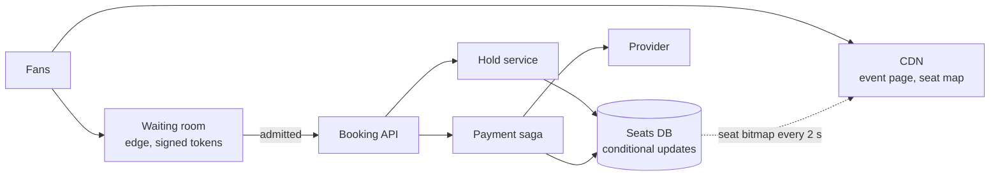

A stadium tour goes on sale at 10:00. At 09:59 a million people are on the event page, and at 10:00 they all press **Find tickets**. The booking backend is the checkout system from the running example: it sustains 2,000 orders/s at its flash-sale peak, and every order pays through a provider that answers in 300 ms at p50 and 2 s at p99 (illustrative). There are 50,000 seats. 968,750 of these people will leave without a ticket no matter what; the design decides whether the other 31,250 get theirs quickly, whether any seat is sold twice, and whether the system survives the minute.

:::key[First principle]
A seat is a row, and selling it is a **conditional write**: `… WHERE status = 'available'` — the database decides who wins, atomically, and the row count tells you. Everything around that write exists to keep it cheap and rare: holds with a TTL so payment happens outside the transaction, a waiting room that admits buyers at the rate *inventory* can absorb, and a static seat map so a million readers never touch the database.
:::

## 59.1 Requirements

**Functional**

- Browse events, sections and a seat map; choose seats or ask for "best available".
- Hold seats while paying; confirm and issue tickets; release on cancel or timeout.
- Queue buyers fairly at on-sale time and tell them their position.

**Non-functional**

- **Never sell a seat twice.** Never take payment for a seat you can't deliver.
- Survive 1M concurrent fans; browsing must stay fast while the write path is saturated.
- Holds must expire, or abandoned checkouts leak inventory.

## 59.2 Estimates

Inputs: 50,000 seats, 2 seats per order, 1M fans, 80% of admitted buyers finish paying, completing checkouts take a lognormal time with median 90 s — all illustrative; backend 2,000 orders/s and provider p50 300 ms / p99 2 s from the checkout example ([§2](/c/system-design/02-estimation)).

1. **Sell-out at full speed.** 50,000 / 2 = 25,000 orders; at 2,000/s every seat is *held* after 12.5 s.
2. **Who gets in.** At 80% conversion, ~31,250 admitted buyers sell the house; 968,750 fans (96.9%) can't get a ticket. Telling them early is a feature.
3. **Waiting room.** 1M pages refreshing their position every 10 s = 100,000 req/s — 50× the booking rate. It must be served at the edge, never by the seat database.
4. **Payments in flight** (Little's law): up to 1,600 payments/s → 480 in flight at p50, 3,200 if the provider degrades to its p99 (§2 computes 600 and 4,000 at the full 2,000/s).
5. **Stranded seats.** 20% of buyers abandon: right after the burst, 10,000 seats are held by people who have left.

```python run
"""Ticket on-sale: sell-out time, waiting room, payments in flight and the hold TTL trade-off."""
import math
from statistics import NormalDist

SEATS, PER_ORDER = 50_000, 2      # illustrative stadium; seats per order
FANS = 1_000_000                  # illustrative: people in the waiting room at on-sale
ADMIT = 2_000                     # orders/s the checkout backend sustains at its flash-sale peak (§2)
CONVERT = 0.8                     # illustrative: admitted buyers who finish paying
MEDIAN_S, SIGMA = 90, 0.6         # illustrative: checkout time of buyers who finish (lognormal)
POLL_S = 10                       # waiting-room page refreshes its position every 10 s
P50, P99 = 0.3, 2.0               # payment provider latency, s (illustrative, §2)

orders = SEATS / PER_ORDER
needed = orders / CONVERT
print(f"{orders:,.0f} orders sell the house; at {ADMIT:,}/s every seat is held after {orders / ADMIT:.1f} s")
print(f"admit ~{needed:,.0f} buyers to sell out at {CONVERT:.0%} conversion;"
      f" {FANS - needed:,.0f} of {FANS:,} fans ({1 - needed / FANS:.1%}) can't get a ticket")
print(f"waiting-room polls: {FANS:,} / {POLL_S} s = {FANS / POLL_S:,.0f} req/s (edge-served, never the seat DB)")
paying = ADMIT * CONVERT
print(f"payments at up to {paying:,.0f}/s: in flight {paying * P50:,.0f} at p50, {paying * P99:,.0f} if all at p99")
print(f"seats held by abandoned checkouts right after the burst: {SEATS * (1 - CONVERT):,.0f}")

print("\nhold TTL   buyers whose hold expires mid-checkout   rounds to sell 99.5%   minutes to sell 99.5%")
for ttl_min in (2, 5, 10, 15):
    late = 1 - NormalDist().cdf(math.log(ttl_min * 60 / MEDIAN_S) / SIGMA)
    back = (1 - CONVERT) + CONVERT * late          # share of held seats that return each TTL
    rounds = math.ceil(math.log(0.005) / math.log(back))
    print(f"{ttl_min:5d} min   {late:38.1%}   {rounds:20d}   {rounds * ttl_min:21d}")
```

```output
25,000 orders sell the house; at 2,000/s every seat is held after 12.5 s
admit ~31,250 buyers to sell out at 80% conversion; 968,750 of 1,000,000 fans (96.9%) can't get a ticket
waiting-room polls: 1,000,000 / 10 s = 100,000 req/s (edge-served, never the seat DB)
payments at up to 1,600/s: in flight 480 at p50, 3,200 if all at p99
seats held by abandoned checkouts right after the burst: 10,000

hold TTL   buyers whose hold expires mid-checkout   rounds to sell 99.5%   minutes to sell 99.5%
    2 min                                    31.6%                      7                      14
    5 min                                     2.2%                      4                      20
   10 min                                     0.1%                      4                      40
   15 min                                     0.0%                      4                      60
```

| Quantity | Value | What it decides |
| --- | ---: | --- |
| Time until every seat is held | 12.5 s at 2,000 orders/s | Backend capacity is not the bottleneck; inventory is |
| Buyers to admit | ~31,250 of 1M | The waiting room admits by inventory and tells the rest early |
| Waiting-room reads | 100,000 req/s | Edge-served queue page with signed tokens |
| Payments in flight | 480 (p50) to 3,200 (p99) | Provider connection pool and timeouts ([§20](/c/system-design/20-circuit-breaker)) |
| Hold TTL | 5 min | 2.2% of payers expire vs 20 min to sell 99.5% (§59.9) |

## 59.3 API

```http
GET    /events/{id}/seatmap            -> 200 {sections[], available_bitmap, as_of}      (CDN, ~2 s TTL)
POST   /queue/{event_id}/join          -> 200 {queue_token, position, eta_s}
GET    /queue/{event_id}/status        -> 200 {position, eta_s, admitted, likely_sold_out}   (edge)
POST   /holds        Admission-Token, Idempotency-Key
                     {event_id, seat_ids[] | {section, count}} -> 201 {hold_id, seats[], expires_at}
                                                               -> 409 {unavailable_seats[]}
DELETE /holds/{id}                     -> 204
POST   /bookings     Idempotency-Key  {hold_id, payment_method} -> 201 {booking_id, tickets[]}
```

`POST /holds` accepts either explicit seats (user picks) or a section and count (server picks, §59.7). It requires a signed admission token from the waiting room, so nobody bypasses the queue by calling the API directly.

## 59.4 Data model

| Table | Key | Columns | Notes |
| --- | --- | --- | --- |
| `seats` | `(event_id, seat_id)` | section, quality_rank, status (available / held / sold), hold_id, hold_expires | 50,000 rows per event; the arbiter of truth |
| `holds` | `hold_id` | event, seats, user, expires_at, idem_key | Short-lived |
| `bookings` | `booking_id` | hold_id UNIQUE, payment_id, status | `hold_id UNIQUE`: one booking per hold, however often confirm is retried |
| `payments` | `payment_id` | `(user_id, idem_key)` UNIQUE, provider_ref, state | Same pattern as [§56](/c/system-design/56-payments-ledger) |

1M events × 10,000 seats × ~100 B ≈ 1 TB over the catalogue's life — partition by event; only events on sale are hot.

## 59.5 High-level design



Reads (the seat map, the queue page) are served from the edge and refreshed every couple of seconds. Writes reach the database only through the waiting room's admission token, at a rate the inventory can absorb. Payment is a saga ([§31](/c/system-design/31-sagas)) that runs *after* the hold commits.

## 59.6 Deep dive: never sell a seat twice

The race: read "seat 4,812 is available", then write "held by me". Between the read and the write — two round trips, or a payment call if someone put it there — another buyer reads the same seat as available. The simulation sends 12,500 hold requests at 2,000/s, each for 2 seats chosen from those shown free, and varies the gap between the read and the write. "Provider call" draws the gap from the payment latency (p50 300 ms, p99 2 s): the design that charges the card between checking the seat and claiming it.

```python run
"""Hold contention at 2,000 requests/s for 2 seats each: read-then-write vs conditional update vs server pick."""
import numpy as np

RATE, SEATS, N = 2_000, 50_000, 12_500      # first half of the on-sale: 25,000 of 50,000 seats requested
SIGMA = np.log(2000 / 300) / 2.326          # provider latency: p50 300 ms, p99 2 s (illustrative)


def run(mode, window_s=0.0, stale_s=0.0, seed=59):
    rng = np.random.default_rng(seed)
    t = np.cumsum(rng.exponential(1 / RATE, N))
    first = np.full(SEATS, np.inf)          # time the seat's first hold committed
    owners = np.zeros(SEATS, int)
    failed, nxt = 0, 0
    for ti in t:
        if mode == "server picks":          # UPDATE ... WHERE seat IN (SELECT ... FOR UPDATE SKIP LOCKED LIMIT 2)
            seats = [nxt, nxt + 1]          # next best free seats, chosen inside the database
            nxt += 2
            first[seats], owners[seats] = ti, owners[seats] + 1
            continue
        pick = set()
        while len(pick) < 2:                # user picks 2 seats shown free on a map stale_s old
            s = int(rng.integers(SEATS))
            if first[s] > ti - stale_s:
                pick.add(s)
        pick = list(pick)
        if (first[pick] <= ti).any():       # the read (or the atomic WHERE) sees a committed hold
            failed += 1
            continue
        w = rng.lognormal(np.log(0.3), SIGMA) if window_s == "pay" else window_s
        commit = ti + (w if mode == "read-then-write" else 0.0)
        first[pick] = np.minimum(first[pick], commit)
        owners[pick] += 1
    return int(np.clip(owners - 1, 0, None).sum()), failed / N


print("read-to-write window   oversold seats (read-then-write)   oversold (conditional UPDATE)")
for w in (0.001, 0.002, 0.005, 0.01, 0.02, 0.05, 0.1, 0.2, 0.5, 1.0, 2.0, "pay"):
    label = "provider call" if w == "pay" else f"{w * 1000:g} ms"
    print(f"{label:>20s}   {run('read-then-write', w)[0]:32d}   {run('conditional', w)[0]:29d}")

print("\nseat map age   failed holds (conditional, user picks)   failed holds (server picks)")
server = run("server picks")
for stale in (0.1, 0.25, 0.5, 1, 2, 5):
    print(f"{stale:9g} s   {run('conditional', 0, stale)[1]:38.1%}   {server[1]:27.1%}")
print(f"server picks: oversold {server[0]}, failed {server[1]:.0%}")
```

```output
read-to-write window   oversold seats (read-then-write)   oversold (conditional UPDATE)
                1 ms                                  1                               0
                2 ms                                  7                               0
                5 ms                                 10                               0
               10 ms                                 24                               0
               20 ms                                 58                               0
               50 ms                                129                               0
              100 ms                                272                               0
              200 ms                                545                               0
              500 ms                               1245                               0
             1000 ms                               2128                               0
             2000 ms                               3450                               0
       provider call                                985                               0

seat map age   failed holds (conditional, user picks)   failed holds (server picks)
      0.1 s                                     2.1%                          0.0%
     0.25 s                                     5.2%                          0.0%
      0.5 s                                     9.2%                          0.0%
        1 s                                    14.8%                          0.0%
        2 s                                    22.5%                          0.0%
        5 s                                    32.6%                          0.0%
server picks: oversold 0, failed 0%
```

:::chart[Seats sold twice by read-then-write vs the read-to-write gap (12,500 holds at 2,000/s, simulated) — the conditional UPDATE sells 0 at every gap]{type="line" x="gap between reading and writing the seat (ms)" y="seats sold twice" xlog="true" ylog="true" points="true" yfmt="int" marks="300:provider p50;2000:provider p99"}
gap ms, read-then-write
1, 1
2, 7
5, 10
10, 24
20, 58
50, 129
100, 272
200, 545
500, 1245
1000, 2128
2000, 3450
:::

For small gaps $w$, a picked seat is double-sold when another request picks it within $w$: with $N$ requests of 2 seats, rate $\lambda$ and $A$ seats free on average,

$$
\text{oversold} \approx 2N \cdot \frac{2\lambda w}{A} = 25{,}000 \times \frac{4{,}000 \times 0.1}{37{,}500} \approx 267 \text{ at } w = 100\ \text{ms (simulated: 272)}.
$$

- **Even 1–2 ms oversells.** Two round trips are a small window, not a closed one — the same lesson as check-then-insert in [§22](/c/system-design/22-idempotency).
- **Paying inside the window is a disaster**: 985 seats (3.9% of those sold) go to two people, and the provider has charged both.
- **The conditional update sells 0** at every gap, because the check and the write are one atomic statement ([§15.4](/c/system-design/15-transactions)).

For a multi-seat hold, the statement must be all-or-nothing:

```sql
BEGIN;
UPDATE seats SET status = 'held', hold_id = :h, hold_expires = now() + interval '5 minutes'
 WHERE event_id = :e AND seat_id = ANY(:seats)
   AND (status = 'available' OR (status = 'held' AND hold_expires < now()));
-- rows updated = cardinality(:seats) -> COMMIT;  fewer -> ROLLBACK and return 409 with the taken seats
COMMIT;
```

The second disjunct is **lazy expiry**: an expired hold counts as available the instant it expires, so correctness never depends on a sweeper running on time. `SELECT … FOR UPDATE` (pessimistic) is also correct; distinct seats are distinct rows, so lock waits are short. A distributed lock per seat is unnecessary and slower ([§21](/c/system-design/21-distributed-locks)).

:::warn[General admission is one hot row]
For unreserved standing tickets, "inventory" is a single counter: 2,000 decrements/s on one row with ~1 ms commits is $\rho = 2$ ([§15.5](/c/system-design/15-transactions)). Split the count into ~16 bucket rows and decrement a random non-empty bucket (ρ ≈ 0.13 each), exactly as for checkout's hot SKU.
:::

## 59.7 Deep dive: who picks the seat?

Correctness is settled; the second table measures **wasted attempts**. A user picks seats from a map that is $s$ seconds old (CDN cache plus think time); by then 4,000 seats/s are being taken. With user-picked seats, 15% of holds fail at a 1 s-old map and 23% at 2 s — and uniform picks are the *kind* case; real demand piles onto the front rows. Each failure is a retry, an extra request on the hottest path, and an unhappy fan.

:::chart[Failed holds vs seat-map age during the on-sale (conditional UPDATE, 2,000 holds/s, simulated)]{type="line" x="seat map age (s)" y="failed holds" unit="%" ymin="0" points="true" dash="server picks"}
map age s, user picks seats, server picks
0.1, 2.1, 0.0
0.25, 5.2, 0.0
0.5, 9.2, 0.0
1, 14.8, 0.0
2, 22.5, 0.0
5, 32.6, 0.0
:::

| Mode | Failed holds | Use when |
| --- | ---: | --- |
| User picks from the live map | 2–33% (map 0.1–5 s old) | Normal sales; low contention |
| Server picks best available in a chosen section | 0% | On-sale minutes of a hot event |
| User picks section and price; server picks seats | 0% | The usual compromise |

Server picks use `FOR UPDATE SKIP LOCKED` so concurrent buyers take *different* best seats instead of queueing for the same ones:

```sql
UPDATE seats SET status = 'held', hold_id = :h, hold_expires = now() + interval '5 minutes'
 WHERE (event_id, seat_id) IN (
       SELECT event_id, seat_id FROM seats
        WHERE event_id = :e AND section = :sec AND status = 'available'
        ORDER BY quality_rank LIMIT :n
          FOR UPDATE SKIP LOCKED);
```

## 59.8 Deep dive: payment outside the hold

The hold is one short transaction; payment is a saga after it ([§31](/c/system-design/31-sagas)): authorise with the provider (idempotency key), then confirm `UPDATE seats SET status = 'sold' WHERE hold_id = :h AND status = 'held' AND hold_expires > now()`, then capture. If confirm updates fewer rows than the hold had (it expired while the buyer typed their card), **void** the authorisation and tell the buyer — never capture for seats you no longer hold. `bookings.hold_id UNIQUE` makes a retried confirm return the existing booking.

At up to 1,600 payments/s the provider has 480 calls in flight at p50; if it slows to its p99 for everyone, 3,200. Size the connection pool for that, time out at ~3 s, and break the circuit if the provider is down — holds are still valid for minutes, so the buyer can retry payment without losing seats.

## 59.9 Deep dive: hold TTL

A hold too short expires under people who are paying; too long strands the seats of people who left. With completing buyers' checkout time lognormal (median 90 s, illustrative) and 20% abandoning, each TTL period returns the abandoned seats plus any expired-while-paying ones to the pool; the estimator counts how many such rounds it takes to sell 99.5%:

| TTL | Payers whose hold expires | Minutes to sell 99.5% | Verdict |
| ---: | ---: | ---: | --- |
| 2 min | 31.6% | 14 | Fast, but a third of payers lose their seats |
| **5 min** | **2.2%** | **20** | Balanced; show a countdown |
| 10 min | 0.1% | 40 | Abandoned seats invisible for 10 min |
| 15 min | 0.0% | 60 | Sale drags for an hour |

Release early whenever you can: an explicit "cancel" button and a page-exit beacon return abandoned seats before the TTL. Note this human TTL is minutes; the saga's machine-side reservation TTL in [§31.5](/c/system-design/31-sagas) is 30 s because it covers only automated steps.

## 59.10 Deep dive: the waiting room

Admitting at the backend's 2,000 orders/s would hold every seat in 12.5 s and then send hundreds of thousands of admitted fans into "no seats available" errors. Admit by **inventory** instead:

- **Burst**: admit enough buyers to hold what's free — about 25,000 orders' worth at the start.
- **Trickle**: afterwards admit one buyer per ~2 seats released (expired, cancelled, or payment failed).
- **Order**: fans who arrived before 10:00 get random positions (arriving at 09:30 is no advantage); later arrivals queue in arrival order.
- **Honesty**: past position ~31,250, the chance of a ticket is small — say so, and let 96.9% of fans stop refreshing.

The queue page is the system's biggest load: 100,000 req/s from 1M pages polling every 10 s. Serve it from the edge: the position lives in a signed token, the "now serving" number is one value published every second, and the browser computes its own wait. Admission issues a short-lived signed token that `POST /holds` checks without a database lookup.

## 59.11 Bottlenecks and failure modes

| Failure | Symptom | Design response |
| --- | --- | --- |
| Read-then-write hold | 985 seats sold twice when payment is in the window | Conditional `UPDATE … WHERE status = 'available'`, all-or-nothing |
| Stale seat map, user picks | 15–23% failed holds at 1–2 s | Server picks in a section at on-sale |
| 1M fans refreshing | 100,000 req/s | Edge waiting room, signed tokens, CDN seat map |
| Admit at backend speed | Seats held in 12.5 s, then mass errors | Admit by inventory; tell the tail early |
| Hold expires mid-payment | Charge for a seat you no longer hold | Confirm conditional on hold; void the authorisation |
| Abandoned holds | 10,000 seats invisible | 5 min TTL, lazy expiry, explicit release |
| Provider slows to p99 | 3,200 calls in flight | Pool sized for it, 3 s timeout, breaker; holds outlive the outage |
| Retried confirm | Two bookings | `bookings.hold_id UNIQUE`, idempotency key |
| GA inventory counter | One row at ρ = 2 | Bucketed counter rows |

## 59.12 Trade-offs

| Decision | Option A | Option B | Choose |
| --- | --- | --- | --- |
| Concurrency control | Conditional update (optimistic) | `SELECT … FOR UPDATE` | Conditional update; locks are fine too since rows are distinct |
| Seat choice | User picks exact seats | Server picks in a section | Server picks at on-sale, user picks afterwards |
| Hold TTL | Short (2 min) | Long (10+ min) | 5 min with countdown and early release |
| Admission | Backend capacity (2,000/s) | Inventory-driven | Inventory-driven |
| Seat map freshness | Live per request | CDN, ~2 s | CDN; the conditional update is the source of truth |

## 59.13 What I'd say in 45 minutes

| Minutes | Topic | What to say, with the number |
| ---: | --- | --- |
| 0–5 | Requirements | Never oversell; survive 1M fans; holds expire |
| 5–10 | Estimates | 25,000 orders; 12.5 s at 2,000/s; 31,250 of 1M can buy; 100,000 req/s of queue polling |
| 10–15 | API + model | Seats table is the arbiter; holds; `bookings.hold_id UNIQUE` |
| 15–20 | Design | Edge for reads and queue; tokens gate writes; saga for payment |
| 20–28 | Double sell | Read-then-write oversells 272 seats at 100 ms, 985 with payment inside; conditional update 0 |
| 28–33 | Seat choice | 15% failed holds at a 1 s map → server picks with SKIP LOCKED |
| 33–39 | Holds | 5 min TTL: 2.2% payers expire, 99.5% sold in 20 min; lazy expiry |
| 39–45 | Waiting room + failure | Admit by inventory; void on expired confirm; 480–3,200 payments in flight |

## 59.14 Check yourself

:::qa[The team proposes: check the seats are free, charge the card, then mark the seats sold. What happens at 2,000 requests/s?]
The read-to-write gap becomes the provider's latency (p50 300 ms, p99 2 s). The simulation sells 985 seats twice in the first half of the on-sale, and both buyers are charged. Hold the seats first with one conditional update, then pay outside the transaction, then confirm conditional on the hold.
:::

:::qa[Why not admit buyers from the waiting room at the backend's full 2,000 orders/s?]
25,000 orders hold every seat in 12.5 s. Admitting more just converts queued fans into failed holds and retries. Admit ~25,000 orders' worth at the start, then one buyer per ~2 seats released, and tell everyone past position ~31,250 that tickets are unlikely.
:::

:::qa[Product wants a 15-minute hold "so nobody loses their seats". What does it cost?]
Payers whose hold expires drop from 2.2% (5 min) to ~0%, but abandoned seats — 10,000 right after the burst — stay invisible for 15 minutes per round, so selling 99.5% takes ~60 minutes instead of 20. A countdown and an early-release button get most of the benefit at 5 minutes.
:::

:::qa[The seat map comes from a CDN with a 2 s TTL. Can it cause an oversell?]
No — the map only influences which seats a user *asks* for; the conditional update decides. It does cause failed holds: 23% at a 2 s-old map with user-picked seats in the simulation. That's why on-sale uses server-picked seats within a section.
:::

Next: [§60 Design a URL shortener](/c/system-design/60-url-shortener).
