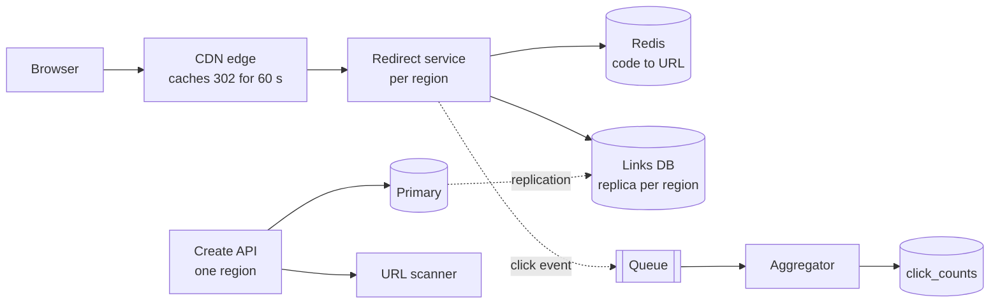

A link-sharing service needs short links: users paste a 200-character URL and get `sho.rt/aZ3k9Qx` back; anyone who clicks it is redirected. Assume, as illustrative inputs, **1M links created and 100M redirects a day** — a mid-size public shortener. The write path is trivial; the read path must answer in a few milliseconds worldwide, the code space must never hand out the same code twice, and the service must not become a free hosting layer for phishing links or a directory that anyone can enumerate.

:::key[First principle]
A short link is an immutable key → value row, read ~100× more often than it is written. Make the **key** short but sparse — the density of live codes in the key space sets both the collision-retry rate and how easily a stranger can guess a link — and make the **read** a cache lookup close to the user. Everything else (analytics, abuse handling) must stay off the redirect's critical path.
:::

## 60.1 Requirements

**Functional**

- Create a short link for a long URL, optionally with a custom alias and an expiry.
- Redirect `GET /{code}` to the long URL; expired or removed links return 410.
- Per-link click counts (approximate, minutes behind is fine).
- Owners can disable a link; the trust team can take down abusive ones.

**Non-functional**

- Redirect p99 < 50 ms worldwide; availability higher than the create path.
- A code never maps to two URLs, and never changes its target once created.
- Codes are not enumerable: knowing one link must not reveal others.
- Abuse is contained: creation is rate-limited and scanned; a takedown is effective within a minute.

**Out of scope** (say so): accounts and auth internals, dashboards, link-in-bio pages.

## 60.2 Estimates

Inputs: 1M creates and 100M redirects per day, ~500 B per stored link including its share of indexes, 5-year retention — all illustrative; the 10^5 s/day shortcut and 3× peak factor come from [§2](/c/system-design/02-estimation).

```python run
"""URL shortener: traffic and storage from illustrative daily volumes."""
CREATES, REDIRECTS = 1e6, 100e6      # per day (illustrative public shortener)
PEAK, DAY = 3, 1e5                   # peak factor; the 10^5 s/day shortcut (section 2)
RECORD_B, YEARS = 500, 5             # bytes per link row incl. index share (illustrative)
ENTRY_B = 250                        # cached code -> URL entry incl. key and overhead (illustrative)
RESP_B = 400                         # 302 response: status line, Location, headers (illustrative)

print(f"creates {CREATES / DAY:,.0f}/s avg, {PEAK * CREATES / DAY:,.0f} peak; "
      f"redirects {REDIRECTS / DAY:,.0f}/s avg, {PEAK * REDIRECTS / DAY:,.0f} peak "
      f"({REDIRECTS / CREATES:.0f}:1 read:write)")
links = CREATES * 365 * YEARS
print(f"{YEARS} years: {links / 1e9:.2f}B links x {RECORD_B} B = {links * RECORD_B / 1e12:.2f} TB per copy "
      f"({CREATES * RECORD_B / 1e9:.1f} GB/day)")
print(f"every link ever made, cached: {links * ENTRY_B / 1e9:,.0f} GB of RAM")
print(f"redirect egress at peak: {PEAK * REDIRECTS / DAY * RESP_B / 1e6:.1f} MB/s")
print(f"click events: {REDIRECTS:,.0f}/day x 200 B = {REDIRECTS * 200 / 1e9:.0f} GB/day raw")
```

```output
creates 10/s avg, 30 peak; redirects 1,000/s avg, 3,000 peak (100:1 read:write)
5 years: 1.82B links x 500 B = 0.91 TB per copy (0.5 GB/day)
every link ever made, cached: 456 GB of RAM
redirect egress at peak: 1.2 MB/s
click events: 100,000,000/day x 200 B = 20 GB/day raw
```

| Quantity | Value | What it decides |
| --- | ---: | --- |
| Redirects | 1,000/s avg, 3,000/s peak | One cache tier; the database must not see all of them |
| Creates | 10/s avg, 30/s peak | A uniqueness check per create is free |
| Storage | 0.91 TB per copy after 5 years | One primary + replicas; no sharding ([§34](/c/system-design/34-sharding)) |
| Code space | 1.82B live links | 7 base62 characters (§60.6) |
| Click events | 20 GB/day | A queue and an aggregator, not a row per click (§60.9) |

0.91 TB is a few percent of the illustrative 21 TB usable database node from [§2](/c/system-design/02-estimation). The shortener is not a storage or throughput problem; it is a key-design, latency and abuse problem.

## 60.3 API

```http
POST   /v1/links      Idempotency-Key: <uuid>
                      {long_url, custom_alias?, expires_at?}  -> 201 {code, short_url}
                                                              -> 409 alias taken | 422 URL rejected
GET    /{code}        -> 302 Location: <long_url>   Cache-Control: public, s-maxage=60, max-age=0
                      -> 404 never existed | 410 expired or removed
PATCH  /v1/links/{code}  {disabled: true}           -> 200
GET    /v1/links/{code}/stats                       -> 200 {clicks, clicks_by_day[]}
```

The idempotency key stops a mobile retry from minting two codes for one paste ([§22](/c/system-design/22-idempotency)). The redirect's cache headers are the 301-vs-302 decision of §60.8: shared caches (CDN) may keep it 60 s, browsers may not keep it at all.

## 60.4 Data model

| Table | Key | Columns | Notes |
| --- | --- | --- | --- |
| `links` | `code` (PK, unique) | long_url, owner_id, created_at, expires_at, status (active / disabled / removed) | The unique constraint is the collision check |
| `links_by_owner` | (`owner_id`, `created_at`) | code | Index for "my links" |
| `click_counts` | (`code`, `day`) | clicks | Written in batches by the aggregator |
| `blocked_domains` | `domain` | reason, added_at | Checked at create and on takedown |

Lookups are point reads by `code`. If the table ever outgrows a node, shard by `hash(code)` and every redirect stays single-shard; "my links" then needs the owner index on its own shard key ([§34](/c/system-design/34-sharding)).

## 60.5 High-level design



Two paths with different shapes. **Create** (30/s peak) runs in one region against the primary, checks the URL and inserts with a unique constraint. **Redirect** (3,000/s peak) runs in every region from a CDN edge, a regional Redis and a regional read replica, and emits a click event asynchronously.

## 60.6 Deep dive: the key space

A code of $L$ characters from the 62 symbols `[0-9A-Za-z]` gives \(62^L\) codes: 56.8 billion at 6, 3.52 trillion at 7, 218 trillion at 8. With $n$ live links the **density** is

$$
d = \frac{n}{62^L}.
$$

Density answers both questions that matter:

- **Retry rate.** A new random code hits a live one with probability $d$; with a unique constraint the insert fails and retries, so expected retries per create are \(d / (1 - d)\).
- **Guessability.** A stranger trying random codes finds a live link once every \(1/d\) attempts.

The birthday bound from [§52.7](/c/system-design/52-id-generator) — collisions become likely after about \(1.18\sqrt{62^L}\) codes — answers a different question: *will two random codes ever coincide?* At 7 characters that happens after ~2.2M codes, i.e. in the first three days. That would be fatal for IDs nobody checks; for codes inserted under a unique constraint it only means "retries will happen", and density says how often.

```python run
"""Key space: density, retry rate and guessability of random base62 codes after 5 years."""
import math

links = 1e6 * 365 * 5                                 # 1M creates/day for 5 years (illustrative)
print("len   codes (62^L)   density after 5 y   retries/create   live link per random guess")
for L in (6, 7, 8):
    d = links / 62 ** L
    print(f"{L:3d}   {62 ** L:12.3g}   {d:17.3%}   {d / (1 - d):14.5f}   1 in {1 / d:,.0f}")

need = math.log(links / 1e-3) / math.log(62)          # keep density <= 0.1%
print(f"\nshortest length with density <= 0.1% after 5 y: {need:.2f} -> {math.ceil(need)} chars")
print(f"birthday 50% point at 7 chars: {1.18 * math.sqrt(62 ** 7) / 1e6:.1f}M codes (~3 days of creates)")
d7 = links / 62 ** 7
print(f"7 chars at 5 y: creates needing 2+ retries: 1 in {1 / d7 ** 2:,.0f}")
for rate, label in ((1_000, "unthrottled scanner, 1,000 req/s"), (20 / 60, "404 budget 20/min per IP")):
    print(f"{label:32s}: {rate * d7 * 86_400:,.0f} live links/day found by random guessing")
```

```output
len   codes (62^L)   density after 5 y   retries/create   live link per random guess
  6       5.68e+10              3.213%          0.03320   1 in 31
  7       3.52e+12              0.052%          0.00052   1 in 1,930
  8       2.18e+14              0.001%          0.00001   1 in 119,638

shortest length with density <= 0.1% after 5 y: 6.84 -> 7 chars
birthday 50% point at 7 chars: 2.2M codes (~3 days of creates)
7 chars at 5 y: creates needing 2+ retries: 1 in 3,723,556
unthrottled scanner, 1,000 req/s: 44,775 live links/day found by random guessing
404 budget 20/min per IP        : 15 live links/day found by random guessing
```

:::chart[Probability that a new random code hits a live one (density) vs links stored]{type="line" x="links stored" y="density = P(retry)" xlog="true" ylog="true" points="true" marks="1825000000:5 years at 1M/day" hmarks="0.001:0.1% target"}
links stored, 6 chars, 7 chars, 8 chars
1000000, 1.761e-05, 2.84e-07, 4.58e-09
3162278, 5.567e-05, 8.98e-07, 1.448e-08
10000000, 0.0001761, 2.84e-06, 4.58e-08
31622777, 0.0005567, 8.98e-06, 1.448e-07
100000000, 0.001761, 2.84e-05, 4.58e-07
316227766, 0.005567, 8.98e-05, 1.448e-06
1000000000, 0.01761, 0.000284, 4.58e-06
3162277660, 0.05567, 0.000898, 1.448e-05
10000000000, 0.1761, 0.00284, 4.58e-05
31622776602, 0.5567, 0.00898, 0.0001448
100000000000, , 0.0284, 0.000458
316227766017, , 0.0898, 0.001448
1000000000000, , 0.284, 0.00458
:::

- **7 characters** keep density at 0.052% after five years: one create in ~1,930 retries once, and one in ~3.7M retries twice. 6 characters reach 3.2% — workable for retries, but a guesser finds a live link every 31 tries. 8 characters buy safety you don't need yet.
- **Plan for growth by length, not by migration**: codes are strings, so when density approaches 0.1% (about 3.5B links at 7 characters) new links get 8 characters and old ones keep working.
- **Guessing is a rate problem.** Density alone can't stop a scanner — 44,775 live links a day at 1,000 req/s — but a per-IP budget of 20 not-found responses a minute cuts it to ~15 a day per IP (§60.10). Links that must stay private need a long random token, not a short code.

### Four ways to mint a code

| Method | Collisions | Coordination | Enumerable? | Notes |
| --- | --- | --- | --- | --- |
| Hash the URL (e.g. first 42 bits of SHA-256 → 7 chars) | At density $d$, like random | None | No | Same URL → same code: dedups, but two users share one code and its stats; a collision must be salted and rehashed |
| Counter → base62 | None | Range leases, as in [§52](/c/system-design/52-id-generator) | **Yes** — every code below the counter is live | Codes grow 1 char at a time; `aaaaaa1`, `aaaaaa2` leaks volume and neighbours |
| **Random 7 chars + unique constraint** | Retry with probability $d$ | None | No (density 0.052%) | Simplest; 30 creates/s make the check free |
| Counter → keyed permutation of the code space | None | Range leases | Only with the key | Format-preserving encryption (a small Feistel network with cycle-walking over \(62^7\)); unique without a check, but the key is now a secret that leaks every link |

Choose **random codes under a unique constraint**: no coordination, non-sequential, and the only cost is a retry once per ~1,930 creates. `INSERT … ON CONFLICT DO NOTHING` and check the row count — never check-then-insert, which races exactly as in [§59.6](/c/system-design/59-ticket-booking). Use a cryptographic RNG (`secrets.choice`), or codes become predictable from a few samples.

Custom aliases live in the same `links.code` column, so the same constraint arbitrates them; reserve route names (`api`, `admin`, `login`) and a profanity list, and rate-limit alias creation harder, since a free namespace invites squatting.

## 60.7 Deep dive: the redirect path and its cache

Mappings are immutable, so a cache never serves a wrong target — only a disabled one, which §60.8 bounds to 60 s. The question is how much memory buys how much hit rate. Click popularity is heavily skewed: a few links go viral, most are clicked a handful of times. Model it as Zipf with exponent $s$ over all $n$ links ([§7.1](/c/system-design/07-caching)); a cache holding the $k$ hottest links hits

$$
h(k) = \frac{H_{k,s}}{H_{n,s}}, \qquad H_{k,s} = \sum_{i=1}^{k} i^{-s},
$$

and leaves $(1 - h)\times 3{,}000$ reads/s for the database at peak.

```python run
"""Redirect cache: ideal hit rate vs cache size under Zipf, and the database load it leaves."""
import math

LINKS = 1.825e9                     # 5 years of links (1M/day)
ENTRY_B = 250                       # cached code -> URL entry incl. key and overhead (illustrative)
PEAK = 3_000                        # redirects/s at peak
T_HIT, T_DB = 0.5, 5.0              # ms: cache round trip, DB point read incl. round trip (illustrative)


def harmonic(n, s):
    """sum_{i<=n} i^-s by Euler-Maclaurin: integral + endpoint and derivative corrections."""
    integral = math.log(n) if s == 1 else (n ** (1 - s) - 1) / (1 - s)
    return integral + (1 + n ** -s) / 2 + s * (1 - n ** (-s - 1)) / 12


def hit(k, s):
    return harmonic(k, s) / harmonic(LINKS, s)


print("cache GB   links cached   hit s=0.8   hit s=1.0   hit s=1.2   DB QPS at peak (s=1)")
for gb in (0.25, 1, 2.5, 10, 25, 100):
    k = gb * 1e9 / ENTRY_B
    h = [hit(k, s) for s in (0.8, 1.0, 1.2)]
    print(f"{gb:8g}   {k:12.3g}   {h[0]:9.1%}   {h[1]:9.1%}   {h[2]:9.1%}   {(1 - h[1]) * PEAK:12,.0f}")

h = hit(10e9 / ENTRY_B, 1.0)
print(f"\n10 GB, s=1: mean redirect lookup {h * T_HIT + (1 - h) * (T_HIT + T_DB):.2f} ms; "
      f"DB {(1 - h) * PEAK:,.0f} reads/s at peak")
print(f"whole 5-year table in cache: {LINKS * ENTRY_B / 1e9:,.0f} GB")
```

```output
cache GB   links cached   hit s=0.8   hit s=1.0   hit s=1.2   DB QPS at peak (s=1)
    0.25          1e+06       21.3%       65.7%       95.6%          1,028
       1          4e+06       28.5%       72.1%       96.9%            838
     2.5          1e+07       34.5%       76.2%       97.7%            713
      10          4e+07       45.9%       82.6%       98.5%            523
      25          1e+08       55.4%       86.7%       99.0%            398
     100          4e+08       73.5%       93.1%       99.5%            208

10 GB, s=1: mean redirect lookup 1.37 ms; DB 523 reads/s at peak
whole 5-year table in cache: 456 GB
```

:::chart[Ideal redirect-cache hit rate vs cache size, Zipf over 1.82B links (250 B per entry, model)]{type="line" x="cache size (GB)" y="hit rate" xlog="true" yfmt="pct" ymin="0" ymax="1" points="true" marks="10:10 GB"}
cache GB, Zipf s=0.8, Zipf s=1.0, Zipf s=1.2
0.1, 0.175, 0.615, 0.944
0.25, 0.213, 0.657, 0.956
0.5, 0.246, 0.689, 0.963
1, 0.285, 0.721, 0.969
2.5, 0.345, 0.762, 0.977
5, 0.398, 0.794, 0.981
10, 0.459, 0.826, 0.985
25, 0.554, 0.867, 0.990
50, 0.638, 0.899, 0.993
100, 0.735, 0.931, 0.995
250, 0.885, 0.973, 0.998
456, 1.000, 1.000, 1.000
:::

- **The skew decides everything.** 10 GB hits 46%, 83% or 98.5% depending on $s$ from 0.8 to 1.2. Fit $s$ from a day of access logs before sizing; an LRU sits a few points below the ideal curve ([§18.3](/c/system-design/18-cache)).
- **The database is not at risk either way**: even at 65.7% hit it sees ~1,000 point reads/s at peak, well within one read replica. The cache is for **latency** (1.37 ms mean vs 5.5 ms on a miss) and for **viral spikes**: one link at 3,000 clicks/s is one hot key, served from cache and the CDN, never from the database.
- **Or cache everything**: 456 GB is the entire five-year table — a handful of Redis nodes per region ([§18.4](/c/system-design/18-cache)). With immutable values and 30 creates/s, write-through on create plus a regional copy makes misses mean "doesn't exist".

### Latency worldwide

A single-region origin cannot meet 50 ms p99: a cross-region round trip is ~150 ms ([§2.7](/c/system-design/02-estimation)). Put a redirect stack — service, Redis, read replica — in each serving region, and let the CDN answer repeat clicks on hot links from the edge (10–40 ms away, [§19.1](/c/system-design/19-cdn)).

:::warn[Read-your-writes across regions]
A user creates a link in Europe and pastes it into a chat; a friend in Asia clicks within 200 ms, before the Asian replica has the row. The redirect service returns 404 for a link that exists. Rule: on any regional miss, ask the primary region before answering 404, and cache negative results for only a few seconds ([§8](/c/system-design/08-consistency)). At 30 creates/s this fallback is rare and cheap.
:::

## 60.8 Deep dive: 301 or 302

| Response | Who caches | What you gain | What you lose |
| --- | --- | --- | --- |
| **301** Moved Permanently | Browsers (often indefinitely), proxies, CDN | Repeat clicks from the same browser never reach you | Those clicks vanish from analytics; you **cannot change or take down** the target for anyone who clicked before |
| **302** Found (or 307) with `max-age=0` | Nobody | Every click is counted and checked against takedowns | Every click costs a request |
| **302 + `s-maxage=60`** | CDN only, 60 s | Edge latency for hot links; counts from CDN logs; takedown effective in ≤ 60 s (or a purge) | A minute of staleness after a disable |

Take an illustrative 30% of clicks as repeats from a browser that has already followed the link: a 301 would remove ~900 of the 3,000 redirects/s at peak — capacity this service doesn't need, bought with analytics it does want and with the ability to stop serving a phishing target that browsers will keep following from their cache. Use **302 with a short shared-cache TTL**; the 60 s is the takedown SLA, so it is a policy number, not a performance one. A 301 is right only for permanent internal moves where neither stats nor takedown matter.

## 60.9 Deep dive: analytics without a write per click

A row per click is 100M inserts a day into the database serving redirects. Instead the redirect service emits an event — `{code, ts, country, referrer, ua_class}` — to a queue without waiting for it ([§25](/c/system-design/25-message-queue)); an aggregator rolls them into `(code, day)` counters and writes them in batches.

- **Volume**: 3,000 events/s at peak, ~20 GB/day raw (illustrative 200 B/event). Keep raw events in object storage for a few weeks, counters forever ([§17](/c/system-design/17-batch-and-stream)).
- **Write load**: flushing every 30 s writes one row per distinct code clicked in the window — at most 90,000, typically far fewer under Zipf — instead of 90,000 single-row inserts.
- **Semantics**: at-least-once delivery double-counts on redelivery; counts are approximate unless events carry an ID and the aggregator deduplicates ([§9](/c/system-design/09-delivery-semantics)). Say so in the API.
- **Isolation**: if the queue is down, drop or buffer events locally — the redirect must not fail because analytics did.

Edge-served redirects (§60.8) are counted from CDN logs fed into the same aggregator.

## 60.10 Deep dive: abuse and rate limits

A shortener hides the destination, which is exactly what phishing and malware campaigns want. Defences, cheapest first:

| Threat | Control | Number (illustrative) |
| --- | --- | --- |
| Bulk creation by bots | Token bucket per IP / API key ([§28](/c/system-design/28-rate-limiter)) | Anonymous 10/min, burst 20; keyed 100/s |
| Malicious destinations | Blocklist + reputation check at create; async rescan of new links; re-check on report | Reject at create; takedown → `status = removed`, 410 within 60 s |
| Code scanning | Per-IP budget on 404/410 responses; 7-char random codes | 20 not-found/min → ~15 live links/day per IP instead of 44,775 at 1,000 req/s |
| Redirect loops / chains | Refuse targets on your own or known shortener domains | One hop maximum |
| Open-redirect abuse | Show an interstitial for flagged or brand-new anonymous links | Interstitial for links < 1 h old with no account |

The redirect stays fast: status checks are part of the cached record, and a takedown deletes the cache entry and purges the CDN.

## 60.11 Bottlenecks and failure modes

| Failure | Symptom | Design response |
| --- | --- | --- |
| Redis down in a region | Every redirect becomes a DB read: 3,000/s | Replica handles ~1,000/s comfortably; above that, shed analytics first, then serve from a second region |
| Viral link | One key at thousands of clicks/s | CDN `s-maxage=60` plus Redis; never reaches the DB |
| Check-then-insert for codes | Two links share a code under a race | `INSERT … ON CONFLICT DO NOTHING`, retry on 0 rows |
| Sequential codes | Competitors enumerate every link | Random or permuted codes; 404 budget per IP |
| 301 to a phishing page | Takedown doesn't reach users who clicked before | 302 with a 60 s shared TTL |
| Replication lag | Fresh link 404s in another region | Fall back to the primary region on a miss |
| Analytics queue down | Redirects fail if the event send blocks | Fire-and-forget with a local buffer |
| Density creeping up | Retries and guessability rise | Alert at 0.1%; switch new links to 8 characters |

## 60.12 Trade-offs

| Decision | Option A | Option B | Choose |
| --- | --- | --- | --- |
| Code generation | Random + unique constraint | Counter + base62 | Random: no coordination, not enumerable |
| Code length | 6 chars (3.2% density in 5 y) | 7 chars (0.052%) | 7; add 8 when density reaches 0.1% |
| Redirect status | 301 | 302 + `s-maxage=60` | 302: analytics and takedown |
| Cache | 10 GB hot set (~83% at $s$ = 1) | All 456 GB | Hot set first; cache all if misses hurt p99 |
| Counts | Exact (event IDs, dedup) | Approximate | Approximate, documented |
| Same URL twice | One shared code | A code per create | Per create: separate owners and stats |

## 60.13 What I'd say in 45 minutes

| Minutes | Topic | What to say, with the number |
| ---: | --- | --- |
| 0–5 | Requirements | Immutable mapping; 50 ms p99 worldwide; non-enumerable; takedown in a minute |
| 5–10 | Estimates | 3,000 redirects/s, 30 creates/s peak; 0.91 TB in 5 years — no sharding |
| 10–14 | API + model | `links.code` unique; 302 with `s-maxage=60`; idempotency key on create |
| 14–24 | Key space | 7 chars: density 0.052%, 1 retry in 1,930, birthday bound irrelevant under a unique constraint |
| 24–31 | Redirect path | Zipf: 10 GB → 83% hit, 523 DB reads/s; regional stacks; miss falls back to primary |
| 31–36 | 301 vs 302 | 301 loses stats and takedown; 302 + edge TTL |
| 36–41 | Analytics + abuse | Queue + aggregator; token bucket on create; 404 budget turns 44,775 into 15 links/day |
| 41–45 | Failures | Redis loss is survivable at 3,000/s; queue loss must not fail redirects |

## 60.14 Check yourself

:::qa[An interviewer says: "7 random base62 characters collide after about 2.2M codes by the birthday bound, so random codes don't work." Respond with numbers.]
The birthday bound says *some* pair of random draws will coincide after ~2.2M codes; it doesn't say the insert fails silently. Under a unique constraint a coincidence is a retry, and the retry probability is the density: 0.052% after five years (1.82B links in \(3.52 \times 10^{12}\) codes), one retry per ~1,930 creates. Unchecked random IDs are a different story — that's where the birthday bound bites ([§52.7](/c/system-design/52-id-generator)).
:::

:::qa[Marketing wants 6-character codes because they look nicer. What does that cost after five years?]
Density 3.2% instead of 0.052%: retries are still cheap (0.033 per create), but a random guess finds a live link every 31 attempts instead of every 1,930, so scanning becomes ~60× more productive. If the links aren't sensitive and the 404 budget is enforced it can work; otherwise keep 7.
:::

:::qa[The redirect cache is 10 GB and the hit rate drops from 83% to 66% after a launch in a new market. What happened to the database, and what would you do?]
Database reads at peak go from \((1 - 0.83) \times 3{,}000 \approx 520\) to ~1,030 per second — doubled, but still within a single replica. More likely causes: popularity got less skewed (new links clicked in a long tail) or the new region has a cold cache. Measure the Zipf exponent again; if latency matters, grow toward caching the whole 456 GB table, which makes the hit rate independent of skew.
:::

:::qa[Why not 301, given it removes ~30% of redirect load?]
The load isn't a problem — 3,000/s peak fits easily — and a 301 is cached by browsers indefinitely: you lose those clicks from analytics and can never redirect them elsewhere or take a malicious target down for people who already clicked. Use 302 and let the CDN cache it for 60 s.
:::

:::qa[A competitor scrapes your links by trying random codes at 1,000 requests/s from one IP. How many do they get, and what stops them?]
At density 0.052% they find ~0.52 live links/s ≈ 44,775 a day. A per-IP budget of 20 not-found responses a minute stops a single IP at ~15 a day; distributed scanners need many IPs, so add per-ASN limits and alerting on the global 404 rate. Anything truly private needs a long random token, not a 7-character code.
:::

Next: [§61 Design a video platform](/c/system-design/61-video-platform).
