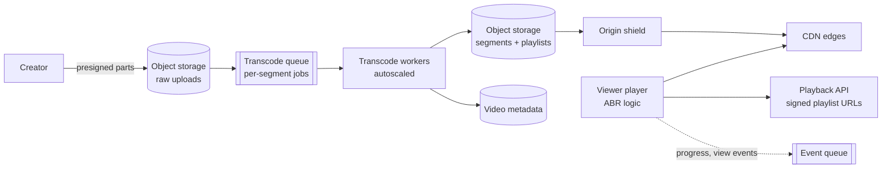

Take the photo service's audience — 20M daily users ([§2](/c/system-design/02-estimation)) — and give it video: each user watches 30 minutes a day, and creators upload 100,000 videos a day averaging 5 minutes (all illustrative). A creator must see the video playable within minutes; a viewer on a train must see the first frame in about a second and never watch a spinner. The photo service taught that egress, not storage, dominates the bill ([§19](/c/system-design/19-cdn)); video makes that 10× sharper, and adds two problems photos don't have: turning one upload into a ladder of renditions, and choosing a bitrate every few seconds on a link that keeps changing.

:::key[First principle]
Video is bytes per second of playback: bitrate × duration sets storage, egress and download time. Encode each upload once into a **ladder** of bitrates cut into short, immutable **segments**; the CDN caches segments like any static object, and the **player**, not the server, picks the next segment's bitrate from its buffer and measured throughput. Cost is egress; quality is startup time and rebuffering — both are arithmetic on bitrate, segment length and bandwidth.
:::

## 61.1 Requirements

**Functional**

- Upload a video (resumable); it becomes playable within minutes.
- Stream on web and mobile with adaptive quality; seek; resume where the viewer left off.
- Count views; show a title, thumbnail and basic recommendations.

**Non-functional**

- Time to first frame p50 < 1 s on a typical connection.
- Rebuffering < 0.5% of watch time; prefer a lower bitrate to a stall.
- An upload is durable before the creator sees "uploaded".
- Egress dominates cost: every design choice is checked against bytes delivered.

**Out of scope**: live streaming, DRM internals, the recommendation model.

## 61.2 Estimates

Inputs (illustrative): 20M DAU × 30 min/day watched; 100,000 uploads/day × 5 min; a 10 Mbit/s source kept as the mezzanine; an H.264-style five-rung ladder with encode costs in core-seconds per second of video; players average 2.5 Mbit/s across the renditions they fetch. Prices follow [§19](/c/system-design/19-cdn) and [§26](/c/system-design/26-object-storage): CDN delivery USD 0.005/GB, origin egress USD 0.02/GB, and a core-hour at USD 0.02 — all illustrative.

```python run
"""Video platform: uploads, renditions, storage, transcode compute and egress (all inputs illustrative)."""
DAU, WATCH_MIN = 20e6, 30                 # the photo service's 20M DAU, 30 min watched per user per day
UPLOADS, LEN_MIN = 100_000, 5             # videos uploaded per day, average length in minutes
SOURCE_MBPS = 10                          # uploaded original, kept as the mezzanine
LADDER = {"240p": (0.4, 0.25), "360p": (0.8, 0.5), "480p": (1.4, 1.0),   # Mbit/s, core-s per video-s
          "720p": (2.8, 2.0), "1080p": (5.0, 4.0)}
AVG_DELIVERED = 2.5                       # Mbit/s averaged over what players actually fetch
PEAK, DAY = 3, 86_400
CDN_GB, ORIGIN_GB, CORE_H = 0.005, 0.02, 0.02   # USD: CDN delivery, origin egress, core-hour

print("rendition   Mbit/s   MB per minute   core-s per video-s")
for name, (mbps, cost) in LADDER.items():
    print(f"{name:>9s}   {mbps:6.1f}   {mbps * 60 / 8:13.1f}   {cost:18.2f}")
ladder_mb = sum(m for m, _ in LADDER.values()) * 60 / 8
core_s = sum(c for _, c in LADDER.values())
print(f"{'ladder':>9s}   {sum(m for m, _ in LADDER.values()):6.1f}   {ladder_mb:13.1f}   {core_s:18.2f}")

minutes = UPLOADS * LEN_MIN
per_day = minutes * (ladder_mb + SOURCE_MBPS * 60 / 8) / 1e6
print(f"\nuploads: {minutes:,.0f} min/day = {minutes / 60 / 1440:.1f} hours of video per minute")
print(f"new storage: {per_day:.1f} TB/day ({ladder_mb:.0f} MB ladder + {SOURCE_MBPS * 60 / 8:.0f} MB source "
      f"per minute) = {per_day * 30 / 1e3:.2f} PB/month")
cores = minutes * 60 * core_s / DAY
print(f"transcode: {minutes * 60 * core_s / 3600:,.0f} core-hours/day = {cores:,.0f} cores busy on average, "
      f"USD {minutes * 60 * core_s / 3600 * CORE_H * 30 / 1e3:,.1f}k/month")

hours = DAU * WATCH_MIN / 60
gb_day = hours * 3600 * AVG_DELIVERED / 8 / 1e3
gbps = gb_day / DAY
print(f"\nwatch: {hours / 1e6:.0f}M hours/day at {AVG_DELIVERED} Mbit/s -> {gb_day / 1e6:.2f} PB/day, "
      f"{gb_day * 30 / 1e6:.0f} PB/month")
print(f"egress: {gbps:.0f} GB/s = {gbps * 8 / 1e3:.2f} Tbit/s avg, {PEAK * gbps * 8 / 1e3:.1f} Tbit/s peak")
print(f"segment requests (4 s segments): {hours * 3600 / 4 / DAY:,.0f}/s avg, "
      f"{PEAK * hours * 3600 / 4 / DAY:,.0f}/s peak")
month = gb_day * 30
print(f"no CDN, all origin egress: USD {month * ORIGIN_GB / 1e6:.2f}M/month")
for hit in (0.90, 0.95, 0.99):
    cdn, origin = month * CDN_GB, month * (1 - hit) * ORIGIN_GB
    print(f"CDN at {hit:.0%} hit: delivery USD {cdn / 1e6:.2f}M + origin USD {origin / 1e3:,.0f}k "
          f"= USD {(cdn + origin) / 1e6:.2f}M/month")
```

```output
rendition   Mbit/s   MB per minute   core-s per video-s
     240p      0.4             3.0                 0.25
     360p      0.8             6.0                 0.50
     480p      1.4            10.5                 1.00
     720p      2.8            21.0                 2.00
    1080p      5.0            37.5                 4.00
   ladder     10.4            78.0                 7.75

uploads: 500,000 min/day = 5.8 hours of video per minute
new storage: 76.5 TB/day (78 MB ladder + 75 MB source per minute) = 2.29 PB/month
transcode: 64,583 core-hours/day = 2,691 cores busy on average, USD 38.8k/month

watch: 10M hours/day at 2.5 Mbit/s -> 11.25 PB/day, 338 PB/month
egress: 130 GB/s = 1.04 Tbit/s avg, 3.1 Tbit/s peak
segment requests (4 s segments): 104,167/s avg, 312,500/s peak
no CDN, all origin egress: USD 6.75M/month
CDN at 90% hit: delivery USD 1.69M + origin USD 675k = USD 2.36M/month
CDN at 95% hit: delivery USD 1.69M + origin USD 338k = USD 2.03M/month
CDN at 99% hit: delivery USD 1.69M + origin USD 68k = USD 1.75M/month
```

| Quantity | Value | What it decides |
| --- | ---: | --- |
| Storage per minute of video | 78 MB ladder + 75 MB source | 76.5 TB/day, 2.29 PB/month of new data |
| Transcode | 2,691 cores on average | A queued, autoscaled worker fleet (§61.7) |
| Watch egress | 11.25 PB/day = 1.04 Tbit/s avg, 3.1 Tbit/s peak | CDN-only delivery; no origin can serve this |
| Segment requests | 312,500/s at peak | Immutable, cacheable segments |
| Delivery bill | USD 2.03M/month at 95% CDN hit vs 6.75M direct | Hit ratio and bitrate are the cost levers |

Watching is 147× uploading by bytes (11.25 PB vs 76.5 TB a day): the read path is the system.

## 61.3 API

```http
POST /v1/videos                {title, size_bytes, content_type}  -> 201 {video_id, upload_id, part_urls[]}
PUT  <part_url>                (presigned, direct to object storage, 8 MB parts)
POST /v1/videos/{id}/complete  {parts[]}                         -> 202 {status: processing}
GET  /v1/videos/{id}           -> 200 {title, status, duration, thumbnails, manifest_url}
GET  /v1/videos/{id}/manifest.m3u8  -> 200 master playlist (signed, short-lived)
POST /v1/videos/{id}/progress  {position_s}                      -> 204
```

The API never carries video bytes: uploads go to object storage with presigned multipart URLs ([§26.3](/c/system-design/26-object-storage)), and playback reads playlists and segments from the CDN. A 5-minute source at 10 Mbit/s is 375 MB — 47 parts of 8 MB, ~150 s on an illustrative 20 Mbit/s uplink — so a dropped connection resumes from the last part, not from zero.

## 61.4 Data model

| Data | Key | Contents | Store |
| --- | --- | --- | --- |
| `videos` | `video_id` | owner, title, status (uploading / processing / ready / failed), duration, ladder done | Relational |
| `renditions` | (`video_id`, `rendition`) | codec, bitrate, segment count, storage prefix, state | Relational; drives the playlist |
| Segments | `v/{video_id}/{rendition}/{n}.m4s` | 4 s of video at one bitrate | Object storage behind the CDN |
| Playlists | `v/{video_id}/master.m3u8`, per rendition | List of renditions and segments | Object storage; generated when renditions finish |
| `watch_progress` | (`user_id`, `video_id`) | position, updated_at | Key-value, TTL 90 days |
| `view_counts` | (`video_id`, `day`) | views, watch seconds | Aggregated from player events |

Segment keys are content-addressed by video, rendition and index and never change, so the CDN can cache them for a year ([§19.5](/c/system-design/19-cdn)). Playlists change while renditions are added, so they get short TTLs.

## 61.5 High-level design



Three independent paths: **ingest** (presigned upload → queue → workers → segments), **playback** (player ↔ CDN, with the API only signing the playlist), and **events** (progress and views, aggregated asynchronously). A transcode backlog never slows playback; a CDN incident never loses an upload.

## 61.6 Deep dive: the transcode pipeline

A single process encoding a 5-minute video through the whole ladder needs \(300 \times 7.75\) = 2,325 core-seconds — **39 minutes** on one core. Instead:

1. **Split** the source into 4 s chunks at keyframes: 75 chunks.
2. **Fan out** one job per (chunk, rendition): 375 jobs on a queue ([§25](/c/system-design/25-message-queue)). The slowest, a 1080p chunk, is \(4 \times 4\) = 16 core-seconds.
3. **Stitch** playlists when a rendition's chunks are done. With enough idle workers the video is ready in ~16 s of encoding plus queueing and I/O.
4. **Publish early**: write the playlist as soon as 360p and 720p exist; 1080p and 240p follow. The creator waits for the cheap rungs, not the expensive one.

Jobs are idempotent — output keys are deterministic, so a worker that dies after the visibility timeout is simply re-run ([§25.2](/c/system-design/25-message-queue)).

**Fleet sizing.** The average demand is 2,691 cores. Uploads peak like everything else, ~3× ([§2.2](/c/system-design/02-estimation)), so absorbing the peak with no backlog needs ~8,100 cores, two-thirds idle off-peak. Run a base fleet near the average and let the queue absorb the peak: autoscale on **queue age** (oldest job), not CPU. Use spare off-peak capacity for re-encodes (§61.7). Order the queue by priority — a creator with a large audience, or a video already being watched, goes first.

:::warn[Never transcode inside the upload request]
The creator's request would hold a connection for minutes, a worker crash would lose the work, and the peak would need the full 8,100 cores at once. The upload request ends when the source is durable in object storage; everything after it is a queued job.
:::

## 61.7 Deep dive: storage, egress and the codec decision

Storage accumulates; egress is paid every month on everything watched. With the estimator's numbers:

```python run
"""Year-one bill by component, and when a costlier codec pays for itself (all prices illustrative)."""
import numpy as np

TB_DAY = 76.5                       # new logical storage per day (ladder + source), from the estimator
STD, COLD = 0.020, 0.005            # USD per GB-month: standard, infrequent-access after 30 days
CDN_PB_MONTH, CDN_GB = 337.5, 0.005
print("month, storage all standard, storage tiered, CDN delivery, origin egress at 95% hit")
for m in (1, 3, 6, 9, 12):
    stored_gb = TB_DAY * 30 * m * 1e3
    hot_gb = min(stored_gb, TB_DAY * 30 * 1e3)
    tiered = hot_gb * STD + (stored_gb - hot_gb) * COLD
    print(f"{m}, {stored_gb * STD / 1e3:.0f}, {tiered / 1e3:.0f}, {CDN_PB_MONTH * 1e6 * CDN_GB / 1e3:.0f}, "
          f"{CDN_PB_MONTH * 1e6 * 0.05 * 0.02 / 1e3:.0f}")

# Codec: ~30% fewer bits at equal quality, ~8x the encode compute (illustrative)
SAVING, EXTRA, CORE_S, CORE_H = 0.30, 7, 7.75, 0.02
extra_usd = 60 * CORE_S * EXTRA / 3600 * CORE_H                 # per minute of video
saved_usd = SAVING * 2.5e6 * 60 / 8 / 1e9 * CDN_GB               # per minute watched
breakeven = extra_usd / saved_usd
print(f"\nre-encode cost USD {extra_usd:.4f} per video-minute; saves USD {saved_usd:.7f} per minute watched")
print(f"break-even: {breakeven:,.0f} minutes watched per minute of video")

videos = 100_000 * 365                                           # one year of uploads, 5 min each
watch = 600e6 * 365                                              # minutes watched in the year
for s in (0.8, 1.0, 1.2):
    w = 1.0 / np.arange(1, videos + 1) ** s
    per_video = watch * w / w.sum() / 5                          # minutes watched per minute of video
    top = per_video >= breakeven
    gain = (per_video[top] * saved_usd - extra_usd).sum() * 5 / 12
    print(f"Zipf s={s}: re-encode {top.mean():.2%} of videos -> {(w[top].sum() / w.sum()):.1%} of watch time "
          f"on the new codec, net USD {gain / 1e3:,.0f}k/month")
```

```output
month, storage all standard, storage tiered, CDN delivery, origin egress at 95% hit
1, 46, 46, 1688, 338
3, 138, 69, 1688, 338
6, 275, 103, 1688, 338
9, 413, 138, 1688, 338
12, 551, 172, 1688, 338

re-encode cost USD 0.0181 per video-minute; saves USD 0.0000281 per minute watched
break-even: 643 minutes watched per minute of video
Zipf s=0.8: re-encode 30.20% of videos -> 78.1% of watch time on the new codec, net USD 318k/month
Zipf s=1.0: re-encode 10.37% of videos -> 87.4% of watch time on the new codec, net USD 420k/month
Zipf s=1.2: re-encode 2.25% of videos -> 96.8% of watch time on the new codec, net USD 491k/month
```

:::chart[Monthly bill by component in year one (illustrative prices, USD thousands)]{type="line" x="month" y="USD thousands per month" prefix="$" unit="k" ymin="0" points="true" dash="storage all standard"}
month, storage all standard, storage tiered, CDN delivery, origin egress at 95% hit
1, 46, 46, 1688, 338
2, 92, 57, 1688, 338
3, 138, 69, 1688, 338
4, 184, 80, 1688, 338
5, 230, 92, 1688, 338
6, 275, 103, 1688, 338
7, 321, 115, 1688, 338
8, 367, 126, 1688, 338
9, 413, 138, 1688, 338
10, 459, 149, 1688, 338
11, 505, 161, 1688, 338
12, 551, 172, 1688, 338
:::

- **Delivery is ~10× storage** even after a year of accumulation: USD 1.69M + 0.34M a month against 172k tiered storage. Every 10% off the delivered bitrate saves ~USD 200k a month; a year of storage tiering saves ~380k a month by month 12.
- **Tier by age**: videos older than 30 days move to an infrequent-access class (cheaper per GB, pricier per read). A policy, not code ([§26.4](/c/system-design/26-object-storage)).
- **The source can go cold too**: the 75 MB/min mezzanine is only read for re-encodes, so it can live in the cheapest tier from day one.
- **Encode compute is small** — USD 38.8k a month — which is what makes spending more of it on popular videos rational.

**The codec decision.** A newer codec that needs ~30% fewer bits for the same quality but ~8× the encode compute (both illustrative — measure on your content) costs USD 0.0181 per minute of video to re-encode and saves USD 0.0000281 per minute watched. Break-even is **643 minutes watched per minute of video**. Under Zipf popularity a small head carries most watching: at $s$ = 1, re-encoding the 10% of videos above break-even moves 87% of watch time to the cheaper codec and nets ~USD 420k a month. Re-encode by popularity, in the off-peak transcode capacity, and keep H.264 renditions for devices that can't decode the new one.

### The CDN in front of segments

312,500 segment requests/s at peak, all immutable: the CDN is a cache of `(video, rendition, index)` objects ([§19](/c/system-design/19-cdn)). At 95% total hit the origin sees ~15,600 GETs/s and ~19.5 GB/s at peak; an **origin shield** collapses the misses of hundreds of PoPs into one fetch per segment. Popularity is extreme — a new hit video is requested by every PoP at once — so request collapsing per key matters more here than for photos ([§19.5](/c/system-design/19-cdn)). The long tail (most videos, little watching) is served from the shield or origin and is where the 5% of misses live.

## 61.8 Deep dive: time to first frame

Before the first frame the player pays round trips and one segment download:

$$
t_{\text{first frame}} \approx \underbrace{4\,\text{RTT}}_{\text{TCP, TLS 1.3, 2 playlists}} + \text{RTT} + \frac{\text{segment length} \times \text{bitrate}}{\text{bandwidth}}
$$

(DNS cached; [§11.2](/c/system-design/11-networking) counts the round trips.) With an illustrative 20 ms RTT to the edge and an 8 Mbit/s connection:

```python run
"""Time to first frame: round trips plus the first segment, by starting rendition and segment length."""
RTT = 0.020                    # s to the CDN edge (illustrative, 10-40 ms)
BW = 8e6                       # bit/s viewer bandwidth (illustrative)
MISS = 0.150                   # s extra when the edge must fetch the first segment cross-region
LADDER = {"480p": 1.4e6, "720p": 2.8e6, "1080p": 5.0e6}

# DNS cached; TCP 1 RTT + TLS 1.3 1 RTT; master + media playlist 2 RTT; segment request 1 RTT
setup = 4 * RTT
print(f"setup before the first segment: {setup * 1000:.0f} ms (TCP, TLS 1.3, two playlists)")
print("segment s   " + "   ".join(f"{n:>7s}" for n in LADDER) + "   1080p edge miss")
for seg in (2, 4, 6, 10):
    row = [setup + RTT + seg * b / BW for b in LADDER.values()]
    print(f"{seg:9d}   " + "   ".join(f"{t:6.2f}s" for t in row) + f"   {row[-1] + MISS:14.2f}s")

# Rebuffer: buffer B seconds, bitrate R, throughput falls to T < R -> stall after B / (1 - T/R)
for b, r, t in ((10, 5.0, 2.0), (30, 5.0, 2.0), (10, 2.8, 2.0), (10, 1.4, 2.0)):
    if t >= r:
        print(f"buffer {b:2d} s, {r} Mbit/s rendition, link {t} Mbit/s: never stalls (buffer grows)")
    else:
        print(f"buffer {b:2d} s, {r} Mbit/s rendition, link {t} Mbit/s: stalls after {b / (1 - t / r):.1f} s")
```

```output
setup before the first segment: 80 ms (TCP, TLS 1.3, two playlists)
segment s      480p      720p     1080p   1080p edge miss
        2     0.45s     0.80s     1.35s             1.50s
        4     0.80s     1.50s     2.60s             2.75s
        6     1.15s     2.20s     3.85s             4.00s
       10     1.85s     3.60s     6.35s             6.50s
buffer 10 s, 5.0 Mbit/s rendition, link 2.0 Mbit/s: stalls after 16.7 s
buffer 30 s, 5.0 Mbit/s rendition, link 2.0 Mbit/s: stalls after 50.0 s
buffer 10 s, 2.8 Mbit/s rendition, link 2.0 Mbit/s: stalls after 35.0 s
buffer 10 s, 1.4 Mbit/s rendition, link 2.0 Mbit/s: never stalls (buffer grows)
```

:::chart[Time to first frame vs segment length and starting rendition (8 Mbit/s, 20 ms RTT, model)]{type="line" x="segment length (s)" y="seconds to first frame" ymin="0" points="true" hmarks="1:1 s target"}
segment s, start at 480p, start at 720p, start at 1080p
2, 0.45, 0.80, 1.35
4, 0.80, 1.50, 2.60
6, 1.15, 2.20, 3.85
10, 1.85, 3.60, 6.35
:::

- **The first segment dominates**, not the round trips (80–100 ms). Starting at 1080p with 4 s segments takes 2.6 s; starting at 480p takes 0.8 s and the player climbs the ladder within a few segments.
- **Short segments start faster but cost more**: 2 s segments double the request rate (625,000/s at peak instead of 312,500) and slightly worsen compression (a keyframe every 2 s). A common compromise: 2 s segments for the first few, 4–6 s after, or 4 s throughout with a low starting rung.
- **Preload what's likely**: thumbnails and the first segment of the next video in a feed turn the first frame into a cache hit on the device.

## 61.9 Deep dive: adaptive bitrate

While a segment of length $S$ at bitrate $R$ downloads over throughput $T$, the player plays $S R / T$ seconds of buffer and gains $S$. Per second of wall time, the buffer $B$ changes by

$$
\frac{dB}{dt} = \frac{T}{R} - 1, \qquad t_{\text{stall}} = \frac{B}{1 - T/R} \text{ when } T < R.
$$

A 10 s buffer at 1080p (5 Mbit/s) on a link that drops to 2 Mbit/s stalls after 16.7 s; at 720p after 35 s; at 480p it never stalls (estimator above). A bigger buffer buys time — 30 s lasts 50 s — but only switching down **stops** the drain. The simulation replays 40 seeded 10-minute sessions on a link that wanders around 4 Mbit/s with a one-minute fade to a quarter every seven minutes (illustrative), and compares four player policies.

```python run
"""Adaptive bitrate on a fluctuating link: fixed renditions vs throughput- and buffer-based ABR."""
import numpy as np

LADDER = [0.4, 0.8, 1.4, 2.8, 5.0]       # Mbit/s
SEG, MAX_BUF, LEN = 4.0, 30.0, 600       # segment s, buffer cap s, video length s


def trace(rng):
    """Link Mbit/s per second: mean-reverting random walk near 4, a 1-minute fade to 25% every 7 min."""
    bw, out = 4.0, []
    for t in range(6_000):
        if t % 5 == 0:
            bw = float(np.clip(bw * rng.lognormal(0, 0.35) * (4.0 / bw) ** 0.2, 0.5, 20))
        out.append(max(0.3, bw * (0.25 if (t // 60) % 7 == 3 else 1.0)))
    return out


def play(bw, pick):
    t = buf = stall = 0.0
    hist, rates = [], []
    for k in range(int(LEN / SEG)):
        if buf > MAX_BUF - SEG:                  # buffer full: idle until one segment fits
            t, buf = t + buf - (MAX_BUF - SEG), MAX_BUF - SEG
        r = pick(hist, buf)
        link = bw[min(int(t), len(bw) - 1)]
        dl = SEG * r / link
        if k:                                    # after startup, playback drains the buffer
            stall += max(0.0, dl - buf)
            buf = max(0.0, buf - dl)
        t, buf = t + dl, buf + SEG
        hist.append(link)
        rates.append(r)
    return np.mean(rates), stall, sum(a != b for a, b in zip(rates, rates[1:]))


def throughput(hist, buf):                       # 80% of the harmonic mean of the last 3 segments
    est = 0.8 * len(hist[-3:]) / sum(1 / h for h in hist[-3:]) if hist else 1.0
    return max([r for r in LADDER if r <= est] or [LADDER[0]])


def buffer_based(hist, buf):                     # map buffer 5..25 s onto the ladder
    return LADDER[int(np.clip((buf - 5) / 20 * len(LADDER), 0, len(LADDER) - 1))]


policies = {"fixed 1080p": lambda h, b: 5.0, "fixed 480p": lambda h, b: 1.4,
            "throughput ABR": throughput, "buffer ABR": buffer_based}
print("policy           avg Mbit/s   stalled s per 10 min   rebuffer ratio   switches")
for name, pick in policies.items():
    res = [play(trace(np.random.default_rng(seed)), pick) for seed in range(40)]
    rate, stall, sw = (np.mean([r[i] for r in res]) for i in range(3))
    print(f"{name:15s}  {rate:10.2f}   {stall:20.1f}   {stall / (LEN + stall):14.1%}   {sw:8.1f}")
```

```output
policy           avg Mbit/s   stalled s per 10 min   rebuffer ratio   switches
fixed 1080p            5.00                  241.4            28.7%        0.0
fixed 480p             1.40                    4.1             0.7%        0.0
throughput ABR         2.34                    0.3             0.1%       31.8
buffer ABR             3.48                    0.7             0.1%       45.9
```

:::chart[Average bitrate vs rebuffer ratio by player policy (40 simulated 10-minute sessions)]{type="scatter" x="average bitrate delivered (Mbit/s)" y="rebuffer ratio (%)" ylog="true" points="true"}
avg Mbit/s, fixed 480p, throughput ABR, buffer ABR, fixed 1080p
1.40, 0.7, , , 
2.34, , 0.1, , 
3.48, , , 0.1, 
5.00, , , , 28.7
:::

- **No fixed rendition works.** 1080p stalls 28.7% of the time on a ~4 Mbit/s link; 480p stalls 0.7% (during fades) while wasting most of the good periods.
- **Both ABR policies cut stalls to ~0.1%** — under the 0.5% target — while delivering 1.7–2.5× the bitrate of fixed 480p. The buffer-based policy delivers more bits (3.48 vs 2.34 Mbit/s) because a full buffer lets it ride out dips that the throughput estimate reacts to; it pays with more switches.
- **Real players blend both**: throughput estimates at startup (when the buffer is empty and says nothing), buffer level in steady state, plus a switch-damping rule so quality doesn't oscillate every segment.
- **The server's role is the ladder**: enough rungs, spaced ~1.5–2× apart, so a dip costs one rung rather than a stall. The ladder also sets the average delivered bitrate — the number that drives the egress bill in §61.7.

## 61.10 Bottlenecks and failure modes

| Failure | Symptom | Design response |
| --- | --- | --- |
| Transcode backlog after an upload spike | New videos take hours to appear | Queue + autoscale on queue age; publish 360p/720p first; priority lanes |
| Worker dies mid-chunk | Missing segment | Idempotent per-(chunk, rendition) job, redelivered after visibility timeout |
| Upload interrupted | Creator starts over on 375 MB | Multipart with 8 MB parts; resume from the last part |
| New hit video purged or cold | Every PoP misses at once; origin spike | Shield + request collapsing; pre-warm the first segments of trending videos |
| CDN hit ratio falls 95% → 90% | Origin egress doubles, USD 338k → 675k/month | Alert on origin GB/s; check cache-key fragmentation (signed query strings in the key) |
| Fixed bitrate or a high starting rung | 28.7% rebuffering; 2.6 s to first frame | ABR on a ladder spaced ~2×; start at 480p |
| Playback API down | New plays fail | Players with a playlist keep streaming from the CDN; cache signed playlists for minutes |
| View-count writes | One write per play at 10,000s/s | Player events → queue → aggregated counters |

## 61.11 Trade-offs

| Decision | Option A | Option B | Choose |
| --- | --- | --- | --- |
| Encode | Whole ladder for every upload | Cheap rungs first, rest async; new codec by popularity | B; re-encode above ~643 view-minutes per minute |
| Segment length | 2 s (faster start, 2× requests) | 6 s (fewer requests, slower start) | 4 s with a low starting rung, or 2 s for the first segments |
| Player logic | Throughput-based | Buffer-based | Hybrid: throughput at startup, buffer in steady state |
| Delivery | Origin egress (USD 6.75M/month) | CDN (USD 2.03M at 95% hit) | CDN with a shield; multi-CDN at this scale |
| Storage class | All standard (USD 551k/month by month 12) | Tier after 30 days (172k) | Tier; mezzanine cold from day one |

## 61.12 What I'd say in 45 minutes

| Minutes | Topic | What to say, with the number |
| ---: | --- | --- |
| 0–5 | Requirements | First frame < 1 s, rebuffer < 0.5%, durable upload, cost = egress |
| 5–11 | Estimates | 10M hours/day → 11.25 PB/day, 1 Tbit/s avg; 76.5 TB/day new storage; 2,691 transcode cores |
| 11–15 | API + model | Presigned multipart; immutable segment keys; playlists short TTL |
| 15–22 | Transcode | 39 min serial → ~16 s by chunk fan-out; queue age autoscaling; cheap rungs first |
| 22–28 | Cost | USD 2.03M/month delivery vs 172k storage; codec break-even 643 view-min/min |
| 28–34 | Startup | First segment dominates: 480p + 4 s = 0.8 s, 1080p = 2.6 s |
| 34–41 | ABR | Stall after B/(1 − T/R); fixed 1080p 28.7% rebuffer, ABR 0.1% |
| 41–45 | Failures | Shield + collapsing for hot videos; hit ratio is the cost alarm |

## 61.13 Check yourself

:::qa[Product wants to add a 4K rung at 16 Mbit/s (illustrative). What does it add to storage per minute, and when does it matter for egress?]
16 × 60 / 8 = 120 MB per minute — more than the whole 78 MB ladder, so storage per video-minute grows from 153 MB to 273 MB if every upload gets it. Egress only grows for viewers who actually fetch it, but each such minute costs 6.4× the 2.5 Mbit/s average. Encode 4K only for sources that have it and videos that are watched (the same popularity rule as the codec), and cap it by device and bandwidth in the player.
:::

:::qa[Your CDN hit ratio falls from 95% to 90% after a change to signed URLs. What happened to cost, and what's the likely cause?]
Origin egress doubles from 5% to 10% of 338 PB: USD 338k → 675k a month, and origin GETs from ~15,600/s to ~31,250/s at peak. The likely cause is the signature (or a per-user token) landing in the cache key, so each viewer misses separately. Strip auth parameters from the cache key and validate them at the edge ([§19.4](/c/system-design/19-cdn)).
:::

:::qa[A viewer has 12 s of buffer at 720p (2.8 Mbit/s) when their link drops to 1.2 Mbit/s. How long until a stall, and what should the player do?]
\(t = 12 / (1 - 1.2/2.8) = 12 / 0.571\) = 21 s. Switching to 480p (1.4 Mbit/s) cuts the drain to \(1 - 1.2/1.4\) = 0.14 s per second — 84 s of runway — and 360p (0.8 Mbit/s) makes the buffer grow. Drop at least two rungs at the next segment boundary.
:::

:::qa[Why is transcode compute (USD 38.8k/month) worth spending more of, while egress is the thing to cut?]
Compute is paid once per minute of video; egress is paid per minute watched. A popular minute is watched thousands of times, so any compute that shrinks its bits is repaid many times: at the illustrative prices, a 30%-better codec breaks even at 643 view-minutes per minute and nets ~USD 420k a month when applied to the top 10% of videos.
:::

Next: [§62 Design a web crawler](/c/system-design/62-web-crawler).
