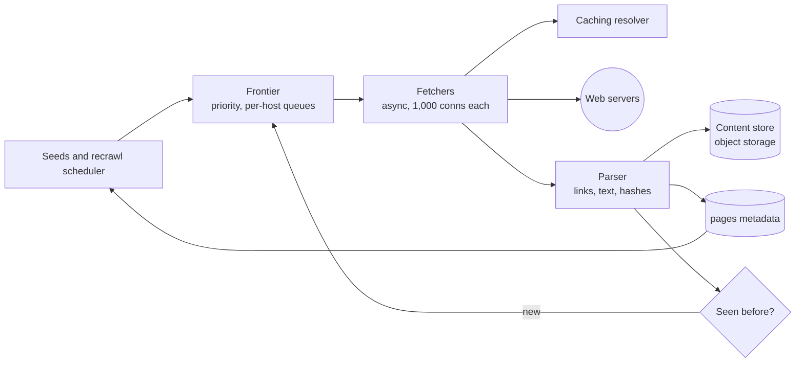

A search team needs a fresh copy of the web: a corpus of 10 billion pages, each revisited about every ten days, so the index never serves a page that changed weeks ago. That is **1 billion fetches a day** (illustrative target). The fleet must reach that rate without ever hammering a single site, without fetching the same URL twice in a cycle, without falling into infinite calendars, and while deciding — with a fixed budget — which pages deserve a visit today.

:::key[First principle]
A crawler's throughput is set by **concurrency**, not by any one server: rate = fetches in flight ÷ time per fetch. Politeness caps each host at about one request every couple of seconds, so the rate must come from thousands of hosts in parallel — which makes the **frontier**, a per-host scheduler, the heart of the design. Everything the crawler remembers (seen URLs, host state, change history) must be sized per URL and per host, because there are billions of the first and millions of the second.
:::

## 62.1 Requirements

**Functional**

- From seed URLs, discover and fetch HTML pages; extract links and enqueue new ones.
- Store page content and metadata for the indexer; revisit pages on a schedule.
- Obey `robots.txt`, including disallowed paths and crawl delays.

**Non-functional**

- 1B pages/day (10B-page corpus refreshed every ~10 days).
- Politeness: by default at most one request per host every ~1 s after the previous response, slower if the host is slow or asks.
- Each URL fetched at most once per revisit cycle; duplicate content stored once.
- Restartable: a node crash loses at most the in-flight fetches.
- Robust to traps: infinite URL spaces, huge pages, slow servers.

**Out of scope**: ranking, the indexer, JavaScript rendering (a separate, much costlier fetch path).

## 62.2 Estimates

Inputs (illustrative): 100 KB average HTML, 4× compression for storage, 1 s per fetch end to end, 1,000 concurrent connections per fetcher node, 5 ms of parse CPU per page, 50 links per page, a 1 s politeness gap, 50 ms per uncached DNS lookup with a 300 s TTL. A crawler paces itself, so there is no 3× peak factor here.

```python run
"""Web crawler: rate, bandwidth, concurrency, politeness and DNS from a pages/day target (inputs illustrative)."""
import math

PAGES_DAY = 1e9                  # refresh a 10B-page corpus about every 10 days
CORPUS = 10e9
PAGE_KB, COMPRESS = 100, 4       # average HTML size; gzip-style ratio for storage
FETCH_S = 1.0                    # mean time per fetch: connect, TLS, server think time, transfer
CONNS_PER_NODE = 1_000           # concurrent async connections one fetcher node keeps open
PARSE_MS = 5                     # CPU per page: decompress, parse, extract links
OUTLINKS = 50                    # links extracted per page
HOST_GAP_S = 1.0                 # politeness: minimum gap between requests to one host
DNS_MS, DNS_TTL = 50, 300        # uncached lookup time; record TTL respected by the crawler cache

rate = PAGES_DAY / 86_400
print(f"rate: {rate:,.0f} pages/s (a crawler sets its own pace: no peak factor)")
print(f"revisit interval: {CORPUS / PAGES_DAY:.0f} days on average")
gbps = rate * PAGE_KB * 1e3 * 8 / 1e9
print(f"download: {rate * PAGE_KB / 1e6:.2f} GB/s = {gbps:.1f} Gbit/s; "
      f"stored {PAGES_DAY * PAGE_KB / COMPRESS / 1e9:.0f} TB/day, latest copy of corpus "
      f"{CORPUS * PAGE_KB / COMPRESS / 1e9:.0f} TB")
inflight = rate * FETCH_S
print(f"fetches in flight (Little's law): {rate:,.0f}/s x {FETCH_S} s = {inflight:,.0f}")
nodes = {"connections": inflight / CONNS_PER_NODE,
         "bandwidth (10 Gbit/s NIC at 60%)": gbps / 6,
         "parse CPU (32 cores at 60%)": rate * PARSE_MS / 1e3 / (32 * 0.6)}
for k, v in nodes.items():
    print(f"  fetcher nodes for {k:33s}: {v:5.1f}")
print(f"  -> {math.ceil(max(nodes.values()))} nodes + 2 spares")
hosts = rate * (FETCH_S + HOST_GAP_S)
print(f"politeness: one request per host per {FETCH_S + HOST_GAP_S:.0f} s -> at least {hosts:,.0f} hosts "
      f"active at once")
print(f"links extracted: {rate * OUTLINKS:,.0f}/s to deduplicate")
print(f"DNS uncached: {rate:,.0f} lookups/s adding {rate * DNS_MS / 1e3:,.0f} connections in flight; "
      f"cached per host: ~{hosts / DNS_TTL:,.0f} re-resolutions/s for active hosts")
for r in (0.2, 1, 5):
    print(f"host with 10M pages at {r} req/s: {10e6 / r / 86_400:,.0f} days for one pass")
```

```output
rate: 11,574 pages/s (a crawler sets its own pace: no peak factor)
revisit interval: 10 days on average
download: 1.16 GB/s = 9.3 Gbit/s; stored 25 TB/day, latest copy of corpus 250 TB
fetches in flight (Little's law): 11,574/s x 1.0 s = 11,574
  fetcher nodes for connections                      :  11.6
  fetcher nodes for bandwidth (10 Gbit/s NIC at 60%) :   1.5
  fetcher nodes for parse CPU (32 cores at 60%)      :   3.0
  -> 12 nodes + 2 spares
politeness: one request per host per 2 s -> at least 23,148 hosts active at once
links extracted: 578,704/s to deduplicate
DNS uncached: 11,574 lookups/s adding 579 connections in flight; cached per host: ~77 re-resolutions/s for active hosts
host with 10M pages at 0.2 req/s: 579 days for one pass
host with 10M pages at 1 req/s: 116 days for one pass
host with 10M pages at 5 req/s: 23 days for one pass
```

| Quantity | Value | What it decides |
| --- | ---: | --- |
| Fetch rate | 11,574 pages/s | Everything below |
| Fetches in flight | 11,574 (Little's law, [§10](/c/system-design/10-latency-and-throughput)) | Async I/O; **connections**, not CPU or bandwidth, size the fleet: 12 nodes + 2 spares |
| Download | 9.3 Gbit/s; 25 TB/day stored | Object storage for content ([§26](/c/system-design/26-object-storage)) |
| Active hosts | ≥ 23,148 at any moment | The frontier must always have that many hosts ready |
| Link dedup | 578,704 lookups/s | In-memory, partitioned with the frontier (§62.7) |
| DNS | 11,574 lookups/s uncached → ~77/s cached | A crawler-local caching resolver |

The surprise is the last row of the estimator: politeness makes a large site slow to crawl no matter how big the fleet is. At 1 request/s a 10M-page site takes 116 days per pass — ~12× the revisit target.

## 62.3 Interfaces

Internal service, no public API:

```text
frontier.add(urls[], source_url, priority)          # dedup, normalise, assign to host queue
frontier.next(fetcher_id) -> (url, host, deadline)  # a URL whose host is ready now
frontier.done(url, status, content_hash, links[], response_ms)
GET /admin/hosts/{host}        -> {queue_len, crawl_delay, last_fetch, errors, budget_left}
GET /admin/stats               -> {fetch_rate, active_hosts, frontier_size, dedup_hit_rate}
```

## 62.4 Data model

| Data | Key | Contents | Size and store |
| --- | --- | --- | --- |
| Frontier queues | `host` → FIFO of URLs | url, priority, discovered_at | ~120 B/URL; on local disk, heads in RAM |
| `host_state` | `host` | robots rules + fetched_at, crawl_delay, next_allowed_at, ip + TTL, error count, page budget | Millions of hosts × ~1 KB; RAM on the owning node |
| Seen URLs | 64-bit fingerprint of the normalised URL | — | Bloom filter or exact set, partitioned by host (§62.7) |
| `pages` | `url_fp` | last_fetch, last_change, change_count, content_hash, storage key | 10B rows; wide-column store |
| Content | `content_hash` | Compressed HTML | 250 TB latest copy, object storage |

Everything keyed by host lives on the node that owns the host, so politeness and dedup are local decisions.

## 62.5 High-level design



Hosts are assigned to crawler nodes by `hash(host)` ([§12](/c/system-design/12-replication-and-partitioning)). A node runs the frontier, fetchers, parser and dedup for its hosts; extracted links for other hosts are batched and shipped to their owners. Politeness needs no distributed lock: one node owns each host and simply waits until `next_allowed_at`.

## 62.6 Deep dive: the frontier and politeness

The frontier answers one question thousands of times a second: *which URL can I fetch now without being rude?* The classic structure (from the Mercator crawler) has two layers:

1. **Front queues by priority**: new URLs land in one of a few priority queues (page importance, freshness need, depth).
2. **Back queues by host**: a selector drains front queues into per-host FIFOs; each host appears in a min-heap keyed by `next_allowed_at`.
3. **`next()`** pops the heap's top host if its time has come, returns its head URL, and on `done()` re-inserts the host at `now + delay`.

**The delay.** A fixed 1 s gap is the floor. A common adaptive rule sets the gap to a multiple (~10×) of the host's last response time and always honours a larger `Crawl-delay` in `robots.txt`: a server that answers in 50 ms gets 0.5–1 s, one struggling at 2 s gets 20 s. Back off exponentially on 429/503 and on timeouts ([§30](/c/system-design/30-retry)).

**How many hosts must be ready.** Each host contributes at most one page per fetch time plus gap, ~2 s, so 11,574 pages/s needs **≥ 23,148 hosts** in rotation at every moment — more, because many hosts have only a handful of pages queued. A common rule of thumb keeps ~3× as many back queues as fetch slots, so a ready host is always waiting.

:::chart[Days for one full pass over a host vs its size, at three politeness rates]{type="line" x="pages on host" y="days per pass" xlog="true" ylog="true" points="true" hmarks="10:10-day revisit target"}
pages on host, 0.2 req/s, 1 req/s, 5 req/s
1000, 0.0579, 0.0116, 0.00231
3160, 0.183, 0.0366, 0.00731
10000, 0.579, 0.116, 0.0231
31600, 1.83, 0.366, 0.0731
100000, 5.79, 1.16, 0.231
316000, 18.3, 3.66, 0.731
1000000, 57.9, 11.6, 2.31
3160000, 183, 36.6, 7.31
10000000, 579, 116, 23.1
31600000, 1830, 366, 73.1
100000000, 5790, 1160, 231
:::

- **Big sites can't be fully refreshed** at polite rates: at 1 req/s, anything above ~864,000 pages misses the 10-day target. Give large, fast hosts a higher rate (the adaptive rule does this), use their sitemaps and `Last-Modified` to fetch only what changed, and accept that low-priority pages on huge sites are revisited less often (§62.9).
- **Host ≠ server.** Thousands of small sites can share one IP on a shared host; rate-limit per IP as well as per hostname, or you will hammer one machine politely through many names.

**Frontier size.** If 10% of the 578,704 extracted links/s are new URLs (illustrative), discovery runs at ~57,870 URLs/s — about 5B a day against 1B fetches. An unbounded frontier grows by ~4B URLs (~480 GB at 120 B each) a day. Bound it: a per-host page budget, a maximum depth from the seeds, a priority threshold below which URLs are dropped, and a URL length limit. The frontier lives on disk per node, with only each host queue's head in RAM.

## 62.7 Deep dive: URL dedup with a Bloom filter

**Normalise first**: lowercase scheme and host, drop the default port and the `#fragment`, resolve `..`, sort query parameters, strip known tracking parameters (`utm_*`, session IDs). Then fingerprint with a 64-bit hash. Without normalisation, `?a=1&b=2` and `?b=2&a=1` are two URLs and the crawler fetches the same page twice.

A **Bloom filter** answers "seen before?" in $m$ bits with $k$ hash functions. After $n$ inserts the false-positive rate is $p \approx (1 - e^{-kn/m})^k$; the optimum is

$$
\frac{m}{n} = \frac{-\ln p}{(\ln 2)^2} \approx 1.44 \log_2 \frac{1}{p}\ \text{bits per URL},\qquad k = \frac{m}{n}\ln 2.
$$

Each 10× lower false-positive rate costs a constant ~4.8 bits per URL. It never returns a false "not seen": a URL it rejects as new really is new.

```python run
"""URL dedup: Bloom filter size vs false-positive rate, checked by simulation, vs an exact fingerprint set."""
import hashlib
import math
import numpy as np


def bloom_bits(p):                                # optimal bits per element and hash count
    b = -math.log(p) / math.log(2) ** 2
    return b, max(1, round(b * math.log(2)))


class Bloom:
    def __init__(self, n, p):
        bits, self.k = bloom_bits(p)
        self.m = int(n * bits)
        self.a = np.zeros(self.m, dtype=bool)

    def _idx(self, s):
        d = hashlib.blake2b(s.encode(), digest_size=16).digest()
        h1, h2 = int.from_bytes(d[:8], "little"), int.from_bytes(d[8:], "little") | 1
        return [(h1 + i * h2) % self.m for i in range(self.k)]   # double hashing

    def add(self, s):
        self.a[self._idx(s)] = True

    def __contains__(self, s):
        return bool(self.a[self._idx(s)].all())


N = 100_000
for p in (0.01, 0.001):
    bf = Bloom(N, p)
    for i in range(N):
        bf.add(f"https://h{i % 997}.example/p/{i}")
    fp = sum(f"https://h{i % 997}.example/q/{i}" in bf for i in range(N)) / N
    print(f"target p={p}: {bloom_bits(p)[0]:.1f} bits/URL, k={bf.k}, measured FP {fp:.4f} on {N:,} unseen URLs")

URLS, NODES = 10e9, 20
print(f"\n{URLS:.0e} URLs   bits/URL   k   total GB   GB per node ({NODES})   new URLs wrongly dropped")
for p in (1e-2, 1e-3, 1e-4, 1e-6):
    b, k = bloom_bits(p)
    print(f"p={p:8.0e}   {b:8.1f}   {k:2d}   {URLS * b / 8e9:8.1f}   {URLS * b / 8e9 / NODES:16.2f}   "
          f"{p * URLS:14,.0f} per 1e10")
print(f"exact 8-byte fingerprints: {URLS * 8 / 1e9:.0f} GB raw ({URLS * 8 / 1e9 / NODES:.0f} GB per node); "
      f"a new URL collides with probability {URLS / 2 ** 64:.1e}")
```

```output
target p=0.01: 9.6 bits/URL, k=7, measured FP 0.0105 on 100,000 unseen URLs
target p=0.001: 14.4 bits/URL, k=10, measured FP 0.0010 on 100,000 unseen URLs

1e+10 URLs   bits/URL   k   total GB   GB per node (20)   new URLs wrongly dropped
p=   1e-02        9.6    7       12.0               0.60      100,000,000 per 1e10
p=   1e-03       14.4   10       18.0               0.90       10,000,000 per 1e10
p=   1e-04       19.2   13       24.0               1.20        1,000,000 per 1e10
p=   1e-06       28.8   20       35.9               1.80           10,000 per 1e10
exact 8-byte fingerprints: 80 GB raw (4 GB per node); a new URL collides with probability 5.4e-10
```

:::chart[Memory to remember 10B URLs: Bloom filter vs exact 64-bit fingerprints]{type="line" x="false-positive rate" y="GB of RAM" xlog="true" ymin="0" points="true" dash="exact 8-byte fingerprints"}
false-positive rate, Bloom filter, exact 8-byte fingerprints
1e-06, 35.9, 80
3.16e-06, 32.9, 80
1e-05, 30.0, 80
3.16e-05, 27.0, 80
0.0001, 24.0, 80
0.000316, 21.0, 80
0.001, 18.0, 80
0.00316, 15.0, 80
0.01, 12.0, 80
0.0316, 9.0, 80
0.1, 6.0, 80
:::

- **The simulation matches the formula**: 1.05% and 0.10% measured against 1% and 0.1% targets.
- **A false positive is a page never crawled.** At 1%, 100M of every 10B new URLs are wrongly treated as seen. At 0.1% the filter costs 18 GB (0.9 GB per node across 20) and loses 10M; at \(10^{-6}\), 36 GB and 10,000.
- **An exact set is affordable here**: 80 GB of 64-bit fingerprints, 4 GB per node (×~1.5 for a hash table), with a collision chance of \(5.4 \times 10^{-10}\) per new URL — about 5 lost URLs per 10B. Host partitioning is what makes either option a local, in-RAM lookup at 578,704 checks/s.
- **Choose**: a Bloom filter at ~0.1% when RAM is tight or the URL count grows past what an exact set can hold; an exact fingerprint set when 4–6 GB per node is available. A Bloom filter cannot delete — rebuild it per crawl cycle, or use a counting/cuckoo filter.

## 62.8 Deep dive: content dedup and traps

Different URLs often serve the same page: mirrors, `http` vs `https`, printer views, tracking redirects. Hash the **extracted text** (not raw HTML, which differs in timestamps and ads) and store content once per `content_hash`; on a match, record the URL as an alias and don't reparse its links. For near-duplicates (same article, different boilerplate), a locality-sensitive fingerprint such as SimHash compares 64-bit signatures by Hamming distance.

Crawler **traps** generate endless distinct URLs for the same few pages: calendars with a "next month" link, session IDs in paths, faceted search with every filter combination. Signals and limits:

| Trap signal | Limit |
| --- | --- |
| A host whose new-URL rate stays high while content hashes repeat | Per-host page budget per cycle (e.g. 10,000 for unknown hosts, raised for important ones) |
| Very long URLs or many repeated path segments | Maximum URL length (~2 KB) and repeated-segment check |
| Deep link chains from the seeds | Maximum depth for low-priority hosts |
| Huge or never-ending responses | Max body size (~10 MB) and a total fetch timeout (~30 s) |

## 62.9 Deep dive: fetchers, DNS and robots.txt

**Fetchers** are async I/O: 1,000 open connections per node, 12 nodes for 11,574 in flight. Bandwidth (1.5 nodes' worth) and parsing (3 nodes) are not the constraint; slow servers are, because each one holds a connection slot for its whole response time. Timeouts bound that: connect ~5 s, total ~30 s ([§11.6](/c/system-design/11-networking)).

**DNS.** Resolving every fetch is 11,574 lookups/s — enough to be rate-limited by a public resolver — and at 50 ms each it adds 579 connections in flight. Cache per host in the crawler, honouring the record TTL: with ≥ 23,148 hosts active and a 300 s TTL, about 77 re-resolutions/s plus first lookups for new hosts. Run a local recursive resolver per data centre and resolve ahead of time: the frontier knows which hosts are next.

**robots.txt** is fetched once per host and cached ~24 h; a host's queue is blocked until it arrives. A 5xx for `robots.txt` means "don't crawl yet", while a 404 means "no restrictions" — getting that backwards turns an outage into a policy violation.

## 62.10 Deep dive: recrawl scheduling

The budget is 1B fetches a day over 10B pages: 0.1 visits per page per day. Pages change at very different rates. Model each page's changes as a Poisson process with rate $\lambda$; visiting it every $I$ days, the stored copy is current a fraction

$$
F(\lambda I) = \frac{1 - e^{-\lambda I}}{\lambda I}
$$

of the time (averaged over the interval: the copy stays fresh until the first change). Freshness depends only on $\lambda I$, the expected number of changes between visits.

:::chart[Freshness of a stored copy vs expected changes between visits]{type="line" x="expected changes between visits (λI)" y="fraction of time the copy is current" xlog="true" yfmt="pct" ymin="0" ymax="1" points="true" marks="0.0274:rarely at 10 d;0.333:monthly at 10 d;1.43:weekly at 10 d;10:daily at 10 d"}
expected changes between visits, freshness
0.01, 0.995
0.0316, 0.984
0.1, 0.952
0.316, 0.857
1, 0.632
3.16, 0.303
10, 0.100
31.6, 0.032
100, 0.010
:::

Spend the budget three ways on an illustrative corpus — 10% of pages change daily, 30% weekly, 40% monthly, 20% about yearly: **uniform** (every page every 10 days), **proportional** (visit rate ∝ change rate), and **optimal** (equalise the marginal freshness per visit across classes, a Lagrange multiplier found by bisection).

```python run
"""Recrawl scheduling: freshness under Poisson page changes for uniform, proportional and optimal revisits."""
import math

# Page classes: share of the 10B-page corpus and changes per day (illustrative)
CLASSES = {"news/home pages": (0.10, 1.0), "weekly": (0.30, 1 / 7),
           "monthly": (0.40, 1 / 30), "rarely": (0.20, 1 / 365)}
BUDGET = 0.1                                   # visits per page per day: 1B fetches over 10B pages


def fresh(lam, f):                             # P(copy is current) for change rate lam, visit rate f
    return 0.0 if f <= 0 else f / lam * (1 - math.exp(-lam / f))


def avg(freqs):
    return sum(sh * fresh(lam, f) for (sh, lam), f in zip(CLASSES.values(), freqs))


uniform = [BUDGET] * len(CLASSES)
c = BUDGET / sum(sh * lam for sh, lam in CLASSES.values())
proportional = [c * lam for _, lam in CLASSES.values()]


def best_f(lam, mu):                           # visit rate where marginal freshness = mu (bisection)
    def slope(f):
        x = lam / f
        return (1 - math.exp(-x) - x * math.exp(-x)) / lam
    if slope(1e-9) < mu:
        return 0.0
    lo, hi = 1e-9, 1e3
    for _ in range(100):
        mid = (lo + hi) / 2
        lo, hi = (mid, hi) if slope(mid) > mu else (lo, mid)
    return lo


lo, hi = 1e-9, 10.0                            # bisection on the Lagrange multiplier to spend the budget
for _ in range(100):
    mu = (lo + hi) / 2
    spend = sum(sh * best_f(lam, mu) for sh, lam in CLASSES.values())
    lo, hi = (mu, hi) if spend > BUDGET else (lo, mu)
optimal = [best_f(lam, mu) for _, lam in CLASSES.values()]

print("class              share   changes/day   " + "   ".join(f"{n:>12s}" for n in ("uniform", "proportional", "optimal")))
for i, (name, (sh, lam)) in enumerate(CLASSES.items()):
    cells = [f"{1 / f:5.1f} d {fresh(lam, f):4.0%}" if f else "never    0%" for f in
             (uniform[i], proportional[i], optimal[i])]
    print(f"{name:17s}  {sh:5.0%}   {lam:11.3f}   " + "   ".join(f"{x:>12s}" for x in cells))
for name, fr in (("uniform", uniform), ("proportional", proportional), ("optimal", optimal)):
    print(f"{name:12s}: average freshness {avg(fr):.1%}, "
          f"visits/page/day {sum(sh * f for (sh, _), f in zip(CLASSES.values(), fr)):.3f}")
```

```output
class              share   changes/day        uniform   proportional        optimal
news/home pages      10%         1.000    10.0 d  10%     1.6 d  50%    never    0%
weekly               30%         0.143    10.0 d  53%    11.0 d  50%     5.6 d  69%
monthly              40%         0.033    10.0 d  85%    47.0 d  50%    10.0 d  85%
rarely               20%         0.003    10.0 d  99%   572.1 d  50%    32.1 d  96%
uniform     : average freshness 70.7%, visits/page/day 0.100
proportional: average freshness 50.5%, visits/page/day 0.100
optimal     : average freshness 73.8%, visits/page/day 0.100
```

- **Proportional is the worst** (50.5%): it pours visits into pages that change daily, which stay only 50% fresh even at a visit every 1.6 days, and starves rarely-changing pages for 572 days. Uniform (70.7%) beats it with no knowledge of change rates at all.
- **The optimum (73.8%) gives up on the fastest pages** under this budget: a visit to a daily-changing page buys less freshness than a visit to a weekly one. It visits weekly pages every 5.6 days, monthly every 10, rare ones every 32.
- **"Never" is wrong in practice** because pages aren't equally important. Weight freshness by importance (traffic, links, query demand): home pages of news sites get their own fast lane, fed by sitemaps, RSS and change signals, outside the bulk budget.
- **Estimate $\lambda$ from history**: changes observed over visits (content hash differs) with a prior for new pages; `Last-Modified`/`ETag` conditional GETs make a "not changed" visit cost a header instead of 100 KB.

## 62.11 Bottlenecks and failure modes

| Failure | Symptom | Design response |
| --- | --- | --- |
| Too few ready hosts | Fetch rate falls although nodes are idle | Keep ≥ 23,148 hosts in rotation (~3× back queues); more seeds |
| Impolite crawling | 429s, abuse complaints, IP blocks | Per-host and per-IP gaps; adaptive delay ~10× response time; honour `Crawl-delay` |
| Slow servers | Connection slots held, rate collapses | Connect 5 s / total 30 s timeouts; per-host backoff |
| Crawler trap | One host floods the frontier | Per-host budget, URL length and depth limits, content-hash repetition |
| Frontier growth | ~480 GB/day if unbounded | Priority threshold, budgets, disk-backed queues |
| Bloom false positives | New pages silently never crawled | Size for ≤ 0.1%, or use an exact fingerprint set (4 GB/node) |
| DNS overload | Resolver rate-limits; +579 connections in flight | Local caching resolver, prefetch for upcoming hosts |
| Node crash | Its hosts stall | Reassign hosts by consistent hashing ([§64](/c/system-design/64-consistent-hashing)); refetch in-flight URLs — at-least-once is safe because dedup is by URL and content hash |
| `robots.txt` 5xx | Treated as allow → policy violation | Treat as disallow until it succeeds |

## 62.12 Trade-offs

| Decision | Option A | Option B | Choose |
| --- | --- | --- | --- |
| Partitioning | By URL hash | By host hash | Host: politeness and dedup become local |
| URL dedup | Bloom filter (18 GB at 0.1%) | Exact 64-bit fingerprints (80 GB) | Exact if RAM allows, Bloom at ≤ 0.1% if not |
| Politeness | Fixed 1 s gap | Adaptive ~10× response time | Adaptive with a floor, plus per-IP limits |
| Recrawl | Uniform 10 days | Optimised by change rate and importance | Optimised, with a fast lane for important fast-changing pages |
| Freshness checks | Full GET | Conditional GET (`If-None-Match`) | Conditional where servers support it |

## 62.13 What I'd say in 45 minutes

| Minutes | Topic | What to say, with the number |
| ---: | --- | --- |
| 0–5 | Requirements | 10B pages every 10 days; polite; no duplicates; restartable |
| 5–11 | Estimates | 11,574 pages/s, 9.3 Gbit/s, 11,574 in flight → 12 nodes by connections |
| 11–15 | Data + design | Partition by host; frontier, fetchers, parser, dedup on the owning node |
| 15–23 | Frontier | Priority front queues, per-host back queues, heap on `next_allowed_at`; ≥ 23,148 active hosts; 10M-page site takes 116 days at 1/s |
| 23–30 | Dedup | Normalise; Bloom 14.4 bits/URL at 0.1% = 18 GB; exact 80 GB; content hash for mirrors |
| 30–34 | DNS + robots | 11,574 lookups/s → ~77/s cached; robots cached 24 h, 5xx = disallow |
| 34–41 | Recrawl | F = (1 − e^−λI)/λI; proportional 50.5% < uniform 70.7% < optimal 73.8% |
| 41–45 | Failures | Traps, slow hosts, node loss via consistent hashing |

## 62.14 Check yourself

:::qa[The target doubles to 2B pages/day. What changes, and what doesn't?]
Rate 23,148 pages/s, so 23,148 fetches in flight at 1 s each — 24 fetcher nodes by connections — 18.5 Gbit/s and 50 TB/day stored. Politeness now needs ≥ 46,296 active hosts. What doesn't change is the time to refresh one big host: a 10M-page site still takes 116 days at 1 req/s, so the extra budget refreshes small sites faster but not the big ones.
:::

:::qa[Why partition crawler nodes by host rather than by URL hash?]
By host, one node owns a host's queue, timer, robots rules and DNS entry, so politeness is a local `sleep until next_allowed_at` — no distributed lock or shared counter on the hot path. By URL hash, the same host's URLs land on every node, and either they coordinate per request or the host gets 20 "polite" crawlers at once.
:::

:::qa[A teammate sizes the Bloom filter at 1% to save memory. What is the cost?]
1% of genuinely new URLs are treated as seen and never fetched: 100M of every 10B. Going to 0.1% costs 4.8 more bits per URL — 18 GB instead of 12 GB total, 0.9 GB instead of 0.6 GB per node — and loses 10M instead. That 6 GB is cheap; the lost pages are not recoverable without a full re-scan.
:::

:::qa[Product asks to visit pages in proportion to how often they change. What happens to freshness?]
On the illustrative mix it drops from 70.7% (uniform) to 50.5%: pages changing daily absorb visits yet stay only half fresh, and rarely-changing pages go 572 days between visits. The freshness-optimal schedule (73.8%) does the opposite — it visits fast-changing pages *less*. Handle important fast pages in a separate, importance-weighted lane.
:::

:::qa[Each fetch currently does its own DNS lookup at 50 ms. What does caching buy?]
11,574 lookups/s drop to ~77 re-resolutions/s for the ≥ 23,148 active hosts at a 300 s TTL, and the 50 ms disappears from each fetch: by Little's law that is 579 fewer connections in flight, about half a fetcher node, and no rate-limiting from upstream resolvers.
:::

Next: [§63 Circuit breaker](/c/system-design/63-circuit-breaker).
