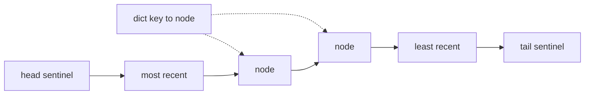

Pulse's feed servers answer up to 6,000 reads/s at peak. A small in-process cache of hot posts in front of Redis saves the ~0.5 ms network round trip on every hit — RAM is ~100 ns away ([§2](/c/system-design/02-estimation), [§7.7](/c/system-design/07-caching)). That only works if the cache itself costs nothing: a "least recently used" list kept as a Python list costs a scan of the list on every hit — ~50,000 element comparisons for a 100,000-entry cache — and the cache becomes the bottleneck it was meant to remove. LRU in $O(1)$ needs two structures working together, and it is the most-asked data-structure question in system design interviews for that reason.

:::key[First principle]
A **hash map** finds a key's entry in $O(1)$; a **doubly linked list** ordered by recency moves an entry to the front or removes the back in $O(1)$ *given a pointer to the node*. Store the node pointer in the map and you get both. Expiry is a separate rule: an entry past its TTL must never be served, whether or not the cache is full.
:::

## 66.1 The structure and its costs



| Operation | Steps | Cost |
|---|---|---|
| `get(k)` hit | map lookup → unlink node → push after head | $O(1)$ |
| `get(k)` miss / expired | map lookup (→ unlink + delete if expired) | $O(1)$ |
| `put(k, v)` existing | map lookup → update → move to front | $O(1)$ |
| `put(k, v)` new, full | unlink `tail.prev` → delete from map → insert node at front | $O(1)$ |
| Memory | one node (key, value, expiry, prev, next) + one map slot per entry | $O(n)$ |

**Sentinels** — permanent dummy head and tail nodes — mean every real node always has a `prev` and a `next`, so `_unlink` and `_push_front` have no `None` branches. Those branches are where hand-written linked lists usually break.

The alternatives each lose one operation: a plain list keeps order but finds or moves a key in $O(n)$; per-key timestamps with a scan for the oldest make eviction $O(n)$; a heap of timestamps makes every hit an $O(\log n)$ re-key. Python's `OrderedDict` is this exact structure implemented in C (`move_to_end`, `popitem(last=False)`), and `functools.lru_cache` is a C implementation of the same idea.

## 66.2 The implementation and its tests

```python run
import random, threading, time, tracemalloc
from collections import OrderedDict

class Node:
    __slots__ = ("key", "value", "expires", "prev", "next")
    def __init__(self, key=None, value=None, expires=None):
        self.key, self.value, self.expires, self.prev, self.next = key, value, expires, None, None

class LRUCache:
    def __init__(self, capacity, clock=time.monotonic):
        if capacity < 1: raise ValueError("capacity must be >= 1")
        self.capacity, self.clock, self.lock = capacity, clock, threading.Lock()
        self.map, self.head, self.tail = {}, Node(), Node()       # sentinels: no None checks
        self.head.next, self.tail.prev = self.tail, self.head      # head.next = most recent
        self.hits = self.misses = self.evictions = self.expired = 0

    def _unlink(self, n): n.prev.next, n.next.prev = n.next, n.prev

    def _push_front(self, n):
        n.prev, n.next = self.head, self.head.next
        self.head.next.prev = n; self.head.next = n

    def get(self, key, default=None):
        with self.lock:                     # a read reorders the list, so it needs the lock too
            n = self.map.get(key)
            if n is not None and n.expires is not None and n.expires <= self.clock():
                self._unlink(n); del self.map[key]; self.expired += 1; n = None
            if n is None:
                self.misses += 1; return default
            self._unlink(n); self._push_front(n); self.hits += 1
            return n.value

    def put(self, key, value, ttl=None):
        with self.lock:
            expires = None if ttl is None else self.clock() + ttl
            n = self.map.get(key)
            if n is not None:
                n.value, n.expires = value, expires; self._unlink(n)
            else:
                if len(self.map) >= self.capacity:                # evict the least recent
                    lru = self.tail.prev; self._unlink(lru); del self.map[lru.key]; self.evictions += 1
                n = self.map[key] = Node(key, value, expires)
            self._push_front(n)

    def keys(self):                         # most -> least recently used
        out, n = [], self.head.next
        while n is not self.tail: out.append(n.key); n = n.next
        return out

now = [0.0]
c = LRUCache(2, clock=lambda: now[0])
c.put("a", 1); c.put("b", 2); c.get("a"); c.put("c", 3)
assert c.keys() == ["c", "a"] and c.get("b") is None, "b was least recent"
c.put("a", 10); assert len(c.map) == 2 and c.evictions == 1 and c.get("a") == 10
c.put("t", 5, ttl=10); now[0] = 11
assert c.get("t") is None and c.expired == 1, "expired entries are never served"
one = LRUCache(1); one.put(1, 1); one.put(2, 2); assert one.keys() == [2]
try: LRUCache(0); raise AssertionError
except ValueError: pass

rnd, ref, lru = random.Random(66), OrderedDict(), LRUCache(8)
for _ in range(200_000):                     # differential test against OrderedDict
    k = rnd.randrange(50)
    if rnd.random() < 0.5:
        exp = ref.get(k)
        if k in ref: ref.move_to_end(k)
        assert lru.get(k) == exp
    else:
        ref[k] = k; ref.move_to_end(k)
        if len(ref) > 8: ref.popitem(last=False)
        lru.put(k, k)
assert lru.keys() == list(reversed(ref))

shared = LRUCache(100)
def worker(seed):
    r = random.Random(seed)
    for _ in range(20_000):
        k = r.randrange(300)
        if shared.get(k) is None: shared.put(k, k)
threads = [threading.Thread(target=worker, args=(s,)) for s in range(8)]
for t in threads: t.start()
for t in threads: t.join()
assert len(shared.keys()) == len(shared.map) == 100 and shared.hits + shared.misses == 160_000

tracemalloc.start(); big = LRUCache(100_000)
for i in range(100_000): big.put(i, None)
per_entry = tracemalloc.get_traced_memory()[0] / 100_000; tracemalloc.stop()
print("all LRU tests passed | 200k ops match OrderedDict | 8 threads x 20k ops consistent")
print("bookkeeping per entry (int key, no value): ~%d bytes" % round(per_entry, -1))
```

```output
all LRU tests passed | 200k ops match OrderedDict | 8 threads x 20k ops consistent
bookkeeping per entry (int key, no value): ~160 bytes
```

What the tests pin down:

- **Recency order**: after `get("a")`, `b` is the least recent and is evicted by `c`; updating an existing key never evicts.
- **Expiry ≠ eviction**: the cache holds 2 entries of capacity 2 and still refuses to serve `t` once its TTL has passed. A cache that only drops stale entries when it runs out of room serves them forever on a quiet system.
- **Edge cases**: capacity 1 (the new entry evicts the only one), capacity 0 rejected.
- **Differential test**: 200,000 random gets and puts over 50 keys at capacity 8 return exactly what an `OrderedDict` reference returns, and the final recency order matches. Random operations against a trusted reference find pointer bugs that hand-picked cases miss.
- **Threads**: 8 threads × 20,000 operations leave the map and the list the same size (100) and lose no counter updates (160,000). `get` takes the lock because a hit *rewrites four pointers*; two unsynchronised hits on neighbouring nodes can splice the list into a loop.
- **Memory**: ~160 bytes of bookkeeping per entry in CPython (node with `__slots__`, map slot, the int key) before the value. For 1 KB posts that is ~16% overhead; for small values the bookkeeping dominates.

## 66.3 How good is LRU? Hit rate on a Zipf trace

The block replays the same scaled-down Pulse trace as [§18.3](/c/system-design/18-cache) — 100,000 posts, Zipf $s$ = 1, 200,000 requests, hit rate counted after a 50,000-request warm-up — so FIFO, LRU and LFU reproduce that section's numbers exactly. It adds **Belady's algorithm**: evict the key whose next use is farthest in the future. It needs the future, so no real cache can run it, but it is the best any cache of that size could do on this exact sequence. LRU here uses `OrderedDict`, which §66.2 showed behaves identically to the hand-built class.

```python run
import heapq
from collections import OrderedDict, defaultdict
import numpy as np

rng = np.random.default_rng(42)
N, REQS, WARM = 100_000, 200_000, 50_000   # same scaled-down Pulse trace as the cache section
p = 1.0 / np.arange(1, N + 1)              # Zipf s = 1
p /= p.sum()
trace = rng.choice(N, REQS, p=p).tolist()

nxt, last = [0] * REQS, {}                 # next time each request's key is used again
for t in range(REQS - 1, -1, -1):
    nxt[t] = last.get(trace[t], REQS + t); last[trace[t]] = t


def hits(policy, cap):
    h = 0
    if policy == "Belady (offline)":       # evict the key whose next use is farthest away
        when, heap = {}, []
        for t, k in enumerate(trace):
            if k in when: h += t >= WARM
            elif len(when) >= cap:
                while True:
                    neg, v = heapq.heappop(heap)
                    if when.get(v) == -neg: del when[v]; break
            when[k] = nxt[t]; heapq.heappush(heap, (-nxt[t], k))
        return h
    if policy == "LFU":                    # O(1) LFU: frequency buckets, oldest evicted on ties
        freq, buckets, lo = {}, defaultdict(OrderedDict), 0
        for t, k in enumerate(trace):
            if k in freq:
                f = freq[k]; del buckets[f][k]; h += t >= WARM
                if lo == f and not buckets[f]: lo = f + 1
                freq[k] = f + 1; buckets[f + 1][k] = None
                continue
            if len(freq) >= cap:
                old, _ = buckets[lo].popitem(last=False); del freq[old]
            freq[k] = 1; buckets[1][k] = None; lo = 1
        return h
    cache = OrderedDict()                  # OrderedDict = dict + doubly linked list
    for t, k in enumerate(trace):
        if k in cache:
            h += t >= WARM
            if policy == "LRU": cache.move_to_end(k)
        else:
            cache[k] = None
            if len(cache) > cap: cache.popitem(last=False)
    return h


POL = ("FIFO", "LRU", "LFU", "Belady (offline)")
seen, first = set(), 0
for t, k in enumerate(trace):
    first += t >= WARM and k not in seen; seen.add(k)
print("first-ever requests after warm-up: %.3f of traffic (no policy can hit them)" % (first / (REQS - WARM)))
print("cache % | " + " | ".join("%16s" % q for q in POL) + " | ideal top-k")
rows = []
for frac in (0.005, 0.01, 0.02, 0.05, 0.10, 0.20):
    cap = int(frac * N)
    rows.append((100 * frac, *(hits(q, cap) / (REQS - WARM) for q in POL), p[:cap].sum()))
    print("%7.1f | %s | %.3f" % (rows[-1][0], " | ".join("%16.3f" % x for x in rows[-1][1:5]), rows[-1][5]))
print("\nchart: cache %, FIFO, LRU, LFU, Belady, ideal top-k")
for r in rows:
    print("%g, %.3f, %.3f, %.3f, %.3f, %.3f" % r)
```

```output
first-ever requests after warm-up: 0.154 of traffic (no policy can hit them)
cache % |             FIFO |              LRU |              LFU | Belady (offline) | ideal top-k
    0.5 |            0.399 |            0.441 |            0.537 |            0.609 | 0.562
    1.0 |            0.466 |            0.508 |            0.593 |            0.666 | 0.619
    2.0 |            0.534 |            0.575 |            0.647 |            0.723 | 0.676
    5.0 |            0.628 |            0.666 |            0.714 |            0.797 | 0.752
   10.0 |            0.701 |            0.737 |            0.763 |            0.840 | 0.810
   20.0 |            0.780 |            0.810 |            0.816 |            0.846 | 0.867

chart: cache %, FIFO, LRU, LFU, Belady, ideal top-k
0.5, 0.399, 0.441, 0.537, 0.609, 0.562
1, 0.466, 0.508, 0.593, 0.666, 0.619
2, 0.534, 0.575, 0.647, 0.723, 0.676
5, 0.628, 0.666, 0.714, 0.797, 0.752
10, 0.701, 0.737, 0.763, 0.840, 0.810
20, 0.780, 0.810, 0.816, 0.846, 0.867
```

:::chart[Hit rate vs cache size (Zipf s = 1, 100,000 posts, 200,000 requests, simulated)]{type="line" x="cache size (% of posts)" y="hit rate" xlog="true" yfmt="pct" ymin="0.3" ymax="0.9" points="true" dash="Belady,ideal top-k" hmarks="0.846:compulsory-miss ceiling"}
cache %, FIFO, LRU, LFU, Belady, ideal top-k
0.5, 0.399, 0.441, 0.537, 0.609, 0.562
1, 0.466, 0.508, 0.593, 0.666, 0.619
2, 0.534, 0.575, 0.647, 0.723, 0.676
5, 0.628, 0.666, 0.714, 0.797, 0.752
10, 0.701, 0.737, 0.763, 0.840, 0.810
20, 0.780, 0.810, 0.816, 0.846, 0.867
:::

:::example[Worked example · reading the curves]
- **LRU leaves 16 points on the table at small sizes**: 50.8% at 1% of the catalogue against Belady's 66.6%. LFU recovers half of that (59.3%) because with stable popularity, frequency predicts reuse better than recency.
- **FIFO trails LRU by 3–4 points** everywhere: it never promotes a hit, so popular posts are evicted on schedule.
- **Belady flattens at 84.6% = 1 − 0.154.** 15.4% of requests after warm-up are first-ever requests for a post — compulsory misses no policy can hit. The "ideal top-k" column (86.7% at 20%) is above it only because it is pre-loaded with the most popular posts, which counts their first requests as hits.
- **What the gap is worth.** At Pulse's 6,000 reads/s, each point of hit rate is 60 reads/s to the next tier. At 5% of the catalogue, LRU's 66.6% vs LFU's 71.4% is ~290 reads/s; LRU vs Belady's 79.7% is ~790 reads/s. Admission policies (below) recover part of it.
- **When LFU loses**: if the hot set changes, old counts keep dead posts resident; §18.3 measured LFU falling below LRU for 100,000 requests after a shift. LRU forgets fast, which is why it is the default.
:::

## 66.4 Production notes

**Thread safety.** In Python a single lock around every `get` and `put` is correct and simple; under heavy multi-threaded load it serialises all access. Options, in order of effort:

1. **Shard**: $N$ independent LRUs, each with capacity $C/N$, chosen by `hash(key) % N` within the process. Approximate global LRU, $N$× less contention.
2. **Buffer reads**: record hits in a per-thread or striped buffer and apply the reorderings in batches under the lock; Caffeine (Java) does this, so reads rarely take the eviction lock.
3. **Drop exact recency**: Redis samples 5 random keys and evicts the oldest, with no linked list at all — 0.4 points behind exact LRU in §18.3.

**What libraries do.**

| Library | Policy | Concurrency |
|---|---|---|
| `functools.lru_cache` | Exact LRU, C implementation | Safe across threads, but concurrent misses on one key may each call the function |
| `cachetools.LRUCache` / `TTLCache` | Exact LRU, optional TTL | Not thread-safe; wrap with a lock |
| Caffeine (Java) | W-TinyLFU: small LRU window + frequency-sketch admission into a segmented LRU | Read and write buffers, lock-free reads |
| Redis | Sampled LRU or LFU (`maxmemory-policy`, `maxmemory-samples`) | Single-threaded command execution |
| Memcached | Segmented LRU (hot / warm / cold) per slab class | Per-class locks |

**Scans and one-hit wonders.** A batch job that reads 1M cold keys once flushes a pure LRU. Segmented LRU (new entries enter a probationary segment and are promoted on a second hit) and TinyLFU admission (admit only if the newcomer is estimated to be more frequent than the victim) both protect the hot set ([§7.3](/c/system-design/07-caching), [§7.8](/c/system-design/07-caching)).

**Sizing by bytes, not entries.** Capacity in entries assumes equal sizes. Production caches track a weight per entry (bytes) and evict from the tail until the total fits.

**Expiry.** This class expires lazily on read, which is enough for correctness; memory held by expired-but-unread entries is reclaimed only by eviction. Add a periodic sweep (or Redis-style random sampling of keys with TTLs) if expired entries are a large share. Add jitter to TTLs so entries written together don't expire together, and use single-flight on misses so one expiry doesn't send 100 concurrent requests to the database ([§7.6](/c/system-design/07-caching)).

:::warn[Failure modes of the code itself]
- **Unlocked `get`** → concurrent hits corrupt the list (a cycle or a lost node), and `len(map)` and the list disagree.
- **Evicting before checking whether the key already exists** → updating a key in a full cache evicts an innocent entry.
- **Forgetting to delete the evicted node from the map** → the map grows without bound while the list stays at capacity.
- **Serving expired entries** → stale data on a cache that is never full.
- **Unbounded per-entry overhead** → ~160 B per entry in CPython; a million tiny values cost ~160 MB of bookkeeping.
:::

## 66.5 Interview angle

The classic statement: "design a cache with `get` and `put` in $O(1)$, evicting the least recently used". Say the structure (map → node, doubly linked list, sentinels), write `_unlink` and `_push_front` first, then `get` and `put` in terms of them. Edge cases to raise unprompted: updating an existing key, capacity 1, a `get` of a missing key, expiry vs eviction, and that `get` mutates. Follow-ups to expect:

- *Make it thread-safe* → a lock, then sharding or read buffers (§66.4).
- *LFU in $O(1)$* → a map key → frequency plus a map frequency → ordered set of keys, and a pointer to the minimum frequency; the `LFU` branch of §66.3's block is exactly that.
- *Add TTL* → per-entry expiry checked on read, plus a sweep.
- *Distribute it* → consistent hashing across cache nodes ([§64](/c/system-design/64-consistent-hashing)); each node runs its own LRU.
- *Why not a heap?* → every hit would be an $O(\log n)$ decrease-key instead of $O(1)$ pointer moves.
- *How close is LRU to optimal?* → on this trace 50.8% vs Belady's 66.6% at 1% capacity; the gap closes as the cache grows toward the compulsory-miss ceiling.

## 66.6 Check yourself

:::qa[Why does the map store a pointer to the list node, rather than the value?]
Moving a key to the front and evicting it both need its node, and finding a node in a linked list by key is $O(n)$. Storing the node in the map makes the lookup $O(1)$; the node carries the value, the expiry and the links.
:::

:::qa[A cache of capacity 3 receives: put a, put b, put c, get a, put d, get b. What does the last get return, and what order are the keys in?]
After `get a` the order (most to least recent) is a, c, b. `put d` evicts the tail, b → d, a, c. `get b` misses and returns the default; the order stays d, a, c.
:::

:::qa[At 1% capacity on the §66.3 trace, LRU hits 50.8% and Belady 66.6%. Why can't any real policy reach 66.6%, and what gets closer?]
Belady evicts by *future* next use, which a real cache doesn't know. Policies that estimate reuse better than recency get closer: exact LFU reached 59.3% with stable popularity, and W-TinyLFU-style admission combines a frequency estimate with recency to stay robust when popularity shifts.
:::

:::qa[Two threads call `get` on different keys at the same time on an unlocked cache. What can go wrong when the two nodes are neighbours?]
Each `_unlink` reads its neighbours' pointers and rewrites them. If node X (prev of Y) and Y are unlinked concurrently, X's unlink can write `Y.prev = X.prev` while Y's unlink writes `X.next = Y.next` using stale values; the list can drop a node or form a cycle, and a later eviction may delete the wrong key or loop forever. The lock makes each reorder atomic.
:::

Next: [§67 Retry with backoff](/c/system-design/67-retry) — retrying without turning one failure into a storm.
