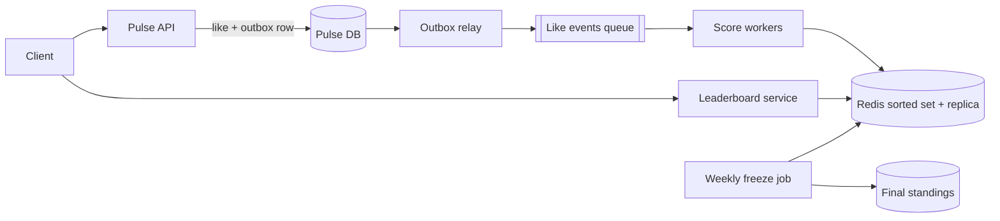

Reading case studies teaches components; it does not teach pacing. This section is one complete interview, written as a transcript with timestamps, on a problem that is not a case study elsewhere in the course: a **leaderboard**. It reuses [Pulse](/c/system-design/01-answering-framework)'s numbers where they fit, follows the [six-step framework](/c/system-design/01-answering-framework) and the [time budget](/c/system-design/04-interview-format), and ends with the interviewer's notes. **I** is the interviewer, **C** the candidate.

:::key[First principle]
A mock is graded on the order of the reasoning, not the final diagram. Every phase hands a number to the next one — load to the data structure, memory to the shard count, the interviewer's twist to a new estimate — and the candidate who says those hand-offs aloud is the one who scores.
:::

## 72.1 The prompt and the plan

> **I:** "Pulse wants a weekly creator leaderboard. Creators earn a point for every like their posts receive. Show the top 100, and show every user their own rank. Design it."

| Minutes | Step ([§1](/c/system-design/01-answering-framework)) | What the candidate puts on the board |
| ---: | --- | --- |
| 0–5 | Scope | Two flows, out-of-scope list, freshness target |
| 5–10 | Numbers | Peak ops/s, memory, the "does it fit one node?" verdict |
| 10–15 | API and data model | Three calls, source of truth vs derived index |
| 15–22 | Happy path | One diagram, one like followed end to end |
| 22–39 | Two deep dives | Write path correctness; scaling global rank |
| 39–45 | Failures, trade-offs, close | Fix + cost per failure; what to watch |

The two deep dives replace §4's single one because the interviewer asks a scaling question at minute 30; that is common, and the budget absorbs it by trimming the high-level design.

## 72.2 Minutes 0–5 · Scope

> **C** `[00:20]`: "Restating: likes come in from Pulse, each one adds a point to the post's author for the current week; reads are the top 100 and 'my rank'. I'll leave out the prize payout, fraud review beyond rate limits, and per-country boards — say if any of those is the point."
>
> **C** `[01:10]`: "Three questions. Does an unlike remove the point? How fresh must the board be? And on ties, who ranks first?"
>
> **I:** "Unlikes remove it. A few seconds is fine. Ties go to whoever got there first."
>
> **C** `[02:30]`: "Then rank must be exact for everyone — 'you are 4,812,331st' — or is a percentile acceptable outside the top?"
>
> **I:** "Exact for now."

| Question | Answer | Decision it changes |
| --- | --- | --- |
| Unlike removes a point? | Yes | Scores go down as well as up: a sorted index, not an append-only log |
| Freshness? | A few seconds | Score updates may go through a [queue](/c/system-design/25-message-queue) |
| Ties? | First to reach the score wins | Tie-break must be encoded into the sort key |
| Exact rank? | Yes, for now | Needs an order-statistics structure, not a cached top list |

## 72.3 Minutes 5–10 · Numbers

> **C** `[05:10]`: "Pulse has 10M daily users. I'll assume each likes 5 posts a day, opens the board once and sees their own rank 5 times — those three are my assumptions, the rest is Pulse's. Weekly actives are more than daily; I'll take 2.5×, so 25M creators can hold a score."

The candidate writes the arithmetic on the board; here it is as a script ([§2](/c/system-design/02-estimation) for the method, [§18.4](/c/system-design/18-cache) for the sorted-set overheads):

```python run
import math

DAU, WAU = 10e6, 25e6                       # Pulse DAU; weekly actives assumed 2.5x DAU (illustrative)
LIKES_PP, BOARD_PP, RANK_PP = 5, 1, 5       # per user per day: likes given, top-100 views, own-rank views
PEAK, DAY = 3, 1e5                          # peak factor; the 10^5 s/day shortcut
OPS_PER_THREAD = 100_000                    # simple Redis ops/s per thread (illustrative, as in section 18)

rates = {"score updates (likes)": DAU * LIKES_PP, "top-100 views": DAU * BOARD_PP,
         "my-rank views": DAU * RANK_PP}
peak_total = 0
for name, per_day in rates.items():
    avg = per_day / DAY
    peak_total += PEAK * avg
    print(f"{name:22s} {per_day / 1e6:4.0f}M/day -> avg {avg:5,.0f}/s, peak {PEAK * avg:5,.0f}/s")
print(f"sorted-set ops at peak: {peak_total:,.0f}/s = {peak_total / OPS_PER_THREAD:.1%} of one thread")

ENTRY, FRAG = 16 + 64, 1.2                  # 8 B id + 8 B score + ~64 B skiplist/dict overhead (section 18)
mem = WAU * ENTRY * FRAG
print(f"memory: {WAU / 1e6:.0f}M members x {ENTRY} B x {FRAG} = {mem / 1e9:.1f} GB")

WEEK_S = 7 * 86_400
bits = math.ceil(math.log2(WEEK_S))
print(f"tie-break: {WEEK_S:,} s/week < 2^{bits} = {2 ** bits:,}; points fit below 2^{53 - bits}"
      f" = {2 ** (53 - bits):,}")

week_events = DAU * LIKES_PP * 7
print(f"like events per week: {week_events / 1e6:,.0f}M")
dedupe = DAU * LIKES_PP / DAY * 3_600       # event ids kept for a 1 h redelivery window
print(f"dedupe ids for 1 h: {dedupe / 1e6:.1f}M x 60 B = {dedupe * 60 / 1e6:,.0f} MB")
print(f"rebuild {WAU / 1e6:.0f}M members at {OPS_PER_THREAD:,} single ZADDs/s: {WAU / OPS_PER_THREAD:,.0f} s")
top_peak = PEAK * DAU * BOARD_PP / DAY
print(f"top-100 reads: {top_peak:,.0f}/s uncached -> 15 app servers x 1 refresh/s = 15/s")
```

```output
score updates (likes)    50M/day -> avg   500/s, peak 1,500/s
top-100 views            10M/day -> avg   100/s, peak   300/s
my-rank views            50M/day -> avg   500/s, peak 1,500/s
sorted-set ops at peak: 3,300/s = 3.3% of one thread
memory: 25M members x 80 B x 1.2 = 2.4 GB
tie-break: 604,800 s/week < 2^20 = 1,048,576; points fit below 2^33 = 8,589,934,592
like events per week: 350M
dedupe ids for 1 h: 1.8M x 60 B = 108 MB
rebuild 25M members at 100,000 single ZADDs/s: 250 s
top-100 reads: 300/s uncached -> 15 app servers x 1 refresh/s = 15/s
```

> **C** `[08:40]`: "So: 3,300 operations a second at peak, about 3% of one Redis thread, and 2.4 GB of memory. The whole leaderboard fits on **one primary with a replica** — I won't shard it. The like writes themselves add 1,500 a second to Pulse's database, next to its 600 post writes, which one primary still holds. The expensive part is not load; it's correctness — duplicates, unlikes, ties and the weekly reset."

:::note[Why this scores]
The verdict sentence ("fits one primary, I won't shard") uses the numbers immediately, which is what the quantitative row rewards ([§4.1](/c/system-design/04-interview-format)). Naming *where* the difficulty is — correctness, not load — tells the interviewer where the deep dive should go.
:::

## 72.4 Minutes 10–15 · API and data model

```http
GET  /v1/leaderboards/{week}/top?limit=100   -> 200 {entries: [{rank, user_id, points}], as_of}
GET  /v1/leaderboards/{week}/me              -> 200 {rank, points, as_of}
(internal) like.created / like.deleted events from Pulse   {event_id, author_id, delta, ts}
```

> **C** `[11:00]`: "No write API: scores are derived from likes, which Pulse already stores. `as_of` tells the client how stale the board is, because I'm allowing a few seconds."

| Data | Key | Size | Store | Role |
| --- | --- | --- | --- | --- |
| `likes` | unique (`user_id`, `post_id`) | Pulse's DB | Relational primary | **Source of truth** |
| outbox rows | `event_id` | 1,500/s peak | Same transaction as the like | Reliable event publish ([§9](/c/system-design/09-delivery-semantics)) |
| `lb:{week}` | sorted set: `user_id` → encoded score | 2.4 GB | Redis primary + replica | Derived index, rebuildable |
| `seen:{event_id}` | string with 1 h TTL | 108 MB | Same Redis | Dedupe of redelivered events |
| `final_standings` | (`week`, `user_id`) | 25M rows/week | Relational DB / object storage | Frozen results for prizes |

> **C** `[13:30]`: "A sorted set gives both reads in \(O(\log N)\): `ZREVRANGE 0 99` for the top and `ZREVRANK` for me. In SQL, 'my rank' is `COUNT(*) WHERE points > mine`, which reads index entries in proportion to the rank — 12.5M of them for the median creator. That's why the index is a skiplist, not a B-tree."

## 72.5 Minutes 15–22 · High-level design



> **C** `[16:30]`: "Follow one like. The API inserts the like row and an outbox row in one transaction, so a like can't exist without its event. The relay publishes it — at least once. A score worker checks the event id against the dedupe set and applies the delta to this week's key in one atomic script. A read goes to the leaderboard service: top 100 is cached for a second in each of the 15 app servers, so Redis sees 15 of those reads a second instead of 300; 'my rank' is one `ZREVRANK`."
>
> **C** `[20:00]`: "Queue in the middle because the like path must not fail when Redis is slow, and because I already accepted a few seconds of staleness. I'll alert on queue age above 30 s ([§25](/c/system-design/25-message-queue))."

## 72.6 Minutes 22–30 · Deep dive 1: correct scores

> **I:** "Walk me through what can make a score wrong."

**Ties.** Redis orders equal scores by member name, not time. The candidate encodes time into the score:

$$
\text{score} = \text{points} \cdot 2^{20} + \left(2^{20} - 1 - t\right), \qquad t = \text{seconds since the week began}
$$

A week is 604,800 s, below \(2^{20}\) = 1,048,576, so the tie-break fits in 20 bits; a double holds integers exactly up to \(2^{53}\), so points can reach \(2^{33}\) ≈ 8.6 billion — far beyond 350M likes in a whole week. Earlier $t$ gives a larger remainder, so the first to reach a score ranks higher. The update must rewrite both parts, which `ZINCRBY` can't do; a small script reads, recomputes and writes atomically:

```python
# Lua sketch, run atomically in Redis per event (not run here)
# if SET seen:{event_id} 1 NX EX 3600 fails -> duplicate, return
# points = floor((ZSCORE lb:{week} author or 0) / 2^20) + delta
# ZADD lb:{week} points * 2^20 + (2^20 - 1 - t) author
```

**Duplicates.** The relay and queue deliver at least once ([§9](/c/system-design/09-delivery-semantics)), and a redelivered `+1` is a wrong score forever. The dedupe check sits inside the same script, so "seen" and "counted" can't diverge. At 500 events/s on average, a 1 h window holds 1.8M ids ≈ 108 MB — about 4.5% of the leaderboard's own 2.4 GB. Events older than the window are caught by the nightly reconciliation below, the business-level guard [§22](/c/system-design/22-idempotency) recommends behind every TTL.

**Unlikes and ordering.** A `-1` that overtakes its `+1` briefly leaves a score one too low; both apply within seconds, and the sum is right regardless of order because deltas commute. That is why the event carries a delta rather than an absolute count.

**The weekly reset.** Each week gets a new key, `lb:2026-W45`, chosen by the like's event time, so there's no "reset" operation to fail. Events up to 5 minutes late still land in last week's key (allowed lateness, [§17](/c/system-design/17-batch-and-stream)); then the freeze job copies the final standings out and sets a 14-day expiry. Never `DEL` a 2.4 GB key on the primary: it frees 25M members on the one thread that serves reads; `UNLINK` or expiry frees it in the background.

**Reconciliation.** Nightly, a batch job counts each author's likes for the week from the `likes` table — 350M rows in a full week — and compares with the sorted set. Any drift (an event older than the dedupe window, an operator mistake) is corrected with an absolute `ZADD`. If Redis is lost entirely, the same aggregate rebuilds it: 25M single `ZADD`s at an illustrative 100,000/s is 250 s, less with pipelining.

:::note[Why this scores]
Every correctness hazard got a mechanism *and* a number: 20 bits for the tie-break, 108 MB for dedupe, 5 minutes of lateness, 250 s to rebuild. "Use Redis sorted sets" alone would have scored on the depth row only for naming the right structure.
:::

## 72.7 Minutes 30–39 · Deep dive 2: the interviewer scales it

> **I** `[30:00]`: "Now it's a mobile game: 100M players, 100,000 score updates a second at peak, 50,000 rank lookups a second. Exact rank still. What changes?"
>
> **C** `[30:40]`: "Memory first: 100M × 80 B × 1.2 is 9.6 GB — still one node. But 150,000 operations a second is 150% of one thread, and I want each shard at 60% of it, 60,000. So I have to shard for throughput, not memory, like the [distributed cache](/c/system-design/50-distributed-cache). The question is what a rank query costs once players are split."

Three options, each with its cost on the **busiest** shard (the one that sets the shard count):

- **Hash by player** ([§34](/c/system-design/34-sharding)): writes spread evenly, but exact global rank is the sum of `ZCOUNT(score, +inf)` over *every* shard, so each of the 50,000 rank reads costs one operation on every shard. Adding shards never removes that 50,000.
- **Range by score**: each shard owns a score interval; rank = own-shard `ZREVRANK` + the cached sizes of the higher shards. One operation per read — but the most active players are the high scorers, so the top shard is hot.
- **Hash + histogram**: each shard also counts its players per score bucket (a second command in the same script); a job merges the shards' histograms every second, and app servers answer "my rank" from the merged copy in memory. Exact rank only for the top 1,000, from a merged top list; everyone else gets an interpolated estimate.

The candidate offers to size them; the script below does it on 1M simulated players standing in for 100M, with activity lognormal and points proportional to activity (illustrative distribution):

```python run
import numpy as np

rng = np.random.default_rng(7)
P = 1_000_000                              # simulated players standing in for 100M
act = rng.lognormal(0.0, 1.0, P)           # relative activity per player (illustrative spread)
score = rng.poisson(act * 40)              # season points grow with activity
w = act / act.sum()                        # each player's share of updates and of rank reads
UPD, RANK, CAP = 100_000, 50_000, 60_000   # peak updates/s, rank reads/s; 60% of 100k ops/s per shard
by_score = np.argsort(-score, kind="stable")

def worst(N):
    h = np.bincount(rng.integers(0, N, P), weights=w, minlength=N)  # hash on user id
    r = np.zeros(P, int)
    r[by_score] = np.arange(P) * N // P                             # equal-member score ranges
    rs = np.bincount(r, weights=w, minlength=N)
    exact = (UPD + RANK) * h + (RANK if N > 1 else 0)  # + one ZCOUNT per shard per rank read
    rng_ = (UPD + RANK) * rs                           # own-shard rank + cached shard sizes
    hist = 2 * UPD * h                                 # ZINCRBY + HINCRBY; rank from merged histogram
    return exact.max(), rng_.max(), rs[0] / rs.mean(), hist.max()

print(" N  hash+exact rank  score ranges (top/mean)  hash+histogram")
rows, first = [], {}
for N in (1, 2, 3, 4, 6, 8, 12, 16, 24, 32):
    e, r, skew, hst = worst(N)
    rows.append((N, e, r, hst))
    for k, v in (("exact", e), ("ranges", r), ("histogram", hst)):
        if v <= CAP and k not in first:
            first[k] = N
    print(f"{N:2d}  {e:15,.0f}  {r:13,.0f} ({skew:4.2f}x)  {hst:14,.0f}")
print("fewest shards under 60,000 ops/s:", first)
top = np.sort(w[by_score[: P // 8]]).sum()
print(f"top 12.5% of players by score carry {top:.0%} of activity")
```

```output
 N  hash+exact rank  score ranges (top/mean)  hash+histogram
 1          150,000        150,000 (1.00x)         200,000
 2          125,348        125,736 (1.68x)         100,463
 3          100,158        106,866 (2.14x)          66,877
 4           87,638         93,760 (2.50x)          50,184
 6           75,109         76,648 (3.07x)          33,478
 8           68,898         65,777 (3.51x)          25,197
12           62,528         52,422 (4.19x)          16,704
16           59,468         44,310 (4.73x)          12,624
24           56,336         34,679 (5.55x)           8,448
32           54,802         28,978 (6.18x)           6,403
fewest shards under 60,000 ops/s: {'histogram': 4, 'ranges': 12, 'exact': 16}
top 12.5% of players by score carry 44% of activity
```

:::chart[Operations/s on the busiest shard vs shard count, 100M players (simulated; 100k updates/s + 50k rank reads/s)]{type="line" x="shards" y="ops/s on the busiest shard" points="true" ymin="0" yfmt="int" hmarks="60000:60% of one thread" dash="score ranges"}
shards, hash + exact rank, score ranges, hash + histogram
1, 150000, 150000, 200000
2, 125348, 125736, 100463
3, 100158, 106866, 66877
4, 87638, 93760, 50184
6, 75109, 76648, 33478
8, 68898, 65777, 25197
12, 62528, 52422, 16704
16, 59468, 44310, 12624
24, 56336, 34679, 8448
32, 54802, 28978, 6403
:::

> **C** `[35:30]`: "Hash with exact rank flattens towards 50,000 a shard — the rank fan-out — and needs 16 shards. Worse, every rank read now waits for the slowest of 16: if each shard is slow 1% of the time, \(1 - 0.99^{16}\) ≈ 15% of rank reads hit a slow shard ([§10](/c/system-design/10-latency-and-throughput), [§68](/c/system-design/68-sharding)). Score ranges need 12 because the top range is 4× the mean — the top eighth of players by score do 44% of the activity. Hash plus histogram needs 4, and rank reads cost Redis nothing."

The histogram's price is accuracy, so the candidate checks it on the same season: log-spaced buckets, exact for the top 1,000, linear interpolation inside a bucket for everyone else.

```python run
import numpy as np

rng = np.random.default_rng(7)
P = 1_000_000
score = rng.poisson(rng.lognormal(0.0, 1.0, P) * 40)   # same season as the shard simulation
exact = 1 + P - np.searchsorted(np.sort(score), score, side="right")  # 1 + players strictly above
rest = exact > 1_000                                    # the top 1,000 come from an exact list

print("buckets  median err  p99 err  worst (pct points)  KB per shard")
for B in (10, 30, 100, 300, 1_000):
    edges = np.unique(np.floor(np.geomspace(1, score.max() + 2, B + 1)).astype(int)) - 1
    counts = np.histogram(score, edges)[0]
    above = np.concatenate((np.cumsum(counts[::-1])[::-1][1:], [0]))  # players in higher buckets
    b = np.searchsorted(edges, score, side="right") - 1
    lo, hi = edges[b], edges[b + 1]
    est = 1 + above[b] + counts[b] * (hi - 1 - score) / (hi - lo)    # uniform within the bucket
    rel = np.abs(est - exact)[rest] / exact[rest]
    pp = np.abs(est - exact)[rest] / P * 100
    print(f"{len(counts):7d}  {np.median(rel):10.2%}  {np.quantile(rel, .99):7.2%}"
          f"  {pp.max():17.2f}  {len(counts) * 8 / 1e3:12.1f}")
```

```output
buckets  median err  p99 err  worst (pct points)  KB per shard
     10       4.34%   78.57%               4.48           0.1
     28       0.53%    7.05%               0.59           0.2
     82       0.04%    0.61%               0.06           0.7
    210       0.00%    0.13%               0.02           1.7
    565       0.00%    0.05%               0.00           4.5
```

(Integer points merge some log-spaced edges, so the effective bucket count is below the requested one.) A few hundred buckets — under 5 KB per shard — put 99% of ranks within 0.13% of the truth.

> **C** `[38:10]`: "So I'd go back to the product: exact rank for the top 1,000, and 'about 4,810,000th' for everyone else, within 0.13% for 99% of players — nobody can tell. That buys 4 shards instead of 16 and no fan-out on reads. If exact rank for everyone is a hard requirement, it's hash sharding with 16 shards and hedged rank queries."

## 72.8 Minutes 39–44 · Failures and trade-offs

> **C** `[39:00]`: "Back to Pulse's version. Here's what breaks and what it costs."

| Failure | Effect | Detection | Response and cost |
| --- | --- | --- | --- |
| Redis primary lost | Seconds of failed reads; async replica lag lost — at 1 s of lag (illustrative), ≈ 1,500 updates at peak | Health check, replica promotion | Replay the queue from 5 min back: dedupe ids skip what the replica has, so replay is safe |
| Score workers behind | Board stale | Queue age > 30 s | Autoscale workers; `as_of` shows staleness honestly |
| Redelivered events | Double-counted points | Reconciliation drift > 0 | Dedupe set (108 MB / 1 h); nightly absolute fix |
| Like-farm bots | Fake winners | Likes per account per minute | Per-account [rate limit](/c/system-design/44-too-many-requests-rate-limit) on likes; fraud review before prizes |
| Late events at rollover | Points in the wrong week | Events with old `ts` | 5 min grace into last week's key, then freeze |
| Whole board on one key | All ops on one thread | Ops/s on the key | 3.3% of a thread today; top-100 cached 1 s per server |

| Decision | Chosen | Rejected | Why, with the number |
| --- | --- | --- | --- |
| Index | Redis sorted set | SQL `COUNT(*)` | \(O(\log N)\) rank vs reading ~12.5M index entries for the median creator |
| Update path | Queue + async workers | Synchronous in the like request | A few seconds of staleness was allowed; the like path never waits on Redis |
| Scale (Pulse) | One primary + replica | Sharding | 3.3% of a thread and 2.4 GB |
| Scale (game) | Hash + histogram, 4 shards | Hash + exact, 16 shards | Rank within 0.13% at p99 vs a 50,000 ops/s fan-out floor per shard |

## 72.9 Minutes 44–45 · Close

> **C** `[44:00]`: "If this shipped tomorrow I'd watch queue age, reconciliation drift and 'my rank' p99. The first thing I'd expect to go wrong is bots farming likes in the last hour of the week, so the per-account like limit and the freeze-then-review step go in before the first prize is paid."

## 72.10 The interviewer's notes

:::note[What earned points]
- **Problem navigation** — scoped in under 3 minutes; the "exact rank or percentile?" question set up the deep dive that mattered 30 minutes later.
- **Quantitative reasoning** — 3,300 ops/s and 2.4 GB by minute 9, then reused: "one primary", "3.3% of a thread", "250 s to rebuild". Re-estimated immediately when the problem changed (9.6 GB, 150% of a thread).
- **Technical depth** — knew why a skiplist answers rank and a B-tree count does not; encoded ties into 20 bits with the double-precision limit checked; `UNLINK` instead of `DEL`.
- **Trade-offs** — compared three sharding schemes on the number that decides them (busiest shard), and turned the result into a product question instead of silently choosing.
- **Communication** — narrated one like through the diagram; each table row had a cost.
:::

What would have lost points, from the same transcript:

| Weak move | Why it costs | Strong version above |
| --- | --- | --- |
| "Use a Redis sorted set" with no numbers | Depth without quantitative evidence | 3.3% of a thread, 2.4 GB → don't shard |
| Sharding Pulse's board "for scale" | Complexity the numbers don't need ([§36](/c/system-design/36-choosing-between-fixes)) | One primary + replica, with the ceiling stated |
| `ZINCRBY` straight from the queue | Every redelivery is a permanent wrong score | Dedupe id and delta in one atomic script |
| Hash-sharding the game and calling `ZCOUNT` everywhere | 16 shards and a 15% slow-read rate, unexamined | Measure the busiest shard; offer approximate rank |
| No mention of the weekly boundary | The one operation that runs every week | Key per week, 5 min grace, freeze, expire |

Weakness the interviewer still wrote down: no discussion of a cross-region board — readers in another region pay a ~150 ms round trip per rank read unless the replica is local ([§11](/c/system-design/11-networking)). That's the gap to practise next.

## 72.11 Check yourself

:::qa[Pulse's likes per user double to 10 a day. Does the design change?]
Score updates go from 1,500 to 3,000/s at peak, total ops from 3,300 to 4,800/s — 4.8% of one thread. Memory is set by members, not likes, so it stays 2.4 GB. Nothing changes except the dedupe set, which doubles to ~216 MB for a 1 h window.
:::

:::qa[Why can't the tie-break simply be the user id, and why 20 bits?]
User id order rewards whoever signed up first, not whoever reached the score first — the interviewer's tie rule. Time-in-week needs \(\lceil \log_2 604{,}800 \rceil\) = 20 bits; the remaining 33 bits of a double's 53-bit exact range allow 8.6 billion points.
:::

:::qa[In the game, why does hash sharding with exact rank never get below ~50,000 ops/s per shard?]
Exact global rank sums `ZCOUNT` over every shard, so each of the 50,000 rank reads/s costs one operation on every shard regardless of $N$. Only the 100,000 updates/s divide by $N$: at 16 shards the busiest carries 59,468 ops/s, of which 50,000 is the fan-out.
:::

Next: [§73 Question bank](/c/system-design/73-question-bank) — drills with model answers for every part of the course.
